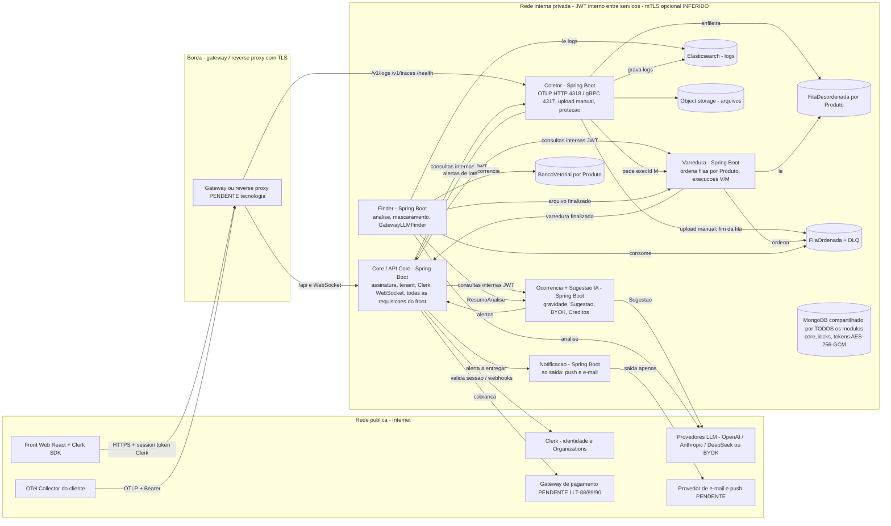

# Arquitetura de Módulos — LhamaLog

**Versão 1 (12/10/2026, Michel Bocchi Junior).** Base para inicializar os projetos Spring Boot. Decisão de rede na ADR_141.
Marcações: `[PENDENTE]` sem decisão; `[INFERIDO]` ligação feita a partir das decisões existentes.

## 1. Visão geral

Arquitetura **distribuída**: 6 serviços Spring Boot (5 já previstos na ADR_054 + Notificação), cada um com seu repositório,
todos usando o **mesmo MongoDB** e as mesmas convenções. O **front fala só com o Core**; o Core busca o que precisa nos outros
módulos pela rede interna e devolve ao front.

## 2. Módulos e tecnologias

| Módulo | Responsabilidade | Tecnologias | Rede | ADRs |
|---|---|---|---|---|
| **Core (API Core)** | assinatura, tenant (pool, `tenantId` em tudo), Clerk, todas as requisições do front, WebSocket, matriz de alertas `/papeis` | Java Spring Boot, Clerk (session token, Organizations, webhooks), MongoDB | **pública** (HTTPS via gateway) + interna | 022, 051, 054, 121–140 |
| **Coletor** | ingestão OTLP, upload manual, proteção (malware/prompt injection), lotes, `TokenApi` | Spring Boot, OTLP HTTP 4318 / gRPC 4317 (`/v1/logs`, `/v1/traces`), `GET /health` + `grpc.health.v1`, Bearer com SHA-256 + AES-256-GCM, Elasticsearch, object storage | **pública** (só OTLP e health) + interna | 041–045, 105–120, 122 |
| **Varredura** | fila desordenada por Produto, ordenação, execuções `V<uuid>`/`M<uuid>`, API de fim de execução | Spring Boot, fila, MongoDB (locks chave-valor com TTL) | interna | 057–075 |
| **Finder** | análise por arquivo, mascaramento, recorrência, `ResumoAnalise` | Spring Boot, workers paralelos, Elasticsearch, BancoVetorial por Produto, `GatewayLLMFinder` (provedor do LhamaLog, sem BYOK) | interna (+ saída ao LLM) | 061–066, 074 |
| **Ocorrência + Sugestão IA** | Ocorrências e gravidade, Sugestão automática/manual, Créditos, chave BYOK (`ChaveLLMTenant`, AES-256-GCM) | Spring Boot, MongoDB, `GatewayLLMSugestao` (OpenAI/Anthropic/DeepSeek `[PENDENTE]` ou BYOK) | interna (+ saída ao LLM) | 062, 076–098, 117, 128 |
| **Notificação** | entrega de push e e-mail conforme a matriz por papel | Spring Boot, provedor de e-mail/push `[PENDENTE]`, MongoDB (histórico de 3 meses) | interna, **só saída** | 060, 071, 130–140, 141 |

**Infraestrutura comum:**
- **MongoDB** compartilhado — banco core (assinaturas, tenants, tokens, Ocorrências, locks) (ADR_029/116).
- **Elasticsearch** — logs de alto volume (ADR_116).
- **Filas** Coletor → Varredura → Finder (FilaDesordenada por Produto, FilaOrdenada, DLQ com 3 tentativas): tecnologia do broker `[PENDENTE]` (ADR_096); a planilha de monetização sugere benchmark Redis Streams × RabbitMQ.
- **JWT interno** entre serviços (ADR_028).
- **Orquestração:** Kubernetes com escala horizontal por módulo `[INFERIDO — planilha de monetização; nuvem não decidida]`.
- **Pagamento:** gateway `[PENDENTE]` (LLT-88/89/90).

## 3. Redes (ADR_141)

| Rede | Quem está | Entradas |
|---|---|---|
| **Pública** | só **Core** e **Coletor**, atrás de gateway/reverse proxy com TLS | Core: HTTPS da API do front e WebSocket; Coletor: OTLP 4318/4317 e `/health` |
| **Interna privada** | todos os módulos, MongoDB, Elasticsearch, filas, BancoVetorial, object storage | só chamadas com JWT interno; nenhum acesso da internet |
| **Saída (egress)** | Notificação (push/e-mail), Finder e Ocorrência (LLM), Core (Clerk, pagamento) | conexões **de dentro para fora**; Notificação não aceita nenhuma entrada pública |

### Como isso aumenta a proteção
- **Superfície de ataque menor:** só 2 serviços expostos; Varredura, Finder, Ocorrência, Notificação e os bancos não têm endereço público.
- **Gateway / reverse proxy na borda:** termina TLS, aplica limites de taxa e só encaminha as rotas permitidas (`/api…` e WebSocket ao Core; `/v1/logs`, `/v1/traces`, `/health` ao Coletor).
- **JWT interno entre serviços (ADR_028):** um serviço interno só aceita chamadas assinadas por outro serviço.
- **mTLS na rede interna:** opcional `[INFERIDO]`, recomendável quando houver Kubernetes/service mesh.
- **Notificação só de saída:** mesmo se comprometido, não é ponto de entrada; um ataque não chega a ele pela internet.
- **Isolamento de dados:** `tenantId` em tudo e filtro centralizado no Core (ADR_121).

### WebSocket para o front — proposta `[PENDENTE confirmação]`
O WebSocket exige que o navegador **abra** a conexão, o que é uma entrada pública. Proposta: o **WebSocket continua no Core**
(já público, ADR_051); a **Notificação** decide os destinatários e entrega **push e e-mail** para fora, e devolve ao Core
(pela rede interna) o que deve ir por WebSocket. Alternativa: um serviço de saída dedicado ao WebSocket — aumenta a superfície e não é recomendada.

## 4. Código Mermaid

## 5. Pontos em aberto

- `[PENDENTE]` broker das filas (Redis Streams, RabbitMQ ou outro — ADR_096).
- `[PENDENTE]` tecnologia do gateway / reverse proxy e da nuvem.
- `[PENDENTE]` provedor de e-mail/push e gateway de pagamento (LLT-88/89/90).
- `[PENDENTE]` provedor LLM padrão (ADR_080).
- `[PENDENTE]` confirmação da proposta do WebSocket no Core.
- `[INFERIDO]` mTLS interno; Kubernetes como orquestração; object storage para os arquivos.
- Divisão Core × Notificação: Core recebe alertas de Coletor/Varredura/Ocorrência (ADR_051) e repassa à Notificação `[INFERIDO]`.
