# Diagrama de Classes — LhamaLog (todos os módulos)

fontes:
- a planilha `Modelo de Classes LhamaLog v2` (com o Guia das Classes e o `diagrama_classes_varredura_finder_v2`);
- as ADR_001 a ADR_147, a ADR_165 (notificação web) e a ADR_166 (escopo dos extras no MVP), de 28/10/2026, e a ADR_167 (Finder sem LLM), de 29/10/2026;
- o `der.md` v9;
- a pauta de 03/10/2026, na coluna "Decisão".

**Sem inferência.** Os blocos Mermaid só têm o que uma das quatro fontes escreve:
- Uma classe, campo, método ou valor de enum aparece quando a fonte o nomeia.
- Uma ligação aparece quando a fonte a escreve: um campo ou parâmetro tipado na planilha, uma frase do Guia, uma ligação do DER que não está marcada `[INFERIDO]` no próprio DER, uma ADR ou uma decisão da pauta.
- A multiplicidade só aparece quando a fonte a dá. Uma ligação que vem só de um campo tipado aparece sem multiplicidade.
- Quando uma ADR pede um elemento sem dar o nome (ex.: "uma coleção chave-valor", "o campo de erro"), ele **não** entra no Mermaid. Fica na tabela do módulo e na seção "Sugestões". Se a ADR muda um elemento da planilha mas a mudança exigiria um nome que nenhuma fonte dá, o elemento da planilha fica e é marcado `[CONFLITO]`.

Marcações:
- `[CONFLITO]`: duas fontes dizem coisas diferentes. A tabela diz qual foi usada no Mermaid.
- `[PENDENTE]`: a própria fonte deixa o ponto em aberto.
- `[A CONFERIR]`: erro ou dúvida da própria planilha.
- `[PROPOSTO]`: rota registrada numa ADR como proposta (ADR_133 e ADR_139), ou ADR ainda não aceita (ADR_154).
- `[DECISÃO v6]`: decisão provisória tomada para fechar o diagrama; vale até sair a ADR correspondente.
- Quando a marcação `[INFERIDO]` aparece numa tabela, ela é **da própria fonte** (ex.: "a planilha marca `[INFERIDO]`"), nunca nossa.

Uma classe sem ligação ou um ponto em conflito que só a tabela explicaria leva uma **nota dentro do próprio diagrama**
(`note for`), para quem olha só o desenho.

Estereótipos usados no Mermaid:
- `<<interface>>`, `<<enumeration>>`: como na planilha.
- `<<DTO>>`: classe intermediária sem coleção própria (ADR_040).
- `<<sem aba>>`: classe que está no DER, numa ADR ou na pauta, mas não tem aba na planilha.
- `<<substituida>>`: classe que o DER v9 ou a pauta dá como substituída. Fica ligada à classe nova por uma seta tracejada "substituida por".
- `<<legado>>`: classe do SDK, mantida para referência.

**Prevalência:**
- Decisão da pauta (03/10) vale onde nenhuma ADR posterior tratou o ponto.
- Entre as fontes, vale primeiro a ADR mais recente, depois o DER v9 e por último a planilha.
- Toda divergência entre fontes fica marcada `[CONFLITO]`, mesmo quando uma delas prevalece.

**Nomes:** nomes com espaço, hífen ou acento viraram CamelCase sem acento no Mermaid (ex.: `Gerenciador Assinatura` →
`GerenciadorAssinatura`, `ScannerSegurança` → `ScannerSeguranca`, `Período` → `Periodo`). O mesmo vale para duas classes com
o mesmo nome (`Plano` de Créditos → `PlanoCreditos`; `Ocorrencia` resumo da planilha → `ResumoArquivo`, `[DECISÃO v6]`). Erros de digitação da planilha foram mantidos, exceto quando o tipo apontava para uma classe que não existe ou
quando uma ADR disse que o tipo estava errado (lista no fim).

## 0. Visão geral — ligações entre módulos

Há duas vistas no nível de módulo. Cada caixa é um módulo e mostra as classes envolvidas. Seta cheia = ligação escrita numa
ADR, no DER, na planilha ou na pauta. Seta tracejada = `[CONFLITO]`, caminho de falha ou legado. A fonte de cada seta está
na tabela "Ligações no nível de classe" ou no texto entre parênteses do rótulo.

### 0a. Fluxo do log

```mermaid
flowchart LR
    classDef mod fill:#f4f4f4,stroke:#555,color:#111
    classDef leg fill:#fafafa,stroke:#999,stroke-dasharray:5 4,color:#555

    COL["<b>5. Coletor</b><br/>Coletor · Arquivo · Trace"]
    VAR["<b>6. Varredura</b><br/>FilaDesordenada · Varredura<br/>ArquivoVarredura · FilaOrdenada"]
    FIN["<b>7. Finder</b><br/>Finder · AchadoAnalise · ResumoAnalise"]
    OCO["<b>8. Ocorrência</b><br/>ModuloOcorrencia · Mapper<br/>Ocorrencia · ResumoArquivo"]
    ASS["<b>3. Assinatura</b><br/>Plano · ProdutoRecursoIA"]
    SUG["<b>9. Sugestão</b><br/>ModuloSugestao · Sugestao"]
    CRE["<b>4. Créditos</b><br/>Saldo"]
    NOT["<b>10. Notificação</b><br/>Notificacao"]
    PAP["<b>2. Papéis de notificação</b><br/>PapelNotificacao"]
    DASH["<b>11. Dashboard</b><br/>FiltroOcorrenciaEmpresarial"]
    REL["<b>12. Relatório</b>"]
    LEG["<b>13. Legado</b><br/>ClienteColetor (SDK)"]

    LEG -. "transmite (Guia)" .-> COL
    COL -- "1. OTel: Arquivo na FilaDesordenada<br/>do Produto (ADR_007, 057)" --> VAR
    COL -- "1. manual: pede o execId M e entra<br/>no fim da FilaOrdenada (ADR_041, 075)" --> VAR
    VAR -- "2. FilaOrdenada (ADR_007)" --> FIN
    FIN -- "3. arquivo finalizado,<br/>resposta true/false (ADR_061, 070)" --> VAR
    FIN -. "falha: DLQ, fim da FilaOrdenada,<br/>3 tentativas (ADR_059)" .-> VAR
    FIN -- "4. ResumoAnalise (ADR_062)" --> OCO
    OCO -- "arquivoId (ADR_040)" --> COL
    OCO -- "5. consulta o plano (ADR_036)" --> ASS
    OCO -- "6. dispara a Sugestao automatica (ADR_036, 040)" --> SUG
    SUG -- "reserva e liquida (ADR_038, 078, 098)" --> CRE
    OCO -- "7. Ocorrencia e Sugestao (ADR_036),<br/>via Core (ADR_165)" --> NOT
    NOT -- "destinatarios por papel (ADR_130, 134)" --> PAP
    REL -- "usa os dashboards (planilha)" --> DASH
    DASH -- "consulta (v6)" --> OCO

    class COL,VAR,FIN,OCO,ASS,SUG,CRE,NOT,PAP,DASH,REL mod
    class LEG leg
```

Os alertas de lote do Coletor, o "varredura finalizada" da Varredura e os alertas da Ocorrência passam pelo Core, que fala
com o front por WebSocket (ADR_051, 060, 141). O Core repassa à Notificação o que fica no histórico de notificações e entrega
pelo WebSocket o que volta dela pela stream de entregas web (ADR_165). O Core é um serviço, não um módulo de classes.

A seta Dashboard → Ocorrência é `[DECISÃO v6]`: nenhuma fonte a escreve, mas o `FiltroOcorrenciaEmpresarial` existe para isso
(Guia das Classes: "consultar ocorrências de vários Produtos").

### 0b. Dependências de cadastro (Tenant, Membro e Produto)

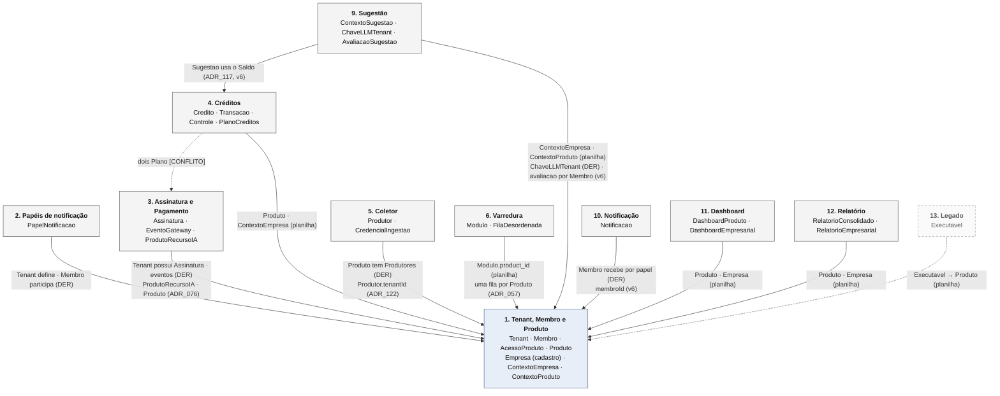

### Ligações no nível de classe

| Vista | Módulos | Ligação no nível de classe | Fonte |
|---|---|---|---|
| (a) | 5. Coletor → 6. Varredura | `FilaDesordenada o-- Arquivo : pendentes` | planilha (FilaDesordenada) |
| (a) | 5. Coletor → 6. Varredura | `Coletor --> Varredura` | planilha (`Coletor.Varredura`) |
| (a) | 5. Coletor → 6. Varredura | `ArquivoVarredura --> Arquivo : arquivo_id` | planilha |
| (a) | 5. Coletor → 6. Varredura | `Trace "0..*" -- "1..*" Modulo` | planilha (`modulo_ids`), DER (`TraceModulo`) |
| (a) | 7. Finder → 6. Varredura | `Finder --> FilaOrdenada`, `Finder --> ArquivoVarredura` | planilha (Finder v2) |
| (a) | 7. Finder → 5. Coletor | `Finder --> Arquivo` | planilha |
| (a) | 7. Finder → 5. Coletor | `AchadoAnalise "0..*" --> "1" Trace` | pauta ING-05 `[CONFLITO]` com o DER |
| (a) | 7. Finder → 6. Varredura | `Modulo "0..1" -- "0..*" AchadoAnalise : afeta` | DER |
| (a) | 7. Finder → 8. Ocorrência | `Finder ..> ModuloOcorrencia : envia o ResumoAnalise` | planilha (ModuloOcorrencia recebe do Finder), ADR_062 |
| (a) | 8. Ocorrência → 7. Finder | `Mapper ..> AchadoAnalise : converte` | pauta FIN-09 |
| (a) | 8. Ocorrência → 7. Finder | `ModuloOcorrencia ..> ResumoAnalise : receberResumo` | ADR_062, `[DECISÃO v6]` |
| (a) | 8. Ocorrência → 5. Coletor | `Arquivo "1" -- "0..1" ResumoArquivo : resumo` | DER |
| (a) | 8. Ocorrência → 5. Coletor | `Ocorrencia --> Arquivo : arquivoId` | ADR_035, 040 |
| (a) | 8. Ocorrência → 9. Sugestão | `Ocorrencia "1" -- "0..*" Sugestao` | ADR_035 |
| (a) | 10. Notificação → 8. Ocorrência | `Notificacao --> "0..1" Ocorrencia : ocorrencia_id` | planilha; ADR_165 (opcional) |
| (a) | 8. Ocorrência → 9. Sugestão | `ModuloOcorrencia ..> ModuloSugestao : dispararSugestaoAutomatica` | ADR_036, `[DECISÃO v6]` |
| (a) | 11. Dashboard → 8. Ocorrência | `FiltroOcorrenciaEmpresarial ..> Ocorrencia : consulta` | `[DECISÃO v6]` |
| (b) | 10. Notificação → 1. Tenant | `PreferenciaNotificacao --> Membro`, `DispositivoPush --> Membro` | `[DECISÃO v6]` |
| (a) | 10. Notificação → 9. Sugestão | `Notificacao --> "0..1" Sugestao : sugestao_id` | planilha, pauta NOT-01 (opcional) |
| (a) | 12. Relatório → 11. Dashboard | `RelatorioDashboard --> DashboardProduto`, `RelatorioEmpresarial --> DashboardEmpresarial` | planilha |
| (a) | 13. Legado → 5. Coletor | `ClienteColetor ..> Coletor : transmite` | Guia das Classes |
| (b) | 2. Papéis → 1. Tenant | `Tenant "1" -- "0..*" PapelNotificacao : define` | DER |
| (b) | 2. Papéis → 1. Tenant | `Membro "0..*" -- "0..*" PapelNotificacao : participa` | DER |
| (b) | 3. Assinatura → 1. Tenant | `Tenant "1" -- "1" Assinatura : possui` | DER |
| (b) | 3. Assinatura → 1. Tenant | `Tenant "1" -- "0..*" EventoGateway : eventos` | DER |
| (b) | 3. Assinatura → 1. Tenant | `ProdutoRecursoIA -- Produto` | ADR_076 |
| (b) | 1. Tenant (interno) | `Tenant "1" -- "1" Empresa : cadastro` | `[DECISÃO v6]` |
| (b) | 4. Créditos → 1. Tenant | `Credito --> Produto`, `Credito --> ContextoEmpresa`, idem `Transacao` e `Controle` | planilha |
| (b) | 5. Coletor → 1. Tenant | `Produto "1" -- "0..*" Produtor : produtores` | DER |
| (b) | 5. Coletor → 1. Tenant | `Produtor --> Tenant : tenantId` | ADR_122, DER (campo) |
| (b) | 5. Coletor → 1. Tenant | `CredencialIngestao --> Tenant` | pauta ING-02 `[CONFLITO]` ADR_122 |
| (b) | 6. Varredura → 1. Tenant | `Modulo --> Produto : product_id` | planilha |
| (b) | 6. Varredura → 1. Tenant | `Produto "1" -- "1" FilaDesordenada : uma por Produto` | ADR_057 |
| (b) | 9. Sugestão → 1. Tenant | `ContextoSugestao --> ContextoEmpresa`, `--> ContextoProduto` | planilha |
| (b) | 9. Sugestão → 1. Tenant | `Tenant "1" -- "0..*" ChaveLLMTenant : byok` | DER |
| (b) | 9. Sugestão → 1. Tenant | `AvaliacaoSugestao --> Membro : membroId` | ADR_088, `[DECISÃO v6]` |
| (b) | 10. Notificação → 1. Tenant | `Membro "1" -- "0..*" Notificacao : recebe por papel` | DER |
| (b) | 11. Dashboard → 1. Tenant | `DashboardProduto --> Produto`, `DashboardEmpresarial --> Empresa` | planilha |
| (b) | 12. Relatório → 1. Tenant | `RelatorioConsolidado --> Produto`, `RelatorioEmpresarial --> Empresa` | planilha |
| (b) | 13. Legado → 1. Tenant | `Executavel --> Produto : produto_id` | planilha |
| (b) | 3. Assinatura → 4. Créditos | `Plano .. PlanoCreditos` | `[CONFLITO]` duas classes `Plano` na planilha |
| (b) | 9. Sugestão → 4. Créditos | `ModuloSugestao ..> Saldo : reserva e liquida` | ADR_038/078/098/117, `[DECISÃO v6]` |

---

## 1. Tenant, Membro e Produto (ADR_121 a ADR_123, ADR_126, ADR_129, ADR_132, ADR_135; DER v9)

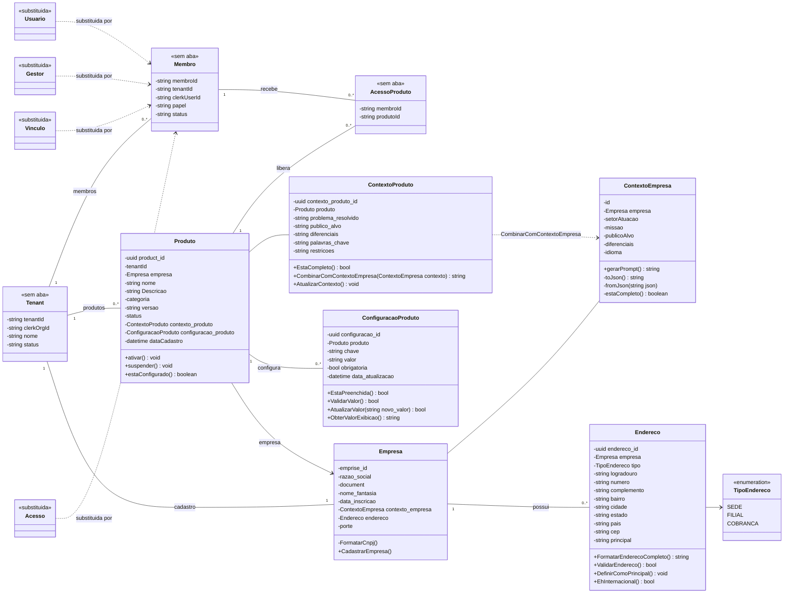

| Ponto | Fonte e situação |
|---|---|
| `Tenant` | ADR_121/122 e DER v9: o tenant é só a empresa cliente e espelha a Organization da Clerk (`clerkOrgId`). Nasce na compra da assinatura e o comprador vira `Membro` `DONO` (ADR_121, ADR_137). Todo documento no MongoDB e todo log no Elasticsearch leva `tenantId` (ADR_121). Valores de `status` `[PENDENTE]`. Substitui o `Tenant` da ADR_030 (empresa + usuário + produto) e o modelo hash da ADR_105. |
| `Membro.papel` | ADR_122/123 e DER v9: `DONO`, `ADMIN` ou `MEMBRO`. Nenhuma fonte dá nome ao enum: o campo fica `string`, como no DER. |
| `Membro.status` | DER v9 e ADR_132/135: `ATIVO` ou `ACESSO_PENDENTE`. Com `ACESSO_PENDENTE` o acesso fica bloqueado até o DONO aprovar em até 24 h; sem aprovação o pedido expira. O valor depois de expirar não está definido `[PENDENTE]`. |
| `AcessoProduto` | ADR_122 e DER v9: só para `MEMBRO`; `DONO` e `ADMIN` veem todos os Produtos. Sem acesso, negação simples, sem o 403 da ADR_032 (ADR_126). |
| `Produto.tenantId` | ADR_122. A planilha não foi atualizada e ainda tem `empresa: Empresa`. O tipo de `tenantId` no Produto não está escrito; no DER o `tenantId` é `string`. |
| `Produto.status` | Planilha (Guia): ativo, suspenso, em configuração. A ADR_129 acrescenta o estado `ACESSO_PENDENTE` para Produtos acima do limite depois de um downgrade. Sem nome de enum `[PENDENTE]`. |
| `Produto.config` × `ConfiguracaoProduto` | A ADR_122 lista `Produto (tenantId, config)`. A planilha tem `configuracao_produto: ConfiguracaoProduto`. As fontes não dizem se é o mesmo campo. |
| `Produto -- ContextoProduto` | Ligação pelos campos da planilha. O DER dá 1:0..1, mas marca `[INFERIDO]`; por isso fica sem multiplicidade. |
| `ContextoEmpresa` | `[CONFLITO]` na planilha pertence à `Empresa` (`empresa: Empresa`); no DER v9 está ligado ao `Produto` e ao `Usuario`. `[DECISÃO v6]`: vale a planilha (ligado à `Empresa`, que agora é o cadastro do Tenant). É usado no prompt da Sugestão (módulo 9). |
| `Empresa.endereco` × `Endereco` | `[CONFLITO]` a planilha guarda um endereço na `Empresa`; o DER liga `Empresa 1:0..*` `Endereco`. O Mermaid usa o DER. |
| `Empresa` (cadastro) | O DER v9 marcava `Empresa` → `Tenant` como substituída (base: ADR_121), mas nenhuma fonte dava destino aos dados cadastrais, ao `Endereco` e ao `ContextoEmpresa`. `[DECISÃO v6]`: a `Empresa` deixa de ser substituída e passa a ser o cadastro da empresa cliente, ligado 1:1 ao `Tenant` (o Tenant continua sendo a identidade, espelho da Organization da Clerk). `[CONFLITO]` com o DER v9 até o DER ser atualizado. `Produto.empresa`, `DashboardEmpresarial.empresa` e `RelatorioEmpresarial.empresa` passam a ser válidos por esse cadastro. |
| `Usuario`, `Gestor`, `Vinculo`, `Acesso` `<<substituida>>` | DER v9: substituídas por `Membro` (ADR_122/123). Senha, sessão e MFA ficam na Clerk (ADR_021). Os campos estão na versão 2. A `PermissaoProduto` (só no DER) foi substituída por `AcessoProduto`. `[DECISÃO v6]`: os campos `usuario_id` das classes de Notificação e da `AvaliacaoSugestao` passam a `membroId`. |
| `Autorizador`, `TenantRoles` | Removidas pela ADR_111 ("Autorizador / Autorizador - SDK"). |
| `TokenMetadata` | Removida: a única classe que a usava (`Autorizador`) saiu pela ADR_111, e nada no modelo atual lê os metadados da Clerk (ADR_121/122/123). Registrada na ADR_154 (Proposto) `[DECISÃO v6]`. |
| Cadeia de validação | ADR_121: identidade na Clerk → papel no `Membro` → `AcessoProduto` → limites da `Assinatura` → filtro `tenantId`, numa camada centralizada do Core. Nenhuma classe representa essa camada `[PENDENTE]`. |
| Convite e promoção | ADR_114: só backend, por `DONO` ou `ADMIN`. Rotas `[PENDENTE]`. |

---

## 2. Papéis de notificação — matriz de alertas (ADR_130, ADR_134, ADR_136 a ADR_140, ADR_142; DER v9)

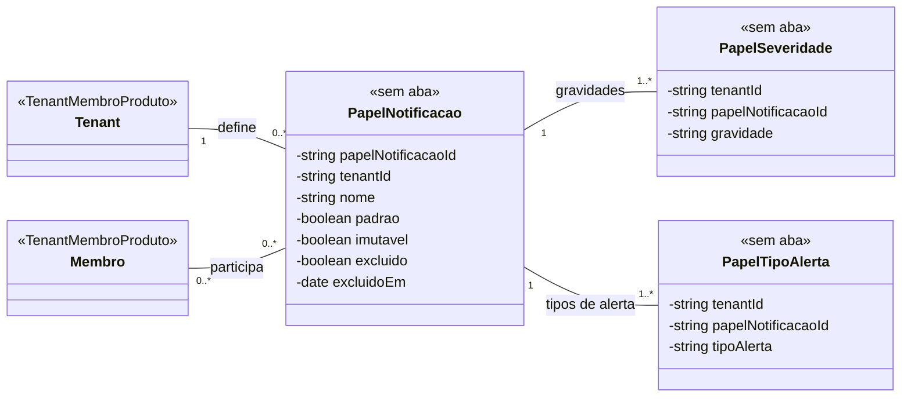

| Ponto | Fonte e situação |
|---|---|
| Matriz por tenant | ADR_134: cada tenant cria os próprios papéis de notificação no nosso banco, sem papéis customizados da Clerk. |
| Papéis padrão | ADR_136/137: todo tenant novo nasce com Dono, Administrador, Gestor, Supervisor e Membro. Dono e Administrador são imutáveis; os outros três podem ser editados e excluídos. A empresa pode criar papéis personalizados (`padrao` e `imutavel` falsos). |
| Exclusão | ADR_138/139: exclusão lógica (`excluido`, `excluidoEm`) e definitiva, sem restauração. Só Dono e Administradores são avisados. Um Membro sem papel continua no sistema, mas não recebe alertas. Se nenhum papel ativo cobre a gravidade ou o tipo, o alerta vai para Dono e Administradores. |
| Cardinalidade | ADR_142 e DER v9: N:N papel × gravidade e papel × tipo de alerta, com `PapelSeveridade` e `PapelTipoAlerta` como ligação (`||--|{` no DER). |
| Membros do papel | DER v9: `Membro }o--o{ PapelNotificacao`. Se é tabela de ligação ou lista no papel `[PENDENTE]` (DER v9, pendência 13). Os Membros de Dono e Administrador vêm do `Membro.papel`, não das rotas de Membros (ADR_140). |
| Entrega | ADR_130/136: o alerta vai a quem atende ao mesmo tempo à gravidade, ao tipo e ao Produto (o Membro precisa de `AcessoProduto`). Dono e Administrador recebem alertas de todos os Produtos (ADR_137). A "consulta de agregação" da ADR_130 não tem classe `[PENDENTE]`. |
| Valores | Lista de tipos de alerta, de gravidades e os padrões de cada papel `[PENDENTE]` (ADR_136). Se Dono e Administrador recebem sempre tudo `[PENDENTE]` (ADR_139/140/142). |
| Rotas `/papeis` | `[PROPOSTO]` ADR_139, no Core, só Dono e Administrador. `GET`/`POST /papeis`; `GET`/`PATCH`/`DELETE /papeis/{papelId}`; `PUT /papeis/{papelId}/severidades`, `/tipos-alerta`, `/membros`; `POST`/`DELETE /papeis/{papelId}/membros/{membroId}`. Sem listagem de excluídos (ADR_140). |

---

## 3. Assinatura e Pagamento (ADR_076, ADR_104, ADR_121, ADR_122, ADR_124, ADR_125, ADR_127, ADR_129, ADR_131, ADR_133; pauta SUG-04)

```mermaid
classDiagram
    direction LR
    class GerenciadorAssinatura {
        +listarPlanosDisponiveis() List~Plano~
        +contratarPlano(UUID empresa_id, Plano plano) Assinatura
        +contratarPlano(String tenantId, Plano plano) Assinatura
        +alterarAssinatura(String assinaturaId, Plano novoPlano) Assinatura
        +cancelarAssinatura(String assinaturaId, Boolean imediato) void
        +solicitarReembolso(String pagamentoId, String motivo) Reembolso
        +aplicarEventoDeAssinatura(String assinaturaId, TipoOperacaoGateway tipoOperacao, EventoGateway evento) void
        +verificarInadimplencia(UUID empresa_id) Boolean
        +verificarInadimplencia(String tenantId) Boolean
        -calcularValorProporcional(UUID empresa_id) Decimal
        -calcularValorProporcional(String tenantId) Decimal
        -validarTransicaoDeStatus(StatusAssinatura atual, StatusAssinatura novo) Boolean
    }
    class Plano {
        -uuid plano_id
        -TipoPlano nome
        -String volumeArmazenamento
        -Integer diasRetencao
        -List~RecursoAnaliseIA~ recursosHabilitados
        -TipoDashboard dashboard
        -String moeda
        -Decimal valor
        -Periodicidade periodicidade
    }
    class TipoPlano {
        <<enumeration>>
        FREE
        STARTER
        PRO
        BUSINESS
        ENTERPRISE
    }
    class RecursosAnaliseIA {
        <<enumeration>>
        NENHUMA
        DETECCAO_ANOMALIAS
        INVESTIGACAO_AUTOMATICA
        RASTREIO_USUARIO
        SUGESTAO
    }
    class TipoDashboard {
        <<enumeration>>
        BASICO
        PADRAO
        PERSONALIZADO
    }
    class Periodicidade {
        <<enumeration>>
        MENSAL
        ANUAL
    }
    class TabelaPrecificacao {
        <<sem aba>>
        -string plano
        -string volumeIngestao
        -string nivelInterpretacao
        -int retencaoDias
        -string extraDashboard
        -string rateLimit
        -number precoMensal
        -int limiteProdutos
        -int limiteMembros
        -number creditosIA
        -number custoAddOnClerk
        -number margemAddOn
        -number precoAddOn
    }
    class Assinatura {
        -String tenantId
        -String planoId
        -StatusAssinatura status
        -limites
        -Date dataInicioVigencia
        -Date vigenciaAte
        -Date cancelamentoAgendadoPara
        -Integer diasCarencia
        -String criterioElegibilidadeReembolso
    }
    class StatusAssinatura {
        <<enumeration>>
    }
    class ProdutoRecursoIA {
        <<sem aba>>
        -boolean planoTemIA
        -boolean produtoAtivouIA
    }
    class ProcessamentoPagamento {
        +processarPagamento(String assinaturaId, Decimal valor) Pagamento
        +receberEventoGateway(EventoGateway evento) void
        +validarDadosEvento(EventoGateway evento) Boolean
        +reprocessarPagamentoFalho(String pagamentoId) StatusPagamento
        -validarAutenticidadeEvento(EventoGateway evento) Boolean
    }
    class GatewayPagamento {
        <<interface>>
        +enviarCobranca(Object dados) EventoGateway
        +consultarStatus(String referenciaExterna) StatusPagamento
        +solicitarReembolsoExterno(String referenciaExterna, Decimal valor) EventoGateway
        +validarAutenticidade(EventoGateway evento) Boolean
    }
    class ApiPagamento {
        -String baseUrl
        -String apiKey
        -String webhookSecret
        -String gatewayAtivo
        -Integer timeoutSegundos
        +enviarCobranca(Object dados) EventoGateway
        +consultarStatus(String referenciaExterna) StatusPagamento
        +solicitarReembolsoExterno(String referenciaExterna, Decimal valor) EventoGateway
        +validarAutenticidade(EventoGateway evento) Boolean
    }
    class Pagamento {
        -String assinaturaId
        -StatusPagamento status
        -Decimal valor
        -DateTime dataProcessamento
        -String referenciaGatewayExterno
        -String chaveIdempotencia
    }
    class StatusPagamento {
        <<enumeration>>
        PENDENTE
        PAGO
        RECUSADO
        ESTORNADO
    }
    class Reembolso {
        -String pagamentoId
        -String motivo
        -StatusReembolso status
        -DateTime dataSolicitacao
    }
    class StatusReembolso {
        <<enumeration>>
        SOLICITADO
        APROVADO
        NEGADO
        CONCLUIDO
    }
    class EventoGateway {
        -String payloadBruto
        -String origemGateway
        -DateTime recebidoEm
        -TipoOperacaoGateway tipoOperacao
        -ResultadoEventoGateway resultado
        -String motivoFalha
        -Boolean processado
        -status
        -erro
    }
    class TipoOperacaoGateway {
        <<enumeration>>
        PRIMEIRA_COMPRA
        ATRASO
        CANCELAMENTO
        UPGRADE_DOWNGRADE
    }
    class ResultadoEventoGateway {
        <<enumeration>>
        SUCESSO
        FALHA
    }
    class Tenant {
        <<TenantMembroProduto>>
    }
    class Produto {
        <<TenantMembroProduto>>
    }

    GerenciadorAssinatura ..> Plano : listarPlanosDisponiveis
    GerenciadorAssinatura ..> Assinatura : contrata / altera / cancela
    GerenciadorAssinatura ..> Reembolso : solicitarReembolso
    GerenciadorAssinatura ..> EventoGateway : aplicarEventoDeAssinatura
    GerenciadorAssinatura --> ProcessamentoPagamento : orquestra
    ProcessamentoPagamento ..> Pagamento : processarPagamento
    ProcessamentoPagamento ..> EventoGateway : receberEventoGateway
    GatewayPagamento ..> EventoGateway
    GatewayPagamento ..> StatusPagamento : consultarStatus
    ApiPagamento ..> EventoGateway : enviarCobranca / solicitarReembolsoExterno / validarAutenticidade
    ApiPagamento ..> StatusPagamento : consultarStatus
    GerenciadorAssinatura ..> StatusAssinatura : validarTransicaoDeStatus
    GerenciadorAssinatura ..> TipoOperacaoGateway : aplicarEventoDeAssinatura
    ProcessamentoPagamento ..> StatusPagamento : reprocessarPagamentoFalho
    Tenant "1" -- "1" Assinatura : possui
    Tenant "1" -- "0..*" EventoGateway : eventos
    Plano "1" -- "0..*" Assinatura : plano
    TabelaPrecificacao "1" -- "0..*" Assinatura : preco
    ProdutoRecursoIA -- Produto : relaciona
    ProdutoRecursoIA -- Plano : relaciona
    Assinatura "1" -- "0..*" Pagamento : cobrancas
    Pagamento "1" -- "0..*" Reembolso : reembolso
    Reembolso "0..1" -- "0..*" EventoGateway : eventos
    Plano --> TipoPlano
    Plano --> RecursosAnaliseIA
    Plano --> TipoDashboard
    Plano --> Periodicidade
    Assinatura --> StatusAssinatura
    Pagamento --> StatusPagamento
    Reembolso --> StatusReembolso
    EventoGateway --> TipoOperacaoGateway
    EventoGateway --> ResultadoEventoGateway
```

| Ponto | Fonte e situação |
|---|---|
| `Tenant 1 -- 1 Assinatura` | DER v9 e ADR_121/122. O DER v9 ainda tem também `Empresa ||--o{ Assinatura` (v1/v2) `[CONFLITO]`. `[DECISÃO v6]`: a Assinatura é só do `Tenant`; a ligação com a `Empresa` saiu. |
| `Assinatura.tenantId`, `limites` | ADR_122: limites de IA, retenção e créditos. A estrutura de `limites` e o tipo `[PENDENTE]`. O downgrade altera só a `Assinatura` (ADR_124). Retenção de arquivos e Ocorrências por plano, padrão 3 meses (ADR_104). |
| Duas versões dos métodos | Planilha: `contratarPlano`, `verificarInadimplencia` e `calcularValorProporcional` por `empresa_id` e por `tenantId`. A pauta (ASS-15) deixou a escolha em aberto `[PENDENTE]`. |
| `StatusAssinatura` | O enum existe na aba, mas sem valores. O Guia das Classes descreve o status como Ativa, Pendente, Inadimplente, Suspensa, Cancelamento Agendado ou Cancelada. Os nomes dos valores no enum não estão escritos `[PENDENTE]` (pauta ASS-09, sem decisão). |
| `RecursosAnaliseIA.SUGESTAO` | Pauta SUG-04: criar o item `SUGESTAO` no enum; se o plano tiver `SUGESTAO`, a Sugestão automática é gerada; no DER, `recursoIA` (Boolean) vira lista de recursos. `[CONFLITO]` a ADR_076 (posterior) diz que o local da flag estava `[PENDENTE]` e cria o `ProdutoRecursoIA` com `planoTemIA`. As fontes não dizem como `SUGESTAO` e `planoTemIA` se relacionam. O DER v9 ainda tem `recursoIA` Boolean. |
| `Plano.recursosHabilitados` | O atributo diz `RecursoAnaliseIA` e o enum se chama `RecursosAnaliseIA` `[A CONFERIR]`. |
| `ProdutoRecursoIA` | ADR_076: tabela de controle e relacionamento entre Produto e Plano, com `planoTemIA` e `produtoAtivouIA`. A Sugestão automática só roda com os dois verdadeiros. No downgrade, a automática de todos os Produtos é desligada. Os campos de ligação não estão escritos `[PENDENTE]`. `[CONFLITO]` não está no DER v9. |
| `TabelaPrecificacao` | ADR_127/131 e DER v9. Valores da aba Planos do Plano de Monetização: FREE 1GB/7 dias/0; Starter 10GB/15 dias/200; Pro 100GB/30 dias/350; Business 500GB/90 dias/800; Enterprise 1TB/90 dias/1500. `rateLimit`, `limiteProdutos`, `limiteMembros`, `creditosIA`, `custoAddOnClerk` e `margemAddOn` `[PENDENTE]`. |
| `Plano` × `TabelaPrecificacao` | Os dois têm nome do plano, volume, retenção, dashboard e preço. Nenhuma fonte diz se a tabela substitui o `Plano`; o DER v9 mantém os dois `[PENDENTE]`. |
| Acima do limite | ADR_129/132/135: Produtos e Membros acima do novo limite ficam `ACESSO_PENDENTE`, bloqueados, até o DONO aprovar em 24 h; sem aprovação, o pedido expira. Se o DONO pode reabrir `[PENDENTE]`. |
| `EventoGateway.status`, `erro` | ADR_125 e DER v9 (texto da v3): o evento é marcado `EXECUTADO` ou `FALHA`, e a `FALHA` guarda o erro. Vale para eventos de qualquer gateway (webhooks da Clerk, pagamento e outros). `[CONFLITO]` a planilha tem `resultado` (`SUCESSO`/`FALHA`) e `motivoFalha`, e o bloco do DER v9 ainda tem `resultado` e `motivoFalha`. Os campos aparecem lado a lado até o time escolher. `TipoOperacaoGateway` só tem operações de pagamento; os tipos dos eventos da Clerk `[PENDENTE]`. |
| Enums do `EventoGateway` | Na aba, os dois estão rotulados "Enum StatusReembolso" (cópia) `[A CONFERIR]`. |
| `Reembolso -- EventoGateway` | DER v9 (`Reembolso |o--o{ EventoGateway`). As ligações do DER com `Pagamento` e `Assinatura` são `[INFERIDO]` no próprio DER e ficaram de fora. |
| Reprocessamento | ADR_125: um evento com `FALHA` pode ser reprocessado sozinho por uma API interna. `[PROPOSTO]` ADR_133: `POST /internal/eventos-gateway/{eventoId}/reprocessar` e `GET /internal/eventos-gateway?status=FALHA`. Nenhum método da planilha cobre isso. |
| `ApiPagamento` × `GatewayPagamento` | A planilha não declara que `ApiPagamento` implementa a interface, e o Guia também não diz isso. Por isso não há seta de implementação (ver "Sugestões"). As setas da `ApiPagamento` são as dependências escritas nos métodos dela (`EventoGateway`, `StatusPagamento`). |
| `Reembolso` | A aba está com o título "Nome da classe" `[A CONFERIR]`. |

---

## 4. Créditos (ADR_038, ADR_078, ADR_098, ADR_117)

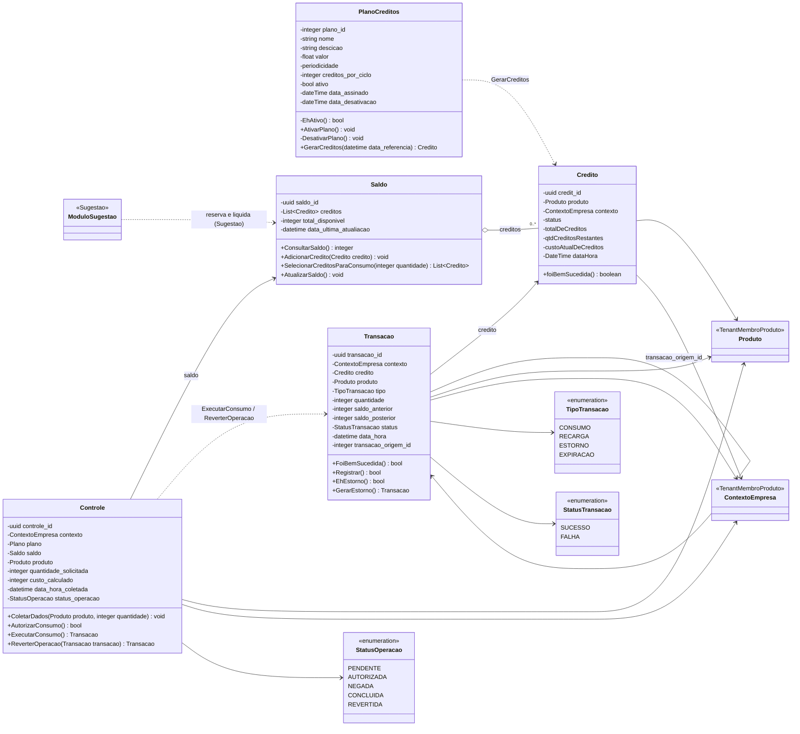

| Ponto | Fonte e situação |
|---|---|
| Serviço | Nenhuma ADR diz em qual serviço fica o módulo Créditos `[PENDENTE]`. |
| Nome | ADR_117: o usuário compra Créditos, não tokens; "o nome é Créditos" resolve o pendente `SaldoTokens` × Créditos. `[DECISÃO v6]`: a classe `SaldoTokens` (módulo 9) sai e a Sugestão usa o `Saldo` deste módulo; quem reserva e liquida é o módulo de Sugestão (ADR_038), representado pela `ModuloSugestao` `[DECISÃO v6]`. Os métodos de reserva, liquidação e substituição atômica (ADR_078/098) continuam `[PENDENTE]`. |
| "Token" da planilha de créditos | ADR_117: refere-se a tokens de API de LLM (BYOK) cadastrados como fonte de crédito, e não ao token do produtor. Como o BYOK entra na reserva e na cobrança `[PENDENTE]` (ADR_080). |
| Reserva | ADR_078: reserva = (tokens do prompt + teto de resposta, ex.: 1000) × 1,2. O consumo real liquida a cobrança e a diferença volta ao saldo. A reserva expira em 30,6 s e é liberada na falha da LLM. ADR_098: cada retentativa faz uma nova reserva, com substituição atômica da anterior; "o módulo de Créditos precisa de uma operação de substituição atômica de reserva ligada à Sugestão". Nenhum método ou valor de enum da planilha representa reserva, liquidação ou substituição `[PENDENTE]`. |
| `Sugestao -- Transacao` | Só no DER, marcada `[INFERIDO]` no próprio DER; não entrou. |
| `PlanoCreditos` | `[CONFLITO]` a aba "Cópia de Modelo Padrão" define uma segunda classe `Plano`, com `creditos_por_ciclo` e `GerarCreditos()`, diferente do `Plano` de Assinatura. Aqui aparece como `PlanoCreditos` só para não colidir. |
| `Controle.plano: Plano` | `[CONFLITO]` não dá para saber qual dos dois `Plano`. Por isso o campo não tem seta. |
| `Credito` | `status`, `totalDeCreditos`, `qtdCreditosRestantes` e `custoAtualDeCreditos` sem tipo `[A CONFERIR]`. |
| Tenant | `Credito`, `Transacao` e `Controle` apontam para `ContextoEmpresa` e `Produto` (planilha). A ligação do DER `Empresa 1:N Credito` é `[INFERIDO]` no próprio DER e ficou de fora. `Assinatura.limites` inclui os créditos do plano (ADR_122). |
| `Saldo` e `Controle` no DER | Não existem no DER v9 (pauta ASS-14). |

---

## 5. Coletor (ADR_015, ADR_041 a ADR_045, ADR_099, ADR_100, ADR_106 a ADR_122; pauta ING-02, ING-05, ING-06)

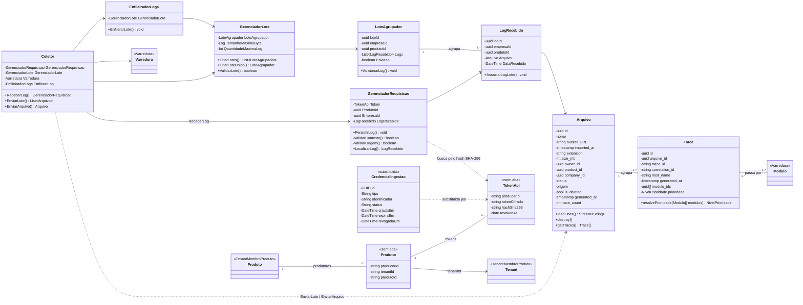

| Ponto | Fonte e situação |
|---|---|
| Ingestão OTLP | ADR_108/119: OTLP HTTP (4318) e gRPC (4317), só os caminhos padrão `/v1/logs` e `/v1/traces`. Produto e tenant vêm do token Bearer, sem `productId` na URL. ADR_118: `GET /health` (200 ou 503) e `grpc.health.v1.Health`, sem token; `/ping` removido. Token inválido ou revogado → 401. Sobrecarga → 429/503 com `Retry-After: 120` (ADR_120). Nenhuma classe da planilha cobre esses pontos `[PENDENTE]`. |
| `Produtor`, `TokenApi` | ADR_113/115/122 e DER v9. O `producerId` nasce com o token; um Produto tem vários produtores, cada um com seu token. O token é cifrado com AES-256-GCM (chave no KMS) e pode ser copiado a qualquer momento; o hash SHA-256 é o índice de busca do Coletor. Não expira e pode ser revogado (ADR_106). Para trocar, cria-se outro e revoga-se o antigo (ADR_107). Só administradores criam ou revogam (ADR_109). O serviço que guarda as duas coleções não está escrito `[PENDENTE]`. |
| Nome do token | ADR_106: "o usuário dá um nome e recebe o token". Nenhuma fonte diz em que campo fica `[PENDENTE]`. |
| `CredencialIngestao` (tabela) | `[CONFLITO]` a pauta ING-02 ligava a tabela ao Tenant; a ADR_111 a mantinha; a ADR_122 (marcado `[INFERIDO]` na ADR) e o DER v9 a dão como substituída por `TokenApi`. `[DECISÃO v6]`: fica só como substituída pelo `TokenApi`; a ligação com o Tenant sai. Campos do DER v9. É diferente da classe `CredencialIngestao` do SDK (módulo 13). |
| `GerenciadorRequisicao.Token` | A planilha tipa como `Credito`, e a ADR_117 diz que esse tipo está errado. `[DECISÃO v6]`: o tipo passa a ser `TokenApi`, e o Coletor busca o produtor pelo hash SHA-256 do Bearer (ADR_113). Isso liga o grupo `Produtor`/`TokenApi` às classes da ingestão. |
| `LogRecebido` | Gravado no Elasticsearch (ADR_116), com `tenantId` como todo log (ADR_121). A planilha ainda tem `empresaId`. |
| `Arquivo.nome` | ADR_044: "a classe Arquivo ganha o atributo nome". O tipo não está escrito. |
| `Arquivo.status` | ADR_099: `PROCESSANDO`, `CONCLUIDO` e `FALHA` (na tela: Processando, Concluído, Falha). Nome do enum `[PENDENTE]`. |
| `Arquivo.origem` | ADR_100: uma lista só, com a coluna de origem `MANUAL` ou `AUTOMATICO`; "Arquivo/Lote precisam guardar a origem". Nome do enum `[PENDENTE]`. Como o Arquivo aponta para o lote não está escrito `[PENDENTE]`. |
| `Arquivo.trace_count` | Pauta ING-05: deve retornar o número de Traces dentro do Arquivo. A planilha marca o campo `[INFERIDO]`. |
| `Arquivo 1 -- 1..* Trace` | `[CONFLITO]` o diagrama de classes v2 (Varredura e Finder) usa 1..*; o DER v9 usa 0..* (pauta ING-05, sem decisão sobre este ponto). O Mermaid usa o modelo de classes. Quem cria o `Trace` na ingestão não está escrito `[PENDENTE]`. |
| `owner_id`, `company_id` | A planilha não foi atualizada. A ADR_121 diz que todo documento leva `tenantId`. A relação entre esses campos e o `tenantId` só aparece no DER v9 como pendência 11, marcada `[INFERIDO]` `[PENDENTE]`. |
| Detalhe da falha | ADR_103: motivo (malware ou prompt injection, erro de leitura, falha após a DLQ), número de tentativas e erro da última tentativa. Onde fica (Arquivo, histórico ou DLQ) `[PENDENTE]` na própria ADR. |
| Proteção e upload manual | ADR_042: o Coletor recebe todos os arquivos, checa binário/executável e prompt injection e manda o manual para uma seção paralela que enfileira no fim da `FilaOrdenada` (ADR_041). ADR_043: `.txt`, `.json`, `.csv`, `.log` (lista extensível), até 100 MB. ADR_045: vários arquivos numa requisição viram um lote. ADR_048: só o arquivo reprovado é bloqueado. ADR_053: 202 Accepted. ADR_075: o Coletor pede o `execId` `M<uuid>` à API da Varredura antes de enfileirar o lote. Nenhuma classe da planilha cobre a proteção, a seção manual nem o lote manual `[PENDENTE]`. |
| Classes de lote | `GerenciadorLote`, `LoteAgrupador` e `EnfileiradorLogs` não aparecem em nenhuma ADR. `GerenciadorLote.TamanhoMaximoByte: Log` `[A CONFERIR]` (o tipo `Log` não existe). A planilha não liga o `EnfileiradorLogs` à `FilaDesordenada`. |
| `LoteAgrupador 1 -- 1..* LogRecebido` | DER v9 (`||--|{`). |
| Tipos corrigidos | `GeremciadorRequisicao` → `GerenciadorRequisicao` e `EnfilerarLog` → `EnfileiradorLogs`, para a ligação apontar para a classe certa. |

---

## 6. Varredura (ADR_006 a ADR_010, ADR_046, ADR_057 a ADR_061, ADR_068 a ADR_075; pauta FIN-01, VAR-03)

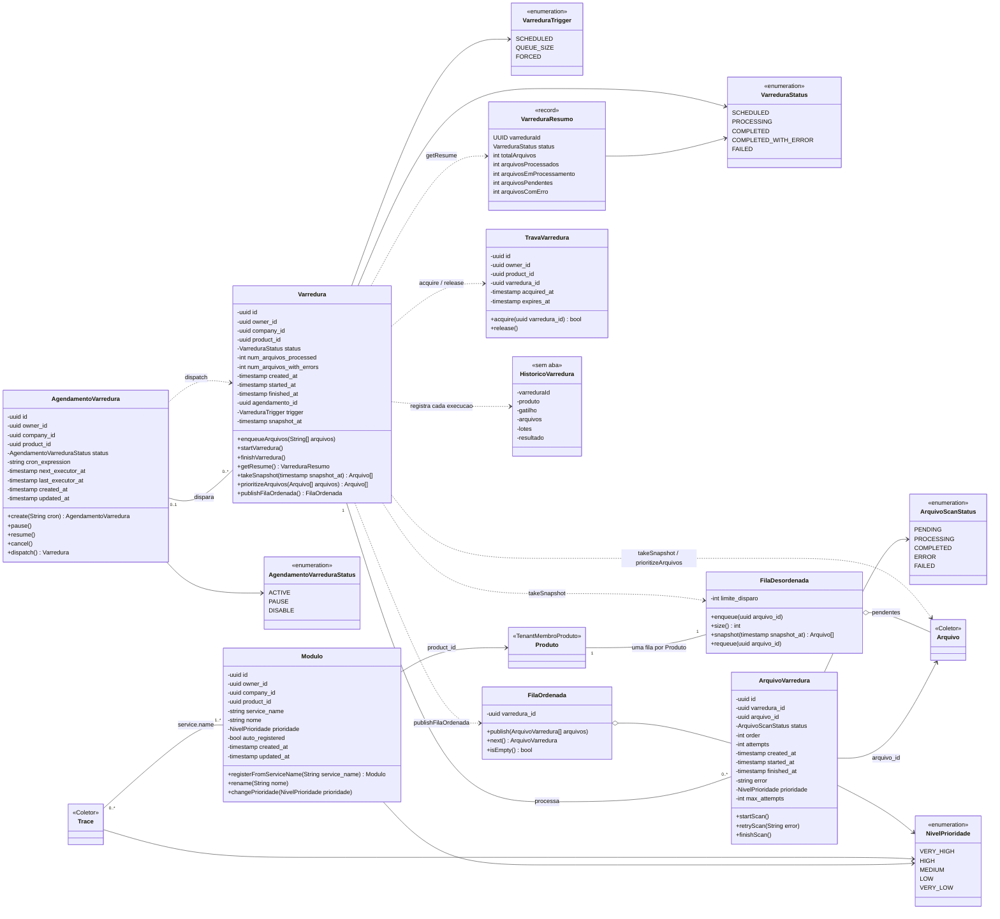

| Ponto | Fonte e situação |
|---|---|
| Por Produto | ADR_057: toda Varredura é de um Produto, com uma `FilaDesordenada` por Produto. O gatilho por tamanho é opcional, habilitado pelo cliente, com padrão de 500 arquivos; o agendamento (cron) continua. A planilha ainda diz que `limite_disparo` é interno e não exposto ao cliente (ADR_010) `[CONFLITO]`. Onde o cliente configura `[PENDENTE]`. A pauta VAR-01 ficou "pendente de cálculo"; a ADR_057 é posterior. |
| `TravaVarredura` | `[CONFLITO]` está na planilha v2 e no DER v9. A pauta VAR-03 decidiu "coleção TravaVarredura, escopo global". Depois, a ADR_068 decidiu que não existe trava por Produto, e as ADR_058/069/072 trocaram a trava por chaves lock por arquivo numa coleção chave-valor do MongoDB: `lock:{tenantProduto}:{execId}:{loteId}:{arquivoId}`, valor de 1 caractere, TTL = estimativa + 10%. As chaves são liberadas no fechamento da execução (ADR_070). A coleção nova não tem nome em nenhuma fonte; a classe da planilha fica até o time decidir. |
| `execId` | ADR_069/075: `V<uuid>` para varredura automática, gerado no `startVarredura()`, e `M<uuid>` para upload manual, pedido pelo Coletor à API da Varredura. Idempotência `arquivoId + execId` (ADR_070). Nenhuma fonte diz em que campo o `execId` fica `[PENDENTE]`. |
| Fim da execução | ADR_061/070: o Finder chama uma API da Varredura a cada arquivo ("arquivo X da execução Y finalizado") e recebe true/false. Com true, a Varredura faz `finishVarredura()` (`COMPLETED` ou `COMPLETED_WITH_ERROR`), libera as chaves lock e emite "varredura finalizada" ao Core. Rota e contrato `[PENDENTE]`. A planilha marca "quem chama `finishVarredura()`" como `[INFERIDO]`; a ADR_061 resolveu. |
| API de Estimativa | ADR_072: calcula o tempo esperado por arquivo para o TTL. Entradas e cálculo `[PENDENTE]`. Não tem classe. |
| `HistoricoVarredura` | ADR_060: cada execução é registrada (varreduraId, Produto, gatilho, arquivos/lotes, resultado). O nome é provisório na própria ADR e a estrutura `[PENDENTE]`. Os campos são as palavras da ADR, sem tipo. Retenção de 3 meses (ADR_071); a ADR_147 põe um índice TTL de cerca de 90 dias no MongoDB. |
| `ArquivoScanStatus` e tentativas | Pauta FIN-01: status final `ERROR` depois de 3 tentativas. ADR_046/059: DLQ com até 3 tentativas, cada uma no fim da `FilaOrdenada`; erro de leitura/parsing é crítico, sem retry (ADR_049). ADR_073: depois de 3 falhas o usuário só pode enviar um novo arquivo. A planilha deixa `max_attempts` `[PENDENTE]`; as fontes dão 3. |
| `ArquivoVarredura.status` × `Arquivo.status` | `[CONFLITO]` a ADR_099 resolveu o conflito "planilha (Arquivo Varredura) × DER × USID_007" com `PROCESSANDO`, `CONCLUIDO`, `FALHA` como status do Arquivo. A planilha (`ArquivoScanStatus`) e a pauta FIN-01 (`ERROR`) continuam com os valores em inglês. As fontes não dizem se os dois status convivem. |
| `VarreduraStatus` | Planilha. Bate com a ADR_061 (`COMPLETED`, `COMPLETED_WITH_ERROR`). `[CONFLITO]` o DER v9 usa `PENDING` e não tem `SCHEDULED` nem `FAILED`. |
| `VarreduraTrigger.FORCED` | A planilha marca `[INFERIDO]` (USID_025/SSID_005). As ADRs só têm agendamento e tamanho da fila; pauta VAR-06 sem decisão. |
| `AgendamentoVarreduraStatus` | Planilha. O DER tem `ativo` (Boolean) e `status`; pauta VAR-07 sem decisão `[CONFLITO]`. |
| `DLQ`, `requeue()` | A DLQ das ADR_046/059 não tem classe `[PENDENTE]`. A ADR_073 tirou a devolução do arquivo à `FilaDesordenada`; o `requeue()` da planilha ainda existe `[CONFLITO]`. |
| Métodos marcados pela planilha | `takeSnapshot()`, `prioritizeArquivos()`, `publishFilaOrdenada()`, `dispatch()` e `ArquivoVarredura.prioridade` estão marcados `[INFERIDO]` na própria planilha v2. |
| `getResume()` | A planilha escreve `VarreduraResume` no retorno e `VarreduraResumo` no tipo `[A CONFERIR]`. |
| `AgendamentoVarredura -- Varredura` | DER v9 (`Agendamento |o--o{ Varredura`). |
| `Varredura -- ArquivoVarredura` | DER v9 (`||--o{`). |
| `Modulo --> Produto` | Campo `product_id` da planilha. A ligação do DER (`Produto ||--o{ Modulo`) é descrita no próprio DER como "`[INFERIDO]` Produto como dono"; pauta ING-04 sem decisão. |
| Filas em Redis Streams | ADR_143: o broker das filas é o Redis Streams (`FilaDesordenada` e `FilaOrdenada` por Produto, DLQ, fila da Sugestão manual e eventos de notificação). ADR_146: nomes `lhamalog:AMBIENTE:PAPEL` com hash tag por `tenantId` e `produtoId`; envelope obrigatório (`eventId`, `type`, `version`, `timestamp`, `tenantId`, `produtoId`, `execId`, `tentativa`, `payload`); até 3 tentativas com reenvio no fim da mesma stream, depois DLQ por stream; erro crítico sem retry; idempotência `arquivoId + execId` nas filas do Finder. ADR_145: a classe base de consumidor é copiada em cada repositório, sem biblioteca comum. Nenhuma classe da planilha representa a stream, o envelope ou o consumidor base (a ADR não dá nome à classe) `[PENDENTE]`. `FilaDesordenada.requeue()` × reenvio no fim da mesma stream `[CONFLITO]`. |
| Agendador | ADR_147: Spring `@Scheduled` + ShedLock, com o lock no MongoDB. Um tick global lê a coleção `varredura_schedules` (cron e próxima execução por Produto) e publica as execuções vencidas no Redis Streams; o gatilho por tamanho (500) publica na mesma stream; os workers da Varredura consomem. Se `varredura_schedules` é a coleção do `AgendamentoVarredura` (que tem `cron_expression` e `next_executor_at` por Produto) não está escrito `[PENDENTE]`. `[CONFLITO]` `AgendamentoVarredura.dispatch(): Varredura` (marcado `[INFERIDO]` na planilha) cria a Varredura, e pela ADR_147 o tick só publica na stream. |

---

## 7. Finder (ADR_011, ADR_016 a ADR_019, ADR_040, ADR_059, ADR_062 a ADR_067, ADR_074, ADR_166, ADR_167; pauta FIN-02, FIN-05, FIN-06, FIN-07, ING-05)

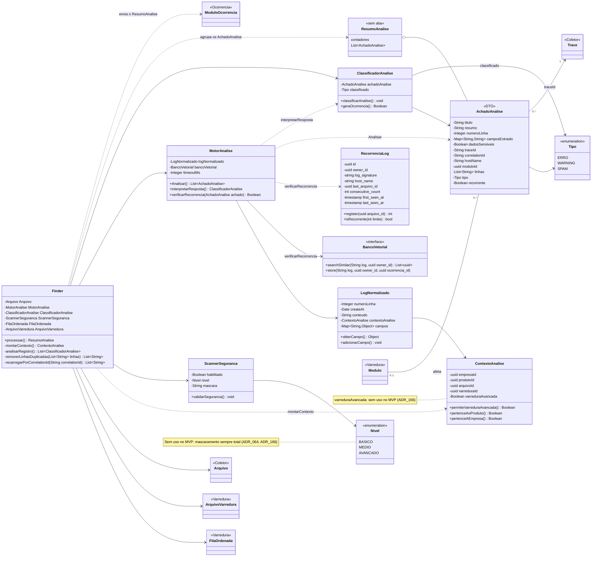

| Ponto | Fonte e situação |
|---|---|
| O Finder não conhece Ocorrência | ADR_062: o Finder registra `AchadoAnalise` (erros e warnings) por arquivo e, ao terminar, agrupa tudo no `ResumoAnalise` e envia ao Módulo Ocorrência, que cria as Ocorrências concretas. A planilha v2 diz que a `ModuloOcorrencia` "recebe as Ocorrências do Finder". |
| Removidos pela ADR | `enviarOcorrencia()`: a ADR_062 pede a remoção. `devolverParaFila()`: a ADR_059 o substitui pela DLQ. `GatewayLLMFinder`, `MotorAnalise.gatewayLLM` e `MotorAnalise.executarAI()`: a ADR_167 tira a LLM do Finder. |
| `Finder.Ocorrencia` e `processar()` | A planilha tinha o campo `Ocorrencia` e `processar(): Ocorrencia`, e a ADR_062 diz que o Finder não conhece Ocorrência. `[DECISÃO v6]`: o campo sai e `processar()` devolve `ResumoAnalise`. |
| `ResumoAnalise` | ADR_062: "contadores + `List<AchadoAnalise>`". Os nomes dos contadores não estão escritos; a ADR_102 diz quais são (linhas processadas, erros, warnings, spam ignorado, dados sensíveis mascarados) e marca a lista como `[INFERIDO]`. O envio usa a chave de idempotência `arquivoId + execId` (ADR_070). |
| `AchadoAnalise` | DTO sem coleção (ADR_040). Campos da aba original + adições v2 (planilha). `tipo`: ADR_040/062. `recorrente`: ADR_063 ("atributo booleano") e pauta FIN-05. `[CONFLITO]` o DER v9 ainda tem `AchadoAnalise` como entidade, com `gravidade`, `chaveAchado` e `vetorRef`. |
| Gravidade | `[CONFLITO]` a pauta FIN-07 decidiu que a `ClassificadorAnalise` registra a gravidade, num atributo chamado `gravidade`, que é o padrão gravado na Ocorrência. Depois, a ADR_062 decidiu que o Finder não sabe nada de criticidade e que a gravidade é definida pelo Módulo Ocorrência. O Mermaid segue a ADR_062: a gravidade só aparece na `Ocorrencia` (módulo 8). |
| `AchadoAnalise → Trace` | Pauta ING-05: um Trace pode ter 0 ou mais `AchadoAnalise`, e o `AchadoAnalise` precisa sempre de 1 Trace. `[CONFLITO]` o DER v9 tem `Trace |o--o{ AchadoAnalise` e a aba "AchadoAnalise (adições v2)" diz "`traceId` null se o log não tiver trace". |
| `Modulo -- AchadoAnalise` | DER v9 (`Modulo |o--o{ AchadoAnalise`). |
| Recorrência | ADR_063/074 e pauta FIN-05: `recorrente` é atributo booleano. `MotorAnalise.verificarRecorrencia()` consulta o `BancoVetorial`, isolado por Produto, na janela dos achados dos últimos 500 arquivos. Critério de semelhança `[PENDENTE]`. |
| `RecorrenciaLog` | `[CONFLITO]` está na planilha (que a marca `[INFERIDO]`) e no DER v9 e implementa a regra "3 ou 4 arquivos seguidos" da ADR_013. A ADR_063 trocou essa regra pela janela de 500 arquivos no `BancoVetorial`, mas não remove a classe pelo nome. |
| `BancoVetorial` | Planilha v2. Pauta FIN-06: estrutura baseada nas tratativas de um RAG comum. `[CONFLITO]` `searchSimilar(..., owner_id)` × isolamento por Produto (ADR_074) e `store(..., ocorrencia_id)` × Finder sem Ocorrência (ADR_062). |
| Finder sem LLM | ADR_167: o Finder não usa LLM. A análise é feita por IA própria: classificação por regras e padrões no `ClassificadorAnalise` e recorrência pelo `BancoVetorial`. A `GatewayLLMFinder` (ADR_018/067) saiu do diagrama; a LLM externa fica só na Sugestão (`GatewayLLMSugestao`). Regras e padrões de classificação `[PENDENTE]`. |
| `MotorAnalise.timeoutMs` | Pauta FIN-02: cálculo determinístico do timeout com base no tamanho do arquivo. A fórmula não está escrita `[PENDENTE]`. Sem a LLM do Finder (ADR_167), se o atributo continua `[PENDENTE]`. |
| `validarSeguranca()` | `[CONFLITO]` a planilha diz `void`. A ADR_064 diz que a função troca emails, remove as linhas com senha, token ou secret (com marcador, ex.: "log com senha omitido") e retorna "as linhas mascaradas (+ total para `dadosSensiveisIdentificados`)". O tipo de retorno não está escrito. A lista de regex `[PENDENTE]`. |
| Spam | ADR_066: spam isolado só conta em `spamIdentificados` e não é armazenado; spam com o mesmo `correlationId`/`traceId` de um erro ou warning entra só como contexto. |
| Enum `Tipo` | ADR_019: `ERRO`, `WARNING`, `SPAM`. A aba v2 ainda tem `INFO` e `RECORRENTE`. |
| Workers e idempotência | ADR_065/068/070: muitos workers independentes, em qualquer fila de Produto. A chave `arquivoId + execId` é reservada antes de processar. A coleção de idempotência não tem classe `[PENDENTE]`. |
| Fim do arquivo | ADR_061/070: o Finder chama a API da Varredura a cada arquivo concluído. Nenhum método da planilha representa essa chamada. |
| Ligações do `Finder` | A planilha marca `[INFERIDO]` os atributos `FilaOrdenada` e `ArquivoVarredura` e os métodos `removerLinhasDuplicadas()` e `recarregarPorCorrelationId()`. |
| Nomes | ADR_016: valem os nomes do modelo original (`MotorAnalise`, `ClassificadorAnalise`, `ScannerSegurança`). O enum `Nivel` tem `AVANÇADO` na planilha (sem acento no Mermaid). |
| Varredura avançada | ADR_166: fora do MVP (USID_027 e SSID_008 em espera). O `ScannerSeguranca` continua mascarando em toda análise (ADR_016/064). `ContextoAnalise.varreduraAvancada`, `permiteVarreduraAvancada()` e o enum `Nivel` ficam sem uso no MVP. Quando voltar, a varredura avançada será o aviso de dados sensíveis expostos nos logs, sem níveis de mascaramento. |

---

## 8. Ocorrência (ADR_035, ADR_036, ADR_040, ADR_062, ADR_082, ADR_089, ADR_101, ADR_104; pauta FIN-09, OCO-06)

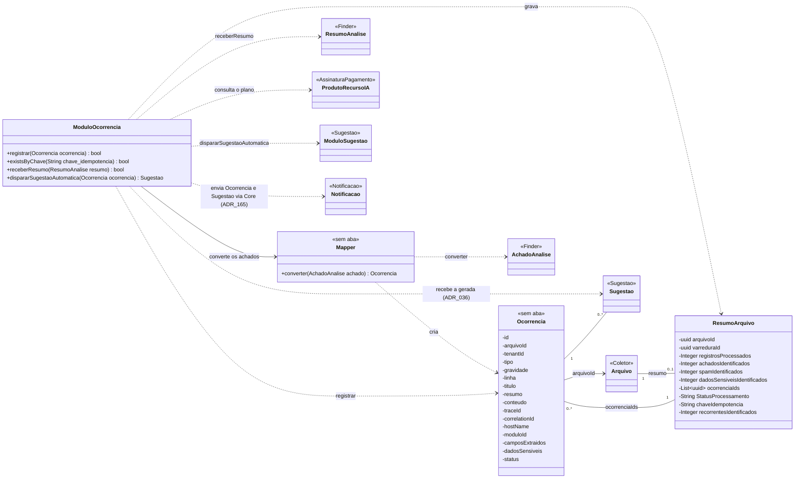

| Ponto | Fonte e situação |
|---|---|
| Resumo × Ocorrência | A aba `Ocorrencia` (e `Ocorrencia v2`) da planilha é o resumo por Arquivo da ADR_020. As ADR_035/040 criaram a Ocorrência concreta e mantiveram o resumo como agrupador ("1 resumo por Arquivo : 0..N Ocorrências", ADR_035). `[DECISÃO v6]`: o resumo se chama `ResumoArquivo` (opção da ADR_035; pauta OCO-02 sem decisão). |
| Campos do `ResumoArquivo` | Aba `Ocorrencia v2`. `spamIdentificados` substitui `informacaoIdentificados`, como no DER v9 (ADR_019). `[DECISÃO v6]`: `achados: List<AchadoAnalise>` vira `ocorrenciaIds: List<uuid>`, porque a ADR_040 diz que o resumo "guarda os contadores e as referências às Ocorrências criadas" e os achados vão no `ResumoAnalise` (ADR_062). A planilha marca `dadosSensiveisIdentificados` e `recorrentesIdentificados` `[INFERIDO]`; `recorrentesIdentificados` tinha "`[PENDENTE]` se RECORRENTE virar atributo", o que a ADR_063 fez. `StatusProcessamento` `[A CONFERIR]` (pauta OCO-03). |
| `chaveIdempotencia` | Na planilha, `= arquivoId` (ADR_014/020). A ADR_070 usa `arquivoId + execId` no envio do `ResumoAnalise`. A chave da Ocorrência concreta continua `[PENDENTE]` (ADR_035/040, pauta OCO-01). |
| `Arquivo 1 -- 0..1 ResumoArquivo` | DER v9. O resumo é gerado para todo Arquivo processado, inclusive só com spam (ADR_035). |
| Ocorrência concreta | Sem aba. Campos do mapeamento da ADR_040, mais `id`, `arquivoId` e `status` (ADR_040) e `tenantId` (ADR_121). Tipos não escritos. "Referência ao resumo", "produto" e "data de criação" não têm nome de campo `[PENDENTE]`; a data é `descobertaEm` no DER e "data de criação" na ADR_040 `[CONFLITO]`. |
| `Ocorrencia.status` | ADR_082: `ABERTA`, `EM_ANALISE` (quando uma Sugestão fica `AGUARDANDO_REVISAO`, ADR_089/091/096) e `FECHADA`. Transições: `ABERTA` → `EM_ANALISE` ou `FECHADA`; `EM_ANALISE` → `FECHADA`; `FECHADA` → `ABERTA`. Só fecha com todas as Sugestões que não falharam `FECHADA` (ADR_089/090). Rota da mudança manual `[PENDENTE]`. |
| `Ocorrencia.gravidade` | ADR_062: definida pelo Módulo Ocorrência (criticidade do módulo × tipo do achado). Matriz e valores `[PENDENTE]`. `[CONFLITO]` pauta FIN-07 (`ClassificadorAnalise`). |
| `ModuloOcorrencia` | Planilha v2 (marcada `[INFERIDO]` na própria planilha), com `registrar()` e `existsByChave()`. `[DECISÃO v6]`: ganha `receberResumo(ResumoAnalise)` (ADR_062: recebe o resumo, define a gravidade e cria as Ocorrências) e `dispararSugestaoAutomatica(Ocorrencia)` (ADR_036: consulta o plano, chama o módulo de Sugestão (`ModuloSugestao`), espera e envia Ocorrência + Sugestão à Notificação). A pauta OCO-06 propunha "ModuloOcorrencia com os métodos novos". Ela não monta prompt nem reserva créditos (ADR_038/039). |
| `Mapper` | Pauta FIN-09 ("uma classe Mapper que converte para a classe concreta"). `[DECISÃO v6]`: fica no módulo Ocorrência e é chamado pela `ModuloOcorrencia` ao receber o `ResumoAnalise` (ADR_062 diz que quem cria as Ocorrências é o Módulo Ocorrência). Método `converter()`. |
| Consulta do plano | ADR_036/076: a automática só roda com `planoTemIA` e `produtoAtivouIA` verdadeiros. |
| `Ocorrencia 1 -- 0..* Sugestao` | ADR_035. |
| Consultas | ADR_101: Ocorrências por Produto, por lote e por arquivo. Rotas `[PENDENTE]`. |
| Retenção | ADR_104: por plano, padrão 3 meses. Expurgo `[PENDENTE]`. |
| `HistoricoOcorrencia` | Só no DER, sem aba e sem ADR (ver "Classes fora do diagrama"). |

---

## 9. Sugestão (ADR_035 a ADR_040, ADR_076 a ADR_080, ADR_083 a ADR_098, ADR_117, ADR_128)

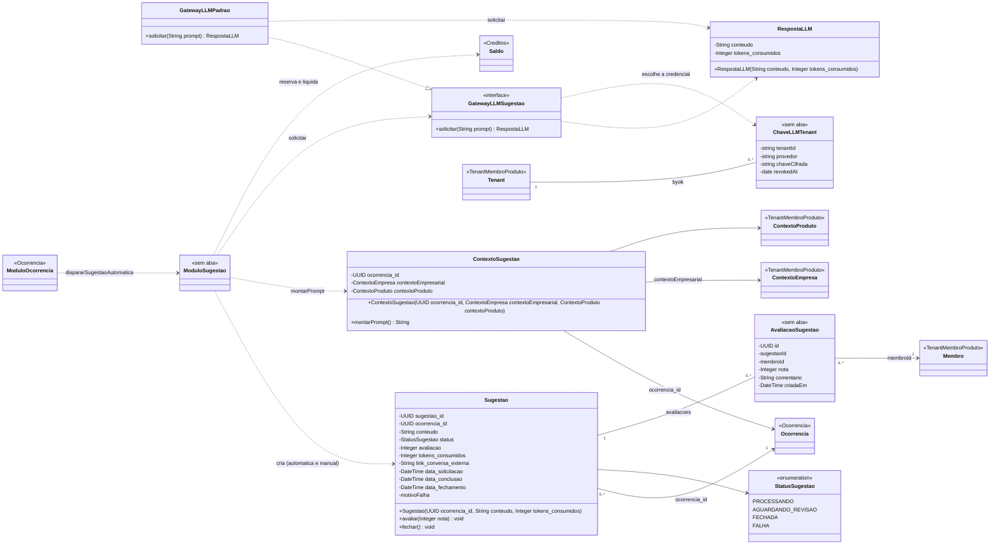

| Ponto | Fonte e situação |
|---|---|
| Serviço | ADR_141: "Ocorrência (com Sugestão IA e BYOK)". |
| `StatusSugestao` | ADR_096: `PROCESSANDO`, `AGUARDANDO_REVISAO` e `FECHADA`, mais o registro interno `FALHA`; não existe `AVALIADA`. `AGUARDANDO_REVISAO` vai direto para `FECHADA`. `DISPONIVEL` (planilha) e `PENDENTE` (ADR_091) saíram. `FALHA` vem das ADR_077/078/096. Não confundir com o `FALHA` de `TentativaEntrega`. |
| `motivoFalha` | ADR_077: "o registro Sugestao fica com status FALHA e motivoFalha". Tipo não escrito. |
| Falha | ADR_090/097: a Sugestão com falha não entra na lista da Ocorrência e não bloqueia o fechamento. Fica no histórico de notificações e no registro interno `FALHA`. |
| Automática | ADR_036/040/076/077: roda quando `planoTemIA` e `produtoAtivouIA` são verdadeiros; síncrona do ponto de vista da Ocorrência, com prioridade. Timeout de 30 s, sem retry. Saldo insuficiente, timeout e falha da LLM geram a mesma notificação, sem o motivo no push ou no email. |
| Manual | ADR_083: `POST /ocorrencias/{id}/sugestoes`, 202 Accepted, sem limite por Ocorrência. ADR_085/092: sem saldo para a reserva mínima → 402 Payment Required, nada é criado. ADR_093/094: timeout de 30 s e 3 retentativas (5 s, 15 s, 45 s). ADR_086/095: avisos por WebSocket e no histórico, sem push nem email. |
| `origem`, `tentativas` | Pauta SUG-14: campos a confirmar, sem decisão. Nenhuma ADR os nomeia. Fora do Mermaid (ver "Sugestões"). |
| `AvaliacaoSugestao` | DER v9 (`id`, `nota`, `comentario`, `criadaEm`) e ADR_088: 1 a 5 estrelas e comentário; qualquer membro com acesso pode avaliar; uma avaliação por pessoa por Sugestão. A ADR pede o autor (`usuarioId`) e a unicidade `sugestaoId + usuarioId`. `[DECISÃO v6]`: o autor é o `Membro` (`membroId`), já que o `Usuario` foi substituído pelo `Membro` (DER v9); unicidade `sugestaoId + membroId`. |
| `Sugestao.avaliacao` e `avaliar()` | `[CONFLITO]` a planilha guarda uma nota; a ADR_088 e o DER usam várias avaliações em `AvaliacaoSugestao`. |
| `Sugestao -- AvaliacaoSugestao` | DER v9 (`||--o{`). |
| `Sugestao --> Ocorrencia` | ADR_035: a Sugestão pertence a uma Ocorrência concreta, `ocorrenciaId` obrigatório, 1 Ocorrência : 0..N Sugestões. |
| Contexto | ADR_087: últimas 5 Sugestões da mesma Ocorrência, com avaliações. Nenhum campo da `ContextoSugestao` guarda isso `[PENDENTE]`. Mascaramento igual ao do Finder (ADR_079). |
| `ContextoSugestao.contextoEmpresarial` | O tipo na aba é `ContextoEmpresarial`, que não existe; a classe é `ContextoEmpresa` (tipo corrigido). Pauta SUG-15 propôs `ContextoEmpresa`, sem decisão. |
| `GatewayLLMSugestao` | ADR_039: nome novo da interface `GatewayLLM` do módulo Sugestão (pauta SUG-16). `GatewayLLMPadrao` implementa a interface ("implements" na aba). Provedor `[PENDENTE]` (ADR_080). |
| `ChaveLLMTenant` | ADR_128 e DER v9: chave BYOK numa coleção do módulo Sugestão, cifrada com AES-256-GCM e ligada ao `tenantId`. ADR_080: "a `GatewayLLMSugestao` precisa escolher a credencial (LhamaLog ou do cliente)". Rota da API de BYOK `[PENDENTE]`. |
| `SaldoTokens` | Removida `[DECISÃO v6]`: a ADR_117 diz que o nome é Créditos e manda atualizar os documentos da Sugestão; a ADR_038 recomendava unificar. A Sugestão usa o `Saldo` do módulo 4. |
| Orquestração | `[DECISÃO v6]` (corrigido na v7): as ADRs falam de um "módulo de Sugestão" sem dar nome de classe. Ele virou a `ModuloSugestao` (nome no padrão da `ModuloOcorrencia`). Pelas ADRs, é ele que cria a `Sugestao` (ADR_036: no manual, com status `PROCESSANDO`), monta o prompt com o `ContextoSugestao` (ADR_039), faz a prévia e a reserva no `Saldo` depois do `montarPrompt()` (ADR_038/078/098) e chama a `GatewayLLMSugestao` (ADR_039). A `ModuloOcorrencia` só o chama no fluxo automático (ADR_036). A manual é consumida de uma fila Redis Streams (ADR_143/146) por um worker; o worker e a rota do pedido manual não têm classe própria `[PENDENTE]`. Métodos da `ModuloSugestao` `[PENDENTE]`. Uma fila com prioridade ou duas continua `[PENDENTE]` (pauta SUG-05). |

---

## 10. Notificação (ADR_060, ADR_071, ADR_081, ADR_086, ADR_130, ADR_141, ADR_165; pauta NOT-01 a NOT-03)

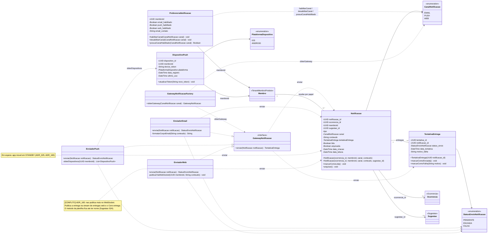

| Ponto | Fonte e situação |
|---|---|
| Serviço | ADR_141: Notificação é um serviço próprio, separado do Core, só de saída (push e email), sem entrada pública. ADR_165: o canal WEB também é da Notificação, que escolhe os destinatários, grava o histórico e manda o e-mail; o item WEB volta ao Core pela stream de entregas web e o Core entrega pelo WebSocket. |
| `Notificacao.tipo` | ADR_081: dois tipos, `OCORRENCIA` e `OCORRENCIA_COM_SUGESTAO`; o segundo leva o `sugestaoId` opcional ou "o campo de erro" quando a Sugestão falhou. Sem IA no plano ou no Produto, vai `OCORRENCIA`. `[CONFLITO]` a pauta NOT-02 decidiu três valores, com `FALHA_SUGESTAO` para a falha da Sugestão manual "só para quem pediu, por PUSH e WEB". Depois, a ADR_081 deixou o tipo da falha manual `[PENDENTE]` e a ADR_086 mandou esse aviso só por WebSocket e histórico, sem push nem email. Nome do enum `[PENDENTE]`. O nome do "campo de erro" não está escrito `[PENDENTE]`. ADR_165: passam a gerar Notificacao também a "varredura finalizada", o relatório final do lote, os avisos da Sugestão manual (aceita, pronta, falhou), os avisos ao Dono (assinatura e ACESSO_PENDENTE) e o aviso de exclusão de cargo; os nomes desses tipos seguem `[PENDENTE]`. |
| Construtor com `sugestao_id` | Pauta NOT-01: incluir `sugestao_id` opcional no construtor e no DER, preenchido só quando a notificação tem Sugestão. A posição do parâmetro não está escrita: no Mermaid ele aparece no fim, num segundo construtor, só para mostrar a decisão ao lado do construtor original da planilha. O DER v9 ainda não tem `sugestaoId` `[CONFLITO]`. |
| Templates | Pauta NOT-03: um template por tipo. `OCORRENCIA` mostra os dados da Ocorrência; `OCORRENCIA_COM_SUGESTAO` mostra a Ocorrência e o texto da Sugestão, ou "Não foi possível criar uma sugestão"; `FALHA_SUGESTAO` mostra "Não foi possível criar a sugestão solicitada". A ADR_077 diz que, no automático, o motivo da falha não vai no push nem no email. Nenhuma classe da planilha representa os templates `[PENDENTE]`. |
| `Membro -- Notificacao` | DER v9 (`Membro \|\|--o{ Notificacao : recebe por papel`). `[DECISÃO v6]`: `usuario_id` da planilha vira `membroId` em `Notificacao`, `PreferenciaNotificacao`, `DispositivoPush` e nos métodos dos enviadores, porque o `Usuario` foi substituído pelo `Membro` (DER v9). |
| Destinatários | ADR_130/134/136: por papel de notificação (módulo 2), com filtro de gravidade, tipo e Produto. A "consulta de agregação" não tem classe `[PENDENTE]`. ADR_165: o destinatário vem pelos cargos (Ocorrências, "varredura finalizada"), pela pessoa que pediu (relatório final do lote, Sugestão manual) ou por papel fixo (Dono; Dono e Administradores). A matriz é configurada pelas rotas `/papeis` do Core e lida pela Notificação no MongoDB compartilhado (marcado `[INFERIDO]` na ADR_165). |
| Canais | ADR_060: push e email só para Ocorrências, estados críticos e alertas do sistema. ADR_165: passam pela Notificação, só pelo canal WEB, a "varredura finalizada", o relatório final do lote, os avisos da Sugestão manual e o aviso de exclusão de cargo; os avisos ao Dono (assinatura e ACESSO_PENDENTE) vão por e-mail e web. Continuam só por WebSocket, direto do Core, o "aceito" e o alerta da proteção do upload manual, o início da Varredura e as atualizações de tela. Push em espera (ADR_025). |
| `EnviadorWeb` × WebSocket | Resolvido pela ADR_165 (era `[CONFLITO]` com a ADR_141): o `EnviadorWeb` publica a entrega na stream de entregas web e o Core entrega pelo WebSocket. `[CONFLITO]` que sobra, só de nome: o `publicarViaWebSocket()` da planilha fica no Mermaid até o método novo ter nome (Sugestão S24). A `TentativaEntrega` do canal WEB fica `ENVIADA` quando a entrega é publicada (marcado `[INFERIDO]` na ADR_165). |
| Retenção | ADR_071: notificações e histórico por 3 meses, consultáveis pelo cliente. ADR_165: o membro desconectado encontra a notificação não lida na caixa; a caixa (listar, marcar como lida, arquivar) é servida pelo Core, que busca os dados na Notificação pela rede interna (marcado `[INFERIDO]` na ADR_165). |
| Eventos | ADR_143: os eventos de notificação passam pelo Redis Streams, no padrão da ADR_146. ADR_165: stream de volta de entregas web (produtor Notificação, grupo core). Nenhuma classe da planilha representa esse consumo nem essa publicação `[PENDENTE]`. |
| `PreferenciaNotificacao` | Ligada ao `Membro` por `membroId` `[DECISÃO v6]`. A seta para `CanalNotificacao` vem dos métodos dela. ADR_165: `push_habilitado` fica, sem uso enquanto o app móvel estiver em STANDBY. |
| `PreferenciaNotificacao` × matriz | `[CONFLITO]` o DER v9 tem `severidadeMinima` na preferência, e a matriz de papéis também filtra por gravidade (ADR_134). A classe da planilha não tem `severidadeMinima` (pauta NOT-15, sem decisão). |
| Retorno de `enviar()` | `[CONFLITO]` a interface devolve `TentativaEntrega`; os três enviadores devolvem `StatusEnvioNotificacao` (pauta NOT-09, sem decisão). |
| `Notificacao.tentativaEntrega` × 1:N | `[CONFLITO]` a classe guarda uma tentativa; o DER liga `Notificacao 1:0..*` `TentativaEntrega`. O Mermaid usa o DER. |
| `Notificacao --> 0..1 Sugestao` | Pauta NOT-01: `sugestao_id` opcional. |
| `Notificacao --> 0..1 Ocorrencia` | ADR_165: a Notificação aceita alertas sem Ocorrência. O DER v9 tem a mesma cardinalidade (uma Ocorrência para 0..N Notificações, a Ocorrência opcional), mas marcada `[INFERIDO]` no próprio DER. Os dois construtores da planilha continuam exigindo `ocorrencia_id`; um construtor sem Ocorrência não tem nome em nenhuma fonte (Sugestão S25). |
| `StatusEnvioNotificacao.PENDENTE` | Valor de enum, sem relação com a marcação `[PENDENTE]`. |
| `EnviadorPush` | App móvel em STANDBY (ADR_025). ADR_165: o canal PUSH fica no modelo, mas não aparece nas preferências e nada é enviado por ele; sem push pelo navegador no MVP. |

---

## 11. Dashboard

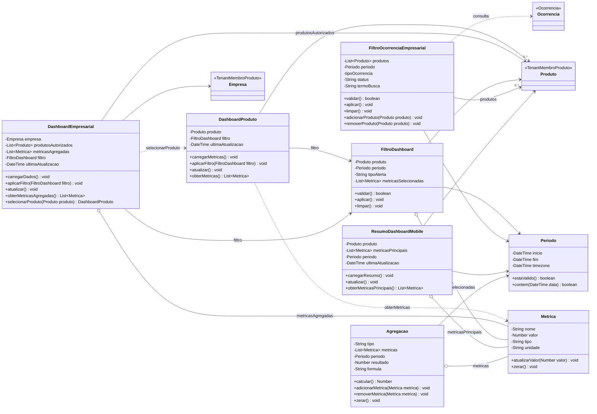

| Ponto | Situação |
|---|---|
| `DashboardProduto` | Tem uma linha "Privado" sem nome nem tipo na aba `[A CONFERIR]`. |
| `Periodo.timezone: DateTime` | `[A CONFERIR]` fuso horário tipado como data. |
| `FiltroOcorrenciaEmpresarial` | O enum `tipoOcorrencia` não tem nome na aba `[A CONFERIR]`. `[DECISÃO v6]`: `..> Ocorrencia : consulta` (Guia das Classes: "consultar ocorrências de vários Produtos"). De onde vêm as outras métricas (`Metrica`, `Agregacao`) continua `[PENDENTE]`. |
| `Agregacao.formula` | `[PENDENTE]` na própria aba. |
| `ResumoDashboardMobile` | App móvel em STANDBY (ADR_025). |
| Serviço | Nenhuma ADR diz em qual serviço fica o Dashboard `[PENDENTE]`. |
| De onde vêm as métricas | Nenhuma classe liga as métricas aos dados de Ocorrência/Varredura `[PENDENTE]`. |
| `Empresa` | `DashboardEmpresarial.empresa` aponta para a `Empresa`, que na v6 é o cadastro do Tenant `[DECISÃO v6]`. |

---

## 12. Relatório (ADR_166)

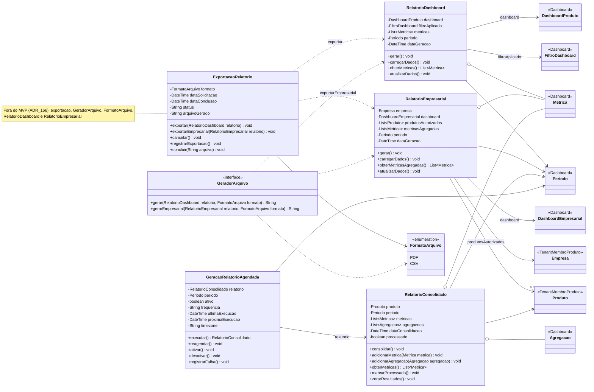

| Ponto | Situação |
|---|---|
| `GeradorArquivo` | Interface sem implementação e sem quem a use na planilha `[PENDENTE]`. |
| `GeracaoRelatorioAgendada.frequencia` e `timezone` | `[PENDENTE]` na própria aba. |
| `FormatoArquivo` | Enum de exportação de relatório; não tem relação com os formatos aceitos no upload manual (DC-09). |
| `ExportacaoRelatorio.status` | Valores não definidos `[PENDENTE]`. |
| `RelatorioEmpresarial.empresa` | Aponta para a `Empresa`, que na v6 é o cadastro do Tenant `[DECISÃO v6]`. |
| Serviço | Nenhuma ADR diz em qual serviço fica o Relatório `[PENDENTE]`. |
| Relatório final do lote | O relatório do upload manual (ADR_055) é um alerta por WebSocket e não tem relação com estas classes. |
| Exportação (USID_033, USID_035) | ADR_166: fora do MVP. Ficam sem uso no MVP `RelatorioDashboard`, `RelatorioEmpresarial`, `ExportacaoRelatorio`, `GeradorArquivo` e `FormatoArquivo`. `RelatorioConsolidado` e `GeracaoRelatorioAgendada` (SSID_011) continuam, porque mantêm as agregações pré-calculadas do Dashboard. |

---

## 13. Legado (SDK e Executável; ADR_007, ADR_111; pauta ING-06)

O OpenTelemetry Collector substituiu a SDK e o Executável (ADR_007), e o DER v9 marca `Executavel` como `MOD_LEGADO`. As
classes do SDK ficam aqui para referência. As classes de token antigas (`APIToken`, `ExternalToken`, `AutorizadorSDK`)
foram removidas pela ADR_111.

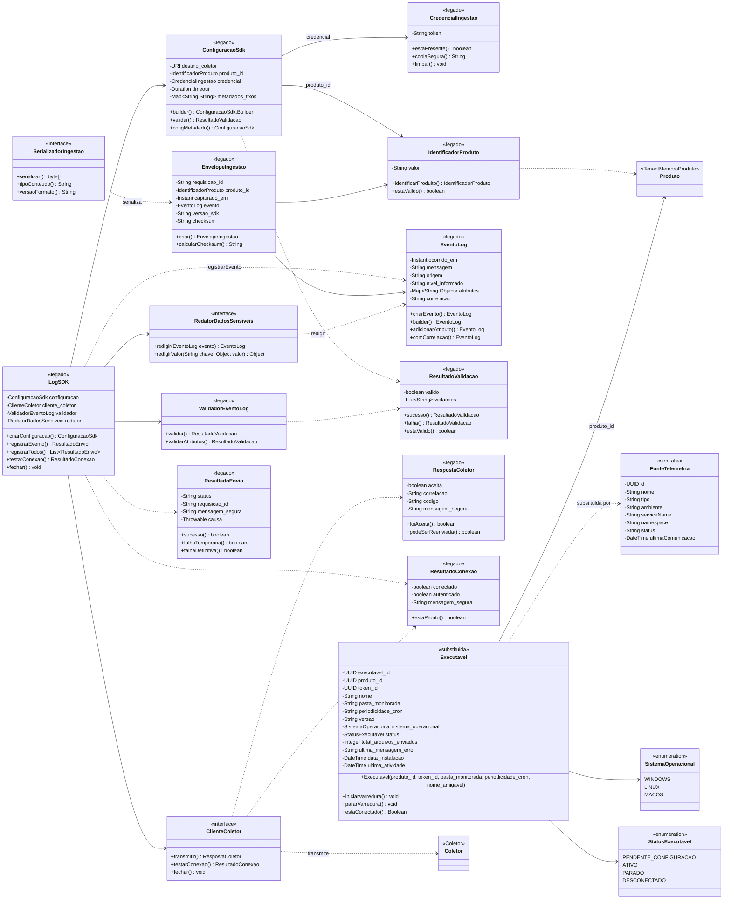

| Ponto | Situação |
|---|---|
| `CredencialIngestao` | Classe do lado do SDK (planilha). A tabela `CredencialIngestao` do servidor, que só está no DER, aparece no módulo 5. |
| `Executavel.token_id` | O Guia diz "identificador do Token usado para autenticação". O `ExternalToken` saiu pela ADR_111, e o campo ficou sem classe de destino. |
| `SerializadorIngestao ..> EnvelopeIngestao`, `ClienteColetor ..> Coletor`, `IdentificadorProduto ..> Produto` | Descrições do Guia das Classes: "conversão do envelope para o formato aceito pelo Coletor", "transmitir Logs e testar a conexão com o Coletor", "identifica o Produto monitorado". |
| `Executavel` `<<substituida>>` | Pauta ING-06: a substituição de `Executavel` por `FonteTelemetria` e de `ExternalToken` por `CredencialIngestao` ficou "Alinhado", com a remoção do legado no DER. O DER v9 ainda traz `Executavel` e `ExternalToken` como `MOD_LEGADO` e a ligação com `FonteTelemetria` marcada `[INFERIDO]` `[CONFLITO]`. `FonteTelemetria` só existe no DER (campos do DER v9). |
| `RedatorDadosSensiveis` | Mascaramento do lado do cliente na SDK; com o OTel, o equivalente é o processador de redação do Collector, configurado pelo cliente. |

---

## Classes e elementos removidos ou substituídos

Só entra aqui o que uma fonte remove ou substitui **pelo nome**. Os campos e métodos removidos estão na versão 2 (`v2/`).

| Elemento da planilha | Situação | Fonte |
|---|---|---|
| `Empresa` | deixou de ser substituída: cadastro 1:1 do `Tenant` | `[DECISÃO v6]` (DER v9 dizia substituída) |
| `TokenMetadata` | removida | ADR_154 (Proposto) `[DECISÃO v6]` |
| `SaldoTokens` | removida; a Sugestão usa o `Saldo` | ADR_117, `[DECISÃO v6]` |
| `Finder.Ocorrencia`, `processar(): Ocorrencia` | campo sai; retorno vira `ResumoAnalise` | ADR_062, `[DECISÃO v6]` |
| `Ocorrencia` (resumo) `achados` | vira `ResumoArquivo.ocorrenciaIds` | ADR_035/040, `[DECISÃO v6]` |
| `usuario_id` (Notificação, Avaliação) | vira `membroId` | DER v9, `[DECISÃO v6]` |
| `Usuario`, `Gestor`, `Vinculo`, `Acesso` | substituídas por `Membro` (no diagrama) | DER v9, ADR_122 |
| `Executavel` | substituída por `FonteTelemetria` (no diagrama) | pauta ING-06 |
| `CredencialIngestao` (tabela do DER) | substituída por `TokenApi` (no diagrama) | DER v9, `[DECISÃO v6]` |
| `Autorizador` (+ enum `TenantRoles`), `API - Token`, `ExternalToken`, `Autorizador - SDK` | removidas | ADR_111 |
| `GatewayLLM` (Finder) | renomeada para `GatewayLLMFinder` | ADR_067 |
| `GatewayLLMFinder`, `MotorAnalise.gatewayLLM`, `MotorAnalise.executarAI()` | removidos: o Finder não usa LLM | ADR_167 |
| `GatewayLLM` (Sugestão) | renomeada para `GatewayLLMSugestao` | ADR_039 |
| `Finder.enviarOcorrencia()` | removido | ADR_062 |
| `Finder.devolverParaFila()` | removido (vira DLQ) | ADR_059 |
| `Tipo.INFO`, `Tipo.RECORRENTE` | removidos (`recorrente` vira atributo) | ADR_019, ADR_063 |
| `StatusSugestao.DISPONIVEL`, `AVALIADA` | removidos; entram `AGUARDANDO_REVISAO` e `FALHA` | ADR_096 |
| `Ocorrencia.informacaoIdentificados` | vira `spamIdentificados` | DER v9 (ADR_019) |
| `GerenciadorRequisicao.Token: Credito` | o tipo sai | ADR_117 |

Ficaram na planilha, marcadas `[CONFLITO]`, porque nenhuma fonte as remove pelo nome: `TravaVarredura` (ADR_058/068),
`RecorrenciaLog` (ADR_063),
`FilaDesordenada.requeue()` (ADR_073), `Sugestao.avaliacao` (ADR_088), `EventoGateway.resultado` (ADR_125).

## Conflitos DER v9 × ADRs

O DER v9 (12/10) aplicou o multi-tenant e a matriz de alertas. A parte de Varredura, Finder e Ocorrência ainda é a da
revisão r3 (02/10).

| No DER v9 | Nas ADRs | ADR |
|---|---|---|
| `Ocorrencia` = resumo por Arquivo, com os contadores | Ocorrência concreta por erro/warning; o resumo é um agrupador à parte | 035, 040, 062 |
| `AchadoAnalise` como entidade, com `gravidade`, `chaveAchado`, `vetorRef` | DTO sem coleção; gravidade no Módulo Ocorrência | 040, 062 |
| `chaveIdempotencia = arquivoId` | `arquivoId + execId` no envio do `ResumoAnalise` | 065, 070 |
| `RecorrenciaLog` (3 ou 4 arquivos seguidos) | flag `recorrente`; janela de 500 arquivos por Produto | 063, 074 |
| `TravaVarredura` | sem trava por Produto; chaves lock por arquivo com TTL | 058, 068, 069, 072 |
| Arquivo só com spam gera Ocorrência-resumo com achados vazios | spam não é armazenado nem vira Ocorrência | 066 |
| `Varredura.status`/`ArquivoVarredura.status` com `PENDING` | status do Arquivo = `PROCESSANDO`, `CONCLUIDO`, `FALHA` | 099 |
| `Arquivo` sem `status` nem origem | status (ADR_099) e origem (ADR_100) | 099, 100 |
| `Sugestao` sem `motivoFalha`; `status` String | `motivoFalha`; `PROCESSANDO`, `AGUARDANDO_REVISAO`, `FECHADA`, `FALHA` | 077, 096 |
| `Notificacao` sem `tipo` nem `sugestaoId` | `tipo` e `sugestaoId` opcional; tipos além dos dois da ADR_081 | 081, 165 |
| `Plano.recursoIA` Boolean | `ProdutoRecursoIA` (`planoTemIA`, `produtoAtivouIA`) | 076 |
| Bloco `EventoGateway` com `resultado`/`motivoFalha` | `EXECUTADO`/`FALHA` e erro (o texto do próprio DER v9 já diz isso) | 125 |
| `PreferenciaNotificacao.severidadeMinima` | gravidade filtrada pela matriz de papéis | 134, 136 |
| Sem `ResumoAnalise`, `HistoricoVarredura`, coleção de lock, `ProdutoRecursoIA` | as quatro existem nas ADRs | 058, 060, 062, 076 |

## Conflitos pauta (03/10) × ADRs posteriores

| Ponto da pauta | Decisão da pauta | ADR posterior | Usado no Mermaid |
|---|---|---|---|
| ING-02 | `CredencialIngestao` do Coletor ligada à tabela de Tenant | ADR_111 mantém a tabela; ADR_122 a representa por `Produtor` + `TokenApi` (marcado `[INFERIDO]` na ADR) | `[DECISÃO v6]`: só a substituição por `TokenApi` |
| VAR-03 | coleção `TravaVarredura`, escopo global | ADR_058/068/069: sem trava por Produto, chaves lock por arquivo | `TravaVarredura` da planilha, marcada `[CONFLITO]` |
| FIN-07 | `ClassificadorAnalise` registra a `gravidade` | ADR_062: gravidade no Módulo Ocorrência; o Finder não sabe de criticidade | ADR_062 (gravidade só na `Ocorrencia`) |
| SUG-04 | item `SUGESTAO` no enum `RecursosAnaliseIA` | ADR_076: `ProdutoRecursoIA` com `planoTemIA` | os dois |
| NOT-02 | `tipo` com `FALHA_SUGESTAO`, enviado por PUSH e WEB | ADR_081: dois tipos, falha manual `[PENDENTE]`; ADR_086: falha manual só por WebSocket | valores da ADR_081 |
| ING-05 | `AchadoAnalise` sempre com 1 Trace | (nenhuma ADR) — o DER v9 e a planilha aceitam `traceId` nulo | pauta |

Os pontos da pauta com decisão e sem conflito também estão no diagrama:
- FIN-01: status final `ERROR` depois de 3 tentativas.
- FIN-02: timeout calculado pelo tamanho do arquivo.
- FIN-05: `recorrente` booleano.
- FIN-06: `BancoVetorial` no padrão de um RAG comum.
- FIN-09: classe `Mapper`.
- ING-06: substituição do `Executavel`.
- NOT-01: `sugestao_id` no construtor.
- NOT-03: templates.

A seção 4 da pauta ("Nome padrão proposto") traz propostas, não decisões, e não foi aplicada.

## Classes fora do diagrama

| Classe / aba | Motivo |
|---|---|
| `AgenteLLM`, `ResultadoClassificacao`, `ClassificacaoLog` | Primeira v2, substituídas por `MotorAnalise`, `ClassificadorAnalise` e o enum `Tipo` (ADR_016; aba "Mudanças v2 (r2)"). |
| `Finder (adições v2)`, `Ocorrência (adições v2)` | Substituídas por `Finder v2`, `Ocorrencia v2` e `AchadoAnalise (adições v2)`. |
| `Modelo Padrão` | Modelo vazio da planilha. |
| Só no DER: `Configuracao2FA`, `PoliticaRetencao`, `IntegracaoOpenTelemetry`, `HistoricoOcorrencia`, `TraceModulo` | Sem aba na planilha e sem ADR que as descreva como classe. `IntegracaoOpenTelemetry.ultimaValidacao` foi anulado pela ADR_118. `TraceModulo` é a associativa de `Trace` × `Modulo`, desenhada como ligação N:M. |
| Só no DER: `PermissaoProduto` | Substituída por `AcessoProduto` no próprio DER v9. |

## Tipos corrigidos no diagrama (a planilha não foi alterada)

| Onde | Na planilha | No diagrama | Motivo |
|---|---|---|---|
| `Coletor` | `GeremciadorRequisicao`, `EnfilerarLog` | `GerenciadorRequisicao`, `EnfileiradorLogs` | o tipo não existe |
| `ContextoSugestao` | `ContextoEmpresarial` | `ContextoEmpresa` | o tipo não existe |
| `GerenciadorRequisicao.Token` | `Credito` | `TokenApi` | ADR_113/117, `[DECISÃO v6]` |
| `MotorAnalise.gatewayLLM` | `GatewayLLM` | `GatewayLLMFinder`; atributo removido pela ADR_167 | ADR_067, ADR_167 |
| `Finder`, `MotorAnalise`, `Ocorrencia` | `ClassidicadoAnalise`, `AchadoAnlise`, `acahdosIdentificados` | já corrigidos pela v2 (r2) | planilha v2 |

Mantidos como estão `[A CONFERIR]`: `emprise_id`, `descicao`, `data_ultima_atualiacao`, `QauntidadeMaximaLog`,
`EnfilerarLote`, `identificarProduito`, `cofigMetadado`, `getAtribute`.

## Sugestões (fora do diagrama)

Coisas que as fontes pedem ou deixam em aberto sem dar nome ou forma. **Nada disto está nos blocos Mermaid.** São propostas
para o time decidir e registrar numa ADR; depois disso entram no diagrama.

| # | Onde falta | Fonte do pedido | Sugestão |
|---|---|---|---|
| S1 | Enums sem nome: `Membro.papel`, `Membro.status`, `Arquivo.status`, `Arquivo.origem`, `Ocorrencia.status`, `Notificacao.tipo`, `EventoGateway.status` | ADR_099, 100, 082, 081, 125; DER v9 | `PapelMembro`, `StatusMembro`, `StatusArquivo`, `OrigemArquivo`, `StatusOcorrencia`, `TipoNotificacao`, `StatusEventoGateway`. |
| S2 | Coleção das chaves lock | ADR_058, 069, 072 | Classe `ChaveLock` (`chave`, `valor`, `expiraEm`) no módulo Varredura, substituindo a `TravaVarredura`. |
| S3 | Onde fica o `execId` | ADR_069, 070, 075 | Campo `execId` na `Varredura` e decidir se o upload manual também gera uma `Varredura` (com um `trigger` próprio). |
| S4 | Contadores do `ResumoAnalise` | ADR_062, 102 | `registrosProcessados`, `errosIdentificados`, `warningsIdentificados`, `spamIdentificados`, `dadosSensiveisIdentificados` + `List<AchadoAnalise> achados`, reaproveitando os nomes do resumo. |
| S5 | Nome do resumo por Arquivo | ADR_035, 062; pauta OCO-02 | **Aplicada na v6.** `ResumoArquivo` (opção da ADR_035), trocando `achados` por uma lista de ids das Ocorrências (ADR_040). |
| S6 | Campos sem nome da Ocorrência concreta | ADR_040 | `resumoId`, `produtoId` e um nome único para a data (`descobertaEm` do DER ou `criadaEm`), mais a chave de idempotência (pauta OCO-01 cita `arquivoId + traceId/correlationId + linha`). |
| S7 | `Finder.processar()` e `Finder.Ocorrencia` | ADR_062 | **Aplicada na v6.** `processar(): ResumoAnalise` e retirar o campo `Ocorrencia`. |
| S8 | Retorno de `validarSeguranca()` | ADR_064 | Um retorno com as linhas mascaradas e o total (ex.: `List<String>` + contador, ou um objeto próprio). |
| S9 | Onde fica o nome do token | ADR_106 | Campo `nome` no `TokenApi`. |
| S10 | Campo de erro da Notificação | ADR_081 | Campo `erro` (String) na `Notificacao`. |
| S11 | Campos de ligação do `ProdutoRecursoIA` | ADR_076 | `produtoId` e `planoId`. |
| S12 | `origem` e `tentativas` da Sugestão | pauta SUG-14; ADR_036, 094 | Confirmar os dois (`AUTOMATICA`/`MANUAL`) e registrar numa ADR. |
| S13 | Implementação do gateway de pagamento | planilha (Guia) | Declarar `ApiPagamento implements GatewayPagamento` e a ligação `ProcessamentoPagamento → GatewayPagamento`. |
| S14 | Estrutura de `Assinatura.limites` | ADR_122 | Objeto com `ia`, `retencaoDias` e `creditos`, alinhado à `TabelaPrecificacao`. |
| S15 | `SaldoTokens` × `Saldo` | ADR_038, 117; pauta ASS-14 | **Aplicada na v6.** Retirar `SaldoTokens` e usar o `Saldo` do módulo Créditos, com métodos de reserva, liquidação e substituição atômica (ADR_078/098). |
| S16 | `RecorrenciaLog` e `TravaVarredura` | ADR_063, 068 | Retirar as duas da planilha e do DER, já que as regras que elas implementavam foram trocadas. |
| S17 | Destinatário de `PreferenciaNotificacao` e `DispositivoPush` | ADR_122, 130; DER v9 | **Aplicada na v6.** Trocar `usuario_id` por `membroId`, como já está na ligação `Membro → Notificacao` do DER. |
| S18 | `Empresa` substituída | ADR_121 | **Aplicada na v6: a `Empresa` fica como cadastro 1:1 do `Tenant`.** Era: decidir se CNPJ, razão social, porte e endereço vão para o `Tenant`, e religar `ContextoEmpresa`, `Endereco`, `DashboardEmpresarial` e `RelatorioEmpresarial`. |
| S19 | Comportamentos sem classe | ADR_042, 046, 059, 065, 072, 121, 130, 036 | **Aplicada na v6/v7 só a orquestração da Sugestão (`ModuloSugestao`).** Classes para: proteção e seção manual do Coletor, DLQ, coleção de idempotência, API de Estimativa, camada de filtro por tenant, consulta de agregação dos destinatários e orquestração da Sugestão automática no Módulo Ocorrência (os métodos novos da `ModuloOcorrencia`, pauta OCO-06). |
| S20 | Módulo do `Mapper` | pauta FIN-09; ADR_062 | **Aplicada na v6.** Colocar o `Mapper` no módulo Ocorrência, chamado pela `ModuloOcorrencia` ao receber o `ResumoAnalise`. |
| S21 | Serviço de Créditos, Dashboard e Relatório | ADR_054, 141 | Registrar numa ADR em qual dos seis serviços cada um fica. |
| S22 | Streams, envelope, consumidor base e agendamento | ADR_143, 145, 146, 147 | Classe do envelope padrão (`eventId`, `type`, `version`, `timestamp`, `tenantId`, `produtoId`, `execId`, `tentativa`, `payload`) e a classe base de consumidor; decidir se `varredura_schedules` é a coleção do `AgendamentoVarredura` e trocar `dispatch()` por "publica a execução na stream". |
| S23 | `TokenMetadata` sem uso | ADR_111, 121 | **Aplicada na v6.** Remover a classe, ou ligá-la a quem lê o session token da Clerk na cadeia de validação do Core (ADR_121), se o time quiser manter um leitor de metadata. |
| S24 | Nome do método do `EnviadorWeb` que publica na stream | ADR_165 | `publicarEntregaWeb(Notificacao notificacao) void`, no lugar de `publicarViaWebSocket()`. |
| S25 | Construtor da `Notificacao` sem Ocorrência | ADR_165 | `Notificacao(membroId, canal, conteudo)` e definir onde vai o tipo. |

## Notas obrigatórias (consolidado)
- **`[CONFLITO]`** DER v9 × ADRs e pauta × ADRs (tabelas acima).
- **`[CONFLITO]`** duas classes `Plano` (Assinatura e Créditos); `Controle.plano` ambíguo.
- **`[CONFLITO]`** `ArquivoVarredura.status` (planilha, pauta FIN-01) × status do Arquivo da ADR_099.
- **`[CONFLITO]`** `TravaVarredura`, `RecorrenciaLog`, `FilaDesordenada.requeue()` e `limite_disparo` × ADRs.
- **`[CONFLITO]`** `ModuloOcorrencia.registrar()` original recebia o resumo da ADR_020 (resolvido na v6 com `receberResumo()` `[DECISÃO v6]`).
- **`[CONFLITO]`** `validarSeguranca(): void` × ADR_064; `BancoVetorial` × ADR_062/074.
- **`[CONFLITO]`** `EventoGateway.resultado`/`motivoFalha` × `status`/`erro` (ADR_125).
- **`[CONFLITO]`** `EnviadorWeb.publicarViaWebSocket()` sem nome novo (o caminho foi resolvido pela ADR_165); `severidadeMinima` × matriz de papéis.
- **`[CONFLITO]`** retorno de `GatewayNotificacao.enviar()`; `Notificacao` com uma tentativa × 1:N.
- **`[CONFLITO]`** `Sugestao.avaliacao` × `AvaliacaoSugestao`; `Arquivo 1..* Trace` × 0..*; `AchadoAnalise` com Trace obrigatório × `traceId` nulo.
- **`[CONFLITO]`** `ContextoEmpresa` ligado à `Empresa` (planilha, usada na v6) × ao `Produto` e ao `Usuario` (DER); `Empresa.endereco` × 1:N.
- **`[DECISÃO v6]`** todas as decisões da tabela "O que mudou em relação à versão 5" precisam virar ADR, e o DER precisa ser atualizado (Empresa, Usuario → membroId, CredencialIngestao, ResumoArquivo).
- **`[CONFLITO]`** `AgendamentoVarredura.dispatch()` × tick que publica na stream (ADR_147); `requeue()` × reenvio na stream (ADR_146).
- **`[PROPOSTO]`** ADR_154 (remoção da `TokenMetadata`).
- **`[PENDENTE]`** todos os nomes e formas da seção "Sugestões".
- **`[PENDENTE]`** valores de gravidade, tipos de alerta, `Tenant.status`, `StatusAssinatura` e o valor de `Membro.status` depois de expirar.
- **`[PENDENTE]`** campos em aberto da `TabelaPrecificacao`; `Plano` × `TabelaPrecificacao`.
- **`[PROPOSTO]`** rotas `/papeis` (ADR_139) e `/internal/eventos-gateway` (ADR_133).
- **`[PENDENTE]`** critério e momento de reavaliar os extras fora do MVP: exportação de relatórios, varredura avançada e link externo da LLM (ADR_166).
- **`[A CONFERIR]`** enums com rótulo copiado (`EventoGateway`), aba `Reembolso` sem título, campos sem tipo.

**Rastreabilidade:** planilha `Modelo de Classes LhamaLog v2` (abas originais, abas v2/r2 e Guia das Classes) e
`diagrama_classes_varredura_finder_v2.md`; `der.md` v9; ADR_001 a ADR_147 e ADR_165 a ADR_167; pauta "Pontos em Aberto dos Diagramas" de
03/10/2026 (coluna Decisão).
