# Diagrama de Classes — LhamaLog (todos os módulos)

**Versão 1 (06/10/2026).** Um diagrama por módulo e uma visão geral só com as ligações entre módulos.

Marcações: `[PENDENTE]` requisito sem definição nas fontes; `[INFERIDO]` ligação feita por nós entre a planilha, o
DER e as ADRs; `[CONFLITO]` duas fontes dizem coisas diferentes; `[A CONFERIR]` erro ou dúvida da própria planilha.
Como no diagrama de classes v2 do time, as marcações ficam **fora** do Mermaid, nas tabelas de cada módulo.

Estereótipos usados no Mermaid:
- `<<interface>>`, `<<enumeration>>` — como na planilha
- `<<legado>>` — classe do modelo antigo (SDK, Executável, tokens antigos), mantida para referência
- `<<DTO>>` — classe intermediária sem coleção própria (ADR_040)
- `<<ADR sem aba>>` — classe exigida por uma ADR que ainda não tem aba na planilha
- `<<externo>>` — fora do LhamaLog (Clerk)
- `<<record>>` — tipo de retorno descrito na planilha

**Base:** `Modelo_de_Classes_LhamaLog_v2.xlsx` (todas as abas, incluindo as v2 de Varredura/Finder);
`diagrama_classes_varredura_finder_v2.md`; `der.md` v2; ADR_001 a ADR_040.

**Regra de prevalência:** ADR aceita mais recente > abas v2 (r2) > abas originais. Onde nenhuma ADR decide, vale a
planilha, e a divergência com o DER fica marcada `[CONFLITO]`. Ponto que só a pauta de 03/10 resolveria fica
`[PENDENTE]`.

**Nomes:** nomes com espaço, hífen ou acento viraram CamelCase sem acento no Mermaid (ex.: `Gerenciador Assinatura` →
`GerenciadorAssinatura`, `API - Token` → `APIToken`, `ScannerSegurança` → `ScannerSeguranca`, `Período` → `Periodo`).
Erros de digitação foram mantidos, exceto quando o tipo apontava para uma classe que não existe (lista no fim).

## Mapa dos módulos

| # | Módulo | Classes |
|---|---|---|
| 1 | Empresa, Produto e Gestor | Empresa, ContextoEmpresa, Endereco, Vinculo, Produto, ContextoProduto, ConfiguracaoProduto, Gestor, Acesso |
| 2 | Autenticação e Tenant | Autorizador, TokenMetadata, Tenant (ADR_030), Usuario (Clerk) |
| 3 | Assinatura e Pagamento | GerenciadorAssinatura, Plano, Assinatura, ProcessamentoPagamento, GatewayPagamento, ApiPagamento, Pagamento, Reembolso, EventoGateway |
| 4 | Créditos | Credito, Plano (Créditos), Controle, Transacao, Saldo |
| 5 | Coletor | Coletor, GerenciadorRequisicao, LogRecebido, GerenciadorLote, LoteAgrupador, EnfileiradorLogs, Arquivo, Trace |
| 6 | Varredura | Varredura, ArquivoVarredura, AgendamentoVarredura, Modulo, NivelPrioridade, FilaDesordenada, FilaOrdenada, TravaVarredura |
| 7 | Finder | Finder, ContextoAnalise, LogNormalizado, MotorAnalise, GatewayLLM (Finder), BancoVetorial, RecorrenciaLog, AchadoAnalise, ClassificadorAnalise, ScannerSeguranca |
| 8 | Ocorrência | ModuloOcorrencia, ResumoArquivo (ADR_035), Ocorrencia |
| 9 | Sugestão | Sugestao, ContextoSugestao, GatewayLLMSugestao, GatewayLLMPadrao, RespostaLLM, SaldoTokens |
| 10 | Notificação | Notificacao, PreferenciaNotificacao, GatewayNotificacao, GatewayNotificacaoFactory, EnviadorEmail, EnviadorPush, EnviadorWeb, DispositivoPush, TentativaEntrega |
| 11 | Dashboard | Metrica, Periodo, FiltroDashboard, DashboardProduto, DashboardEmpresarial, FiltroOcorrenciaEmpresarial, ResumoDashboardMobile, Agregacao |
| 12 | Relatório | RelatorioDashboard, RelatorioEmpresarial, RelatorioConsolidado, ExportacaoRelatorio, FormatoArquivo, GeracaoRelatorioAgendada, GeradorArquivo |
| 13 | Legado | LogSDK, ConfiguracaoSdk, CredencialIngestao, IdentificadorProduto, EventoLog, EnvelopeIngestao, ClienteColetor, SerializadorIngestao, ValidadorEventoLog, ResultadoValidacao, RedatorDadosSensiveis, RespostaColetor, ResultadoEnvio, ResultadoConexao, APIToken, ExternalToken, AutorizadorSDK, Executavel |

Em cada diagrama de módulo, classes de outros módulos aparecem como caixa vazia, com o nome do módulo de origem como
estereótipo.

---

## 0. Visão geral — ligações entre módulos

Só as classes que participam de alguma ligação entre módulos; os atributos e métodos estão nos diagramas de cada
módulo.

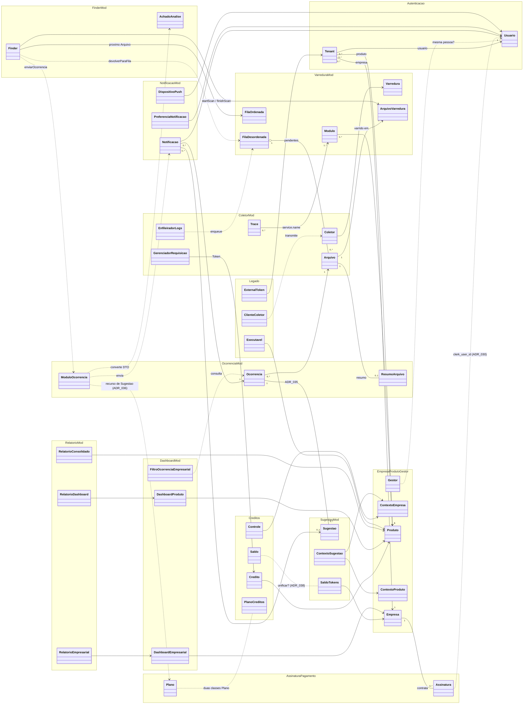

| Ligação | Situação |
|---|---|
| `Gestor .. Usuario` | `[PENDENTE]` a planilha só tem `Gestor`; o DER tem `Gestor` e `Usuario`; os usuários ficam na Clerk (ADR_021). Não está definido se Gestor é um tipo de Usuario. |
| `Assinatura ..> Usuario` | ADR_030: o `clerk_user_id` fica nas coleções de Assinaturas e Planos. Nenhuma das duas classes tem o campo. |
| `Saldo .. SaldoTokens` | `[CONFLITO]` dois controles de saldo (Créditos e Sugestão); a ADR_038 recomenda unificar `[PENDENTE]`. |
| `Plano .. PlanoCreditos` | `[CONFLITO]` duas classes chamadas `Plano`, com campos diferentes (módulo 3 e módulo 4). |
| `GerenciadorRequisicao --> Credito` | `[CONFLITO]` o campo `Token` está tipado como `Credito`. |
| `ModuloOcorrencia ..> Plano / Notificacao` | ADR_036/040: a criação da Ocorrência consulta o plano e dispara a Sugestão automática antes de notificar. |
| `ClienteColetor ..> Coletor` | `[INFERIDO]` a SDK legada transmitia ao Coletor (SSID_001). |

---

## 1. Empresa, Produto e Gestor

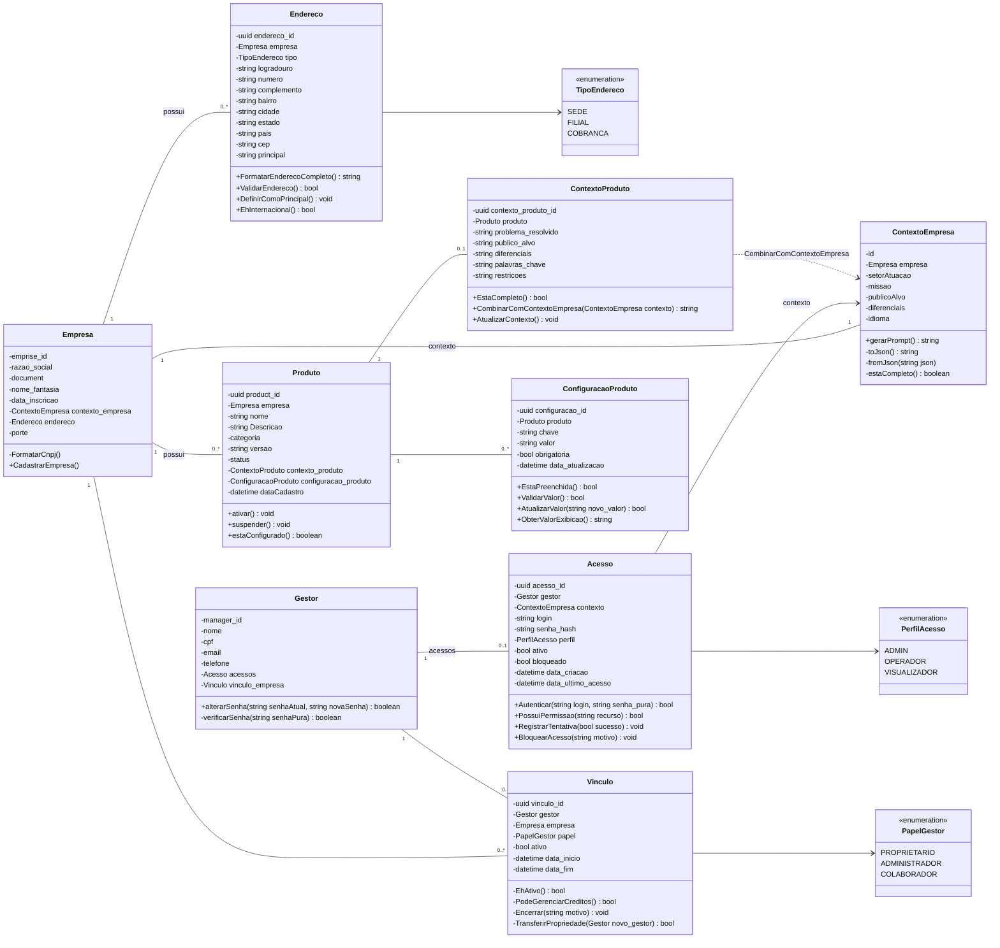

| Ponto | Situação |
|---|---|
| Tipos ausentes | `[A CONFERIR]` vários campos de `Empresa`, `ContextoEmpresa` e `Gestor` não têm tipo na planilha; mantidos sem tipo. |
| `Empresa.porte`, `Produto.categoria`, `Produto.status` | Valores na planilha (MEI, ME, EPP, Demais / ERP, CRM, e-commerce… / ativo, suspenso, em configuração), sem nome de enum `[PENDENTE]`. |
| `Empresa.endereco` (um) × `Endereco` (vários) | `[CONFLITO]` a planilha guarda um endereço na Empresa, mas o Guia fala em sede, filiais e cobrança e o DER liga Empresa 1:N Endereco; o diagrama usa 1:N. |
| `Produto.configuracao_produto` (um) × `ConfiguracaoProduto` (chave/valor) | Ligação 1:N `[INFERIDO]`: cada configuração é um par chave/valor. |
| `Gestor.alterarSenha`, `Acesso.senha_hash`, `Acesso.Autenticar()` | `[CONFLITO]` ADR_021/030: senha, sessão e MFA ficam na Clerk e o módulo de autenticação do LhamaLog não guarda dados de segurança. |
| `Vinculo` com todos os métodos privados | `[A CONFERIR]` como está na planilha. |

---

## 2. Autenticação e Tenant

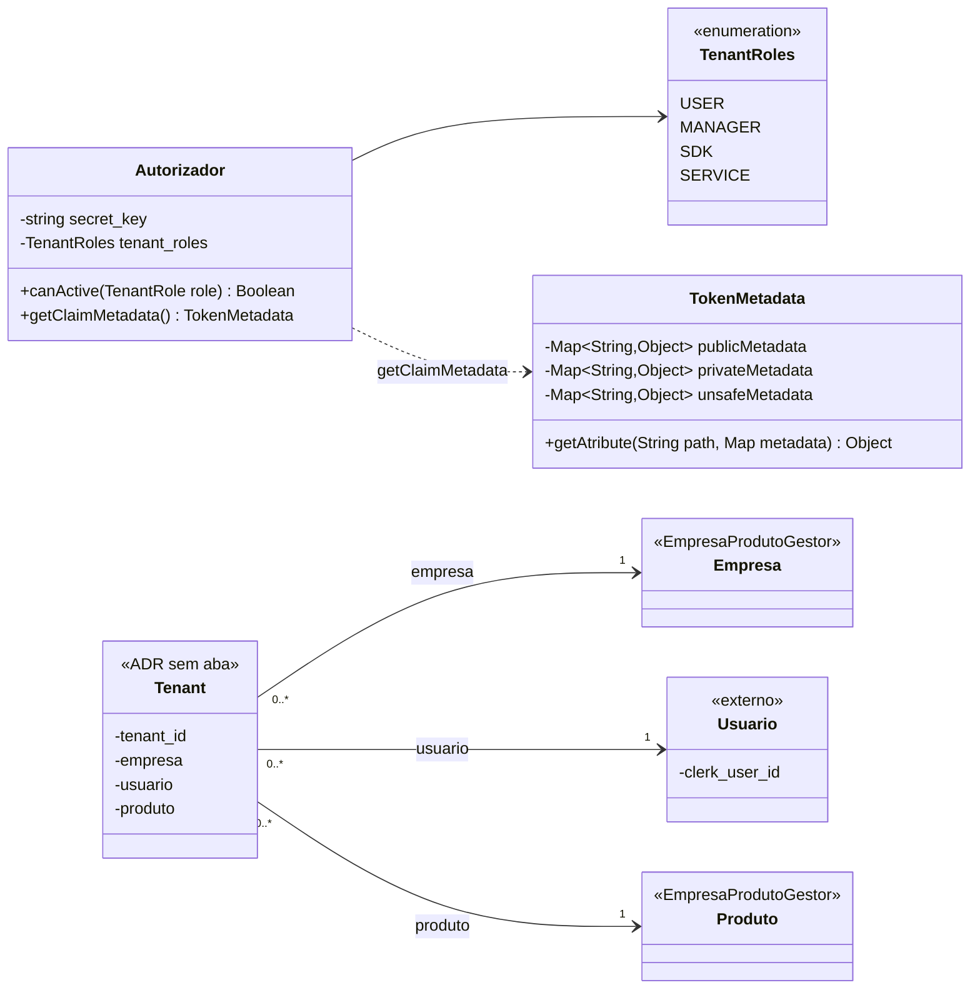

| Ponto | Situação |
|---|---|
| `Tenant` | ADR_030: coleção mestre com `tenant_id` único por empresa + usuário + produto (índice único composto, ADR_029); criado no webhook `user.created` (ADR_033). Sem aba na planilha. |
| `Tenant.usuario` | `[PENDENTE]` `clerk_user_id` ou id interno (ADR_030). |
| `Usuario` | Fica na Clerk (ADR_021); o LhamaLog guarda só o vínculo. Representado como externo. |
| `Autorizador` | O Guia chama de "Autenticador" `[A CONFERIR]`. O enum está rotulado `FileScanStatus` na planilha (cópia de outra aba) `[A CONFERIR]`; o atributo diz `TenantRoles` e o método recebe `TenantRole`. |
| `TokenMetadata` | Mapeia os metadados public/private/unsafe, que são os mesmos da Clerk (ADR_021). |
| JWT interno entre módulos | ADR_028 define um JWT próprio para API REST, Coletor, Finder e Fila; nenhuma classe representa esse emissor `[PENDENTE]`. `Autorizador` (secret_key + papéis SDK/SERVICE) pode ser esse ponto `[INFERIDO]`. |
| `APIToken`, `ExternalToken`, `AutorizadorSDK` | Legado (diagrama 13). |

---

## 3. Assinatura e Pagamento

```mermaid
classDiagram
    direction LR
    class GerenciadorAssinatura {
        +listarPlanosDisponiveis() List~Plano~
        +contratarPlano(UUID empresa_id, Plano plano) Assinatura
        +contratarPlano(String tenantId, Plano plano) Assinatura
        +alterarAssinatura(String assinaturaId, Plano novoPlano) Assinatura
        +cancelarAssinatura(String assinaturaId, Boolean imediato) void
        +solicitarReembolso(String pagamentoId, String motivo) Reembolso
        +aplicarEventoDeAssinatura(String assinaturaId, TipoOperacaoGateway tipoOperacao, EventoGateway evento) void
        +verificarInadimplencia(UUID empresa_id) Boolean
        +verificarInadimplencia(String tenantId) Boolean
        -calcularValorProporcional(UUID empresa_id) Decimal
        -calcularValorProporcional(String tenantId) Decimal
        -validarTransicaoDeStatus(StatusAssinatura atual, StatusAssinatura novo) Boolean
    }
    class Plano {
        -uuid plano_id
        -TipoPlano nome
        -String volumeArmazenamento
        -Integer diasRetencao
        -List~RecursoAnaliseIA~ recursosHabilitados
        -TipoDashboard dashboard
        -String moeda
        -Decimal valor
        -Periodicidade periodicidade
    }
    class TipoPlano {
        <<enumeration>>
        FREE
        STARTER
        PRO
        BUSINESS
        ENTERPRISE
    }
    class RecursosAnaliseIA {
        <<enumeration>>
        NENHUMA
        DETECCAO_ANOMALIAS
        INVESTIGACAO_AUTOMATICA
        RASTREIO_USUARIO
    }
    class TipoDashboard {
        <<enumeration>>
        BASICO
        PADRAO
        PERSONALIZADO
    }
    class Periodicidade {
        <<enumeration>>
        MENSAL
        ANUAL
    }
    class Assinatura {
        -String planoId
        -StatusAssinatura status
        -Date dataInicioVigencia
        -Date vigenciaAte
        -Date cancelamentoAgendadoPara
        -Integer diasCarencia
        -String criterioElegibilidadeReembolso
    }
    class StatusAssinatura {
        <<enumeration>>
        ATIVA
        PENDENTE
        INADIMPLENTE
        SUSPENSA
        CANCELAMENTO_AGENDADO
        CANCELADA
    }
    class ProcessamentoPagamento {
        +processarPagamento(String assinaturaId, Decimal valor) Pagamento
        +receberEventoGateway(EventoGateway evento) void
        +validarDadosEvento(EventoGateway evento) Boolean
        +reprocessarPagamentoFalho(String pagamentoId) StatusPagamento
        -validarAutenticidadeEvento(EventoGateway evento) Boolean
    }
    class GatewayPagamento {
        <<interface>>
        +enviarCobranca(Object dados) EventoGateway
        +consultarStatus(String referenciaExterna) StatusPagamento
        +solicitarReembolsoExterno(String referenciaExterna, Decimal valor) EventoGateway
        +validarAutenticidade(EventoGateway evento) Boolean
    }
    class ApiPagamento {
        -String baseUrl
        -String apiKey
        -String webhookSecret
        -String gatewayAtivo
        -Integer timeoutSegundos
        +enviarCobranca(Object dados) EventoGateway
        +consultarStatus(String referenciaExterna) StatusPagamento
        +solicitarReembolsoExterno(String referenciaExterna, Decimal valor) EventoGateway
        +validarAutenticidade(EventoGateway evento) Boolean
    }
    class Pagamento {
        -String assinaturaId
        -StatusPagamento status
        -Decimal valor
        -DateTime dataProcessamento
        -String referenciaGatewayExterno
        -String chaveIdempotencia
    }
    class StatusPagamento {
        <<enumeration>>
        PENDENTE
        PAGO
        RECUSADO
        ESTORNADO
    }
    class Reembolso {
        -String pagamentoId
        -String motivo
        -StatusReembolso status
        -DateTime dataSolicitacao
    }
    class StatusReembolso {
        <<enumeration>>
        SOLICITADO
        APROVADO
        NEGADO
        CONCLUIDO
    }
    class EventoGateway {
        -String payloadBruto
        -String origemGateway
        -DateTime recebidoEm
        -TipoOperacaoGateway tipoOperacao
        -ResultadoEventoGateway resultado
        -String motivoFalha
        -Boolean processado
    }
    class TipoOperacaoGateway {
        <<enumeration>>
        PRIMEIRA_COMPRA
        ATRASO
        CANCELAMENTO
        UPGRADE_DOWNGRADE
    }
    class ResultadoEventoGateway {
        <<enumeration>>
        SUCESSO
        FALHA
    }
    class Empresa {
        <<EmpresaProdutoGestor>>
    }

    GerenciadorAssinatura ..> Plano : listarPlanosDisponiveis
    GerenciadorAssinatura ..> Assinatura : contrata / altera / cancela
    GerenciadorAssinatura ..> Reembolso : solicitarReembolso
    GerenciadorAssinatura --> ProcessamentoPagamento : orquestra
    ProcessamentoPagamento ..> Pagamento : registra
    ProcessamentoPagamento --> GatewayPagamento : usa
    ApiPagamento ..|> GatewayPagamento
    GatewayPagamento ..> EventoGateway
    Assinatura "0..*" --> "1" Plano : planoId
    Pagamento "0..*" --> "1" Assinatura : assinaturaId
    Reembolso "0..*" --> "1" Pagamento : pagamentoId
    Empresa "1" -- "0..*" Assinatura : contrata
    Plano --> TipoPlano
    Plano --> RecursosAnaliseIA
    Plano --> TipoDashboard
    Plano --> Periodicidade
    Assinatura --> StatusAssinatura
    Pagamento --> StatusPagamento
    Reembolso --> StatusReembolso
    EventoGateway --> TipoOperacaoGateway
    EventoGateway --> ResultadoEventoGateway
```

| Ponto | Situação |
|---|---|
| Duas assinaturas por método | A planilha traz duas versões de `contratarPlano`, `verificarInadimplencia` e `calcularValorProporcional` (por `empresa_id` e por `tenantId`); as duas estão no diagrama `[PENDENTE]` qual fica. |
| `StatusAssinatura` | Valores tirados do Guia das Classes (Ativa, Pendente, Inadimplente, Suspensa, Cancelamento Agendado, Cancelada); a aba não lista o enum `[INFERIDO]`. |
| `ApiPagamento ..|> GatewayPagamento` | `[INFERIDO]` mesmos métodos da interface; a aba não declara "implements". |
| `Reembolso` | A aba está com o título "Nome da classe" `[A CONFERIR]`. |
| Enums do `EventoGateway` | Os dois enums estão rotulados "Enum StatusReembolso" na aba (cópia) `[A CONFERIR]`. |
| `Plano.recursosHabilitados` | O atributo diz `RecursoAnaliseIA` e o enum se chama `RecursosAnaliseIA` `[A CONFERIR]`. O DER tem `recursoIA` (Boolean) `[CONFLITO]`. Onde fica a flag da Sugestão (ADR_036) `[PENDENTE]`. |
| `clerk_user_id` | ADR_030 coloca o vínculo com o usuário da Clerk em Assinaturas e Planos; nenhuma das duas classes tem o campo `[PENDENTE]`. |

---

## 4. Créditos

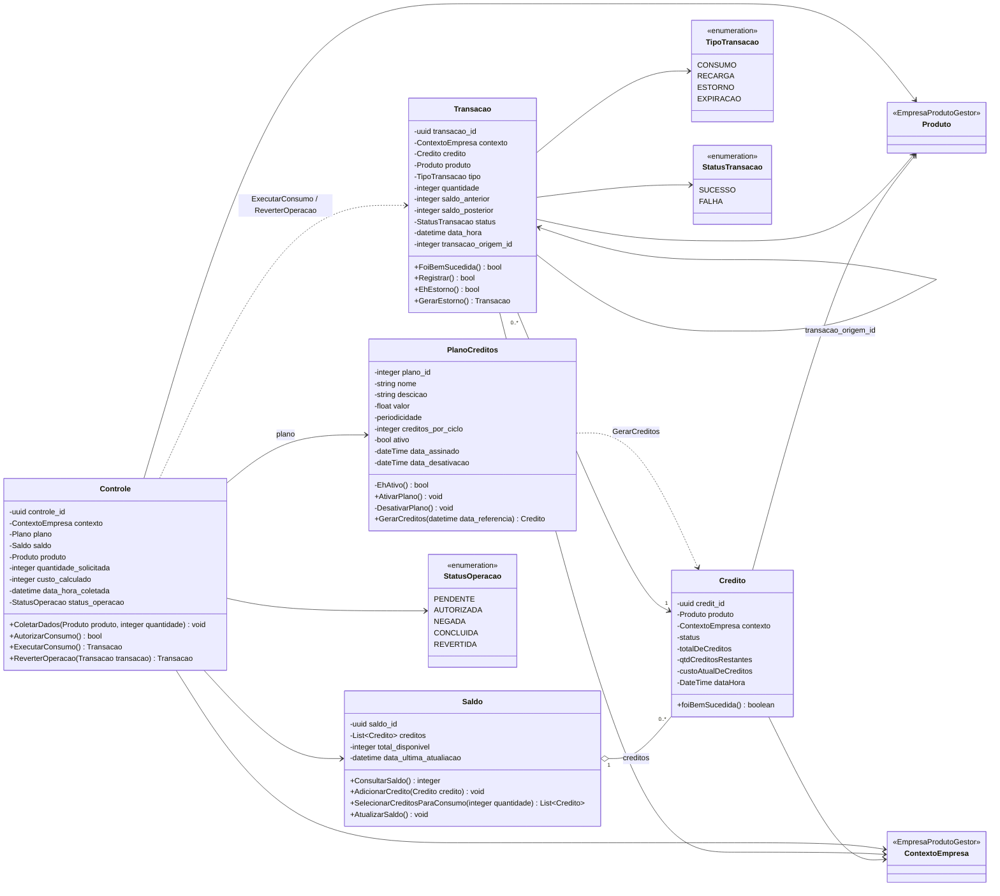

| Ponto | Situação |
|---|---|
| `PlanoCreditos` | `[CONFLITO]` a aba "Cópia de Modelo Padrão" define uma segunda classe `Plano` (com `creditos_por_ciclo` e `GerarCreditos()`), diferente do `Plano` de Assinatura. No diagrama aparece como `PlanoCreditos` para não colidir. |
| `Controle.plano: Plano` | `[CONFLITO]` não dá para saber qual dos dois `Plano`; ligado ao `PlanoCreditos`, do mesmo módulo `[INFERIDO]`. |
| `Credito` | `status`, `totalDeCreditos`, `qtdCreditosRestantes` e `custoAtualDeCreditos` sem tipo `[A CONFERIR]`. |
| Reserva de créditos (ADR_038) | Reserva, efetivação e liberação não existem em `TipoTransacao` nem em `StatusOperacao` `[PENDENTE]`. |
| `Saldo` × `SaldoTokens` | `[CONFLITO]` a ADR_038 recomenda unificar `SaldoTokens` (Sugestão) com o módulo Créditos `[PENDENTE]`. |

---

## 5. Coletor

```mermaid
classDiagram
    direction LR
    class Coletor {
        -GerenciadorRequisicao GerenciadorRequisicao
        -GerenciadorLote GerenciadorLote
        -Varredura Varredura
        -EnfileiradorLogs EnfilerarLog
        +ReceberLog() GerenciadorRequisicao
        +EnviarLote() List~Arquivo~
        +EnviarArquivo() Arquivo
    }
    class GerenciadorRequisicao {
        -Credito Token
        -uuid ProdutoId
        -uuid EmpresaId
        -LogRecebido LogRecebido
        +PersistirLog() void
        -ValidarContexto() boolean
        -ValidarOrigem() boolean
        +LocalizarLog() LogRecebido
    }
    class LogRecebido {
        -uuid logId
        -uuid empresaId
        -uuid produtoId
        -Arquivo Arquivo
        -DateTime DataRecebido
        +AssociarLogLote() void
    }
    class GerenciadorLote {
        -LoteAgrupador LoteAgrupador
        -Log TamanhoMaximoByte
        -Int QauntidadeMaximaLog
        +CriarLotes() List~LoteAgrupador~
        +CriarLoteUnico() LoteAgrupador
        +ValidarLote() boolean
    }
    class LoteAgrupador {
        -uuid loteId
        -uuid empresaId
        -uuid produtoId
        -List~LogRecebido~ Logs
        -boolean Enviado
        +AdicionarLog() void
    }
    class EnfileiradorLogs {
        -GerenciadorLote GerenciadorLote
        +EnfilerarLote() void
    }
    class Arquivo {
        -uuid id
        -string bucket_URL
        -timestamp imported_at
        -string extension
        -int size_mb
        -uuid owner_id
        -uuid product_id
        -uuid company_id
        -bool is_deleted
        -timestamp generated_at
        -int trace_count
        +loadLines() Stream~String~
        +destroy()
        +getTraces() Trace[]
    }
    class Trace {
        -uuid id
        -uuid arquivo_id
        -string trace_id
        -string correlation_id
        -string host_name
        -timestamp generated_at
        -uuid[] modulo_ids
        -NivelPrioridade prioridade
        +resolvePrioridade(Modulo[] modulos) NivelPrioridade
    }
    class Varredura {
        <<Varredura>>
    }
    class FilaDesordenada {
        <<Varredura>>
    }
    class Modulo {
        <<Varredura>>
    }
    class Credito {
        <<Creditos>>
    }

    Coletor --> GerenciadorRequisicao : ReceberLog
    Coletor --> GerenciadorLote
    Coletor --> EnfileiradorLogs
    Coletor --> Varredura
    Coletor ..> Arquivo : EnviarLote / EnviarArquivo
    GerenciadorRequisicao --> LogRecebido
    GerenciadorRequisicao --> Credito : Token
    LogRecebido "0..*" --> "0..1" Arquivo
    GerenciadorLote --> LoteAgrupador
    LoteAgrupador "1" o-- "1..*" LogRecebido : Logs
    EnfileiradorLogs --> GerenciadorLote
    EnfileiradorLogs ..> FilaDesordenada : enqueue
    Arquivo "1" *-- "1..*" Trace : agrupa (ADR_015)
    Trace "0..*" --> "1..*" Modulo : passou por
```

| Ponto | Situação |
|---|---|
| `Arquivo`, `Trace` | Versão v2 (ADR_015): `generated_at`, `trace_count`, `getTraces()` e a classe `Trace` são `[INFERIDO]` na própria planilha v2. |
| `Arquivo 1 *-- 1..* Trace` | Cardinalidade da v2. O DER v2 usa 0..*, e um arquivo enviado manualmente pode não ter traces `[CONFLITO]`. |
| `GerenciadorRequisicao.Token: Credito` | `[CONFLITO]` tipo errado (Créditos em vez de credencial). A credencial de ingestão é própria (ADR_025/028), sem classe do lado do servidor `[PENDENTE]`. |
| `GerenciadorLote.TamanhoMaximoByte: Log` | `[A CONFERIR]` o tipo `Log` não existe. |
| `EnfileiradorLogs ..> FilaDesordenada` | `[INFERIDO]` (DC-08); a planilha não liga as duas. |
| Tipos corrigidos | `GeremciadorRequisicao` → `GerenciadorRequisicao`, `EnfilerarLog` → `EnfileiradorLogs`, para a ligação apontar para a classe certa. A aba `EnfileiradorLogs` chama a classe de `EnfileiradorLog`. |
| Classes de lote | `GerenciadorLote`, `LoteAgrupador` e `EnfileiradorLogs` não aparecem em nenhuma ADR `[PENDENTE]`. |

---

## 6. Varredura

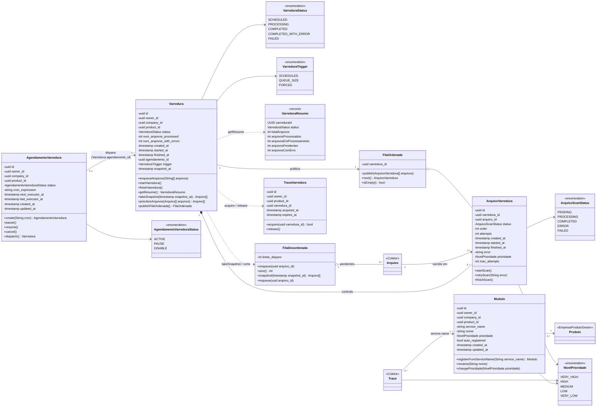

| Ponto | Situação |
|---|---|
| Fonte | Abas v2 (r2), sem mudança de nomes, como no `diagrama_classes_varredura_finder_v2.md`. |
| `VarreduraTrigger.FORCED` | `[INFERIDO]` na v2 (USID_025/SSID_005). A ADR_010 só define agendamento e tamanho da fila. |
| Status | `[CONFLITO]` a planilha tem `VarreduraStatus` com `SCHEDULED`… `FAILED` e `ArquivoScanStatus` com `ERROR`/`FAILED`; o DER v2 usa `PENDING`, `PROCESSING`, `COMPLETED`, `COMPLETED_WITH_ERROR` para os dois. |
| `getResume()` | A planilha escreve `VarreduraResume` no retorno e `VarreduraResumo` no tipo `[A CONFERIR]`. |
| `max_attempts`, `limite_disparo`, `TravaVarredura.expires_at` e escopo da trava | `[PENDENTE]` (ADR_010/014). |
| `takeSnapshot()`, `prioritizeArquivos()`, `publishFilaOrdenada()`, `dispatch()`, `ArquivoVarredura.prioridade` | `[INFERIDO]` na própria v2. |
| `Modulo → Produto` | O DER v2 liga Produto 1:N Modulo `[INFERIDO Produto como dono]`. |

---

## 7. Finder (ADR_011, ADR_016 a ADR_019, ADR_040)

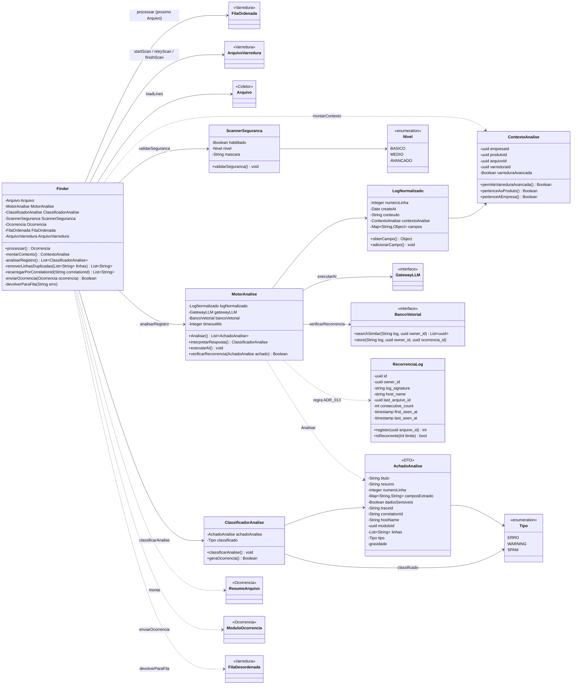

| Ponto | Situação |
|---|---|
| Nomes | ADR_016: valem os nomes do modelo original (`MotorAnalise`, `ClassificadorAnalise`, `processar`/`montarContexto`/`analisarRegistro`, `ScannerSegurança`). As abas da primeira v2 (`AgenteLLM`, `ResultadoClassificacao`, `ClassificacaoLog`, adições de Finder e de Ocorrência) ficaram de fora. |
| Quem chama a classificação | ADR_017: o Finder chama `classificarAnalise()`; o `MotorAnalise` fala só com a LLM e com o `BancoVetorial`. |
| `GatewayLLM` | ADR_018: exclusivo do Finder/MotorAnalise. A ADR_039 renomeou a interface do módulo Sugestão para `GatewayLLMSugestao`, então o nome `GatewayLLM` fica com o Finder. Métodos e implementação não estão definidos `[PENDENTE]`; a v2 dizia "reaproveita a do módulo Sugestão" `[A CONFERIR]`, o que a ADR_018 substitui. |
| Enum `Tipo` | ADR_019: `ERRO`, `WARNING`, `SPAM`; `INFO` removido. `RECORRENTE` como valor ou atributo `[PENDENTE]`. A aba v2 ainda tem `INFO` e `RECORRENTE`. |
| `AchadoAnalise` | ADR_040: DTO sem coleção, convertido na Ocorrência concreta. Campos = aba original (`titulo`, `resumo`, `numeroLinha`, `camposExtraido`, `dadosSensiveis`) + adições v2 (`traceId`, `correlationId`, `hostName`, `moduloId`, `linhas`) + `tipo` e `gravidade` (ADR_017/040). Valores e dono da `gravidade` `[PENDENTE]`. |
| `LogNormalizado` | A aba original existe e tem campos; a v2 dizia "aba não transcrita". |
| `processar(): Ocorrencia`, `enviarOcorrencia(Ocorrencia)`, `Finder.Ocorrencia` | A planilha ainda usa a Ocorrência-resumo da ADR_020. Pelas ADR_035/040, o Finder entrega o resumo + os `AchadoAnalise`, e a Ocorrência concreta nasce no módulo de Ocorrência `[PENDENTE ajustar as assinaturas]`. |
| `validarSeguranca(): void` | `[A CONFERIR]` não devolve as linhas mascaradas nem a contagem de `dadosSensiveisIdentificados` (ADR_016). |
| `ScannerSeguranca.nível` | Escrito com acento na planilha; o enum `Nivel` tem `AVANÇADO` (sem acento no diagrama). |
| `BancoVetorial`, `RecorrenciaLog` | Classes v2; critério de semelhança, isolamento e limite 3 ou 4 `[PENDENTE]` (ADR_013). |
| `AchadoAnalise.traceId` / `moduloId` | Apontam para `Trace` e `Modulo` (ver visão geral). |

---

## 8. Ocorrência (ADR_020, ADR_035, ADR_036, ADR_040)

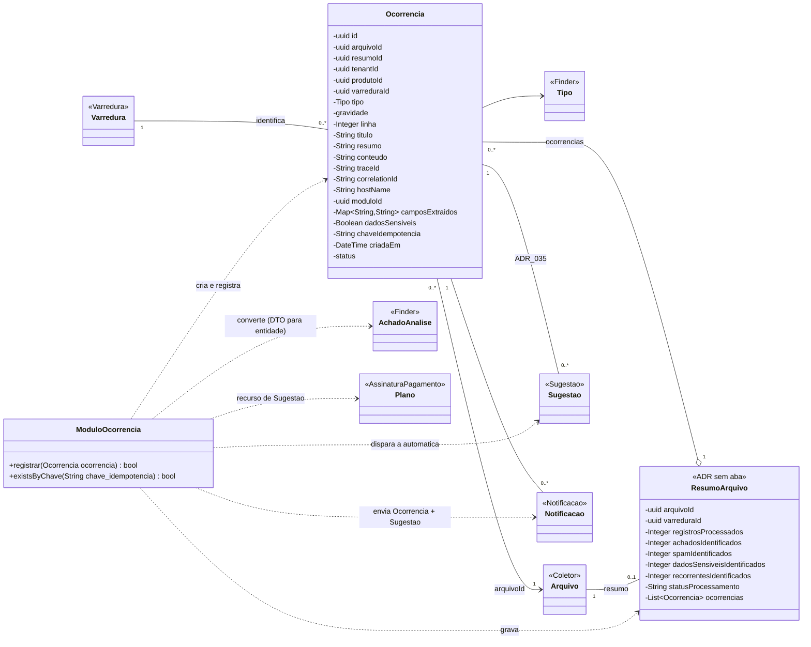

| Ponto | Situação |
|---|---|
| Modelo | ADR_035/040: cada erro/warning do Arquivo vira uma `Ocorrencia` concreta (documento próprio); o resumo por Arquivo agrupa as Ocorrências e guarda os contadores; spam não vira Ocorrência. |
| `ResumoArquivo` | Nome `[PENDENTE]` (a ADR_035 sugere `ResumoArquivo` ou `RelatorioProcessamento`). Os contadores vêm da antiga `Ocorrencia v2`; `spamIdentificados` substitui `informacaoIdentificados` (ADR_019/020). `recorrentesIdentificados` `[INFERIDO]`; valores de `statusProcessamento` `[PENDENTE]`. |
| Campos da `Ocorrencia` | Mapeamento da ADR_040 (`numeroLinha` → `linha`, `linhas` → `conteudo`, `camposExtraido` → `camposExtraidos`). `resumoId`, `tenantId`, `produtoId` e `varreduraId` são `[INFERIDO]` na própria ADR. Valores de `status` e de `gravidade` `[PENDENTE]`. |
| `chaveIdempotencia` | Para a Ocorrência concreta `[PENDENTE]` (ADR_035/040); sugestão da ADR: `arquivoId + traceId/correlationId + linha`. |
| `ModuloOcorrencia` | Classe v2 `[INFERIDO]`. Quem converte o DTO na Ocorrência também é `[INFERIDO]` na ADR_040. As ligações com Plano, Sugestão e Notificação vêm da ADR_036 (automático síncrono, ADR_040). |
| Métodos do Guia | O Guia descreve "estimar a idade da ocorrência" e "liberar a criação de uma sugestão", sem método na aba `[PENDENTE]`. |
| Abas antigas | `Ocorrencia` (original) e `Ocorrencia v2` descrevem o resumo; viraram `ResumoArquivo` aqui. |

---

## 9. Sugestão (ADR_018, ADR_035 a ADR_040)

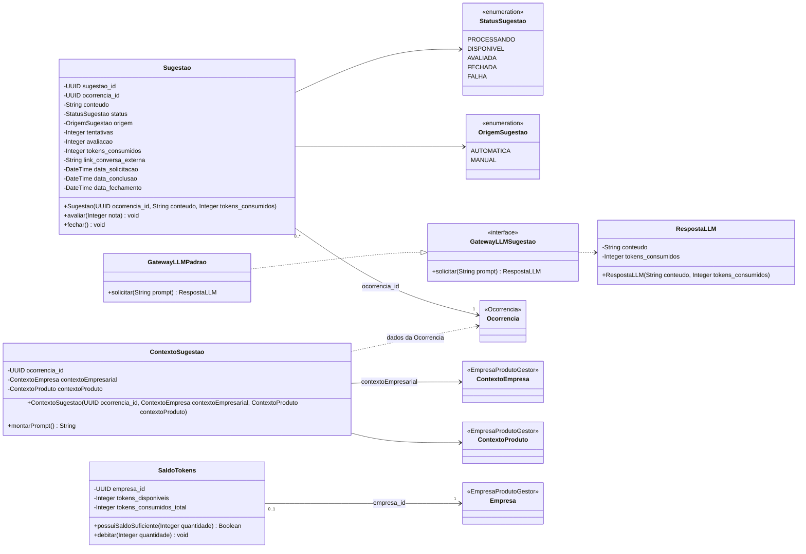

| Ponto | Situação |
|---|---|
| `GatewayLLMSugestao` | ADR_039: nome novo da interface `GatewayLLM` do módulo Sugestão, separada da do Finder (ADR_018). `GatewayLLMPadrao` continua sendo a implementação. Provedor e modelo `[PENDENTE]`. |
| `StatusSugestao.FALHA` | Novo estado da ADR_037, `[INFERIDO]` na própria ADR. |
| `origem`, `tentativas` | ADR_036/037, `[INFERIDO]`. Não estão na aba. |
| `Sugestao → Ocorrencia` | ADR_035: a Sugestão pertence a uma Ocorrência concreta (1 Ocorrência : N Sugestões). |
| `ContextoSugestao.contextoEmpresarial` | O tipo na aba é `ContextoEmpresarial`, que não existe; a classe é `ContextoEmpresa` (tipo corrigido no diagrama). Pela ADR_039, o prompt também leva as avaliações anteriores da mesma Ocorrência, sem campo para isso `[PENDENTE]`. |
| Avaliações | A classe tem uma `avaliacao: Integer`; o DER tem `AvaliacaoSugestao` 1:N e a ADR_039 usa várias avaliações por Sugestão `[CONFLITO]`. `AvaliacaoSugestao` não tem aba. |
| Reserva de tokens | ADR_038: reserva antes da chamada e efetivação depois; `SaldoTokens` só tem `possuiSaldoSuficiente()` e `debitar()` `[PENDENTE]`. Unificação com Créditos `[PENDENTE]`. |
| Orquestração | Fila de baixa prioridade, worker e o "módulo de Sugestão" que chama o gateway (ADR_036/040) não têm classe `[PENDENTE]`. |

---

## 10. Notificação

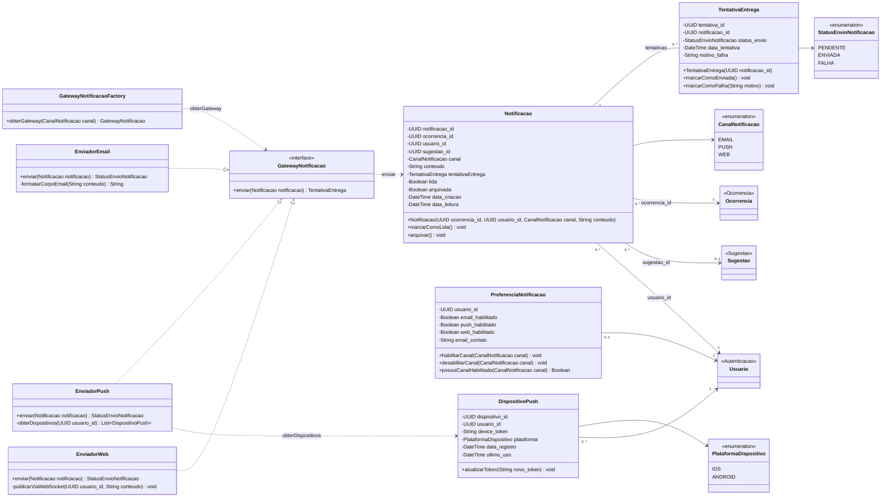

| Ponto | Situação |
|---|---|
| Retorno de `enviar()` | `[CONFLITO]` a interface devolve `TentativaEntrega`; os três enviadores devolvem `StatusEnvioNotificacao`. |
| `Notificacao.tentativaEntrega` (uma) × várias tentativas | `[CONFLITO]` a classe guarda uma tentativa; `TentativaEntrega` tem `notificacao_id` e o DER liga Notificacao 1:N TentativaEntrega; o diagrama usa 1:N. |
| Construtor sem `sugestao_id` | A classe tem o atributo, mas o construtor não recebe `[PENDENTE]`. Tipo de notificação (Ocorrência, Ocorrência + Sugestão, falha da Sugestão) e templates `[PENDENTE]` (ADR_036/037). |
| `Notificacao → Ocorrencia` | Agora aponta para a Ocorrência concreta (ADR_035/040). |
| DER × classe | O DER tem `titulo`, `status` e `severidadeMinima`; a classe tem `arquivada`, `data_leitura`, `sugestao_id`, `email_contato` `[CONFLITO]`. |
| `StatusEnvioNotificacao.PENDENTE` | É valor de enum, sem relação com a marcação `[PENDENTE]`. |
| `EnviadorPush` | App móvel em STANDBY (ADR_025). |

---

## 11. Dashboard

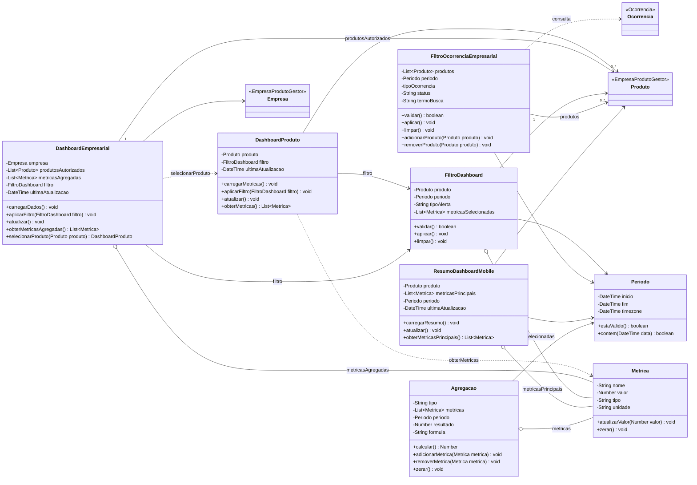

| Ponto | Situação |
|---|---|
| `DashboardProduto` | Tem uma linha "Privado" sem nome nem tipo na aba `[A CONFERIR]`. |
| `Periodo.timezone: DateTime` | `[A CONFERIR]` fuso horário tipado como data. |
| `FiltroOcorrenciaEmpresarial.tipoOcorrencia: Enum` | Enum sem nome; com a ADR_019 seria o `Tipo` (`ERRO`, `WARNING`) `[INFERIDO]`. A ligação com `Ocorrencia` é `[INFERIDO]` pelo nome. |
| `Agregacao.formula` | `[PENDENTE]` na própria aba. |
| `ResumoDashboardMobile` | App móvel em STANDBY (ADR_025). |
| De onde vêm as métricas | Nenhuma classe liga as métricas aos dados de Ocorrência/Varredura `[PENDENTE]`. |

---

## 12. Relatório

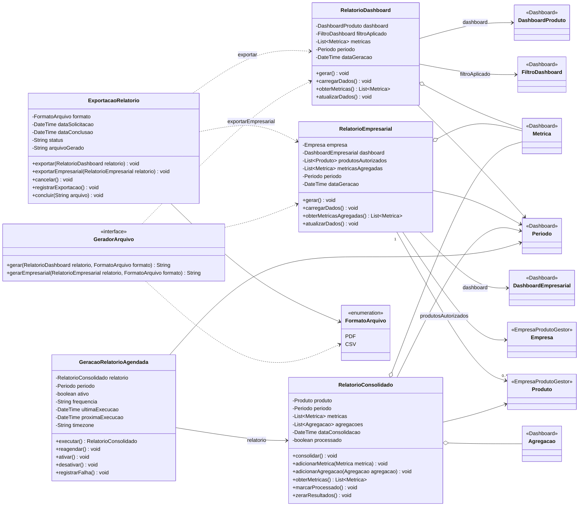

| Ponto | Situação |
|---|---|
| `GeradorArquivo` | Interface sem implementação e sem quem a use na planilha `[PENDENTE]`. |
| `GeracaoRelatorioAgendada.frequencia` e `timezone` | `[PENDENTE]` na própria aba. |
| `FormatoArquivo` | Enum de exportação de relatório; não tem relação com os formatos aceitos no upload manual (DC-09). |
| `ExportacaoRelatorio.status` | Valores não definidos `[PENDENTE]`. |

---

## 13. Legado (SDK, Executável e tokens antigos)

O OpenTelemetry Collector substituiu a SDK e o Executável (ADR_007), e o DER v2 marca `Executavel` e `ExternalToken`
como `MOD_LEGADO`. As classes ficam aqui para referência.

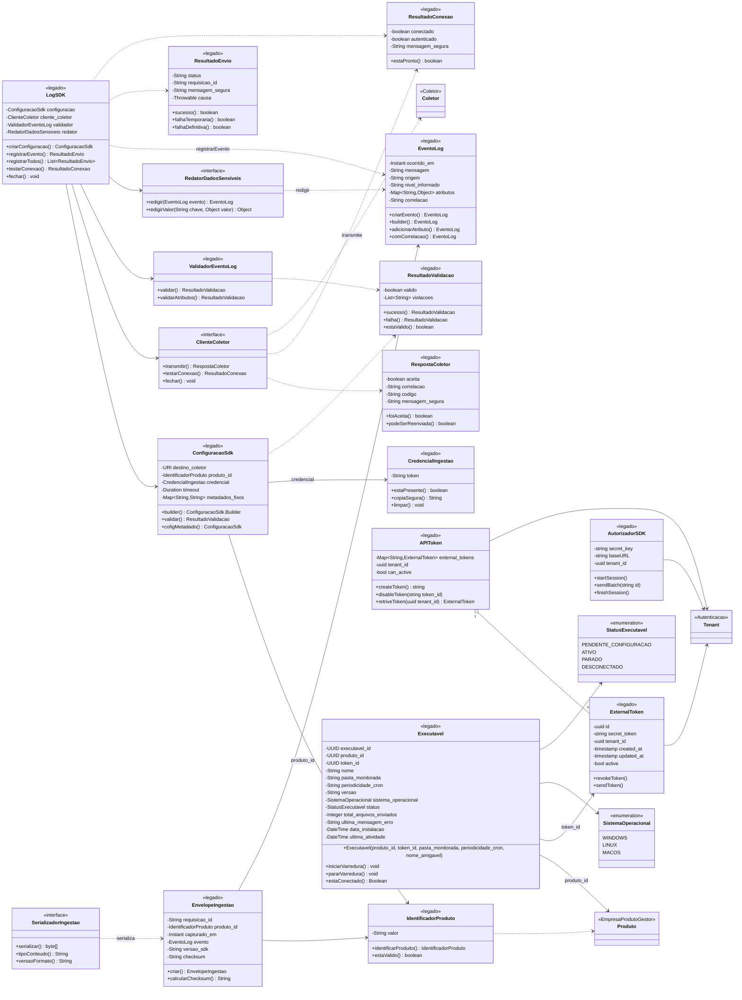

| Ponto | Situação |
|---|---|
| `CredencialIngestao` | A classe é do lado da SDK, mas o conceito continua: a ingestão do Collector usa uma credencial própria do LhamaLog (ADR_025/028), cujo registro no servidor (status, expiração, revogação) só existe no DER `[PENDENTE classe]`. |
| `APIToken.external_tokens` | O tipo na aba é `ExternaToken`, que não existe (tipo corrigido no diagrama). |
| `AutorizadorSDK` | Marcada legado por ser da SDK `[INFERIDO]`. |
| `Executavel.token_id → ExternalToken` | `[INFERIDO]` pelo Guia ("identificador do Token usado para autenticação"). |
| `SerializadorIngestao ..> EnvelopeIngestao`, `ClienteColetor ..> Coletor`, `IdentificadorProduto ..> Produto` | `[INFERIDO]` pelas descrições do Guia. |
| `RedatorDadosSensiveis` | Mascaramento do lado do cliente na SDK; com o OTel, o equivalente é o processador de redação do Collector, configurado pelo cliente. |

---

## Classes fora do diagrama

| Classe / aba | Motivo |
|---|---|
| `AgenteLLM`, `ResultadoClassificacao`, `ClassificacaoLog` | Primeira v2, substituídas por `MotorAnalise`, `ClassificadorAnalise` e o enum `Tipo` (ADR_016; aba "Mudanças v2 (r2)"). |
| `Finder (adições v2)`, `Ocorrência (adições v2)` | Substituídas por `Finder v2`, `Ocorrencia v2` e `AchadoAnalise (adições v2)`. |
| `Modelo Padrão` | Modelo vazio da planilha. |
| Entidades só do DER: `Usuario` (como tabela), `Configuracao2FA`, `PermissaoProduto`, `PoliticaRetencao`, `IntegracaoOpenTelemetry`, `FonteTelemetria`, `HistoricoOcorrencia`, `AvaliacaoSugestao`, `TraceModulo` | Não têm aba na planilha. `Configuracao2FA` tende a sair do escopo (ADR_024/030). |

## Tipos corrigidos no diagrama (a planilha não foi alterada)

Só onde o tipo apontava para uma classe que não existe; os demais erros de digitação foram mantidos.

| Onde | Na planilha | No diagrama |
|---|---|---|
| `Coletor` | `GeremciadorRequisicao`, `EnfilerarLog` | `GerenciadorRequisicao`, `EnfileiradorLogs` |
| `ContextoSugestao` | `ContextoEmpresarial` | `ContextoEmpresa` |
| `APIToken` | `ExternaToken` | `ExternalToken` |
| `Finder`, `MotorAnalise`, `Ocorrencia` | `ClassidicadoAnalise`, `AchadoAnlise`, `acahdosIdentificados` | já corrigidos pela v2 (r2) |

Mantidos como estão `[A CONFERIR]`: `emprise_id`, `descicao`, `data_ultima_atualiacao`, `QauntidadeMaximaLog`,
`EnfilerarLote`, `identificarProduito`, `cofigMetadado`, `retriveToken`, `getAtribute`.

## Notas obrigatórias (consolidado)
- **`[CONFLITO]`** duas classes `Plano` (Assinatura e Créditos); `Controle.plano` ambíguo.
- **`[CONFLITO]`** `Saldo`/`Credito` (Créditos) × `SaldoTokens` (Sugestão); ADR_038 recomenda unificar.
- **`[CONFLITO]`** `Gestor`/`Acesso` com senha e autenticação próprias × ADR_021/030 (Clerk).
- **`[CONFLITO]`** `GerenciadorRequisicao.Token: Credito`.
- **`[CONFLITO]`** status de `Varredura`/`ArquivoVarredura`: planilha × DER v2.
- **`[CONFLITO]`** retorno de `GatewayNotificacao.enviar()` × enviadores; `Notificacao` com uma tentativa × 1:N.
- **`[CONFLITO]`** `Plano.recursosHabilitados` (lista) × `recursoIA` (Boolean, DER); `Sugestao.avaliacao` (uma) × várias avaliações (ADR_039, DER).
- **`[CONFLITO]`** `Arquivo 1..* Trace` (v2) × 0..* (DER v2).
- **`[PENDENTE]`** relação `Gestor` × `Usuario` (Clerk); `clerk_user_id` em Assinaturas/Planos (ADR_030).
- **`[PENDENTE]`** nome do resumo por Arquivo; chave de idempotência, `status` e `gravidade` da Ocorrência concreta (ADR_035/040).
- **`[PENDENTE]`** assinaturas do Finder que ainda usam a Ocorrência-resumo (`processar()`, `enviarOcorrencia()`).
- **`[PENDENTE]`** métodos/implementação do `GatewayLLM` do Finder; retorno de `validarSeguranca()`.
- **`[PENDENTE]`** classes para: credencial de ingestão no servidor, emissor do JWT interno (ADR_028), orquestração da Sugestão (fila e worker), reserva de créditos (ADR_038), `AvaliacaoSugestao`.
- **`[PENDENTE]`** `RECORRENTE` no enum `Tipo`; flag da Sugestão no Plano; tipo e templates da Notificação.
- **`[A CONFERIR]`** enums com rótulo copiado (`Autorizador`, `EventoGateway`), aba `Reembolso` sem título, campos sem tipo.

**Rastreabilidade:** `Modelo_de_Classes_LhamaLog_v2.xlsx` (93 abas originais + 27 abas v2); `diagrama_classes_varredura_finder_v2.md`;
`der.md` v2; ADR_007, 009, 010, 013–021, 024, 025, 028–030, 033, 035–040.

**Renderização:** PNGs gerados com o mermaid-cli (`mmdc`, tema neutral, fundo branco) e escala 2, um por seção, com o
número da seção no nome (`classes_00_visao_geral.png` a `classes_13_legado.png`).
