# Diagrama de Classes v2 — Varredura e Finder (LhamaLog)

**Versão 2, revisão r2 (02/10/2026, 22h).** Decisão do Michel: **os nomes do Modelo de Classes original prevalecem**
sobre os da primeira v2 e dos diagramas de sequência v1. Por isso a r2 reaproveita as classes originais do Finder
(`Finder.processar()`, `montarContexto()`, `analisarRegistro()`, `MotorAnalise`, `ClassificadorAnalise`, `ScannerSegurança`,
`ContextoAnalise`, `Ocorrencia` com `List<AchadoAnalise>`) em vez de criar classes paralelas.
Nada da v1 foi alterado: as abas originais continuam na planilha `Modelo de Classes LhamaLog`.

Fontes: abas originais do modelo de classes (Varredura, Arquivo Varredura, Agendamento Varredura, Arquivo, Finder, MotorAnalise,
ClassificadorAnalise, ScannerSegurança, ContextoAnalise, Ocorrencia), ADR_004 a ADR_015 e os diagramas de sequência
(`Atualização - 02/10 > Diagramas de Sequencia v2`: `finder_v2.png`, `varredura_v2.png`).
Planilha: `Modelo de Classes LhamaLog v2` (abas v2) e `modelo_classes_finder_v2_r2.xlsx` (abas da r2).

Marcações: `[INFERIDO]` ligação feita por nós; `[PENDENTE]` indefinido nas ADRs; `[A CONFERIR]` decisão para o Michel
ou aba original ainda não transcrita. No Mermaid as marcações ficam fora; estão nas colunas D e F das abas v2.

> O PNG `diagrama_classes_varredura_finder_v2.png` desta pasta pode ainda mostrar a primeira v2 (com AgenteLLM) até ser
> substituído pela nova versão; o código Mermaid abaixo é a referência atual.

## Mapa de nomes: primeira v2 -> r2 (original)

| Primeira v2 (descartado) | r2 (nome do original) |
|---|---|
| `AgenteLLM` | `MotorAnalise` (com `GatewayLLM` por baixo) |
| `AgenteLLM.classify(contexto)` | `MotorAnalise.executarAI()` + `Analisar()` + `interpretarResposta()` |
| `AgenteLLM.analyzeCorrelation(logs)` | `MotorAnalise.verificarRecorrencia(achado)` (BancoVetorial + RecorrenciaLog) |
| `ResultadoClassificacao` | `ClassificadorAnalise` (`achadoAnalise`, `classificado: Tipo`) |
| enum `ClassificacaoLog` (ERRO, ALERTA, RECORRENTE, SPAM) | enum `Tipo` do ClassificadorAnalise (ERRO, WARNING, INFO + RECORRENTE, SPAM) |
| `Finder.consume(fila)` | `Finder.processar()` |
| `Finder.buildOcorrencia(resultado)` | dentro de `Finder.processar()` |
| `Finder.removeDuplicateLines()` | `Finder.removerLinhasDuplicadas()` (chamado em `montarContexto()`) |
| `Finder.reloadByCorrelationId()` | `Finder.recarregarPorCorrelationId()` |
| `Finder.sendOcorrencia()` | `Finder.enviarOcorrencia()` |
| campos por log na `Ocorrência (adições v2)` (traceId, correlationId, classificacao, recorrente, hostName, moduloId) | `AchadoAnalise` (por achado) + `ClassificadorAnalise.classificado` |
| `Ocorrência.chave_idempotencia` = trace_id / arquivo_id | `Ocorrencia.chaveIdempotencia` = arquivoId (uma Ocorrencia por Arquivo) |

## Classes

| Classe | Módulo | Tipo | Situação na v2 | Planilha |
|---|---|---|---|---|
| `Varredura` | Varredura | Classe | alterada (cópia da aba original + mudanças) | aba `Varredura v2` |
| `ArquivoVarredura` | Varredura | Classe | alterada (cópia da aba original + mudanças) | aba `ArquivoVarredura v2` |
| `AgendamentoVarredura` | Varredura | Classe | alterada (cópia da aba original + mudanças) | aba `AgendamentoVarredura v2` |
| `Arquivo` | Coletor | Classe | alterada (cópia da aba original + mudanças) | aba `Arquivo v2` |
| `Trace` | Coletor | Classe | nova | aba `Trace` |
| `Modulo` | Varredura | Classe | nova | aba `Modulo` |
| `NivelPrioridade` | Varredura | Enum | nova | aba `NivelPrioridade` |
| `FilaDesordenada` | Varredura | Classe | nova | aba `FilaDesordenada` |
| `FilaOrdenada` | Varredura | Classe | nova | aba `FilaOrdenada` |
| `TravaVarredura` | Varredura | Classe | nova | aba `TravaVarredura` |
| `BancoVetorial` | Finder | Interface | nova | aba `BancoVetorial` |
| `RecorrenciaLog` | Finder | Classe | nova | aba `RecorrenciaLog` |
| `ModuloOcorrencia` | Finder | Classe | nova | aba `ModuloOcorrencia` |
| `Finder` | Finder | Classe | alterada (cópia da aba original + mudanças) | aba `Finder v2` |
| `MotorAnalise` | Finder | Classe | alterada (cópia da aba original + mudanças) | aba `MotorAnalise v2` |
| `ClassificadorAnalise` | Finder | Classe | alterada (cópia da aba original + mudanças) | aba `ClassificadorAnalise v2` |
| `Ocorrencia` | Finder | Classe | alterada (cópia da aba original + mudanças) | aba `Ocorrencia v2` |
| `AchadoAnalise` | Finder | Classe | somente adições (aba original não transcrita) | aba `AchadoAnalise (adições v2)` |
| `ScannerSegurança` | Finder | original | sem alteração | aba original |
| `ContextoAnalise` | Finder | original | sem alteração | aba original |
| `GatewayLLM (Interface)` | Sugestão | original | sem alteração | aba original |
| `LogNormalizado` | Finder | original | sem alteração | aba original |

## Mudanças em classes que já existiam no original

- **Varredura v2**: Adicionado agendamento_id:uuid (opcional): o Agendamento deixa de apontar para uma única Varredura; cada Varredura aponta para o agendamento que a disparou.
- **Varredura v2**: Adicionados trigger:VarreduraTrigger (SCHEDULED, QUEUE_SIZE, FORCED) e snapshot_at:timestamp.
- **Varredura v2**: Adicionados takeSnapshot(), prioritizeArquivos(), publishFilaOrdenada() [INFERIDO].
- **Varredura v2**: Imagem da classe refeita: status com os valores do enum (em ingles, como na célula) e correção de 'onwer_id' para 'owner_id'.
- **ArquivoVarredura v2**: Nome do enum na coluna D corrigido de 'Enum FileScanStatus' para 'Enum ArquivoScanStatus' (igual ao tipo do atributo).
- **ArquivoVarredura v2**: Adicionados prioridade:NivelPrioridade [INFERIDO] e max_attempts:int [PENDENTE].
- **ArquivoVarredura v2**: Descrição (coluna D) do comportamento de retryScan/finishScan conforme ADR_014 e o diagrama finder.png.
- **ArquivoVarredura v2**: Imagem da classe refeita: incluído arquivo_id (estava na célula, faltava na imagem) e status com os valores do enum.
- **AgendamentoVarredura v2**: varredura_id:uuid marcado como [REMOVIDO na v2] (riscado, não apagado) - regra: Agendamento não aponta para uma única Varredura.
- **AgendamentoVarredura v2**: create(cron:String, varredura_id:uuid) riscado e substituído por create(cron:String):AgendamentoVarredura.
- **AgendamentoVarredura v2**: Nome do enum na coluna D corrigido de 'Enum VarreduraStatus' para 'Enum AgendamentoVarreduraStatus'.
- **AgendamentoVarredura v2**: Adicionado dispatch():Varredura [INFERIDO].
- **Arquivo v2**: Adicionados generated_at:timestamp e trace_count:int [INFERIDO] e o metodo getTraces():Trace[] [INFERIDO].
- **Finder v2**: Corrigido (só na v2) o erro de digitação 'ClassificadoAnalise: ClassidicadoAnalise' -> 'ClassificadorAnalise: ClassificadorAnalise' e o retorno de analisarRegistro() 'List<ClassificadoAnalise>' -> 'List<ClassificadorAnalise>'.
- **Finder v2**: Mantidos processar(), montarContexto() e analisarRegistro() do original (substituem consume/buildOcorrencia da primeira v2).
- **Finder v2**: Adicionados removerLinhasDuplicadas(), recarregarPorCorrelationId(), enviarOcorrencia() e devolverParaFila() [INFERIDO], e os atributos FilaOrdenada e ArquivoVarredura [INFERIDO].
- **Finder v2**: Substitui a aba 'Finder (adições v2)' (removeDuplicateLines -> removerLinhasDuplicadas; reloadByCorrelationId -> recarregarPorCorrelationId; sendOcorrencia -> enviarOcorrencia; consume -> processar; buildOcorrencia -> dentro de processar()).
- **MotorAnalise v2**: Corrigido (só na v2) o retorno de Analisar(): 'List<AchadoAnlise>' -> 'List<AchadoAnalise>'.
- **MotorAnalise v2**: Adicionados gatewayLLM: GatewayLLM [INFERIDO], bancoVetorial: BancoVetorial, timeoutMs [PENDENTE] e verificarRecorrencia().
- **MotorAnalise v2**: Substitui a classe 'AgenteLLM' da primeira v2 (classify -> executarAI/Analisar/interpretarResposta; analyzeCorrelation -> verificarRecorrencia; modelo -> hospedagem PENDENTE atrás do GatewayLLM; timeout_ms -> timeoutMs).
- **ClassificadorAnalise v2**: Enum Tipo ALTERADO v2 [A CONFERIR]: mantidos ERRO, WARNING, INFO; adicionados RECORRENTE [PENDENTE] e SPAM (ADR_012). WARNING = 'alerta' da ADR_012.
- **ClassificadorAnalise v2**: Adicionado geraOcorrencia(): Boolean.
- **ClassificadorAnalise v2**: Substitui 'ResultadoClassificacao' (classificacao -> classificado: Tipo; trace_id/correlation_id/host_name -> AchadoAnalise; isSpam/geraOcorrencia -> geraOcorrencia) e o enum 'ClassificacaoLog' (ALERTA -> WARNING).
- **Ocorrencia v2**: Corrigido (só na v2) 'acahdosIdentificados' -> 'achadosIdentificados'.
- **Ocorrencia v2**: Adicionados chaveIdempotencia (= arquivoId) e recorrentesIdentificados [INFERIDO].
- **Ocorrencia v2**: Substitui a aba 'Ocorrência (adições v2)': traceId, correlationId, classificacao, recorrente, hostName e moduloId foram para AchadoAnalise (são por achado, não por Arquivo); arquivoId já existia no original.
- **AchadoAnalise (adições v2)**: Somente adições [A CONFERIR - aba original não transcrita]: traceId, correlationId, hostName, moduloId, linhas. A classificação do achado fica no ClassificadorAnalise (classificado: Tipo).

## Por que traceId/classificação saíram da Ocorrencia

A `Ocorrencia` original é um **resumo do processamento de um Arquivo** (arquivoId, varreduraId, contadores
registrosProcessados / achadosIdentificados / informacaoIdentificados / dadosSensiveisIdentificados e `achados: List<AchadoAnalise>`).
Então:
- `chaveIdempotencia` **fica na Ocorrencia** e vale `arquivoId`: reprocessar o mesmo Arquivo (falha da LLM ou queda entre
  enviar e marcar como varrido) não cria outra Ocorrencia (ADR_014). `[A CONFERIR]` se precisa incluir `varreduraId`.
- `traceId`, `correlationId`, `hostName`, `moduloId` são **por log/achado** → vão para `AchadoAnalise`.
- A classificação de cada achado é `ClassificadorAnalise.classificado: Tipo`; a Ocorrencia só conta (ganhou
  `recorrentesIdentificados` [INFERIDO]).
- Observação: no DER (Miro) a `Ocorrencia` tem `tipo`, `gravidade`, `linha`, `conteudo`, ou seja, está no grão do **achado**.
  O grão de Ocorrencia × AchadoAnalise entre o modelo de classes e o DER está `[A CONFERIR]` (ver `der_v2.md`).

## Fluxo representado (finder_v2.png)

`Finder.processar()`: `ArquivoVarredura.startScan()` → `Arquivo.loadLines()` → `montarContexto()` (com `removerLinhasDuplicadas()`
e `ScannerSegurança.validarSeguranca()` mascarando dados sensíveis antes da LLM [INFERIDO]) → `analisarRegistro()`
(`MotorAnalise.Analisar()` → `executarAI()` pelo `GatewayLLM` → `interpretarResposta()` → `ClassificadorAnalise.classificarAnalise()`)
→ em ERRO/WARNING: `recarregarPorCorrelationId()` e nova análise da série + `MotorAnalise.verificarRecorrencia()` →
`enviarOcorrencia()` com `chaveIdempotencia` → `ArquivoVarredura.finishScan()`. Falha da LLM → `devolverParaFila()`
(`retryScan(erro)` + `FilaDesordenada.requeue()` com horários originais). A Varredura não mudou de nomes.

## Código Mermaid (classDiagram)

```mermaid
classDiagram
    direction TB
    namespace ModuloVarredura {
        class Varredura {
            -uuid id
            -uuid owner_id
            -uuid company_id
            -uuid product_id
            -VarreduraStatus status
            -int num_arquivos_processed
            -int num_arquivos_with_errors
            -timestamp created_at
            -timestamp started_at
            -timestamp finished_at
            -uuid agendamento_id
            -VarreduraTrigger trigger
            -timestamp snapshot_at
            +enqueueArquivos(String[] arquivos)
            +startVarredura()
            +finishVarredura()
            +getResume() VarreduraResume
            +takeSnapshot(timestamp snapshot_at) Arquivo[]
            +prioritizeArquivos(Arquivo[] arquivos) Arquivo[]
            +publishFilaOrdenada() FilaOrdenada
        }
        class ArquivoVarredura {
            -uuid id
            -uuid varredura_id
            -uuid arquivo_id
            -ArquivoScanStatus status
            -int order
            -int attempts
            -timestamp created_at
            -timestamp started_at
            -timestamp finished_at
            -string error
            -NivelPrioridade prioridade
            -int max_attempts
            +startScan()
            +retryScan(String error)
            +finishScan()
        }
        class AgendamentoVarredura {
            -uuid id
            -uuid owner_id
            -uuid company_id
            -uuid product_id
            -AgendamentoVarreduraStatus status
            -string cron_expression
            -timestamp next_executor_at
            -timestamp last_executor_at
            -timestamp created_at
            -timestamp updated_at
            +create(String cron) AgendamentoVarredura
            +pause()
            +resume()
            +cancel()
            +dispatch() Varredura
        }
        class Modulo {
            -uuid id
            -uuid owner_id
            -uuid company_id
            -uuid product_id
            -string service_name
            -string nome
            -NivelPrioridade prioridade
            -bool auto_registered
            -timestamp created_at
            -timestamp updated_at
            +registerFromServiceName(String service_name) Modulo
            +rename(String nome)
            +changePrioridade(NivelPrioridade prioridade)
        }
        class NivelPrioridade {
            <<enumeration>>
            VERY_HIGH
            HIGH
            MEDIUM
            LOW
            VERY_LOW
        }
        class FilaDesordenada {
            -int limite_disparo
            +enqueue(uuid arquivo_id)
            +size() int
            +snapshot(timestamp snapshot_at) Arquivo[]
            +requeue(uuid arquivo_id)
        }
        class FilaOrdenada {
            -uuid varredura_id
            +publish(ArquivoVarredura[] arquivos)
            +next() ArquivoVarredura
            +isEmpty() bool
        }
        class TravaVarredura {
            -uuid id
            -uuid owner_id
            -uuid product_id
            -uuid varredura_id
            -timestamp acquired_at
            -timestamp expires_at
            +acquire(uuid varredura_id) bool
            +release()
        }
    }
    namespace ModuloColetor {
        class Arquivo {
            -uuid id
            -string bucket_URL
            -timestamp imported_at
            -string extension
            -int size_mb
            -uuid owner_id
            -uuid product_id
            -uuid company_id
            -bool is_deleted
            -timestamp generated_at
            -int trace_count
            +loadLines() Stream~String~
            +destroy()
            +getTraces() Trace[]
        }
        class Trace {
            -uuid id
            -uuid arquivo_id
            -string trace_id
            -string correlation_id
            -string host_name
            -timestamp generated_at
            -uuid[] modulo_ids
            -NivelPrioridade prioridade
            +resolvePrioridade(Modulo[] modulos) NivelPrioridade
        }
    }
    namespace ModuloFinder {
        class BancoVetorial {
            <<interface>>
            +searchSimilar(String log, uuid owner_id) List~uuid~
            +store(String log, uuid owner_id, uuid ocorrencia_id)
        }
        class RecorrenciaLog {
            -uuid id
            -uuid owner_id
            -string log_signature
            -string host_name
            -uuid last_arquivo_id
            -int consecutive_count
            -timestamp first_seen_at
            -timestamp last_seen_at
            +register(uuid arquivo_id) int
            +isRecorrente(int limite) bool
        }
        class ModuloOcorrencia {
            +registrar(Ocorrencia ocorrencia) bool
            +existsByChave(String chave_idempotencia) bool
        }
        class Finder {
            <<original + v2>>
            -Arquivo Arquivo
            -MotorAnalise MotorAnalise
            -ClassificadorAnalise ClassificadorAnalise
            -ScannerSegurança ScannerSegurança
            -Ocorrencia Ocorrencia
            -FilaOrdenada FilaOrdenada
            -ArquivoVarredura ArquivoVarredura
            +processar() Ocorrencia
            -montarContexto() ContextoAnalise
            -analisarRegistro() List~ClassificadorAnalise~
            -removerLinhasDuplicadas(List~String~ linhas) List~String~
            -recarregarPorCorrelationId(String correlationId) List~String~
            -enviarOcorrencia(Ocorrencia ocorrencia) Boolean
            -devolverParaFila(String erro)
        }
        class MotorAnalise {
            <<original + v2>>
            -LogNormalizado logNormalizado
            -GatewayLLM gatewayLLM
            -BancoVetorial bancoVetorial
            -Integer timeoutMs
            +Analisar() List~AchadoAnalise~
            +interpretarResposta() ClassificadorAnalise
            +executarAI() void
            +verificarRecorrencia(AchadoAnalise achado) Boolean
        }
        class ClassificadorAnalise {
            <<original + v2>>
            -AchadoAnalise achadoAnalise
            -Tipo classificado
            +classificarAnalise() void
            +geraOcorrencia() Boolean
        }
        class Ocorrencia {
            <<original + v2>>
            -uuid arquivoId
            -uuid varreduraId
            -Integer registrosProcessados
            -Integer achadosIdentificados
            -Integer informacaoIdentificados
            -Integer dadosSensiveisIdentificados
            -List~AchadoAnalise~ achados
            -String StatusProcessamento
            -String chaveIdempotencia
            -Integer recorrentesIdentificados
        }
        class AchadoAnalise {
            <<somente adições v2>>
            -String traceId
            -String correlationId
            -String hostName
            -uuid moduloId
            -List~String~ linhas
        }
        class ScannerSeguranca["ScannerSegurança"] {
            <<original sem mudança>>
            -Boolean habilitado
            -Nivel nível
            -String mascara
            +validarSeguranca() void
        }
        class ContextoAnalise {
            <<original sem mudança>>
            -uuid empresaId
            -uuid produtoId
            -uuid arquivoId
            -uuid varreduraId
            -Boolean varreduraAvancada
            +permiteVarreduraAvancada() Boolean
            +pertenceAoProduto() Boolean
            +pertenceAEmpresa() Boolean
        }
        class LogNormalizado {
            <<original - a conferir>>
        }
        class GatewayLLM {
            <<interface original (Sugestão)>>
        }
    }
    class Tipo {
        <<enumeration>>
        ERRO
        WARNING
        INFO
        RECORRENTE
        SPAM
    }
    AgendamentoVarredura "0..1" --> "0..*" Varredura : dispara (Varredura.agendamento_id)
    Varredura "1" *-- "0..*" ArquivoVarredura : controla
    Arquivo "1" --> "0..*" ArquivoVarredura : varrido em
    Arquivo "1" *-- "1..*" Trace : agrupa (ADR_015)
    Trace "0..*" --> "1..*" Modulo : passou por (service.name)
    Modulo --> NivelPrioridade
    Trace --> NivelPrioridade
    ArquivoVarredura --> NivelPrioridade
    FilaDesordenada "1" o-- "0..*" Arquivo : pendentes
    Varredura ..> FilaDesordenada : takeSnapshot / corte
    Varredura "1" --> "1" FilaOrdenada : publica
    FilaOrdenada o-- ArquivoVarredura
    Varredura ..> TravaVarredura : acquire / release
    Finder ..> FilaOrdenada : processar (próximo Arquivo)
    Finder ..> Arquivo : loadLines
    Finder ..> ContextoAnalise : montarContexto
    Finder ..> ScannerSeguranca : validarSeguranca
    Finder ..> MotorAnalise : analisarRegistro
    Finder ..> ClassificadorAnalise : classificarAnalise
    MotorAnalise --> LogNormalizado
    MotorAnalise ..> GatewayLLM : executarAI
    MotorAnalise ..> BancoVetorial : verificarRecorrencia
    MotorAnalise ..> RecorrenciaLog : regra ADR_013
    MotorAnalise ..> AchadoAnalise : Analisar
    MotorAnalise ..> ClassificadorAnalise : interpretarResposta
    ClassificadorAnalise --> AchadoAnalise
    ClassificadorAnalise --> Tipo : classificado
    Ocorrencia "1" *-- "0..*" AchadoAnalise : achados
    Finder ..> ModuloOcorrencia : enviarOcorrencia (chaveIdempotencia)
    ModuloOcorrencia ..> Ocorrencia : registrar
    Finder ..> ArquivoVarredura : startScan / retryScan / finishScan
    Finder ..> FilaDesordenada : devolverParaFila (falha da LLM)
```

## [A CONFERIR] / pendências
- Enum `Tipo`: manter INFO e acrescentar SPAM, ou fundir os dois ("não classificado")? RECORRENTE como valor do enum ou atributo?
- `MotorAnalise` usa a mesma interface `GatewayLLM` do módulo Sugestão ou uma própria? (métodos de `GatewayLLM` não transcritos)
- Abas originais não transcritas: `AchadoAnalise`, `LogNormalizado`, `GatewayLLM`, `RespostaLLM` — os campos de `AchadoAnalise (adições v2)` podem já existir.
- `ScannerSegurança.validarSeguranca(): void` não devolve nada: como o Finder obtém `dadosSensiveisIdentificados`?
- `Ocorrencia.StatusProcessamento: String` (inicial maiúscula, valores não definidos).
- Grão da Ocorrencia (por Arquivo no modelo de classes × por achado no DER).
- `[PENDENTE]` limite de tentativas, trava, limite do gatilho por tamanho, 3 ou 4 arquivos, destino do spam, hospedagem da LLM.
