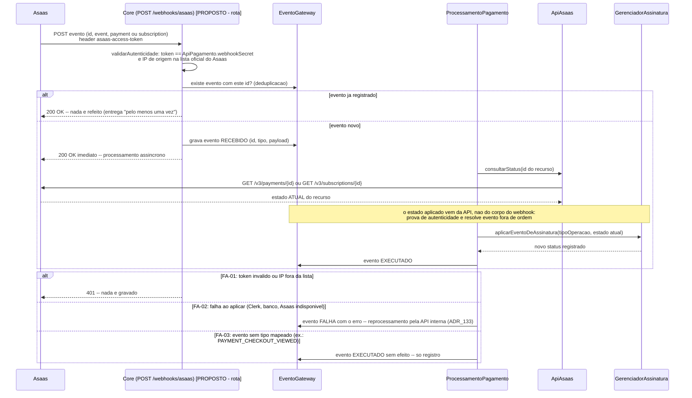
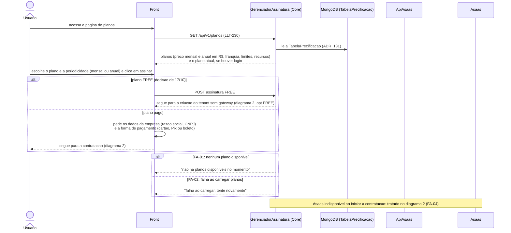
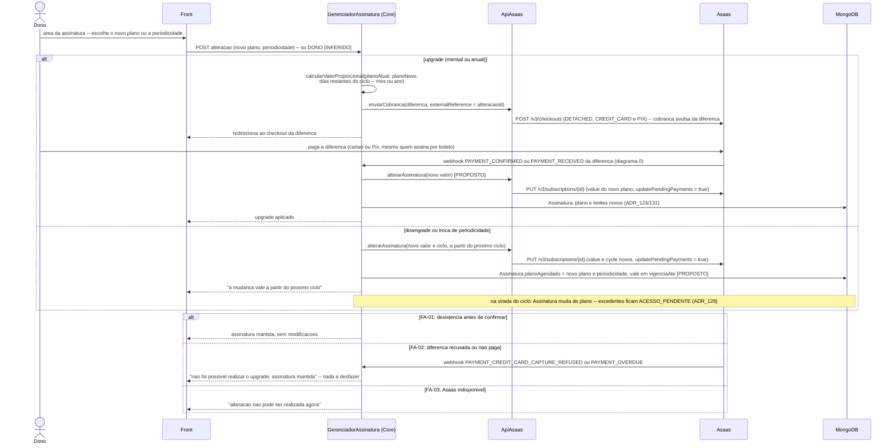
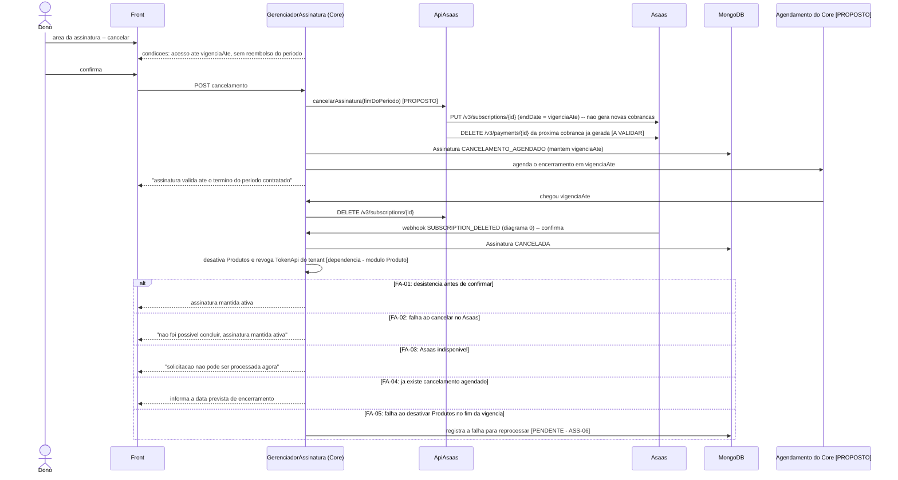
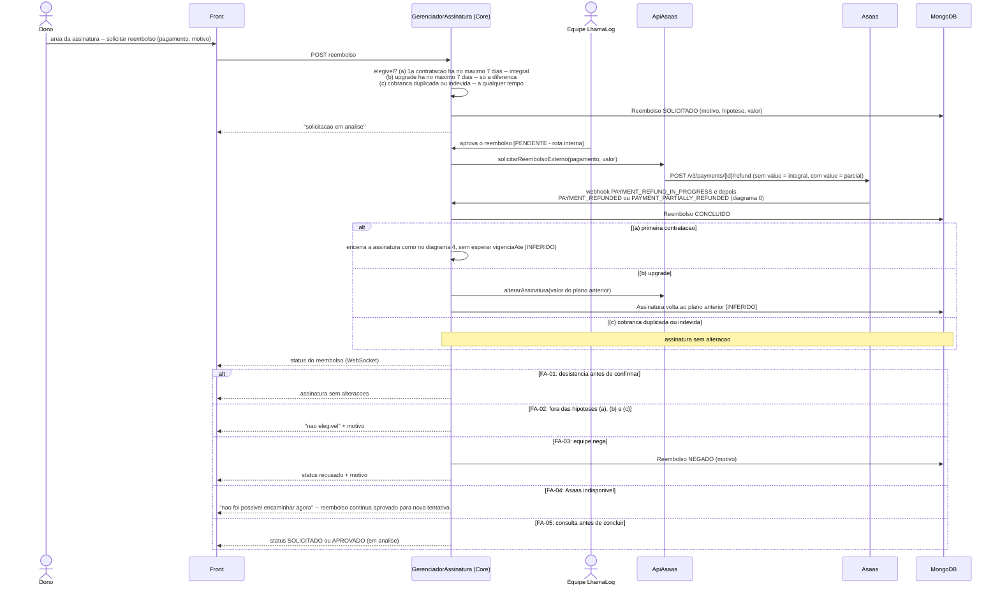
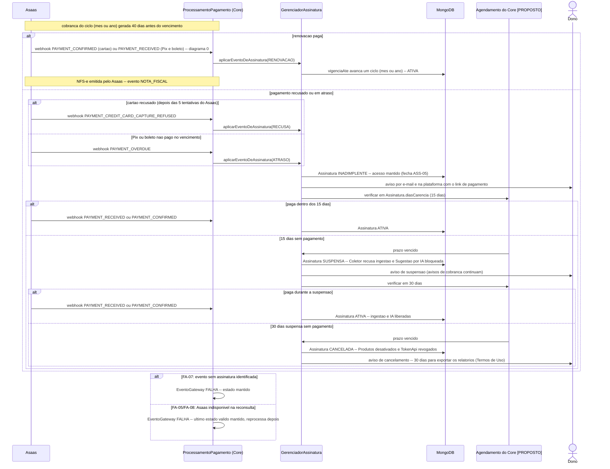

# Diagramas de Sequência — Assinatura e Pagamento com o Asaas (LhamaLog)

**LLT-90.** Substitui o participante `GatewayPagamento [PENDENTE]`
da versão 2 (`sequencia-assinatura-pagamento.md`, Pedro) pelo **Asaas**, conforme o documento da LLT-89 (Eleger gateway e interface).
Também substitui, para a parte de pagamento, o diagrama `tenant_criacao_assinatura` da v10 de
`sequencia-tenant-multitenant.md` (Michel): o restante daquele diagrama (Clerk, papéis, FA-02/FA-03) foi mantido.

Base: USID_039–043, SSID_016, SSID_018; ADR_121, 124, 125, 129, 131, 133, 141 e documento da LLT-89;
decisões de 17/10, 19/10 e 21/10/2026 (`decisoes.md` e ADR_163); Termos de Uso (alinhados em 21/10/2026);
documentação oficial do Asaas consultada em 17/10 e 19/10/2026.

**Revisão de 21/10/2026 (ADR_163):** mensal ou anual; cartão e Pix pelo checkout, boleto fora do checkout;
upgrade com checkout avulso (DETACHED); reembolso também no upgrade e em cobrança indevida; recusa de cartão
como RECUSA; 30 dias para exportar no fim do contrato. Diagramas alterados: 1, 2, 3, 5 e 6.

**Imagens (PNG, tema neutral, fundo branco, escala 2), na mesma pasta:** `webhook_asaas.png` (diagrama 0),
`visualizacao.png` (1), `contratacao.png` (2), `alteracao_upgrade.png` (3), `cancelamento.png` (4),
`reembolso.png` (5) e `evento_gateway_externo.png` (6).

**Marcações:** `[PENDENTE]` sem definição · `[INFERIDO]` ligação feita por nós a partir das decisões ·
`[A VALIDAR]` comportamento do Asaas a confirmar no sandbox · `[PROPOSTO]` nome novo a aprovar.

**Participantes usados:**
- `Usuario` / `Dono` — ator humano.
- `Front` — Front Web (React + Clerk).
- `Core` — Backend Java / API Core; dentro dele, `GerenciadorAssinatura` e `ProcessamentoPagamento`.
- `ApiAsaas` — implementação de `GatewayPagamento` (classe `ApiPagamento`, `gatewayAtivo = ASAAS`).
- `Asaas` — sistema externo (API `https://api-sandbox.asaas.com` no MVP, checkout hospedado e webhooks).
- `Evt` — coleção `EventoGateway` (ADR_125). `Mongo` — Tenant, Assinatura, Membro, Pagamento, Reembolso.

**Status da Assinatura (enum `StatusAssinatura`):** `ATIVA`, `PENDENTE`, `INADIMPLENTE`, `SUSPENSA`,
`CANCELAMENTO_AGENDADO`, `CANCELADA`. Fonte: Guia das Classes da planilha "Modelo de Classes LhamaLog v2"
(citado no DC-10 v4) e imagem `classes_03_assinatura_pagamento.png` (DC-10 v1). Os diagramas desta versão
usam cinco deles; `PENDENTE` está no Guia, mas nenhum fluxo da v3 precisa dele. Fecha o ASS-09 se o time aprovar.

**Carência do atraso:** campo `Assinatura.diasCarencia` (já existe no DC-10, sem valor) = **15 dias**, igual à sugestão dos Termos de Uso v0.2
(decisão de 17/10/2026). **Suspensão até o cancelamento:** **30 dias** (decisão de 17/10/2026).

---

## 0. Recebimento de webhook do Asaas (base de todos os fluxos) — novo

Resolve ASS-07 (eventos repetidos ou fora de ordem) e a falta de HMAC no Asaas (LLT-89, seção 2, itens 7 a 9).

**Mapeamento de eventos** (`TipoOperacaoGateway` com 9 valores, ADR_163): `PAYMENT_CONFIRMED`/`PAYMENT_RECEIVED` →
PRIMEIRA_COMPRA (1ª cobrança) ou RENOVACAO · `SUBSCRIPTION_UPDATED` → UPGRADE_DOWNGRADE ·
`SUBSCRIPTION_INACTIVATED`/`SUBSCRIPTION_DELETED` → CANCELAMENTO · `PAYMENT_OVERDUE` → ATRASO ·
`PAYMENT_CREDIT_CARD_CAPTURE_REFUSED`/`PAYMENT_REPROVED_BY_RISK_ANALYSIS` → RECUSA ·
`PAYMENT_REFUND_IN_PROGRESS`/`PAYMENT_REFUNDED`/`PAYMENT_PARTIALLY_REFUNDED` → REEMBOLSO ·
`PAYMENT_CHARGEBACK_REQUESTED`/`PAYMENT_CHARGEBACK_DISPUTE`/`PAYMENT_AWAITING_CHARGEBACK_REVERSAL` → CHARGEBACK ·
`INVOICE_AUTHORIZED`/`INVOICE_ERROR`/`INVOICE_CANCELED` → NOTA_FISCAL.

---

## 1. Visualização dos planos (USID_039)

Só mostra os planos e leva o usuário à contratação. Cada plano pago tem preço mensal e anual (desconto anual
`[PENDENTE]` com o PO); o Dono escolhe a periodicidade e a forma de pagamento. Detalhe da tela e da API na LLT-230.

---

## 2. Contratação e criação do tenant (USID_040 + tenant_criacao_assinatura)

O Tenant só nasce no webhook de pagamento aprovado (ADR_121, decisão de 17/10). Cartão e Pix pelo checkout
hospedado; boleto fora do checkout (o checkout do Asaas só aceita cartão e Pix), criado direto como assinatura.

```mermaid
sequenceDiagram
  actor Comprador
  participant Front
  participant Clerk
  participant Ger as GerenciadorAssinatura (Core)
  participant ApiAsaas
  participant Asaas
  participant Evt as EventoGateway
  participant Mongo as MongoDB

  Front->>Ger: POST contratacao (plano, periodicidade, forma de pagamento,<br/>dados da empresa, session token)
  Ger->>Clerk: valida o session token -- clerkUserId
  Ger->>Mongo: cria PreCadastro (clerkUserId, CNPJ, plano, periodicidade,<br/>forma de pagamento, AGUARDANDO_PAGAMENTO) [PROPOSTO]
  Ger->>ApiAsaas: enviarCobranca(preCadastroId)
  ApiAsaas->>Asaas: POST /v3/customers (nome, CNPJ, externalReference = preCadastroId)
  alt cartao ou Pix (checkout hospedado)
    ApiAsaas->>Asaas: POST /v3/checkouts (RECURRENT, CREDIT_CARD e PIX,<br/>cycle MONTHLY ou YEARLY, successUrl, cancelUrl, externalReference)
    Asaas-->>ApiAsaas: link do checkout
    Ger-->>Front: redireciona ao checkout hospedado
    Comprador->>Asaas: escolhe cartao ou Pix e paga (o LhamaLog nao ve o cartao)
    Asaas-->>Front: redireciona ao successUrl -- o callback NAO confirma o pagamento
  else boleto (fora do checkout)
    ApiAsaas->>Asaas: POST /v3/subscriptions (billingType BOLETO,<br/>cycle MONTHLY ou YEARLY, externalReference = preCadastroId)
    Asaas-->>ApiAsaas: assinatura e link do boleto com QR Code Pix
    Ger-->>Front: mostra o boleto -- "conta liberada apos a compensacao"
    Comprador->>Asaas: paga pelo QR Code (na hora) ou pelo codigo de barras (ate 3 dias uteis)
  end
  Front-->>Comprador: "pagamento em processamento"
  Asaas->>Ger: webhook PAYMENT_CONFIRMED (cartao) ou PAYMENT_RECEIVED (Pix e boleto) -- diagrama 0
  Ger->>ApiAsaas: consultarStatus(pagamento) -- confirmado pela API
  Ger->>Evt: evento PRIMEIRA_COMPRA EXECUTADO (ADR_125)
  Ger->>Clerk: cria a Organization com o comprador como org:admin
  Clerk-->>Ger: clerkOrgId
  Ger->>Mongo: cria Tenant, Assinatura (ATIVA, periodicidade, limites da TabelaPrecificacao),<br/>Membro DONO e PapelNotificacao padrao (ADR_121/136/137)
  Ger->>Mongo: Pagamento (chaveIdempotencia = externalReference, id do Asaas)
  Ger->>ApiAsaas: configurarNotaFiscal(assinatura) [PROPOSTO]
  ApiAsaas->>Asaas: POST /v3/subscriptions/{id}/invoiceSettings (ON_PAYMENT_CONFIRMATION)
  Ger-->>Front: assinatura ativa (WebSocket) -- usuario entra na Organization

  opt plano FREE (sem gateway)
    Ger->>Clerk: cria a Organization
    Ger->>Mongo: cria Tenant, Assinatura FREE, Membro DONO e papeis padrao
  end

  alt FA-01: cartao recusado no checkout
    Asaas-->>Comprador: pagamento nao aprovado -- tenta outro cartao ou Pix
  else FA-02: Pix ou boleto nao pago ate o vencimento
    Asaas->>Ger: webhook PAYMENT_OVERDUE [A VALIDAR - evento do Pix do checkout]
    Ger->>Mongo: PreCadastro EXPIRADO -- nenhum tenant criado
    Ger->>ApiAsaas: no boleto, DELETE /v3/subscriptions/{id} -- para de gerar cobrancas
  else FA-03: comprador fecha o checkout
    Asaas-->>Front: redireciona ao cancelUrl -- PreCadastro continua AGUARDANDO_PAGAMENTO
  else FA-04: Asaas indisponivel ao iniciar
    Ger-->>Front: "nao foi possivel iniciar a contratacao, tente depois"
  else FA-05: pagamento aprovado mas falha na Clerk ou no banco
    Ger->>Evt: evento FALHA com o erro (ADR_125)
    Ger-->>Front: "pagamento recebido -- ativacao em processamento"
    Note over Ger,Evt: equipe reprocessa por POST /internal/eventos-gateway/{eventoId}/reprocessar (ADR_133)
  end
```

`[A VALIDAR]` no sandbox: se o checkout `RECURRENT` aceita `PIX` junto com `CREDIT_CARD` (se não aceitar, o Pix
segue o caminho do boleto, com `billingType PIX`); qual evento chega quando o Pix do checkout não é pago.
Pix Automático fica para depois (exige CNPJ ativo há 6 meses, ADR_163).

---

## 3. Alteração de plano (USID_041)

Proration calculada pelo Core (decisão revista em 17/10). Upgrade vale quando a diferença é paga, por um
checkout avulso (DETACHED); no anual, a proporção é sobre os dias que faltam no ano. Downgrade e troca de
periodicidade [PROPOSTO] valem no próximo ciclo, sem reembolso (ADR_124).

---

## 4. Cancelamento (USID_042)

Fim da vigência controlado pelo Core (decisão revista em 17/10). Cuidado: o Asaas gera cada cobrança
40 dias antes do vencimento, e o `DELETE` da assinatura apaga as cobranças pendentes (LLT-89, item 3.3).

---

## 5. Reembolso (USID_043)

Regras dos Termos de Uso (alinhadas em 21/10/2026): integral em até 7 dias da primeira contratação; a diferença
em até 7 dias de um upgrade; cobrança duplicada ou indevida a qualquer tempo. A equipe LhamaLog aprova.

---

## 6. Renovação, atraso e recusa (SSID_016 + SSID_018)

15 dias de carência com acesso mantido; depois 30 dias de suspensão e então cancelamento (decisões de 17/10).

Tentativas no cartão (Blog Asaas, atualizado em 04/05/2026): 3 no dia do vencimento (8h, 14h e 20h) e mais 2 a
cada 24h; a carência de 15 dias começa depois disso. `[A VALIDAR]` reembolso de pagamento feito por boleto
(diagrama 5).

---

## Pendências desta versão

- `[A VALIDAR]` (sandbox): checkout `RECURRENT` com `PIX` junto com `CREDIT_CARD`; evento quando o Pix do
  checkout não é pago; exclusão da próxima cobrança no cancelamento; reembolso de pagamento por boleto.
- Confirmados na documentação do Asaas (19/10 e 21/10/2026): `updatePendingPayments` no `PUT /v3/subscriptions/{id}`;
  5 tentativas automáticas no cartão; `cycle YEARLY`; boleto só fora do checkout.
- `[PROPOSTO]` rota `POST /webhooks/asaas`; `PreCadastro`; métodos `alterarAssinatura`,
  `cancelarAssinatura` e `configurarNotaFiscal`; `planoAgendado`; agendamento do Core; troca de periodicidade no
  ciclo seguinte.
- Prazo entre SUSPENSA e CANCELADA: **30 dias** (decisão do André em 17/10/2026, mantida em 21/10). Termos de Uso
  alinhados em 21/10/2026; o responsável pela LGPD inclui nos Termos os 30 dias de suspensão e o cancelamento.
- `[PENDENTE]` valor do desconto anual (PO); rota interna de aprovação de reembolso; ASS-06.

## O que esta versão fecha da Pauta de 03/10

| Item | Situação |
|---|---|
| ASS-01 gateway, moeda, periodicidade | Fechado: Asaas, R$, mensal ou anual (ADR_163) |
| ASS-02 proration | Fechado: Core calcula (diagrama 3) |
| ASS-03 reembolso | Fechado: 7 dias da 1ª contratação ou do upgrade, cobrança indevida a qualquer tempo, equipe aprova (diagrama 5) |
| ASS-04 atraso | Fechado: 15 dias de carência, 30 dias de suspensão e cancelamento (diagrama 6) |
| ASS-05 recusa | Fechado: atualiza para INADIMPLENTE (diagrama 6) |
| ASS-07 eventos repetidos ou fora de ordem | Fechado: deduplicação por id e reconsulta (diagrama 0) |
| ASS-09 status da Assinatura | Valores do Guia das Classes (topo do arquivo), aguardando aprovação do time |
| ASS-06, ASS-08, ASS-10 a ASS-16 | Continuam abertos |

**Rastreabilidade:** USID_039–043, SSID_016, SSID_018; ADR_121, 124, 125, 129, 131, 133, 141, 163, documento
da LLT-89; Pauta ASS-01 a ASS-09; Termos de Uso do LhamaLog.
