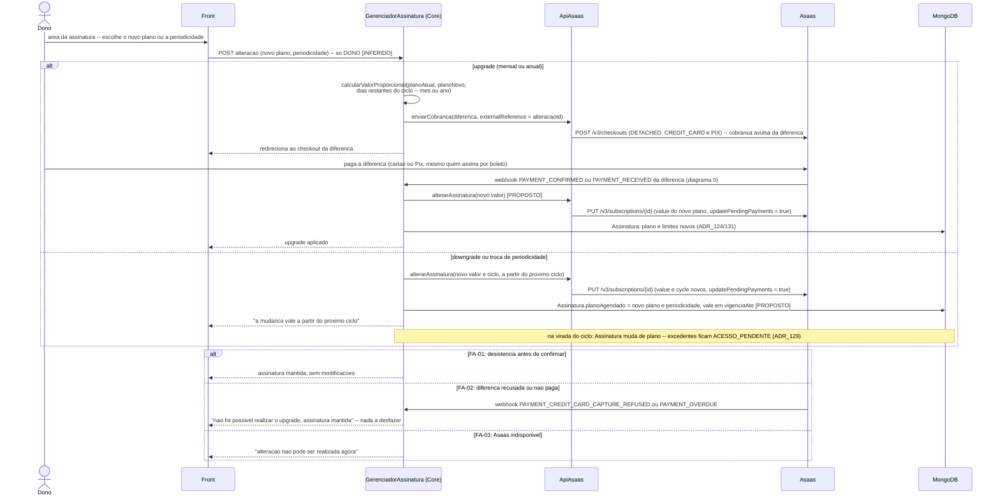

# Alteração de plano (diagrama 3) — Assinatura e Pagamento com o Asaas (LhamaLog)

**LLT-90.** Caso de uso: USID_041. Gateway: Asaas (ADR_163). Imagem: `alteracao_upgrade.png` (nesta pasta).
Arquivo completo com os 7 diagramas: `LLT-90 - sequencia-assinatura-pagamento-asaas.md` (pasta v3).

Proration calculada pelo Core. Upgrade vale quando a diferença é paga; downgrade vale no próximo ciclo, sem reembolso
(ADR_124). Revisão de 21/10/2026 (ADR_163): a diferença é cobrada por um checkout avulso (DETACHED), sem depender de
cartão salvo; no plano anual a proporção é sobre os dias que faltam no ano; a troca de mensal para anual (ou o
contrário) vale no ciclo seguinte [PROPOSTO].

`updatePendingPayments = true` aplica a mudança também à cobrança já gerada (o Asaas gera cada cobrança 40 dias antes
do vencimento). Alterar o valor de assinatura no cartão exige a tokenização habilitada na conta Asaas.
