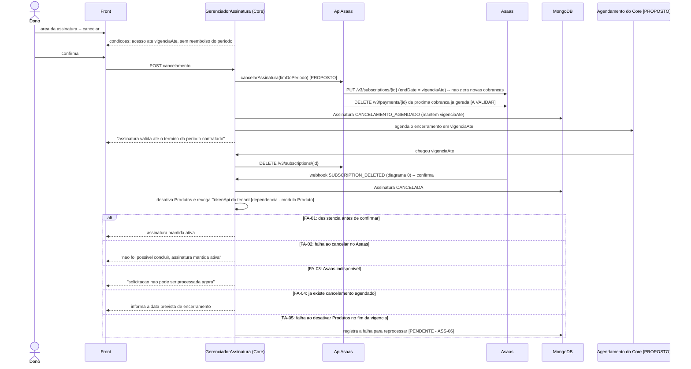

# Cancelamento (diagrama 4) — Assinatura e Pagamento com o Asaas (LhamaLog)

**LLT-90.** Caso de uso: USID_042. Gateway: Asaas (ADR_163). Imagem: `cancelamento.png` (nesta pasta).
Arquivo completo com os 7 diagramas: `LLT-90 - sequencia-assinatura-pagamento-asaas.md` (pasta v3).

Fim da vigência controlado pelo Core. O Asaas gera cada cobrança 40 dias antes do vencimento e o DELETE da assinatura apaga as cobranças pendentes (ADR_163).

[A VALIDAR] exclusão da próxima cobrança e se o Asaas encerra a assinatura sozinho na endDate, o que dispensaria o DELETE.
