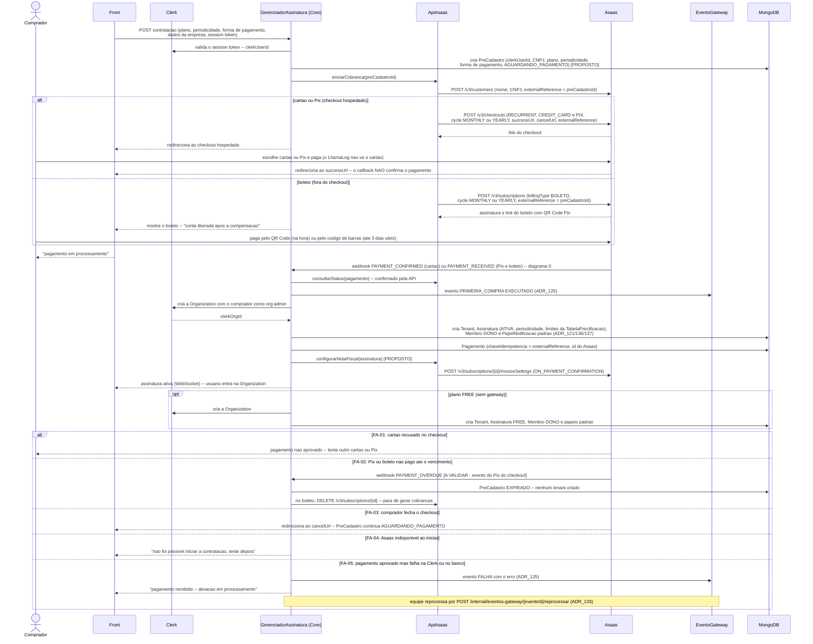

# Contratação e criação do tenant (diagrama 2) — Assinatura e Pagamento com o Asaas (LhamaLog)

**LLT-90.** Caso de uso: USID_040 + tenant_criacao_assinatura. Gateway: Asaas (ADR_163). Imagem: `contratacao.png` (nesta pasta).
Arquivo completo com os 7 diagramas: `LLT-90 - sequencia-assinatura-pagamento-asaas.md` (pasta v3).

O Tenant só nasce no webhook de pagamento aprovado (ADR_121). Revisão de 21/10/2026 (ADR_163): mensal ou anual;
cartão e Pix pelo checkout hospedado; boleto fora do checkout (o checkout do Asaas só aceita cartão e Pix), criado
direto como assinatura. Pix Automático fica para depois (exige CNPJ ativo há 6 meses).

[A VALIDAR] no sandbox: se o checkout `RECURRENT` aceita `PIX` junto com `CREDIT_CARD` (se não aceitar, o Pix segue o
mesmo caminho do boleto, com `billingType PIX`); e qual evento chega quando o Pix do checkout não é pago.
