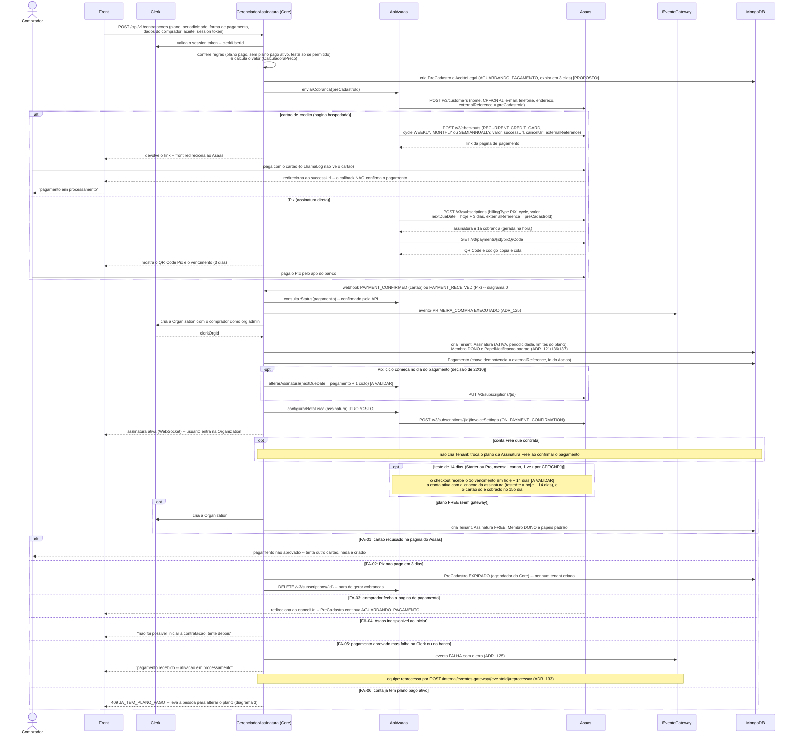

# Contratação e criação do tenant (diagrama 2) — Assinatura e Pagamento com o Asaas (LhamaLog)

**LLT-90 (v4, 26/10/2026).** Caso de uso: USID_040. Gateway: Asaas (ADR_163). Imagem: `contratacao.png` (nesta pasta).
Arquivo completo com os 7 diagramas: `LLT-90 - sequencia-assinatura-pagamento-asaas.md` (pasta v4).
## 2. Contratação e criação do tenant (USID_040 + tenant_criacao_assinatura)

O Tenant só nasce no webhook de pagamento aprovado (ADR_121, decisão de 17/10). **Cartão:** página de pagamento
hospedada pelo Asaas (checkout recorrente, que só aceita cartão de crédito). **Pix:** assinatura criada direto
(`POST /v3/subscriptions`), porque o Pix recorrente não passa pelo checkout (confirmado no sandbox em 24/10/2026).

Achados do sandbox (24 e 25/10/2026): o checkout recorrente aceita só `CREDIT_CARD`; com cliente já cadastrado ele
exige telefone, endereço, número, CEP, bairro e cidade; a resposta já traz o `link`; a criação da assinatura gera a
primeira cobrança na hora. `[A VALIDAR]` na implementação: adiar a primeira cobrança do cartão em 14 dias;
`PUT /v3/subscriptions` com `nextDueDate`; ciclos `WEEKLY` e `SEMIANNUALLY` na página e na assinatura direta.
Pix Automático fica para depois (exige CNPJ ativo há 6 meses, ADR_163).
