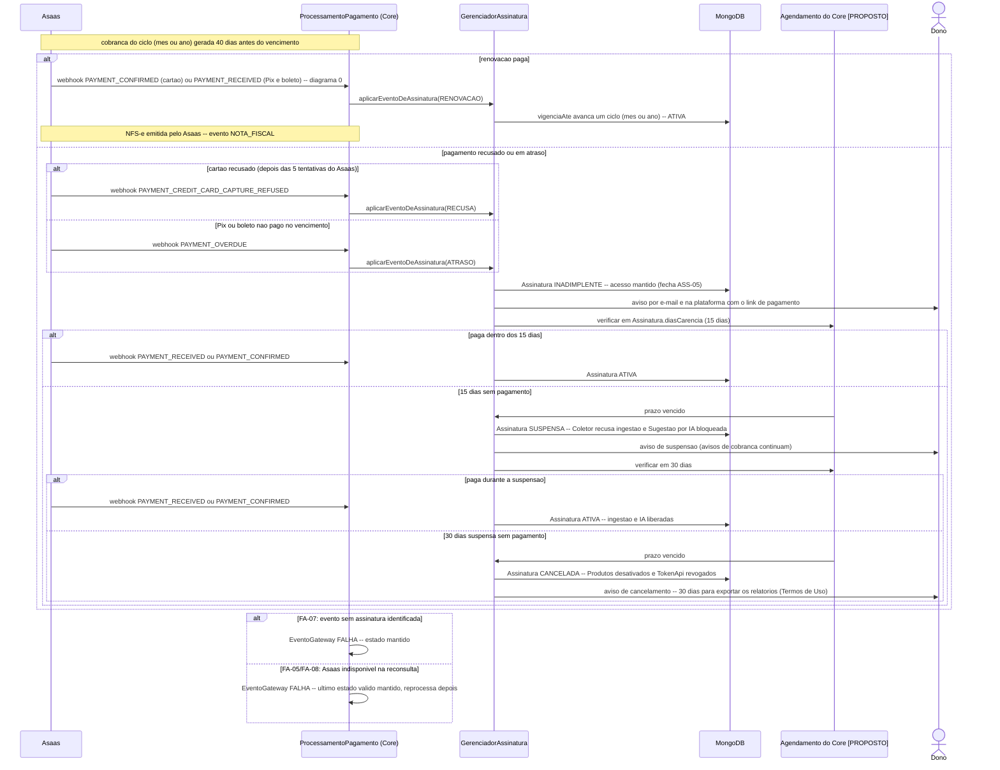

# Renovação, atraso e recusa (diagrama 6) — Assinatura e Pagamento com o Asaas (LhamaLog)

**LLT-90.** Caso de uso: SSID_016 + SSID_018. Gateway: Asaas (ADR_163). Imagem: `evento_gateway_externo.png` (nesta pasta).
Arquivo completo com os 7 diagramas: `LLT-90 - sequencia-assinatura-pagamento-asaas.md` (pasta v3).

15 dias de carência (Assinatura.diasCarencia) com acesso mantido; depois 30 dias SUSPENSA e então CANCELADA (regra da
ADR_163, mantida em 21/10/2026). Revisão de 21/10: ciclo mensal ou anual; recusa de cartão vira RECUSA (não ATRASO);
no cartão o Asaas faz 5 tentativas antes de marcar a cobrança como vencida; 30 dias para exportar (Termos de Uso).

Tentativas no cartão (Blog Asaas, atualizado em 04/05/2026): 3 no dia do vencimento (8h, 14h e 20h) e mais 2 a cada
24h; a carência de 15 dias começa depois disso.
