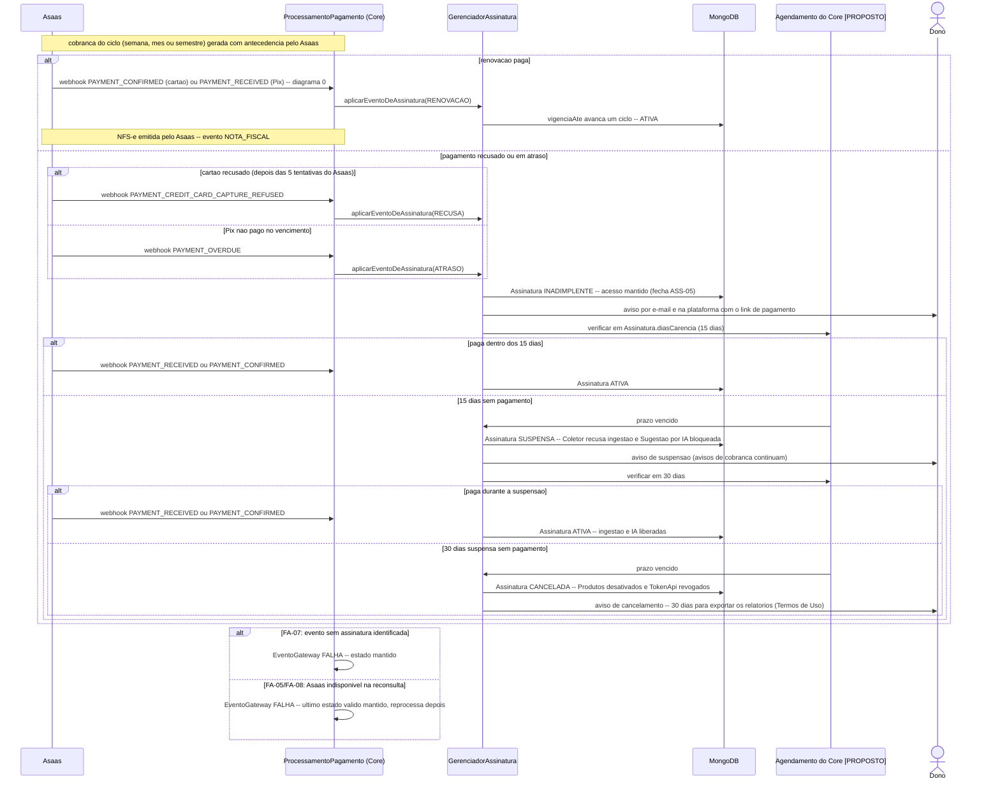

# Renovação, atraso e recusa (diagrama 6) — Assinatura e Pagamento com o Asaas (LhamaLog)

**LLT-90 (v4, 26/10/2026).** Caso de uso: SSID_016, SSID_018. Gateway: Asaas (ADR_163). Imagem: `evento_gateway_externo.png` (nesta pasta).
Arquivo completo com os 7 diagramas: `LLT-90 - sequencia-assinatura-pagamento-asaas.md` (pasta v4).
## 6. Renovação, atraso e recusa (SSID_016 + SSID_018)

15 dias de carência com acesso mantido; depois 30 dias de suspensão e então cancelamento (decisões de 17/10).
Vale para qualquer periodicidade. No cartão o Asaas cobra sozinho; no Pix o Dono recebe a cobrança de cada ciclo e paga.

Tentativas no cartão (Blog Asaas, atualizado em 04/05/2026): 3 no dia do vencimento (8h, 14h e 20h) e mais 2 a
cada 24h; a carência de 15 dias começa depois disso. O excedente de GB e o armazenamento extra são cobrados
numa cobrança avulsa mensal (LLT-234 e LLT-235); o atraso dela segue a mesma regra de carência e suspensão.
