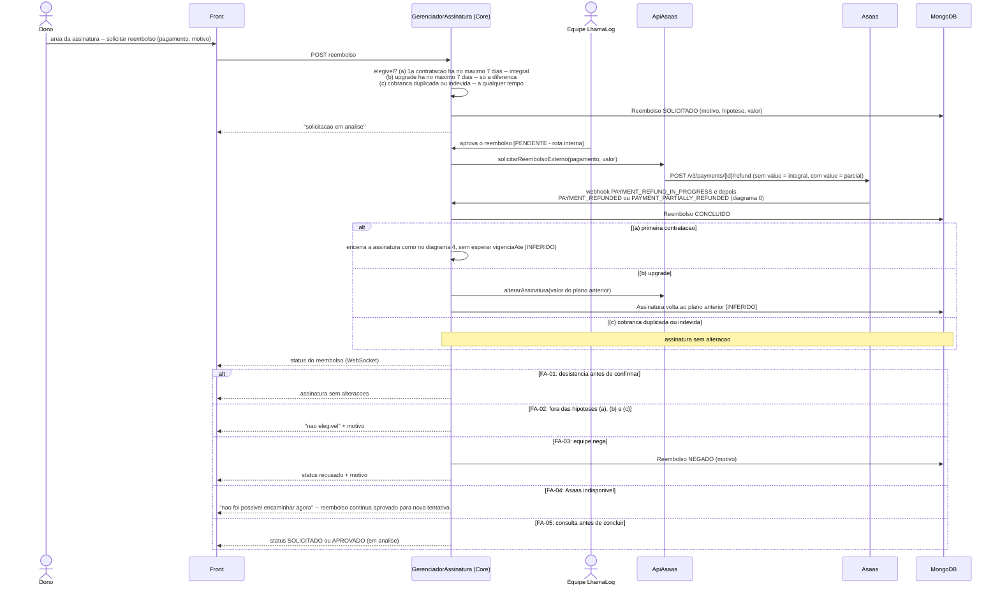

# Reembolso (diagrama 5) — Assinatura e Pagamento com o Asaas (LhamaLog)

**LLT-90.** Caso de uso: USID_043. Gateway: Asaas (ADR_163). Imagem: `reembolso.png` (nesta pasta).
Arquivo completo com os 7 diagramas: `LLT-90 - sequencia-assinatura-pagamento-asaas.md` (pasta v3).

Regras alinhadas com os Termos de Uso em 21/10/2026 (ADR_163): (a) integral em até 7 dias da primeira contratação;
(b) em até 7 dias de um upgrade, devolve a diferença; (c) cobrança duplicada ou indevida, a qualquer tempo.
Fora disso, não há reembolso de período já iniciado, inclusive no plano anual. A equipe LhamaLog aprova.

[A VALIDAR] no sandbox: como o Asaas devolve um pagamento feito por boleto (se pede dados bancários do Dono).
