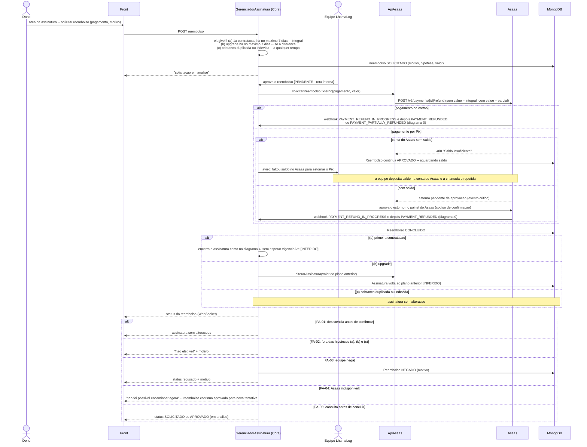

# Reembolso (diagrama 5) — Assinatura e Pagamento com o Asaas (LhamaLog)

**LLT-90 (v4, 26/10/2026).** Caso de uso: USID_043. Gateway: Asaas (ADR_163). Imagem: `reembolso.png` (nesta pasta).
Arquivo completo com os 7 diagramas: `LLT-90 - sequencia-assinatura-pagamento-asaas.md` (pasta v4).
## 5. Reembolso (USID_043)

Regras dos Termos de Uso (alinhadas em 21/10/2026): integral em até 7 dias da primeira contratação; a diferença
em até 7 dias de um upgrade; cobrança duplicada ou indevida a qualquer tempo. A equipe LhamaLog aprova.
**Reembolso de Pix (sandbox, 25/10/2026):** o Asaas só estorna se a conta tiver saldo e pede uma segunda aprovação
(evento crítico), que a equipe confirma no painel do Asaas (no sandbox, com o código `000000`). Reembolso no cartão
não passa por essa etapa.

