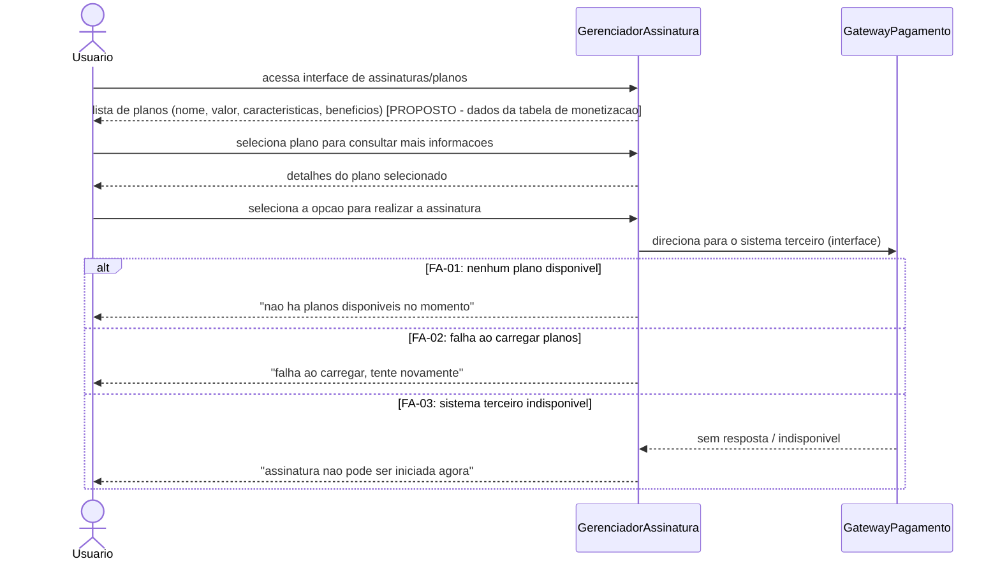
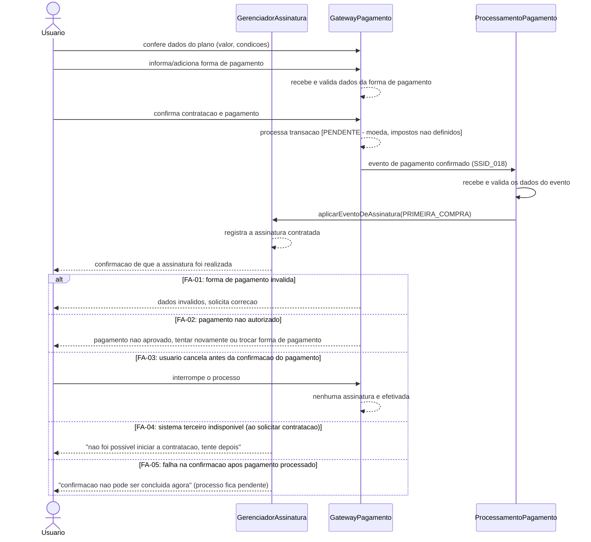
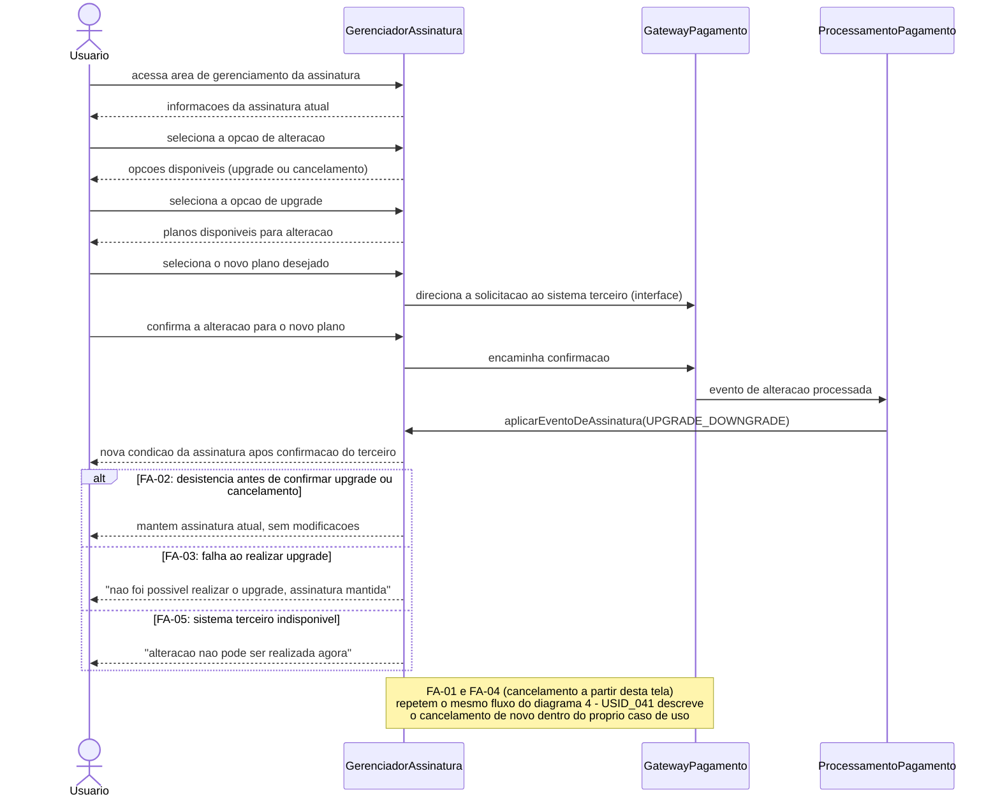
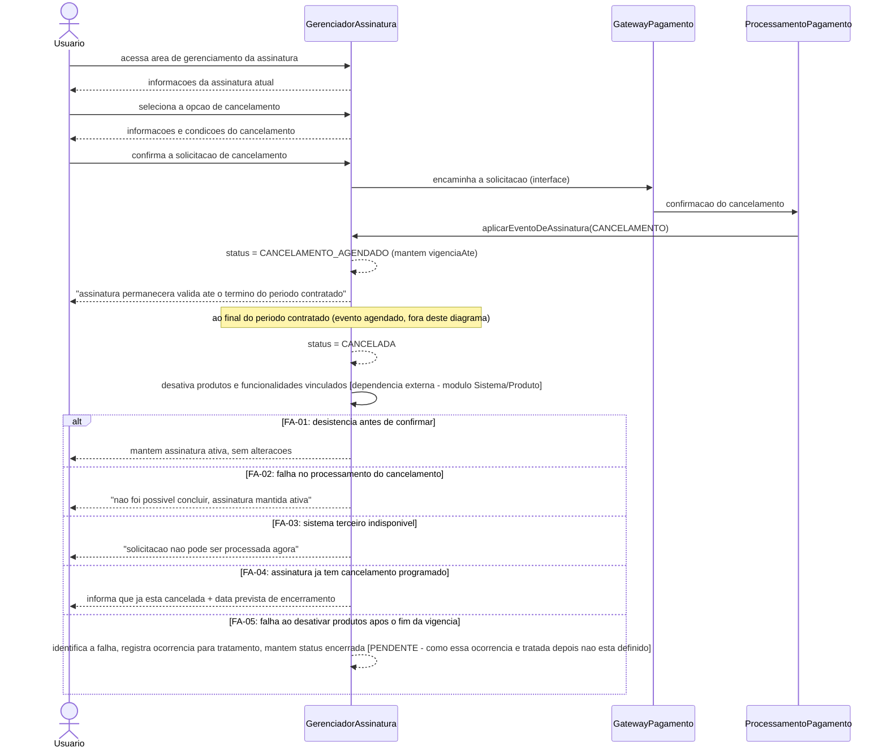
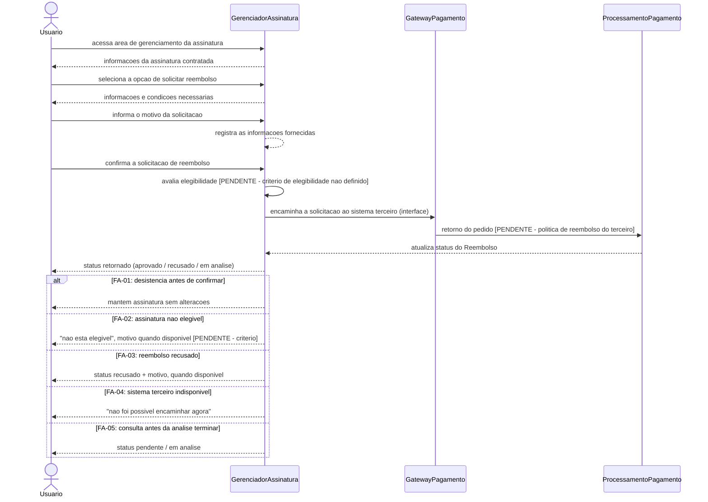
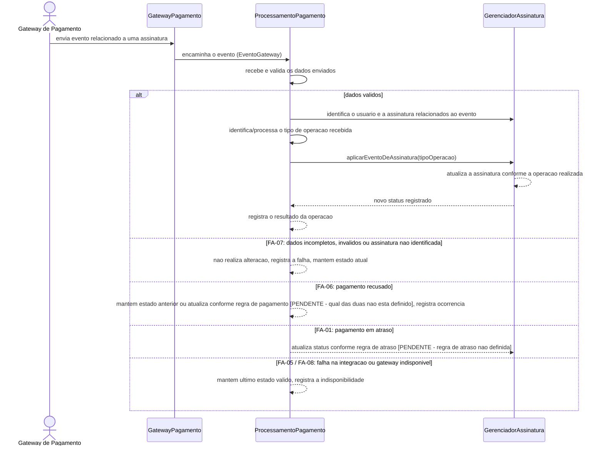

# Diagramas de Sequência — Ciclo de Assinatura (LhamaLog)

Baseado em: USID_039 (Visualizar), USID_040 (Contratar), USID_041 (Alterar), USID_042 (Cancelar),
USID_043 (Reembolsar), SSID_016 (Manter Assinatura) e SSID_018 (Integração de Pagamento) —
texto completo lido do `LhamaLog_casos_de_uso.xlsx`.

**Revisão aplicada** (autoauditoria linha a linha contra o texto original): removidas 2 chamadas
que não estavam em nenhum caso de uso (`calcularValorProporcional()` no diagrama 3,
`validarTransicaoDeStatus()` no diagrama 6 — ambas são métodos do modelo de classes antigo, mas
não aparecem descritos nestes fluxos específicos); corrigida 1 seta que fazia o Usuário falar
direto com o Gateway quando o texto diz que é o sistema quem direciona (diagrama 3); e removida
1 marcação `[PENDENTE]` usada errado (não era requisito em aberto, era um princípio já discutido
em outro momento da conversa, fora do escopo deste caso de uso).

**Participantes usados em todos os diagramas:**
- `Usuario` — ator humano (USID_039–043)
- `GerenciadorAssinatura` — orquestra o ciclo de vida da assinatura
- `ProcessamentoPagamento` — processa cobrança/eventos de pagamento
- `GatewayPagamento` — representa ao mesmo tempo a interface conceitual do gateway **e** a fronteira
  com o ator externo "Sistema Terceiro de Assinatura/Pagamento" / "Gateway de Pagamento" — nenhum
  provedor foi escolhido, por isso ele nunca aparece com comportamento interno concreto, só como
  fronteira de troca de mensagens.

Tudo marcado `[PENDENTE]` é requisito ainda sem definição — não foi assumido nenhum valor, regra
de gateway, moeda, periodicidade, imposto, proration ou política de reembolso.

---

## 1. Visualização (USID_039)

## 2. Contratação (USID_040)

## 3. Alteração / Upgrade (USID_041)

**Nota sobre este diagrama:** a versão anterior tinha um passo `calcularValorProporcional()`
aqui. Removido — a USID_041 não menciona cálculo de valor proporcional em nenhum lugar do texto.
O método existe no modelo de classes (herdado do diagrama antigo), mas incluí-lo neste fluxo
seria afirmar algo que o caso de uso não descreve. Fica como gap conhecido, não como passo do
diagrama: **proration continua sem nenhuma descrição de quando/como é calculado.**

## 4. Cancelamento (USID_042) — com cancelamento programado

## 5. Reembolso (USID_043)

## 6. Eventos externos do Gateway (SSID_016 + SSID_018)

**Nota sobre este diagrama:** a versão anterior tinha um passo `validarTransicaoDeStatus()` aqui.
Removido pelo mesmo motivo do diagrama 3 — é um método privado do modelo de classes, mas nenhuma
das duas SSIDs descreve essa validação explicitamente. Também separei os fluxos alternativos
FA-01 e FA-06 (que antes estavam agrupados) porque o texto os trata como casos distintos: atraso
tem regra própria ainda não definida, pagamento recusado tem uma ambiguidade textual própria
("mantém OU atualiza" — o texto não diz qual dos dois).

---

## Notas obrigatórias (não inventar / pendências)

- **`[CONFLITO]` SSID_016 e SSID_018 continuam mescladas no diagrama 6** — descrevem quase o
  mesmo fluxo em granularidade ligeiramente diferente; sobreposição ainda sem resolução do time.
- **`[RISCO]` Duplicidade e ordem de eventos**: nenhum dos 6 diagramas define o que acontece se
  dois eventos da mesma assinatura chegarem fora de ordem ou repetidos.
- **`[GAP]` Proration** (upgrade/downgrade, diagrama 3): a USID_041 não descreve quando ou como
  o valor proporcional é calculado — não modelado como passo, só citado como lacuna.
- **`[PENDENTE]` Cancelamento programado → falha ao desativar produtos** (diagrama 4): o texto só
  diz "registra a ocorrência para tratamento" — não define reprocessamento nem alerta.
- **`[PENDENTE]` FA-06 de SSID_016** (diagrama 6): o texto diz "mantém a assinatura no estado
  anterior OU atualiza seu status" — ambíguo de propósito no original, não resolvi a ambiguidade.
- Gateway concreto, moeda, periodicidade, impostos, proration e política de reembolso **não foram
  assumidos em nenhum dos 6 diagramas**.

**Rastreabilidade:** USID_039–043, SSID_016, SSID_018 — todos os 6 diagramas cruzados linha a
linha com o texto completo das páginas originais do `LhamaLog_casos_de_uso.xlsx`.
