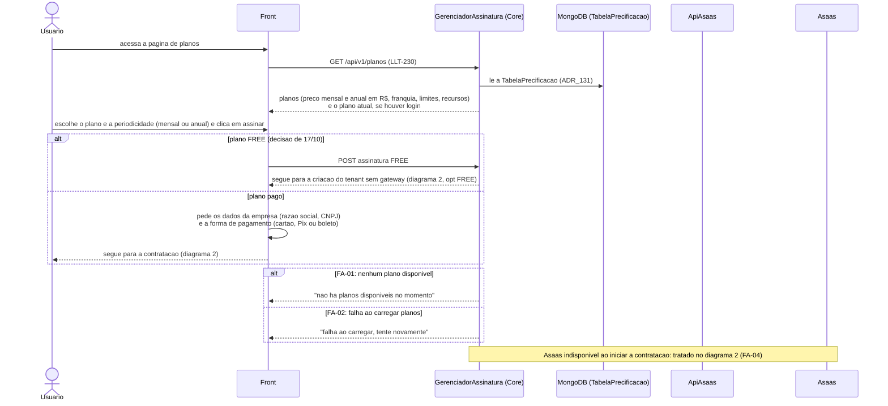

# Visualização dos planos (diagrama 1) — Assinatura e Pagamento com o Asaas (LhamaLog)

**LLT-90.** Caso de uso: USID_039. Gateway: Asaas (ADR_163). Imagem: `visualizacao.png` (nesta pasta).
Arquivo completo com os 7 diagramas: `LLT-90 - sequencia-assinatura-pagamento-asaas.md` (pasta v3).

Só mostra os planos e leva o usuário à contratação. Revisão de 21/10/2026 (ADR_163): cada plano pago tem preço mensal
e anual (anual com desconto, valor a definir com o PO), e o Dono escolhe a periodicidade e a forma de pagamento
(cartão, Pix ou boleto). Detalhe da tela e da API na LLT-230.

[PENDENTE] valor do desconto do plano anual (PO, Plano de Monetização); até lá, o preço anual vem vazio.
