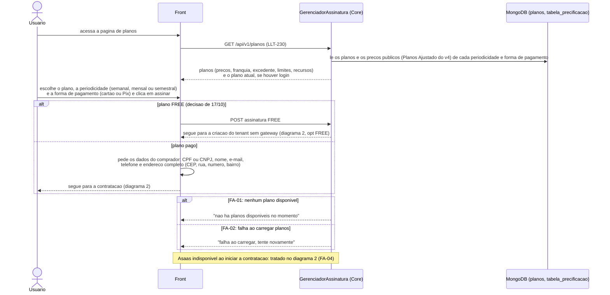

# Visualização dos planos (diagrama 1) — Assinatura e Pagamento com o Asaas (LhamaLog)

**LLT-90 (v5, 26/10/2026).** Caso de uso: USID_039. Gateway: Asaas (ADR_163). Imagem: `visualizacao.png` (nesta pasta).
Arquivo completo com os 7 diagramas: `LLT-90 - sequencia-assinatura-pagamento-asaas.md` (pasta v5).
## 1. Visualização dos planos (USID_039)

Só mostra os planos e leva o usuário à contratação. Cada plano pago tem um preço para cada periodicidade
(semanal, mensal, semestral) e forma de pagamento (Pix, cartão de crédito), já com a taxa do Asaas (aba Planos Ajustado do Plano de
Monetização v4). Detalhe da tela e da API na LLT-230.

