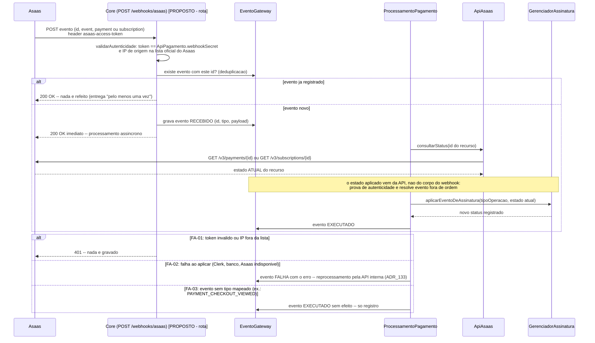

# Recebimento de webhook do Asaas (diagrama 0, novo) — Assinatura e Pagamento com o Asaas (LhamaLog)

**LLT-90.** Caso de uso: SSID_016, SSID_018. Gateway: Asaas (ADR_163). Imagem: `webhook_asaas.png` (nesta pasta).
Arquivo completo com os 7 diagramas: `LLT-90 - sequencia-assinatura-pagamento-asaas.md` (pasta v3).

Base de todos os fluxos: valida o token e o IP, deduplica pelo id do evento e aplica o estado consultado na API do Asaas (resolve o ASS-07).

A rota POST /webhooks/asaas e [PROPOSTO]. Mapeamento completo de eventos na ADR_163.
