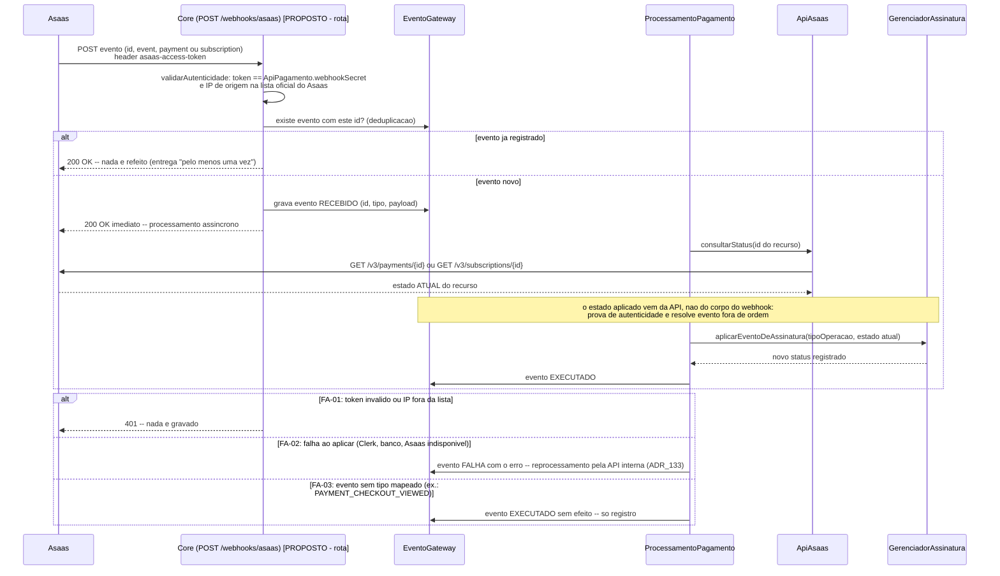

# Recebimento de webhook do Asaas (diagrama 0) — Assinatura e Pagamento com o Asaas (LhamaLog)

**LLT-90 (v5, 26/10/2026).** Caso de uso: SSID_016, SSID_018. Gateway: Asaas (ADR_163). Imagem: `webhook_asaas.png` (nesta pasta).
Arquivo completo com os 7 diagramas: `LLT-90 - sequencia-assinatura-pagamento-asaas.md` (pasta v5).
## 0. Recebimento de webhook do Asaas (base de todos os fluxos)

Resolve ASS-07 (eventos repetidos ou fora de ordem) e a falta de HMAC no Asaas (LLT-89, seção 2, itens 7 a 9).

**Mapeamento de eventos** (`TipoOperacaoGateway` com 9 valores, ADR_163): `PAYMENT_CONFIRMED`/`PAYMENT_RECEIVED` →
PRIMEIRA_COMPRA (1ª cobrança) ou RENOVACAO · `SUBSCRIPTION_UPDATED` → UPGRADE_DOWNGRADE ·
`SUBSCRIPTION_INACTIVATED`/`SUBSCRIPTION_DELETED` → CANCELAMENTO · `PAYMENT_OVERDUE` → ATRASO ·
`PAYMENT_CREDIT_CARD_CAPTURE_REFUSED`/`PAYMENT_REPROVED_BY_RISK_ANALYSIS` → RECUSA ·
`PAYMENT_REFUND_IN_PROGRESS`/`PAYMENT_REFUNDED`/`PAYMENT_PARTIALLY_REFUNDED` → REEMBOLSO ·
`PAYMENT_CHARGEBACK_REQUESTED`/`PAYMENT_CHARGEBACK_DISPUTE`/`PAYMENT_AWAITING_CHARGEBACK_REVERSAL` → CHARGEBACK ·
`INVOICE_AUTHORIZED`/`INVOICE_ERROR`/`INVOICE_CANCELED` → NOTA_FISCAL.

Observação (sandbox): a fila de avisos do Asaas pausa depois de 15 falhas seguidas; por isso o Core responde 200 na hora e processa depois.
