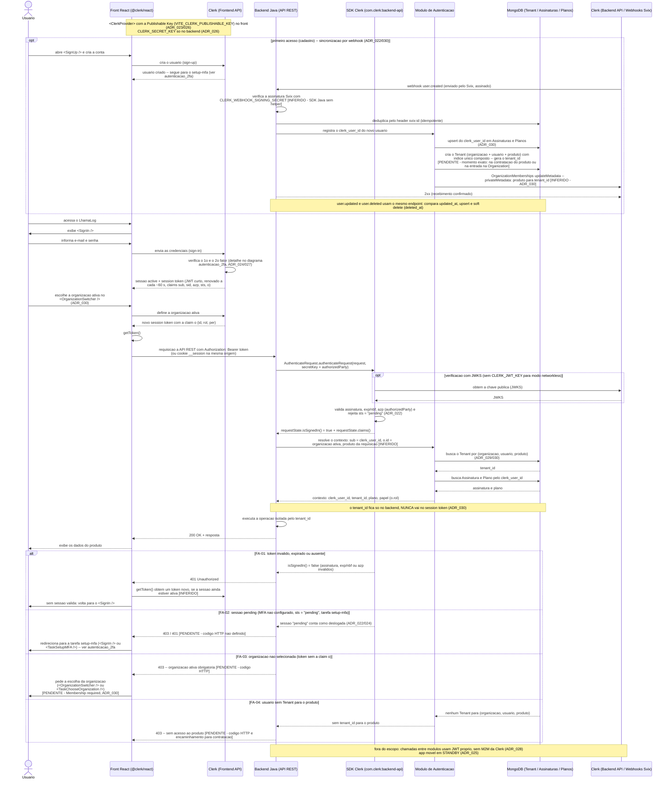
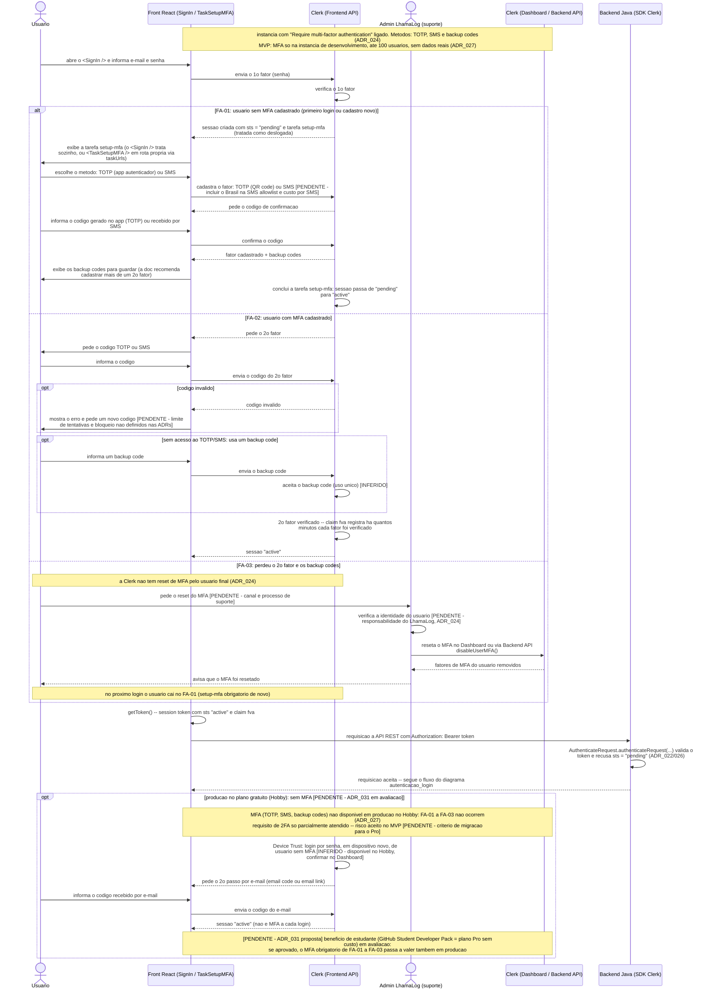

# Diagramas de Sequência — Autenticação e 2FA (LhamaLog)

Baseado em: ADR_021 (Clerk como provedor de identidade e autenticação), ADR_022 (Integração do
backend Java com a Clerk), ADR_023 (Componentes de front-end da Clerk), ADR_024 (MFA obrigatório no
login via Clerk), ADR_025 (Gestão de tokens internos e app móvel em standby), ADR_026 (Backend Java
com SDK oficial da Clerk e front-end em React), ADR_027 (MVP no plano gratuito da Clerk e estratégia
de 2FA), ADR_028 (Tokens internos próprios, sem M2M nem API keys da Clerk), ADR_029 (MongoDB
confirmado e DER como artefato de restrição) e ADR_030 (Multi-tenant com Organizations, Tenant
mestre e mapeamento do clerk_user_id) — pasta `Documentações > Diagrama ADR`. Apoio: resumos
`resumo_clerk.md` e `resumo_clerk_v2.md` (02/10/2026).

**Visão geral do fluxo:** a Clerk é o provedor de identidade (usuários, sessões e MFA). O front em
React (provável, `@clerk/react`) usa os componentes prontos (`<SignIn />`, `<SignUp />`,
`<OrganizationSwitcher />`, `<TaskSetupMFA />`) com a Publishable Key. O backend Java valida o
session token em cada requisição com o SDK oficial (`com.clerk:backend-api`), e o Módulo de
Autenticação do LhamaLog só faz o mapeamento `clerk_user_id` ↔ tenant / assinatura / plano no
MongoDB. O **diagrama 1** mostra o login até a resposta da API; o **diagrama 2** detalha o 2º fator
obrigatório.

**Participantes usados:**
- `Usuario` — pessoa que acessa a Aplicação Web
- `Front React (@clerk/react)` — `<ClerkProvider>` com a Publishable Key, `<SignIn />`, `<SignUp />`,
  `<OrganizationSwitcher />`, `<TaskSetupMFA />` (ADR_023/026)
- `Clerk (Frontend API)` — login, cadastro, sessão, session token e MFA (ADR_021/024)
- `Clerk (Backend API / Webhooks Svix)` — JWKS, metadata da OrganizationMembership e webhooks
  `user.*` (ADR_022/030); no diagrama 2 aparece como `Clerk (Dashboard / Backend API)`
- `Backend Java (API REST)` — guarda a `CLERK_SECRET_KEY`, recebe o Bearer token e os webhooks
- `SDK Clerk (com.clerk:backend-api)` — `AuthenticateRequest.authenticateRequest(...)` (ADR_022/026)
- `Modulo de Autenticacao` — só mapeia `clerk_user_id` ↔ tenant, assinatura e plano; não guarda
  dados de segurança (ADR_030)
- `MongoDB (Tenant / Assinaturas / Planos)` — coleção mestre Tenant com índice único composto
  (organização + usuário + produto) → `tenant_id` (ADR_029/030)
- `Admin LhamaLog (suporte)` — só no diagrama 2, faz o reset de MFA (ADR_024)

Tudo marcado `[PENDENTE]` é requisito ainda sem definição nas ADRs; `[INFERIDO]` é ligação feita
por mim a partir das ADRs/documentação da Clerk que não está escrita literalmente nelas.

**Atenção, risco de confusão de nomes:** o status de sessão da Clerk `sts = "pending"` (sessão
esperando uma tarefa, como `setup-mfa`) **não tem relação** com a marcação `[PENDENTE]` deste
documento. Nos diagramas, os status de sessão aparecem sempre entre aspas (`"pending"`, `"active"`).

---

## 1. Autenticação — login até a resposta da API (ADR_021, 022, 023, 026, 028, 029, 030)

Arquivo: `autenticacao_login.png`

**Resumo do fluxo:** o usuário entra pelo `<SignIn />`; a Clerk verifica os fatores (detalhe no
diagrama 2) e devolve a sessão `"active"` com o session token (JWT curto, renovado a cada ~60 s).
O usuário escolhe a organização ativa (claim `o`). O front chama a API REST com
`Authorization: Bearer <token>`; o SDK valida assinatura (JWKS ou `CLERK_JWT_KEY`), `exp`/`nbf`,
`azp` e recusa `sts = "pending"`. O Módulo de Autenticação resolve `sub` (= `clerk_user_id`) +
organização ativa + produto no Tenant e busca assinatura e plano. O `tenant_id` fica só no backend.

**Fluxo principal:**
1. Usuário abre o `<SignIn />` e informa e-mail e senha; a Clerk verifica 1º e 2º fator.
2. Clerk devolve sessão `"active"` + session token; usuário escolhe a organização no `<OrganizationSwitcher />`.
3. Front obtém o token (`getToken()`) e chama a API REST com Bearer token.
4. Backend chama `AuthenticateRequest.authenticateRequest(...)` (`secretKey` + `authorizedParty`); `isSignedIn() = true` e `claims()`.
5. Módulo de Autenticação busca o Tenant (organização, usuário, produto) e a assinatura/plano pelo `clerk_user_id`.
6. Backend executa a operação isolada pelo `tenant_id` e responde 200.

**Fluxos alternativos:**
- **FA-01** — token inválido, expirado ou ausente: `isSignedIn() = false` → 401; o front tenta token novo ou volta ao `<SignIn />`.
- **FA-02** — sessão `"pending"` (MFA não configurado, tarefa `setup-mfa`): conta como deslogada → 403/401 `[PENDENTE]` e redireciona para o setup do MFA (diagrama 2).
- **FA-03** — organização não selecionada (token sem a claim `o`): 403 `[PENDENTE]` e pede a escolha no `<OrganizationSwitcher />` / `<TaskChooseOrganization />`.
- **FA-04** — usuário sem Tenant para o produto: 403 `[PENDENTE]` (encaminhamento para contratação não definido).
- **opt** — primeiro acesso/cadastro: `<SignUp />` → webhook `user.created` (Svix) → verificação da assinatura, dedupe por `svix-id`, upsert do `clerk_user_id` em Assinaturas e Planos, criação do Tenant e espelho do `tenant_id` no privateMetadata da OrganizationMembership.
- **opt** — verificação com JWKS quando não há `CLERK_JWT_KEY` (modo networkless).

**Notas sobre este diagrama:**
- `[INFERIDO]` a verificação da assinatura Svix em Java: o README do SDK não lista helper (ADR_022).
- `[INFERIDO]` o espelho do `tenant_id` vai no privateMetadata da OrganizationMembership, como mapa
  produto → `tenant_id`, via `OrganizationMemberships` `updateMetadata` (ADR_030, a doc não é decisiva).
- `[PENDENTE]` o momento exato de criar o Tenant (contratação do produto ou entrada na Organization)
  e se a chave "usuário" do Tenant é o `clerk_user_id` ou um id interno (ADR_030). O diagrama coloca
  a criação no `opt` de primeiro acesso, como pedido, sem decidir isso.
- O encaixe do SDK como filtro/middleware depende do framework Java, ainda `[PENDENTE]` (ADR_022/026).
- Fora do escopo (nota no rodapé): comunicação entre módulos com JWT próprio, sem M2M da Clerk
  (ADR_028); app móvel em STANDBY (ADR_025).

## 2. 2FA obrigatório — do 1º fator à sessão ativa (ADR_022, 023, 024, 026, 027)

Arquivo: `autenticacao_2fa.png`

**Resumo do fluxo:** com "Require multi-factor authentication" ligado (TOTP, SMS e backup codes),
depois da senha a Clerk decide: quem não tem MFA fica com a sessão `"pending"` e a tarefa
`setup-mfa`, tratada sozinha pelo `<SignIn />` (ou `<TaskSetupMFA />`); quem já tem informa o código
TOTP/SMS ou um backup code; quem perdeu tudo depende de um admin. Só a sessão `"active"` é aceita
pelo backend. No MVP, o MFA só funciona na instância de desenvolvimento (ADR_027).

**Fluxo principal:**
1. Usuário informa e-mail e senha no `<SignIn />`; a Clerk verifica o 1º fator.
2. A Clerk exige o 2º fator conforme o estado do usuário (FA-01, FA-02 ou FA-03).
3. Sessão `"active"`: o front obtém o token e chama a API com Bearer token.
4. Backend valida com `AuthenticateRequest.authenticateRequest(...)`, recusa `sts = "pending"` e aceita a requisição (segue o diagrama 1).

**Fluxos alternativos:**
- **FA-01** — usuário sem MFA cadastrado: sessão `"pending"` + tarefa `setup-mfa`; cadastro de TOTP (QR code) ou SMS, confirmação do código, entrega dos backup codes; sessão passa a `"active"`.
- **FA-02** — usuário com MFA cadastrado: pede o código TOTP ou SMS; `opt` código inválido (novo código); `opt` usa um backup code; claim `fva` registra a verificação.
- **FA-03** — perdeu o 2º fator e os backup codes: não há reset pelo usuário final; admin verifica a identidade e reseta no Dashboard ou via `disableUserMFA()`; no próximo login o usuário cai no FA-01.
- **opt** — produção no plano gratuito (Hobby), sem MFA: FA-01 a FA-03 não ocorrem; Device Trust pede código por e-mail em dispositivo novo `[INFERIDO]`; benefício de estudante (ADR_031 proposta) `[PENDENTE]`.

**Notas sobre este diagrama:**
- Senha incorreta no 1º fator é tratada pelo próprio `<SignIn />` e não foi detalhada.
- `[INFERIDO]` backup code de uso único; a ADR_024 só diz que a doc recomenda habilitá-los.
- `[PENDENTE]` SMS: incluir o Brasil na SMS allowlist (padrão só EUA e Canadá) e custo por mensagem
  (ADR_024). A ADR_024 propõe TOTP + backup codes como base e SMS opcional `[INFERIDO]`.
- `[PENDENTE]` passkeys: se forem habilitados com "Passkeys satisfy multi-factor authentication",
  o login por passkey dispensa o 2º fator (ADR_024). Não desenhado.
- A ADR_031 (benefício de estudante, GitHub Student Developer Pack) ainda não está na pasta
  `Diagrama ADR`; aparece só como `[PENDENTE - ADR_031]` no `opt` de produção gratuita.

---

## Notas obrigatórias (pendências)

- **`[PENDENTE]`** código HTTP para sessão `"pending"`, organização não selecionada e usuário sem Tenant (401 × 403) — não definido nas ADRs.
- **`[PENDENTE]`** momento de criar o Tenant (contratação ou entrada na Organization) e chave "usuário" do Tenant (ADR_030).
- **`[PENDENTE]`** modo "Membership required" / `<TaskChooseOrganization />` (ADR_021/030).
- **`[PENDENTE]`** encaminhamento do usuário sem Tenant para o produto (contratação/Assinatura).
- **`[PENDENTE]`** SMS: Brasil na allowlist e custo por SMS (ADR_024).
- **`[PENDENTE]`** limite de tentativas e bloqueio para código de 2º fator inválido — não definido nas ADRs.
- **`[PENDENTE]`** canal/processo de suporte e verificação de identidade antes do reset de MFA (ADR_024).
- **`[PENDENTE]`** critério de migração para o Pro: produção no Hobby sem MFA, 2FA só parcial (ADR_027).
- **`[PENDENTE]`** ADR_031 (proposta): benefício de estudante / Pro sem custo, em avaliação.
- **`[PENDENTE]`** framework Java (encaixe do filtro) e React final, Vite ou Next.js (ADR_022/026).
- Nenhuma API foi inventada: só aparecem `AuthenticateRequest.authenticateRequest`, `requestState.isSignedIn()/claims()`,
  `getToken()`, `OrganizationMemberships updateMetadata`, `disableUserMFA()`, os webhooks `user.*` e os componentes
  `@clerk/react` citados nas ADRs. Endpoints da API REST do LhamaLog não foram nomeados.

**Rastreabilidade:** ADR_021–030 (`Documentações > Diagrama ADR`), `resumo_clerk.md` e `resumo_clerk_v2.md`.

**Renderização:** PNGs gerados com o mermaid-cli 12 (`mmdc`, tema neutral, fundo branco) e escala 2, com o mesmo ajuste de estilo preto e branco usado em `Varredura e Finder` (auto-mensagens, setas abertas e caixas retas).
