# Diagramas de Sequência — Autenticação e 2FA (LhamaLog) — v2

> **Changelog v2 (Out 02, 2026, Michel Bocchi Junior):** versão nova e oficial. A versão anterior (v1) dos três arquivos
> (`sequencia-autenticacao-2fa.md`, `autenticacao_login.png` e `autenticacao_2fa.png`) foi movida, sem alteração, para a
> subpasta `v1` desta pasta. Os arquivos desta versão, gerados como `*_v2`, foram renomeados para os nomes oficiais sem
> sufixo; as menções a `autenticacao_login_v2` / `autenticacao_2fa_v2` dentro do código Mermaid e das imagens referem-se
> a `autenticacao_login.png` / `autenticacao_2fa.png` desta pasta.
> - **401/403 (ADR_032):** 401 = token inválido no login ou em qualquer requisição → erro básico → o front trata
>   a exceção "Você foi deslogado" e volta ao `<SignIn />`. 403 = o backend lista e revoga todas as sessões do
>   usuário na Clerk e o usuário recomeça o login. Sessão `"pending"` passou a 401 `[INFERIDO]`. A dúvida
>   "403 / 401" saiu do FA-02, e os antigos FA-03 (sem organização) e FA-04 (sem Tenant) viraram um único FA-03 (403).
> - **Renovação da sessão (ADR_032):** novo `loop`: padrão da Clerk (token de ~60 s renovado pelo SDK a cada ~50 s); o
>   backend valida cada token renovado e gera/renova os tokens internos (JWT próprio, ADR_028).
> - **Tenant (ADR_033):** criado no webhook `user.created`, no mesmo processamento que grava o usuário (saiu o
>   `[PENDENTE]` do momento de criação). Novo `opt` `organizationMembership.created` `[INFERIDO]`. Empresa/produto no
>   cadastro continuam `[PENDENTE]`.
> - **Limite de tentativas (ADR_034):** `opt` código inválido mostra o account lockout padrão da Clerk (10 falhas / 1 h
>   em instâncias novas); limite próprio `[PENDENTE futuro]`.
> - **Suporte (ADR_034):** FA-03 do 2FA passa pelo endpoint interno de suporte (`disableMfa` + revogação das sessões).
>   Novo `opt` "ferramentas de suporte" no diagrama 2FA: FA-04 logout de todas as máquinas e FA-05 acesso remoto por
>   token único (impersonation recomendada, sign-in token como alternativa, escolha `[PENDENTE]`).
> - Diagrama 2: `Admin LhamaLog (suporte)` virou `Suporte LhamaLog (equipe interna)`, `Backend Java (SDK Clerk)` virou
>   `Backend Java (SDK Clerk + endpoints internos de suporte)` e `Clerk (Dashboard / Backend API)` virou `Clerk (Backend API)`.

Baseado em: ADR_021 a ADR_030 (Clerk, backend Java, front React, MFA, tokens internos, plano gratuito, MongoDB,
multi-tenant), ADR_031 (proposta: benefício de estudante) e as novas **ADR_032** (Tratamento de erros 401/403 e
renovação da sessão), **ADR_033** (Criação do Tenant no webhook user.created) e **ADR_034** (Ferramentas de suporte:
revogação de sessões, reset de MFA e acesso remoto por token único) — pasta `Documentações > Diagrama ADR`.
Documentação da Clerk consultada em 02/10/2026.

**Visão geral do fluxo:** a Clerk é o provedor de identidade (usuários, sessões e MFA). O front em React
(provável, `@clerk/react`) usa os componentes prontos (`<SignIn />`, `<SignUp />`, `<OrganizationSwitcher />`,
`<TaskSetupMFA />`) com a Publishable Key. O backend Java valida o session token em cada requisição com o SDK
oficial (`com.clerk:backend-api`), gera os tokens internos e, pelo Módulo de Autenticação, mapeia
`clerk_user_id` ↔ tenant / assinatura / plano no MongoDB. 401 e 403 são tratados pelo front: o usuário é deslogado e
volta ao login. O **diagrama 1** mostra cadastro, login, renovação e erros; o **diagrama 2** detalha o 2º fator e as
ferramentas da equipe de suporte.

**Participantes usados:**
- `Usuario` — pessoa que acessa a Aplicação Web
- `Front React (@clerk/react)` — `<ClerkProvider>`, `<SignIn />`, `<SignUp />`, `<OrganizationSwitcher />`,
  `<TaskSetupMFA />`; trata 401/403 com a exceção "Você foi deslogado" (ADR_023/026/032)
- `Clerk (Frontend API)` — login, cadastro, sessão, renovação do session token, MFA e consumo de tickets (ADR_021/024/034)
- `Clerk (Backend API / Webhooks Svix)` — JWKS, sessões (`list`/`revoke`), MFA (`disableMfa`), actor tokens,
  sign-in tokens, metadata e webhooks `user.*` / `organizationMembership.*` (ADR_022/030/033/034)
- `Backend Java (API REST)` — guarda a `CLERK_SECRET_KEY`, valida os tokens, gera os tokens internos, recebe webhooks e
  expõe os endpoints internos de suporte
- `SDK Clerk (com.clerk:backend-api)` — `AuthenticateRequest.authenticateRequest(...)` (ADR_022/026)
- `Modulo de Autenticacao` — grava o usuário, cria o Tenant e mapeia `clerk_user_id` ↔ tenant, assinatura e plano (ADR_030/033)
- `MongoDB (Tenant / Usuario / Assinaturas / Planos)` — Tenant com índice único composto (empresa + usuário + produto) → `tenant_id`
- `Suporte LhamaLog (equipe interna)` — só no diagrama 2: reset de MFA, logout global e acesso remoto (ADR_034)

Tudo marcado `[PENDENTE]` é requisito ainda sem definição nas ADRs; `[INFERIDO]` é ligação feita por mim a partir das
ADRs/documentação da Clerk que não está escrita literalmente nelas.

**Atenção, risco de confusão de nomes:** o status de sessão da Clerk `sts = "pending"` (sessão esperando uma tarefa,
como `setup-mfa`) **não tem relação** com a marcação `[PENDENTE]` deste documento. Nos diagramas, os status de sessão
aparecem sempre entre aspas (`"pending"`, `"active"`, `revoked`).

---

## 1. Autenticação — cadastro, login, renovação e erros 401/403 (ADR_021–023, 026, 028–030, 032, 033)

Arquivo: `autenticacao_login.png`

**Resumo do fluxo:** no cadastro, o webhook `user.created` faz o backend gravar o usuário e já criar o Tenant
(ADR_033). No login, a Clerk verifica os fatores (diagrama 2) e devolve a sessão `"active"`; o usuário escolhe a
organização ativa (claim `o`). O front chama a API com Bearer token; o SDK valida e o backend gera os tokens internos
(ADR_028), resolve o Tenant e responde. O SDK do front renova o token a cada ~50 s e cada token renovado passa pela
validação do backend (ADR_032). 401 → "Você foi deslogado" e volta ao login; 403 → revogação de todas as sessões na
Clerk e novo login.

**Fluxo principal:**
1. (Cadastro) `<SignUp />` → webhook `user.created` → verificação Svix, dedupe por `svix-id`, upsert do usuário e criação do Tenant.
2. Usuário abre o `<SignIn />`, informa e-mail e senha; a Clerk verifica 1º e 2º fator e devolve sessão `"active"` + session token.
3. Usuário escolhe a organização no `<OrganizationSwitcher />`; o front obtém o token (`getToken()`) e chama a API com Bearer token.
4. Backend valida com `AuthenticateRequest.authenticateRequest(...)` e gera os tokens internos (JWT próprio).
5. Módulo de Autenticação busca o Tenant (empresa, usuário, produto) e a assinatura/plano; backend executa isolado pelo `tenant_id` e responde 200.
6. `loop` renovação: o SDK do front renova o token (~50 s); o backend valida o token renovado e renova os tokens internos.

**Fluxos alternativos:**
- **FA-01 (401)** — token inválido, expirado ou ausente, no login ou em qualquer requisição: `isSignedIn() = false` → 401 + erro básico → o front trata a exceção "Você foi deslogado", chama `signOut()` `[INFERIDO]` e volta ao `<SignIn />`.
- **FA-02** — sessão `"pending"` (tarefa `setup-mfa`): conta como deslogada → 401 `[INFERIDO]` → redireciona para o setup do MFA (diagrama 2).
- **FA-03 (403)** — sem organização ativa, sem Tenant para o produto ou sem permissão `[INFERIDO - casos]`: o backend lista as sessões (`sdk.sessions().list`, `GET /sessions`) e revoga cada uma (`sdk.sessions().revoke`, `POST /sessions/{id}/revoke`) → 403 + erro básico → front "Você foi deslogado" + `signOut()` → novo login.
- **opt** — cadastro: Tenant criado no `user.created` (ADR_033).
- **opt** — vínculo com a organização: webhook `organizationMembership.created` completa/cria o Tenant e grava o espelho do `tenant_id` no privateMetadata da OrganizationMembership `[INFERIDO]`.
- **opt** — verificação com JWKS quando não há `CLERK_JWT_KEY` (modo networkless).

```mermaid
sequenceDiagram
    actor Usuario
    participant Front as Front React (@clerk/react)
    participant ClerkFAPI as Clerk (Frontend API)
    participant Backend as Backend Java (API REST)
    participant SDK as SDK Clerk (com.clerk:backend-api)
    participant ModAuth as Modulo de Autenticacao
    participant Mongo as MongoDB (Tenant / Usuario / Assinaturas / Planos)
    participant ClerkBAPI as Clerk (Backend API / Webhooks Svix)

    Note over Front,ClerkFAPI: #lt;ClerkProvider#gt; com a Publishable Key (VITE_CLERK_PUBLISHABLE_KEY) no front<br/>(ADR_023/026)<br/>CLERK_SECRET_KEY so no backend (ADR_026)

    opt cadastro (sign-up) -- Tenant criado no webhook user.created (ADR_022/030/033)
        Usuario->>Front: abre #lt;SignUp /#gt; e cria a conta
        Front->>ClerkFAPI: cria o usuario (sign-up)
        ClerkFAPI-->>Front: usuario criado -- segue para o setup-mfa (ver<br/>autenticacao_2fa_v2)
        ClerkBAPI->>Backend: webhook user.created (enviado pelo Svix, assinado)
        Backend->>Backend: verifica a assinatura Svix com<br/>CLERK_WEBHOOK_SIGNING_SECRET [INFERIDO - SDK Java sem<br/>helper]
        Backend->>Mongo: deduplica pelo header svix-id (idempotente)
        Backend->>ModAuth: grava o novo usuario e cria o Tenant no mesmo<br/>processamento (ADR_033)
        ModAuth->>Mongo: upsert do usuario pelo clerk_user_id [PENDENTE -<br/>colecao: Usuario ou Assinaturas e Planos, ADR_030]
        ModAuth->>Mongo: cria o Tenant (empresa + usuario + produto) com indice<br/>unico composto -- gera o tenant_id<br/>[PENDENTE - como definir empresa e produto: o<br/>user.created nao traz organizacao nem produto]
        Backend-->>ClerkBAPI: 2xx (recebimento confirmado)
        Note over Backend,Mongo: falha ao criar o Tenant: o backend responde erro e o Svix reenvia, ate la as requisicoes<br/>recebem 403 [INFERIDO - ADR_033]<br/>user.updated e user.deleted usam o mesmo endpoint: compara updated_at, upsert e soft<br/>delete (deleted_at)
    end

    opt vinculo com a organizacao [INFERIDO - ADR_033]
        ClerkBAPI->>Backend: webhook organizationMembership.created (organization.id,<br/>public_user_data.user_id, role)
        Backend->>ModAuth: completa ou cria o Tenant com a empresa correta (upsert,<br/>tolera eventos fora de ordem)
        ModAuth->>Mongo: upsert do Tenant (empresa + usuario + produto)
        ModAuth->>ClerkBAPI: OrganizationMemberships updateMetadata --<br/>privateMetadata: produto para tenant_id [INFERIDO -<br/>ADR_030]
        Backend-->>ClerkBAPI: 2xx (recebimento confirmado)
    end

    Usuario->>Front: acessa o LhamaLog
    Front->>Usuario: exibe #lt;SignIn /#gt;
    Usuario->>Front: informa e-mail e senha
    Front->>ClerkFAPI: envia as credenciais (sign-in)
    ClerkFAPI->>ClerkFAPI: verifica o 1o e o 2o fator (detalhe no diagrama<br/>autenticacao_2fa_v2, ADR_024/027)
    ClerkFAPI-->>Front: sessao "active" + session token (JWT de ~60 s, claims<br/>sub, sid, azp, sts, o)
    Usuario->>Front: escolhe a organizacao ativa no<br/>#lt;OrganizationSwitcher /#gt; (ADR_030)
    Front->>ClerkFAPI: define a organizacao ativa
    ClerkFAPI-->>Front: novo session token com a claim o (id, rol, per)
    Front->>Front: getToken()
    Front->>Backend: requisicao a API REST com Authorization: Bearer token<br/>(ou cookie __session na mesma origem)
    Backend->>SDK: AuthenticateRequest.authenticateRequest(request,<br/>secretKey + authorizedParty)
    opt verificacao com JWKS (sem CLERK_JWT_KEY para modo networkless)
        SDK->>ClerkBAPI: obtem a chave publica (JWKS)
        ClerkBAPI-->>SDK: JWKS
    end
    SDK->>SDK: valida assinatura, exp/nbf, azp (authorizedParty) e<br/>rejeita sts = "pending" (ADR_022)
    SDK-->>Backend: requestState.isSignedIn() = true + requestState.claims()
    Backend->>Backend: gera os tokens internos (JWT proprio) para as chamadas<br/>entre modulos (ADR_028/032)
    Backend->>ModAuth: resolve o contexto: sub = clerk_user_id, o.id =<br/>organizacao ativa, produto da requisicao [INFERIDO]
    ModAuth->>Mongo: busca o Tenant por (empresa, usuario, produto)<br/>(ADR_029/030)
    Mongo-->>ModAuth: tenant_id
    ModAuth->>Mongo: busca Assinatura e Plano pelo clerk_user_id
    Mongo-->>ModAuth: assinatura e plano
    ModAuth-->>Backend: contexto: clerk_user_id, tenant_id, plano, papel (o.rol)
    Note over Backend,Mongo: o tenant_id fica so no backend, NUNCA vai no session token (ADR_030)
    Backend->>Backend: executa a operacao isolada pelo tenant_id
    Backend-->>Front: 200 OK + resposta
    Front-->>Usuario: exibe os dados do produto

    loop renovacao da sessao -- padrao da Clerk (ADR_032)
        Front->>ClerkFAPI: o SDK renova o session token automaticamente a cada ~50<br/>s
        ClerkFAPI-->>Front: novo session token (validade ~60 s)
        Front->>Backend: proxima requisicao com o token renovado
        Backend->>SDK: authenticateRequest valida o token renovado
        SDK-->>Backend: isSignedIn() = true
        Backend->>Backend: renova os tokens internos (JWT proprio, ADR_028)<br/>[PENDENTE - validade e invalidacao do JWT interno]
    end

    alt FA-01: 401 -- token invalido, expirado ou ausente (no login ou em qualquer requisicao)
        SDK-->>Backend: isSignedIn() = false (assinatura, exp/nbf ou azp<br/>invalidos)
        Backend-->>Front: 401 Unauthorized + erro basico [PENDENTE - formato do<br/>corpo do erro]
        Front->>Front: trata a excecao "Voce foi deslogado" [PENDENTE - nome da<br/>excecao no front]
        Front->>ClerkFAPI: signOut() encerra a sessao no navegador [INFERIDO]
        Front->>Usuario: mostra "Voce foi deslogado" e volta para o<br/>#lt;SignIn /#gt;
    else FA-02: sessao "pending" (MFA nao configurado, tarefa setup-mfa)
        SDK-->>Backend: sessao "pending" conta como deslogada (ADR_022/024)
        Backend-->>Front: 401 Unauthorized [INFERIDO - ADR_032]
        Front->>Usuario: redireciona para a tarefa setup-mfa (#lt;SignIn /#gt; ou<br/>#lt;TaskSetupMFA /#gt;) -- ver autenticacao_2fa_v2
    else FA-03: 403 -- sem organizacao ativa, sem Tenant para o produto ou sem permissao [INFERIDO - casos de 403, ADR_032]
        ModAuth-->>Backend: sem tenant_id ou sem permissao para (empresa, usuario,<br/>produto)
        Backend->>ClerkBAPI: lista as sessoes do usuario -- sdk.sessions().list (GET<br/>/sessions, user_id, status active)
        ClerkBAPI-->>Backend: sessoes ativas do usuario
        Backend->>ClerkBAPI: revoga cada sessao -- sdk.sessions().revoke (POST<br/>/sessions/id/revoke)
        ClerkBAPI-->>Backend: sessoes com status revoked
        Backend-->>Front: 403 Forbidden + erro basico
        Front->>Front: trata a excecao "Voce foi deslogado" e chama signOut()
        Front->>Usuario: volta para o #lt;SignIn /#gt; e o usuario recomeca o<br/>login
        Note over Front,ClerkFAPI: um token ja emitido continua valido por ate ~60 s, a renovacao seguinte falha (ADR_032)<br/>invalidacao dos tokens internos [PENDENTE - ADR_032]
    end

    Note over Backend,ClerkBAPI: ferramentas de suporte (logout de todas as maquinas, reset de MFA e acesso remoto por<br/>token unico) no diagrama autenticacao_2fa_v2 (ADR_034)<br/>fora do escopo: chamadas entre modulos usam JWT proprio, sem M2M da Clerk (ADR_028), app<br/>movel em STANDBY (ADR_025)
```

**Notas sobre este diagrama:**
- `[PENDENTE]` como definir empresa e produto no cadastro: o `user.created` não traz organização nem produto (ADR_033).
  Opções em avaliação na ADR_033: convite, Tenant com o produto do plano de entrada completado depois, ou produto
  escolhido no cadastro e gravado pelo backend em metadata (nunca `unsafeMetadata`).
- `[PENDENTE]` se a coleção onde o usuário é gravado é `Usuario` ou o mapeamento de Assinaturas e Planos (ADR_030/033).
- `[INFERIDO]` `organizationMembership.created` completa o Tenant; os dois handlers fazem upsert e toleram eventos fora
  de ordem (o Svix pode repetir e reordenar).
- `[INFERIDO]` sessão `"pending"` → 401 e casos de 403 (sem organização, sem Tenant, sem permissão) — ADR_032.
- `[PENDENTE]` formato do corpo do erro, nome da exceção no front e invalidação dos tokens internos ao revogar a
  sessão (ADR_032). Um session token já emitido continua válido por até ~60 s depois da revogação.
- "A renovação passa pelo backend": o SDK do front renova o token na Clerk (Frontend API) e o backend valida cada
  token renovado e gera os tokens internos (ADR_032). O backend não emite o session token da Clerk.
- `[INFERIDO]` verificação da assinatura Svix em Java: o README do SDK não lista helper (ADR_022).
- Encaixe do SDK como filtro/middleware depende do framework Java, ainda `[PENDENTE]` (ADR_022/026).

## 2. 2FA obrigatório e ferramentas de suporte (ADR_022–024, 026, 027, 031, 034)

Arquivo: `autenticacao_2fa.png`

**Resumo do fluxo:** com "Require multi-factor authentication" ligado (TOTP, SMS e backup codes), depois da senha a
Clerk decide: quem não tem MFA fica com a sessão `"pending"` e a tarefa `setup-mfa`; quem já tem informa o código
TOTP/SMS ou um backup code (falhas contam no account lockout da Clerk); quem perdeu tudo pede o reset ao suporte,
que usa o endpoint interno (`disableMfa` + revogação das sessões). O `opt` de suporte mostra o logout de todas as
máquinas e o acesso remoto por token único. No MVP, o MFA só funciona na instância de desenvolvimento (ADR_027).

**Fluxo principal:**
1. Usuário informa e-mail e senha no `<SignIn />`; a Clerk verifica o 1º fator.
2. A Clerk exige o 2º fator conforme o estado do usuário (FA-01, FA-02 ou FA-03).
3. Sessão `"active"`: o front obtém o token e chama a API com Bearer token.
4. Backend valida, recusa `sts = "pending"` e aceita a requisição (segue o diagrama 1).

**Fluxos alternativos:**
- **FA-01** — usuário sem MFA (primeiro login, cadastro novo ou MFA resetado): sessão `"pending"` + `setup-mfa`; cadastro de TOTP ou SMS, confirmação, backup codes; sessão passa a `"active"`.
- **FA-02** — usuário com MFA: código TOTP/SMS; `opt` código inválido (account lockout da Clerk: 10 falhas / 1 h em instâncias novas; limite próprio `[PENDENTE futuro]`); `opt` backup code.
- **FA-03** — perdeu o 2º fator e os backup codes: suporte verifica a identidade `[PENDENTE]` e chama o endpoint interno → `sdk.users().disableMfa` (`DELETE /users/{id}/mfa`) + revogação das sessões `[INFERIDO]`; no próximo login, FA-01.
- **FA-04** (`opt` suporte) — deslogar de todas as máquinas: `sdk.sessions().list` + `sdk.sessions().revoke` em cada sessão; não usar `banUser`.
- **FA-05** (`opt` suporte) — acesso remoto por token único: recomendado `sdk.actorTokens().create` (impersonation, claim `act`, sessão curta); alternativa `sdk.signInTokens().create` + strategy `ticket`; escolha final `[PENDENTE]`. Não é o "SSO" da Clerk.
- **opt** — produção no Hobby, sem MFA: FA-01 a FA-03 não ocorrem; Device Trust por e-mail `[INFERIDO]`; ADR_031 (proposta) `[PENDENTE]`.

```mermaid
sequenceDiagram
    actor Usuario
    participant Front as Front React (SignIn / TaskSetupMFA)
    participant ClerkFAPI as Clerk (Frontend API)
    actor Suporte as Suporte LhamaLog (equipe interna)
    participant Backend as Backend Java (SDK Clerk + endpoints internos de suporte)
    participant ClerkBAPI as Clerk (Backend API)

    Note over Front,ClerkBAPI: instancia com "Require multi-factor authentication" ligado. Metodos: TOTP, SMS e backup codes<br/>(ADR_024)<br/>MVP: MFA so na instancia de desenvolvimento, ate 100 usuarios, sem dados reais (ADR_027)

    Usuario->>Front: abre o #lt;SignIn /#gt; e informa e-mail e senha
    Front->>ClerkFAPI: envia o 1o fator (senha)
    ClerkFAPI->>ClerkFAPI: verifica o 1o fator

    alt FA-01: usuario sem MFA cadastrado (primeiro login, cadastro novo ou MFA resetado)
        ClerkFAPI-->>Front: sessao criada com sts = "pending" e tarefa setup-mfa<br/>(tratada como deslogada)
        Front->>Usuario: exibe a tarefa setup-mfa (o #lt;SignIn /#gt; trata<br/>sozinho, ou #lt;TaskSetupMFA /#gt; em rota propria via<br/>taskUrls)
        Usuario->>Front: escolhe o metodo: TOTP (app autenticador) ou SMS
        Front->>ClerkFAPI: cadastra o fator: TOTP (QR code) ou SMS [PENDENTE -<br/>incluir o Brasil na SMS allowlist e custo por SMS]
        ClerkFAPI-->>Front: pede o codigo de confirmacao
        Usuario->>Front: informa o codigo gerado no app (TOTP) ou recebido por<br/>SMS
        Front->>ClerkFAPI: confirma o codigo
        ClerkFAPI-->>Front: fator cadastrado + backup codes
        Front->>Usuario: exibe os backup codes para guardar (a doc recomenda<br/>cadastrar mais de um 2o fator)
        ClerkFAPI->>ClerkFAPI: conclui a tarefa setup-mfa: sessao passa de "pending"<br/>para "active"
    else FA-02: usuario com MFA cadastrado
        ClerkFAPI-->>Front: pede o 2o fator
        Front->>Usuario: pede o codigo TOTP ou SMS
        Usuario->>Front: informa o codigo
        Front->>ClerkFAPI: envia o codigo do 2o fator
        opt codigo invalido -- limite proprio do LhamaLog [PENDENTE futuro, ADR_034]
            ClerkFAPI->>ClerkFAPI: conta a tentativa falha no account lockout da Clerk<br/>(senha, TOTP, SMS e backup codes contam)
            ClerkFAPI-->>Front: codigo invalido (ou conta bloqueada, se atingiu o<br/>limite)
            Front->>Usuario: mostra o erro e pede um novo codigo, ou avisa do<br/>bloqueio temporario
            Note over Front,ClerkFAPI: lockout padrao da Clerk em todos os planos: instancia nova bloqueia apos 10 falhas, por 1 h<br/>(Dashboard / Protect / Rules, minimo 5)<br/>[PENDENTE - conferir o valor da nossa instancia] desbloqueio antes do prazo so por admin<br/>(UnlockUser) [INFERIDO - endpoint de suporte]
        end
        opt sem acesso ao TOTP/SMS: usa um backup code
            Usuario->>Front: informa um backup code
            Front->>ClerkFAPI: envia o backup code
            ClerkFAPI->>ClerkFAPI: aceita o backup code (uso unico) [INFERIDO]
        end
        ClerkFAPI->>ClerkFAPI: 2o fator verificado -- claim fva registra ha quantos<br/>minutos cada fator foi verificado
        ClerkFAPI-->>Front: sessao "active"
    else FA-03: perdeu o 2o fator e os backup codes -- reset pelo endpoint de suporte (ADR_034)
        Note over Usuario,ClerkFAPI: a Clerk nao tem reset de MFA pelo usuario final (ADR_024)
        Usuario->>Suporte: pede o reset do MFA [PENDENTE - canal de suporte]
        Suporte->>Suporte: verifica a identidade do usuario [PENDENTE -<br/>procedimento, ADR_034]
        Suporte->>Backend: chama o endpoint interno de reset de MFA [PENDENTE -<br/>como autorizar a equipe de suporte]
        Backend->>Backend: autoriza o suporte e grava o log de auditoria [INFERIDO]
        Backend->>ClerkBAPI: sdk.users().disableMfa (DELETE /users/id/mfa,<br/>disableUserMFA nos SDKs JS)
        ClerkBAPI-->>Backend: todos os fatores de MFA do usuario removidos
        Backend->>ClerkBAPI: revoga as sessoes ativas do usuario (sessions list +<br/>revoke) [INFERIDO - recomendado na ADR_034]
        Backend-->>Suporte: reset concluido
        Suporte-->>Usuario: avisa que o MFA foi resetado
        Note over Usuario,ClerkFAPI: no proximo login o usuario cai no FA-01 (setup-mfa obrigatorio de novo)
    end

    Front->>Front: getToken() -- session token com sts "active" e claim fva
    Front->>Backend: requisicao a API REST com Authorization: Bearer token
    Backend->>Backend: AuthenticateRequest.authenticateRequest(...) valida o<br/>token e recusa sts = "pending" (ADR_022/026)
    Backend-->>Front: requisicao aceita -- segue o fluxo do diagrama<br/>autenticacao_login_v2

    opt ferramentas de suporte -- endpoints internos restritos a equipe de suporte, com auditoria (ADR_034)
        alt FA-04: deslogar o usuario de todas as maquinas
            Suporte->>Backend: chama o endpoint interno de logout global do usuario
            Backend->>Backend: autoriza o suporte e grava o log de auditoria [INFERIDO]
            Backend->>ClerkBAPI: sdk.sessions().list -- GET /sessions (user_id, status<br/>active)
            ClerkBAPI-->>Backend: sessoes ativas do usuario
            Backend->>ClerkBAPI: sdk.sessions().revoke para cada sessao -- POST<br/>/sessions/id/revoke
            ClerkBAPI-->>Backend: sessoes com status revoked
            Backend-->>Suporte: usuario deslogado de todas as maquinas
            Note over Front,Backend: token ja emitido vale ate ~60 s, a renovacao seguinte falha e o front volta ao #lt;SignIn /#gt;<br/>(ADR_032)<br/>nao usar banUser: tambem revoga as sessoes, mas impede novos logins
        else FA-05: acesso remoto por token unico e temporario (login unico, nao e o SSO da Clerk) [PENDENTE - escolha final]
            Suporte->>Backend: pede o acesso remoto a conta do usuario
            Backend->>Backend: autoriza o suporte e grava o log de auditoria [INFERIDO]
            Backend->>ClerkBAPI: recomendado, impersonation: sdk.actorTokens().create<br/>(user_id, actor.sub = id do suporte, expires_in_seconds<br/>curto)
            ClerkBAPI-->>Backend: actor token + url de uso unico
            Backend-->>Suporte: url de acesso temporaria
            Suporte->>Front: abre a url
            Front->>ClerkFAPI: consome o ticket (__clerk_ticket) pela Frontend API
            ClerkFAPI-->>Front: sessao do usuario com a claim act (id do suporte) --<br/>inatividade 10 min, maximo 30 min
            Front->>Backend: requisicoes com o token: grava act.sub na auditoria e<br/>bloqueia acoes sensiveis [INFERIDO]
            Note over Suporte,ClerkBAPI: 5 impersonations por mes gratis (Hobby/Pro), ilimitado so com o add-on Administration Enhanced (US$<br/>100 por mes)<br/>o MFA do usuario nao e pedido ao suporte [INFERIDO - a doc nao cita]
            Note over Suporte,ClerkBAPI: alternativa: sign-in token -- sdk.signInTokens().create (POST /sign_in_tokens, uso unico, expiracao<br/>curta) + strategy ticket no front<br/>sessao sem a claim act e comportamento com MFA nao documentado [PENDENTE - testar na instancia de<br/>desenvolvimento]
        end
    end

    opt producao no plano gratuito (Hobby): sem MFA [PENDENTE - ADR_031 em avaliacao]
        Note over Front,ClerkBAPI: MFA (TOTP, SMS, backup codes) nao disponivel em producao no Hobby: FA-01 a FA-03 nao ocorrem<br/>(ADR_027)<br/>requisito de 2FA so parcialmente atendido -- risco aceito no MVP [PENDENTE - criterio de migracao<br/>para o Pro]
        ClerkFAPI->>ClerkFAPI: Device Trust: login por senha, em dispositivo novo, de<br/>usuario sem MFA [INFERIDO - disponivel no Hobby,<br/>confirmar no Dashboard]
        ClerkFAPI-->>Front: pede o 2o passo por e-mail (email code ou email link)
        Usuario->>Front: informa o codigo recebido por e-mail
        Front->>ClerkFAPI: envia o codigo do e-mail
        ClerkFAPI-->>Front: sessao "active" (nao e MFA a cada login)
        Note over Front,ClerkBAPI: [PENDENTE - ADR_031 proposta] beneficio de estudante (GitHub Student Developer Pack = plano Pro sem<br/>custo) em avaliacao:<br/>se aprovado, o MFA obrigatorio de FA-01 a FA-03 passa a valer tambem em producao
    end
```

**Notas sobre este diagrama:**
- Account lockout da Clerk (todos os planos): instâncias novas bloqueiam após 10 tentativas falhas, com cooldown de 1 h
  (o padrão mudou de 100 para 10 em 06/07/2026; instâncias antigas mantêm o valor). Contam senha, reset de senha,
  backup codes, códigos de e-mail/telefone e TOTP. Configuração em Dashboard > Protect > Rules (mínimo 5).
  `[PENDENTE]` conferir o valor da nossa instância. Desbloqueio antecipado só por admin (Dashboard ou `UnlockUser`),
  que pode virar mais um endpoint de suporte `[INFERIDO]`. Fonte: https://clerk.com/docs/guides/secure/user-lockout
- **SSO ≠ acesso remoto:** na Clerk, SSO é o Enterprise SSO (SAML/OIDC/EASIE com o IdP corporativo do cliente,
  Pro/Business em produção). O login único do suporte usa impersonation (actor token) ou sign-in token (ADR_034).
- Impersonation: `POST /actor_tokens` (`user_id`, `actor.sub`, `expires_in_seconds` padrão 1 h,
  `session_max_duration_in_seconds` padrão 30 min), inatividade de 10 min, claim `act` no token. 5 por mês grátis
  (Hobby/Pro; Student = limites do Pro `[INFERIDO]`); ilimitado com o add-on Administration Enhanced (US$ 100/mês ou
  US$ 85/mês no anual). Fontes: https://clerk.com/docs/guides/users/impersonation e https://clerk.com/pricing
- Sign-in token: `POST /sign_in_tokens` (`user_id`, `expires_in_seconds` padrão 30 dias — usar poucos minutos), uso
  único, strategy `ticket`; sem limite no pricing `[INFERIDO]`; sessão sem `act`; MFA não documentado `[PENDENTE - testar]`.
  Fonte: https://clerk.com/docs/reference/backend/sign-in-tokens/create-sign-in-token
- `[PENDENTE]` como autorizar a equipe de suporte nos endpoints internos e formato do log de auditoria (ADR_034).
- `[PENDENTE]` SMS: Brasil na SMS allowlist e custo por mensagem (ADR_024).
- `[INFERIDO]` backup code de uso único.

---

## Notas obrigatórias (pendências)

- **`[PENDENTE]`** empresa e produto no momento do cadastro (`user.created` não traz) e coleção onde o usuário é gravado (ADR_033).
- **`[PENDENTE]`** formato do corpo do erro 401/403 e nome da exceção no front (ADR_032).
- **`[PENDENTE]`** validade e invalidação dos tokens internos (JWT próprio) quando a sessão é revogada (ADR_028/032).
- **`[PENDENTE futuro]`** limite próprio de tentativas de código errado; conferir o lockout configurado na instância (ADR_034).
- **`[PENDENTE]`** autorização da equipe de suporte, procedimento de verificação de identidade e auditoria (ADR_034).
- **`[PENDENTE]`** escolha final do acesso remoto (impersonation × sign-in token), cota de 5/mês e add-on; comportamento do sign-in token com MFA (ADR_034).
- **`[PENDENTE]`** LGPD: consentimento e registro do acesso remoto do suporte (ADR_030/034).
- **`[PENDENTE]`** modo "Membership required" / `<TaskChooseOrganization />` para evitar o 403 por falta de organização (ADR_021/030).
- **`[PENDENTE]`** SMS: Brasil na allowlist e custo por SMS (ADR_024).
- **`[PENDENTE]`** critério de migração para o Pro e ADR_031 (proposta, benefício de estudante) (ADR_027/031).
- **`[PENDENTE]`** framework Java (encaixe do filtro) e React final, Vite ou Next.js (ADR_022/026).
- Nenhum endpoint da API REST do LhamaLog foi nomeado; os métodos da Clerk citados (`authenticateRequest`, `getToken()`,
  `signOut()`, `sessions().list/revoke`, `users().disableMfa`, `actorTokens().create`, `signInTokens().create`,
  `OrganizationMemberships updateMetadata`, webhooks `user.*` / `organizationMembership.created`) vêm das ADRs e da doc oficial.

**Rastreabilidade:** ADR_021–034 (`Documentações > Diagrama ADR`), `resumo_clerk.md`, `resumo_clerk_v2.md`; doc da Clerk:
https://clerk.com/docs/reference/backend/sessions/get-session-list, https://clerk.com/docs/reference/backend/sessions/revoke-session,
https://clerk.com/docs/reference/backend/user/disable-user-mfa, https://clerk.com/docs/guides/how-clerk-works/overview,
https://clerk.com/docs/guides/development/custom-flows/account-updates/user-impersonation,
https://clerk.com/docs/guides/configure/auth-strategies/enterprise-connections/overview.

**Renderização:** PNGs gerados com o mermaid-cli 12 (`mmdc`, tema neutral, fundo branco) e escala 2, com o mesmo ajuste de estilo preto e branco usado em `Varredura e Finder` (auto-mensagens, setas abertas e caixas retas).
