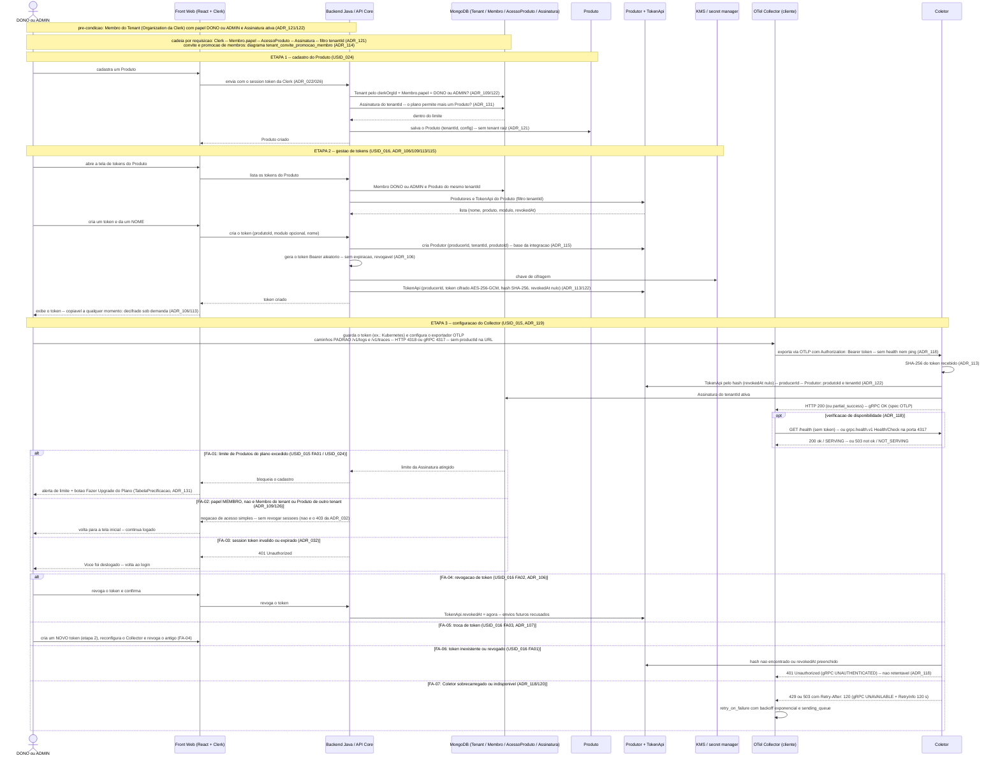
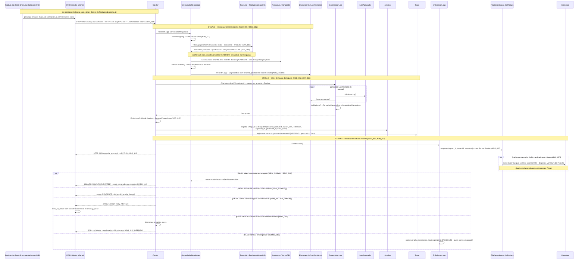

# Diagramas de Sequência v7 — Ingestão de Telemetria (LhamaLog)

> **v7 (12/10/2026).** Os **dois PNGs foram redesenhados** no modelo multi-tenant (ADR_121–133): `Tenant` = empresa
> (Organization da Clerk), `Membro.papel` DONO/ADMIN/MEMBRO, `Produto` com `tenantId`, `Produtor` + `TokenApi`,
> busca SHA-256 → producerId → produtoId/tenantId, negação simples da ADR_126; mantidas as ADR_112/113/118/119/120.
> Diagrama 2: `LogRecebido` no **Elasticsearch** (ADR_116), 401 para token inválido, 429/503 com `Retry-After: 120`,
> fila por Produto com gatilho padrão 500 (ADR_057). O PNG de Pedro `ingestao_telemetria.png` fica na pasta (sem permissão
> para movê-lo); o diagrama 2 novo é `telemetria_ingestao.png`. Limite de Produtos vem da `TabelaPrecificacao` (ADR_131).

> **Nota multi-tenant (12/10/2026) — ADR_121 a ADR_130.** O modelo hierárquico hash → metadata da ADR_105 foi **substituído**
> pelo modelo SaaS pool: tenant = empresa cliente (Organization da Clerk, `clerkOrgId`), coleções `Tenant`, `Assinatura`,
> `Membro` (papel DONO/ADMIN/MEMBRO), `Produto`, `AcessoProduto`, `Produtor` e `TokenApi`; todo documento e log leva `tenantId`
> e toda consulta passa pelo filtro centralizado do Core. Hash + metadata ficou só para máquinas (`TokenApi`). Não-membro ou
> produtoId errado = negação simples e volta à tela inicial (ADR_126). Detalhes e diagramas por módulo na pasta
> `Diagramas de Sequencia > Tenant e Multi-tenant` (`sequencia-tenant-multitenant.md`).
>
> **Neste fluxo:** onde o texto e o diagrama 1 citam a "Tabela de Tenant (hash → metadata)", leia: papel no `Membro`
> (ADR_122/123), Produto no `Produto` com `tenantId`, token em `Produtor` + `TokenApi`; na ingestão o Coletor faz
> Bearer → SHA-256 → `TokenApi` → `Produtor` → `tenantId` + `produtoId` (ver `tenant_ingestao_coletor.png`). Não existe mais
> "tenant raiz empresa + produto" nem teamId na metadata; destinatários de alertas são por papel (ADR_130).
> O PNG `telemetria_configuracao.png` foi redesenhado na v7.
> **Changelog v6 (Out 11, 2026, Michel Bocchi Junior):** ADR_119 — só os caminhos OTLP padrão `/v1/logs` e `/v1/traces`
> (HTTP 4318, gRPC 4317); `producer/{productId}/packet` removido; Produto/tenant resolvidos só pela metadata do token
> Bearer (substitui a parte de endpoint da ADR_108). ADR_120 — `Retry-After` de 120 s em 429/503. A v5 foi movida, sem
> alteração, para a subpasta `v1`.

> **Changelog v5 (Out 11, 2026, Michel Bocchi Junior):** ADR_118 — saúde do serviço só por `GET /health` (+ `grpc.health.v1`
> na porta 4317), `/ping` removido, `ultimaValidacao` anulado; respostas de exportação seguem a spec OTLP (retentáveis
> 429/502/503/504 com Retry-After; não retentáveis 400/401). Substitui parcialmente a ADR_112. A v4 foi movida, sem
> alteração, para a subpasta `v1`.

> **Changelog v4 (Out 11, 2026, Michel Bocchi Junior):** respostas do Michel às pendências do diagrama 1 (ADR_112 a
> ADR_117). A v3 (`sequencia-ingestao-telemetria.md` e `telemetria_configuracao.png`) foi movida, sem alteração, para a
> subpasta `v1`; os arquivos do Pedro continuam na pasta (403). Diagrama 2 sem alteração no PNG; notas atualizadas.
> - ADR_112 — Endpoints de teste GET /ping e GET /health
> - ADR_113 — Token Bearer do produtor: AES-256-GCM (chave no KMS) + SHA-256 como índice (sugerido pelo assistente, aceito pelo Michel)
> - ADR_114 — Convite de membros e promoção a administrador (só backend)
> - ADR_115 — producerId gerado com o token
> - ADR_116 — Elasticsearch para logs e MongoDB como banco core (resolve o conflito da SSID_002)
> - ADR_117 — "Token" da planilha de créditos = tokens de API de LLM (BYOK); o usuário compra Créditos

> **Changelog v3 (Out 11, 2026, Michel Bocchi Junior):** revisão do **diagrama 1 (configuração)** com as decisões do
> Michel de 11/10/2026 (ADR_105 a ADR_111). O diagrama 2 (ingestão) **não foi alterado**; ganhou só notas onde as decisões
> o afetam. **Versionamento:** o `sequencia-telemetria.md` e o `configurar_fonte_telemetria.png` do Pedro **não puderam
> ser movidos (403, sem permissão de escrita do app)** e continuam na pasta, intactos. Por isso esta versão foi gravada
> com nomes distintos: **`sequencia-ingestao-telemetria.md`** e **`telemetria_configuracao.png`** (o nome que a v2 já
> citava para o diagrama 1). A subpasta `v1` foi criada para receber os arquivos do Pedro quando forem movidos manualmente.
> O `ingestao_telemetria (2).png` não foi tocado (o Michel resolve).

**Versão 2 (03/10/2026).** Versão consolidada em **2 diagramas**: cada fluxo alternativo fica num `alt` dentro do
diagrama, e as etapas são separadas por notas. A v1 (6 diagramas) está, sem alteração, na subpasta `v1`.

**Escopo:** da configuração da fonte de telemetria até o `Arquivo` entrar na `FilaDesordenada`. Daí em diante
(Varredura → Finder → Ocorrência) vale o diagrama oficial `Varredura e Finder` (`varredura.png` e `finder.png`).

Marcações: `[PENDENTE]` requisito sem definição nas fontes; `[INFERIDO]` ligação feita por nós entre o modelo de
classes, os casos de uso e as ADRs; `[CONFLITO]` duas fontes dizem coisas diferentes. Valores de enum entre aspas
(`"ACTIVE"`), sem relação com `[PENDENTE]`. Onde o modelo de classes não tem método, o passo aparece como descrição.

**Base:** USID_015, USID_016, USID_024, SSID_001, SSID_002, SSID_003, SSID_014 (`LhamaLog_casos_de_uso.xlsx`);
abas `Coletor`, `GerenciadorRequisicao`, `LogRecebido`, `GerenciadorLote`, `LoteAgrupador`, `EnfileiradorLogs`,
`Arquivo`, `CredencialIngestao`, `ExternalToken`, `API - Token` (`Modelo_de_Classes_LhamaLog.xlsx`);
`diagrama_classes_varredura_finder_v2.md` (`Arquivo` v2, `Trace`, `FilaDesordenada`); `der.md` v2
(`IntegracaoOpenTelemetry`, `FonteTelemetria`, `CredencialIngestao`, `LogRecebido`, `LoteAgrupador`, `Arquivo`, `Trace`);
ADR_001, 007, 010, 015, 022, 025, 026, 028, 029, 030, 032.

**Visão geral do fluxo:** o Gestor cadastra o Produto, o sistema gera a credencial de ingestão e o Gestor configura o
OpenTelemetry Collector do cliente com o endpoint do Coletor e essa credencial (**diagrama 1**). Em execução, o
Collector exporta logs e traces ao Coletor, que valida a origem, resolve o tenant, registra os `LogRecebido`, agrupa
em lote, forma o `Arquivo` (pacote de traces, ADR_015) e o publica na `FilaDesordenada`; se a fila passar do limite
interno, a Varredura é disparada (**diagrama 2**).

**Participantes usados:**
- `Gestor` / `Front Web (React + Clerk)` / `Backend Java (API REST)` — sessão da Clerk validada no backend (ADR_022/026/032)
- `Assinatura / Plano` — limite de Produtos do plano (USID_015/024)
- `Produto` — produto do cliente, dono da credencial
- `CredencialIngestao` — credencial própria do LhamaLog para o Collector (ADR_025/028); no DER tem `status`,
  `expiraEm`, `revogadaEm`
- `IntegracaoOpenTelemetry` — só existe no DER v2 (protocolo, endpoint, status, `ultimaValidacao`); sem classe
- `OTel Collector (cliente)` — Collector padrão de mercado instalado no cliente (ADR_007)
- `Coletor`, `GerenciadorRequisicao`, `LogRecebido`, `GerenciadorLote`, `LoteAgrupador`, `EnfileiradorLogs` — módulo
  Coletor do modelo de classes
- `Tenant` — coleção mestre de tenant (ADR_030), a "tabela de tenant" da ADR_007
- `Arquivo`, `Trace` — pacote de traces e seus traces (ADR_015; classes v2)
- `FilaDesordenada`, `Varredura` — classes v2; a `Varredura` só aparece no ponto de disparo

## ⚠️ Pontos críticos

**1. Resolvido (ADR_105), substituído pelas ADR_121/122 — Tenant na ingestão.** Modelo hierárquico chave-valor: tenant raiz (empresa + produto) e uma
entrada com hash aleatório por usuário ou produtor; a ingestão resolve o tenant pelo hash do token do produtor →
metadata (enterpriseId, productId, producerId), e o `owner_id` sai daí. Texto original: — a ADR_007 diz que o Coletor "preenche o `owner_id` consultando a tabela de
tenant". A ADR_030 define essa coleção com um `tenant_id` único por **empresa + usuário + produto**. Na ingestão pelo
Collector não existe usuário, só a credencial do Produto. Não está definido como o Coletor chega a um `tenant_id` sem
usuário, nem se `owner_id` e `tenant_id` são o mesmo campo. Diagrama 2, etapa 1.

**2. Resolvido (ADR_106/111) — Credencial de ingestão.** Token de API (hash aleatório) por produtor, criado na tela de
gestão de tokens, copiável a qualquer momento, sem expiração por padrão, revogável; vários por Produto ou módulo. As
classes `ExternalToken`, `API - Token`, `Autorizador` e `Autorizador - SDK` saem; fica a tabela `CredencialIngestao`.
Texto original: — ADR_025 e ADR_028 confirmam que a ingestão usa uma credencial própria
(`CredencialIngestao`), sem M2M nem API keys da Clerk, mas deixam geração, hash, rotação e revogação em aberto.
A classe `CredencialIngestao` do modelo é do lado do SDK (`estaPresente()`, `copiaSegura()`, `limpar()`); o registro
guardado no servidor (status, expiração, revogação) só existe no DER. As classes `ExternalToken`, `API - Token`,
`Autorizador` e `Autorizador - SDK` continuam no modelo; o DER v2 marca `ExternalToken` como "substituir por
`CredencialIngestao`" `[INFERIDO]`. Diagramas 1 e 2.

**3. Resolvido (ADR_116) — Banco de gravação dos logs:** Elasticsearch para logs, MongoDB como banco core. Texto original: — a SSID_002 diz que os logs são gravados "no Elasticsearch/OpenSearch".
A ADR_001 define MongoDB e a ADR_029 (Aceito) confirma: "O banco do LhamaLog é MongoDB". Diagrama 2, etapa 1.

**4. Resolvido (ADR_117) — Tipo errado na planilha:** o "Token" da planilha de créditos são tokens de API de LLM (BYOK). Texto original: — `GerenciadorRequisicao.Token` está tipado como `Credito`.

**5. `[PENDENTE]` Classes de lote sem ADR** — `GerenciadorLote`, `LoteAgrupador` e `EnfileiradorLogs` vêm do modelo de
classes e das SSID_002/003; nenhuma ADR as cita. O DER v2 mantém `LoteAgrupador` e `LogRecebido`. O diagrama oficial de
Varredura mostra o Coletor gravando o Arquivo direto na `FilaDesordenada`, sem essas classes. Diagrama 2, etapa 2.

**6. `[INFERIDO]` Criação do `Trace`** — a ADR_015 diz que o Arquivo comprime traces, correlation IDs e logs do pacote,
e as classes v2 criaram `Trace` (`trace_id`, `correlation_id`, `host_name`, `generated_at`). Nenhuma fonte diz quem cria
o `Trace` na ingestão. Módulo e prioridade do trace são resolvidos depois, na Varredura (ADR_009). Diagrama 2, etapa 2.

**7. Resolvido (ADR_109) — Usuário sem permissão.** Só administradores criam/revogam tokens; quem não tem permissão
recebe uma negação de acesso simples na tela, sem o 403 da ADR_032 (que revoga as sessões). Texto original: — a USID_016 (FA04) pede a mensagem "Acesso Negado". A ADR_032 trata
falta de permissão como 403 `[INFERIDO na própria ADR]`, e o 403 revoga todas as sessões do usuário e o desloga.
Diagrama 1.

**8. Resolvido (ADR_107) — Regeneração de credencial:** não existe caso especial; cria-se outro token e revoga-se o antigo. Texto original: — a USID_016 (FA03) diz que o sistema "invalida o token anterior (ou
mantém ambos conforme a regra de negócio)"; a regra não existe. Diagrama 1.

**9. Parcialmente resolvido (ADR_108/110) — Protocolo e resposta do Coletor.** OTLP HTTP (4318) e gRPC (4317), endpoint
caminhos padrão `/v1/logs` e `/v1/traces` (ADR_119, que substitui o `producer/{productId}/packet`), saúde por `GET /health` (ADR_118) e respostas pela spec OTLP (ADR_118/120). Texto original: nenhuma fonte define o protocolo OTLP (gRPC ou HTTP), o endpoint,
nem a resposta do Coletor ao Collector (aceite, recusa, códigos). `IntegracaoOpenTelemetry` e `FonteTelemetria` existem
só no DER; nenhuma fonte diz quando `ultimaValidacao` ou `ultimaComunicacao` são atualizados. Diagramas 1 e 2.

**10. `[PENDENTE]` Limite do plano na ingestão** — a USID_015 (FA01) bloqueia o envio de dados de um Produto acima da
cota da assinatura, mas não diz onde o Coletor consulta essa cota. Diagrama 2.

**11. `[PENDENTE]` Aviso de falha de conexão** — a SSID_001 pede "retornar um erro e alertar o usuário da melhor forma e
mais rápido possível" quando o utilitário não conecta; canal e quem detecta não estão definidos. Diagrama 2.

**12. Legado fora dos diagramas** — USID_017–020 (Baixar SDK, Baixar/Configurar/Iniciar Executável), a classe
`Executavel` e as classes do SDK (`LogSDK`, `ClienteColetor`, `EnvelopeIngestao` etc.) não aparecem: o DER v2 marca
`Executavel` como `MOD_LEGADO` e a ADR_007 coloca o OpenTelemetry Collector no lugar. A SSID_001 ainda fala em "SDK ou
Executável" e a USID_015 em "Implementar SDK"; aqui a USID_015 foi lida como configurar o Collector `[INFERIDO]`.

**13. `[PENDENTE]` Comunicação entre módulos** — a ADR_028 define API interna com JWT próprio entre API REST, Coletor,
Finder e Fila; algoritmo, rotação e chaves estão em aberto. Não aparece como passo separado nos diagramas.

**14. Divergência fora do escopo, registrada para não se perder** — a ADR_010 (Aceito) tem só dois gatilhos de
Varredura (agendamento e tamanho da fila); as classes v2 e o DER v2 têm `trigger` com `"FORCED"` `[INFERIDO]`, que
corresponde ao disparo manual. Só o gatilho por tamanho da fila aparece aqui (diagrama 2, etapa 3).

---

## 1. Configuração da fonte de telemetria — Produto, tenant, token e Collector (USID_015, USID_016, USID_024; ADR_105 a ADR_111)

Arquivo: `telemetria_configuracao.png` (o `configurar_fonte_telemetria.png` do Pedro segue na pasta por causa do 403)

**Resumo do fluxo:** o administrador cadastra um Produto dentro do limite do plano; o sistema cria o tenant raiz
(empresa + produto) e atualiza a metadata dos membros. Na tela de gestão de tokens (só administradores), ele cria um
token com nome para um produtor; o token (hash aleatório) é registrado na tabela de tenant com a metadata do produtor e
pode ser copiado a qualquer momento. O cliente guarda o token (ex.: Kubernetes), configura o Collector em OTLP HTTP/gRPC
nos caminhos padrão `/v1/logs` e `/v1/traces` (ADR_119); a saúde é verificada por `GET /health` (ADR_118).

**Fluxo principal:**
1. Cadastro do Produto com checagem de administrador na metadata do tenant e do limite do plano (USID_024).
2. Criação do tenant raiz (empresa + produto) e atualização da metadata dos membros — Resolvido (ADR_105).
3. Tela de gestão de tokens: acesso pela metadata do usuário (administrador + Produto acessível) — Resolvido (ADR_109).
4. Criação do token com nome; hash aleatório, sem expiração, revogável, vários por Produto/módulo; entrada do produtor na tabela de tenant — Resolvido (ADR_105/106).
5. O token pode ser copiado a qualquer momento — Resolvido (ADR_106).
6. Collector configurado com OTLP HTTP 4318 ou gRPC 4317 nos caminhos padrão `/v1/logs` e `/v1/traces`; sem productId na URL, Produto e tenant vêm só da metadata do token Bearer — Resolvido (ADR_108/119).
7. Disponibilidade só por `GET /health` (200 ok / 503 not ok, sem token) e, no gRPC, `grpc.health.v1` — Resolvido (ADR_118, substitui o `/ping` da ADR_112). O token é validado na própria exportação OTLP (401 não retentável).
8. Token Bearer guardado cifrado (AES-256-GCM, chave no KMS/secret manager) + hash SHA-256 como índice de busca do Coletor — Resolvido (ADR_113).
9. Convite de membro e promoção a administrador por endpoints de backend autorizados pela Clerk (owner ou admin) — Resolvido (ADR_114).

**Fluxos alternativos:**
- **FA-01** limite de Produtos do plano excedido (sem mudança).
- **FA-02** usuário não administrador ou sem o Produto na metadata → negação de acesso simples na tela, sem revogar
  sessões — Resolvido (ADR_109). Substitui o `[CONFLITO]` com o 403 da ADR_032.
- **FA-03** session token inválido ou expirado → 401 (ADR_032).
- **FA-04** revogação do token: `CredencialIngestao` revogada e entrada do produtor invalidada (ADR_106).
- **FA-05** troca de token: criar um novo e revogar o antigo; sem regeneração especial — Resolvido (ADR_107). Substitui o antigo FA-05.
- **FA-06** exportação recusada: token inexistente, revogado ou de outro Produto → 401 / `UNAUTHENTICATED`, não retentável (ADR_118).
- **FA-07** LhamaLog sobrecarregado ou indisponível → 429/503 com `Retry-After: 120` (gRPC `UNAVAILABLE` + `RetryInfo` de 120 s, ADR_120); o Collector refaz com backoff exponencial (ADR_118).
- **opt convite/promoção:** owner convida um email direto como administrador; admin convida como membro e depois promove (ADR_114).

**Notas sobre este diagrama:**
- **Por que não 403 no FA-02 (ADR_109):** na ADR_032 o 403 revoga todas as sessões do usuário e o desloga, uma reação a
  uso indevido. Um membro sem perfil de administrador que abre a tela de tokens não está atacando nada: só não tem a
  permissão. Por isso a resposta é uma negação de acesso simples na tela, e ele continua logado.
- `IntegracaoOpenTelemetry` saiu do diagrama: o teste de conexão é feito pelo endpoint de teste (ADR_110); se
  `ultimaValidacao` continua sendo gravada `[PENDENTE]`.
- Armazenamento do token — Resolvido (ADR_113): AES-256-GCM (recuperável para copiar) + SHA-256 como índice. Sugerido pelo assistente a pedido do Michel e aceito.
- `producerId` — Resolvido (ADR_115): gerado com o token, identificador base do produtor; um Produto tem vários produtores, cada um com seu token. O vínculo token ↔ módulo continua `[INFERIDO]`.
- `IntegracaoOpenTelemetry.ultimaValidacao` foi anulado — Resolvido (ADR_118); a disponibilidade fica no `GET /health`.
- **Caminhos OTLP — Resolvido (ADR_119):** só `/v1/logs` e `/v1/traces`, os padrões do exportador `otlphttp`; o cliente só configura o `endpoint` base e o header `Authorization: Bearer`. `producer/{productId}/packet` foi removido.
- A `CredencialIngestao` passa a ser a tabela do módulo de gestão de tokens, que registra quais Produtos e módulos da
  empresa têm tokens (ADR_111); se ela e a entrada do produtor na tabela de tenant são o mesmo registro `[INFERIDO: não,
  são duas coleções ligadas pelo hash]`.

---

## 2. Ingestão em execução — do Collector até a FilaDesordenada (SSID_001, SSID_002, SSID_003; ADR_007, 010, 015)

Arquivo: `telemetria_ingestao.png`

**Resumo do fluxo:** o Collector exporta logs e traces com o token Bearer em `/v1/logs` ou `/v1/traces`. O Coletor recebe pelo
`GerenciadorRequisicao`, resolve o tenant por SHA-256 → `TokenApi` → `Produtor` (tenantId + produtoId), confere a `Assinatura` e persiste cada `LogRecebido` no
Elasticsearch (ADR_116). O `GerenciadorLote` agrupa os logs no `LoteAgrupador` e valida o lote; o Coletor forma o `Arquivo` com
`EnviarLote()` (pacote de traces, ADR_015) e registra os `Trace` do pacote. O `EnfileiradorLogs` publica o Arquivo na
`FilaDesordenada` como pendente. Se a fila passar do limite interno e não houver varredura agendada, a Varredura é
disparada.

**Fluxo principal:**
1. Recepção e validação: `ReceberLog()`, `ValidarOrigem()` (SHA-256 → `TokenApi` → `Produtor`), `Assinatura`, `ValidarContexto()`, `PersistirLog()` no Elasticsearch.
2. Lote e Arquivo: `CriarLoteUnico()`/`CriarLotes()`, `AdicionarLog()` + `AssociarLogLote()` por log, `ValidarLote()`,
   `EnviarLote(): List<Arquivo>`, registro dos `Trace`.
3. Fila: `EnfilerarLote()` → `FilaDesordenada.enqueue(arquivo_id)`; disparo por tamanho da fila (ADR_010).

**Fluxos alternativos:**
- **FA-01** credencial inválida, expirada ou revogada (USID_016 FA01, SSID_014).
- **FA-02** Produto acima da cota do plano (USID_015 FA01).
- **FA-03** Collector não consegue conectar ao Coletor (SSID_001).
- **FA-04** falha de comunicação ou de armazenamento (SSID_002).
- **FA-05** falha ao enviar para a fila (SSID_003).

**Notas sobre este diagrama:**
- **Nota v3 (sem alterar o PNG):** decisões do diagrama 1 que afetam este diagrama —
  - caminhos padrão `/v1/logs` e `/v1/traces`, OTLP HTTP (4318) e gRPC (4317) (ADR_108/119; `producer/{productId}/packet` removido): resolve o `[PENDENTE]` de protocolo
    da mensagem de exportação;
  - `ValidarOrigem()` e a consulta ao `Tenant` passam a ser a busca do hash do token na tabela de tenant → metadata
    (enterpriseId, productId, producerId), e o `owner_id` sai dessa metadata (ADR_105/106): resolve o `[CONFLITO]` do
    tenant sem usuário. Não há productId na URL: Produto e tenant vêm **só** da metadata do token (ADR_119) — o antigo `[INFERIDO]` de conferir o productId do endpoint com a metadata não se aplica mais;
  - sobrecarga: 429/503 com `Retry-After: 120` (ADR_120);
  - token revogado → FA-01 (ADR_106).
- Etapa 1: Elasticsearch × MongoDB resolvido (ADR_116) — os `LogRecebido` vão para o Elasticsearch; o PNG ainda não reflete isso. O tenant sem usuário foi resolvido (ADR_105).
- O Coletor recebe o token como Bearer e busca pelo SHA-256 (ADR_113).
- `[PENDENTE]` etapa 2: `GerenciadorLote`/`LoteAgrupador`/`EnfileiradorLogs` sem ADR (ponto crítico 5).
- `QauntidadeMaximaLog` está escrito assim na planilha; mantido como está.
- O `Arquivo` sai da ingestão como pendente. `ArquivoVarredura` só é criado pela Varredura (`enqueueArquivos()`), no
  diagrama oficial.
- O `Arquivo` devolvido pelo Finder após falha da LLM volta à `FilaDesordenada` com os horários originais (ADR_014);
  isso está no diagrama oficial `finder.png`, não aqui.

---

## Notas obrigatórias (pendências)

**Resolvidos na v3 (diagrama 1):**
- **Resolvido (ADR_105), substituído pelas ADR_121/122** tenant da ADR_030 × ingestão sem usuário: agora TokenApi → Produtor → tenantId (o hash fica só para máquinas).
- **Resolvido (ADR_109)** USID_016 FA04 × 403 da ADR_032: negação de acesso simples na tela.
- **Resolvido (ADR_111)** classes legadas `ExternalToken`, `API - Token`, `Autorizador`, `Autorizador - SDK` removidas; fica a `CredencialIngestao`.
- **Resolvido (ADR_106)** geração, revogação e exibição do token (sem expiração, copiável a qualquer momento).
- **Resolvido (ADR_107)** regeneração: criar novo e revogar o antigo.
- **Resolvido (ADR_108)** protocolo OTLP e endpoint.
- **Resolvido (ADR_110)** teste de conexão por endpoint HTTP de teste.

**Resolvidos na v6 (diagrama 1):** caminhos padrão `/v1/logs` e `/v1/traces` (ADR_119); `Retry-After: 120` (ADR_120).

**Resolvidos na v5 (diagrama 1):** saúde só por `GET /health` e `grpc.health.v1`; `/ping` e `ultimaValidacao` removidos; códigos OTLP (ADR_118).

**Resolvidos na v4 (diagrama 1):** endpoints de teste (ADR_112); armazenamento do token (ADR_113); convite/promoção (ADR_114); producerId (ADR_115).

**Continuam abertos — diagrama 1:**
- **`[PENDENTE]`** rotas exatas dos endpoints de convite e promoção (ADR_114).
- **Resolvido (ADR_119)** caminhos OTLP: só os padrão.
- **Resolvido (ADR_120)** `Retry-After` em sobrecarga: 120 s. Quem emite (Coletor ou gateway) `[INFERIDO: o Coletor]`.
- **Resolvido (ADR_118)** `ultimaValidacao` removido.
- **`[INFERIDO]`** vínculo opcional token ↔ módulo; `CredencialIngestao` e entrada do produtor como coleções separadas ligadas pelo hash.

**Continuam abertos — diagrama 2 (revisão seguinte):**
- **Resolvido (ADR_116)** SSID_002 × ADR_001/029: Elasticsearch guarda os logs; **PNG redesenhado na v7**.
- **`[PENDENTE]`** cota de ingestão por plano e código de recusa (403 ou 429); quem reenvia um Arquivo que falhou ao entrar na fila; quem cria o `Trace` `[INFERIDO: o Coletor]`; `GerenciadorLote`/`LoteAgrupador`/`EnfileiradorLogs` sem ADR.
- **Resolvido (ADR_117)** `GerenciadorRequisicao.Token` tipado como `Credito`: o "Token" da planilha de créditos são tokens de API de LLM (BYOK) cadastrados como fonte de crédito, diferente do token do produtor `[INFERIDO — ligação com o GerenciadorRequisicao]`.
- **Resolvido (ADR_118)** códigos de resposta ao Collector e reenvio: seguir a spec OTLP (200/partial success; 400 e 401 não retentáveis; 429/502/503/504 retentáveis com Retry-After; o Collector reenvia com backoff). Falta só desenhar no diagrama 2.
- **`[PENDENTE]`** onde o Coletor consulta a cota do plano (USID_015 FA01).
- **`[PENDENTE]`** canal do alerta de falha de conexão (SSID_001).
- **`[PENDENTE]`** `GerenciadorLote`/`LoteAgrupador`/`EnfileiradorLogs` sem ADR; o diagrama oficial de Varredura não os mostra.
- **`[PENDENTE]`** reenvio de Arquivo que falhou ao entrar na fila (SSID_003).
- **`[PENDENTE]`** alinhar o disparo por tamanho da fila com a ADR_057 (opcional por cliente, padrão 500 arquivos, fila por Produto) — o PNG ainda mostra "ex.: 10".
- **`[PENDENTE]`** alinhar o Arquivo devolvido após falha com as ADR_059/073 (DLQ) em vez da ADR_014.
- **`[PENDENTE]`** algoritmo, rotação e chaves do JWT interno entre módulos (ADR_028).
- **`[INFERIDO]`** criação do `Trace` na ingestão. (A conferência do productId do endpoint com a metadata do token deixou de se aplicar — ADR_119.)
- **`[INFERIDO]`** USID_015 ("Implementar SDK") lida como configuração do OpenTelemetry Collector (ADR_007).
- Fora do escopo: Varredura, Finder e Ocorrência — diagrama oficial `Varredura e Finder`.

**Rastreabilidade:** USID_015, USID_016, USID_024, SSID_001, SSID_002, SSID_003, SSID_014 (`LhamaLog_casos_de_uso.xlsx`);
`Modelo_de_Classes_LhamaLog.xlsx` (abas listadas na Base); `diagrama_classes_varredura_finder_v2.md`; `der.md` v2;
ADR_001, 007, 010, 015, 022, 025, 026, 028, 029, 030, 032 e ADR_105–133. USID_017–020 não estão representados (legado, ponto
crítico 12).

**Renderização:** PNGs gerados com o mermaid-cli (`mmdc`, tema neutral, fundo branco) e escala 2.
