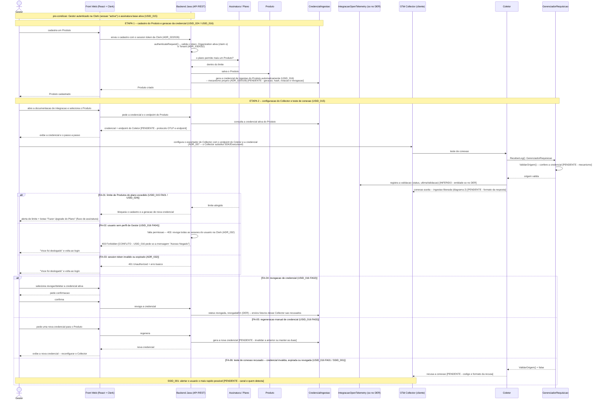
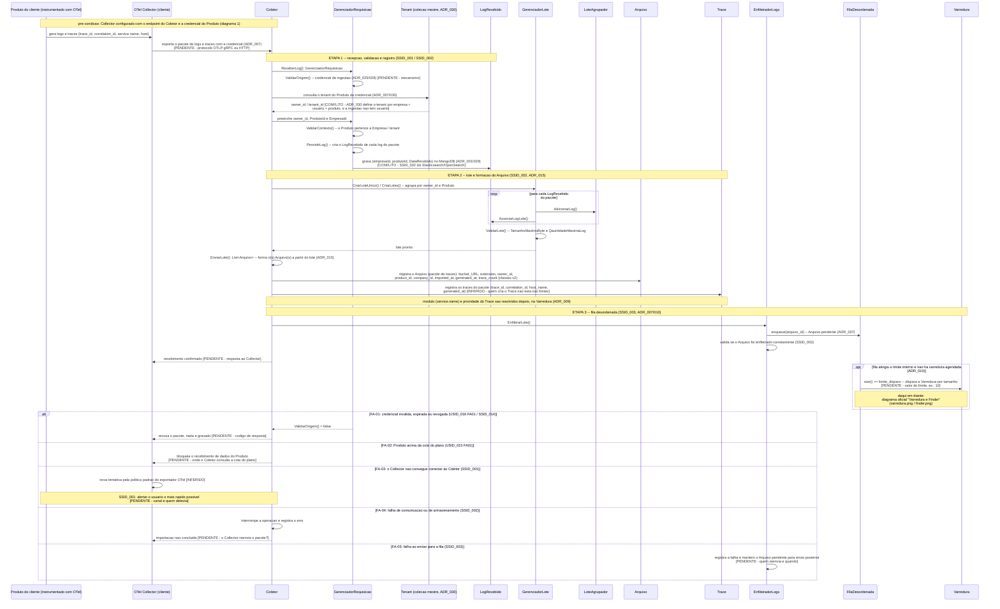

# Diagramas de Sequência v2 — Ingestão de Telemetria (LhamaLog)

**Versão 2 (03/10/2026).** Versão consolidada em **2 diagramas**: cada fluxo alternativo fica num `alt` dentro do
diagrama, e as etapas são separadas por notas. A v1 (6 diagramas) está, sem alteração, na subpasta `v1`.

**Escopo:** da configuração da fonte de telemetria até o `Arquivo` entrar na `FilaDesordenada`. Daí em diante
(Varredura → Finder → Ocorrência) vale o diagrama oficial `Varredura e Finder` (`varredura.png` e `finder.png`).

Marcações: `[PENDENTE]` requisito sem definição nas fontes; `[INFERIDO]` ligação feita por nós entre o modelo de
classes, os casos de uso e as ADRs; `[CONFLITO]` duas fontes dizem coisas diferentes. Valores de enum entre aspas
(`"ACTIVE"`), sem relação com `[PENDENTE]`. Onde o modelo de classes não tem método, o passo aparece como descrição.

**Base:** USID_015, USID_016, USID_024, SSID_001, SSID_002, SSID_003, SSID_014 (`LhamaLog_casos_de_uso.xlsx`);
abas `Coletor`, `GerenciadorRequisicao`, `LogRecebido`, `GerenciadorLote`, `LoteAgrupador`, `EnfileiradorLogs`,
`Arquivo`, `CredencialIngestao`, `ExternalToken`, `API - Token` (`Modelo_de_Classes_LhamaLog.xlsx`);
`diagrama_classes_varredura_finder_v2.md` (`Arquivo` v2, `Trace`, `FilaDesordenada`); `der.md` v2
(`IntegracaoOpenTelemetry`, `FonteTelemetria`, `CredencialIngestao`, `LogRecebido`, `LoteAgrupador`, `Arquivo`, `Trace`);
ADR_001, 007, 010, 015, 022, 025, 026, 028, 029, 030, 032.

**Visão geral do fluxo:** o Gestor cadastra o Produto, o sistema gera a credencial de ingestão e o Gestor configura o
OpenTelemetry Collector do cliente com o endpoint do Coletor e essa credencial (**diagrama 1**). Em execução, o
Collector exporta logs e traces ao Coletor, que valida a origem, resolve o tenant, registra os `LogRecebido`, agrupa
em lote, forma o `Arquivo` (pacote de traces, ADR_015) e o publica na `FilaDesordenada`; se a fila passar do limite
interno, a Varredura é disparada (**diagrama 2**).

**Participantes usados:**
- `Gestor` / `Front Web (React + Clerk)` / `Backend Java (API REST)` — sessão da Clerk validada no backend (ADR_022/026/032)
- `Assinatura / Plano` — limite de Produtos do plano (USID_015/024)
- `Produto` — produto do cliente, dono da credencial
- `CredencialIngestao` — credencial própria do LhamaLog para o Collector (ADR_025/028); no DER tem `status`,
  `expiraEm`, `revogadaEm`
- `IntegracaoOpenTelemetry` — só existe no DER v2 (protocolo, endpoint, status, `ultimaValidacao`); sem classe
- `OTel Collector (cliente)` — Collector padrão de mercado instalado no cliente (ADR_007)
- `Coletor`, `GerenciadorRequisicao`, `LogRecebido`, `GerenciadorLote`, `LoteAgrupador`, `EnfileiradorLogs` — módulo
  Coletor do modelo de classes
- `Tenant` — coleção mestre de tenant (ADR_030), a "tabela de tenant" da ADR_007
- `Arquivo`, `Trace` — pacote de traces e seus traces (ADR_015; classes v2)
- `FilaDesordenada`, `Varredura` — classes v2; a `Varredura` só aparece no ponto de disparo

## ⚠️ Pontos críticos

**1. `[CONFLITO]` Tenant na ingestão** — a ADR_007 diz que o Coletor "preenche o `owner_id` consultando a tabela de
tenant". A ADR_030 define essa coleção com um `tenant_id` único por **empresa + usuário + produto**. Na ingestão pelo
Collector não existe usuário, só a credencial do Produto. Não está definido como o Coletor chega a um `tenant_id` sem
usuário, nem se `owner_id` e `tenant_id` são o mesmo campo. Diagrama 2, etapa 1.

**2. `[PENDENTE]` Credencial de ingestão** — ADR_025 e ADR_028 confirmam que a ingestão usa uma credencial própria
(`CredencialIngestao`), sem M2M nem API keys da Clerk, mas deixam geração, hash, rotação e revogação em aberto.
A classe `CredencialIngestao` do modelo é do lado do SDK (`estaPresente()`, `copiaSegura()`, `limpar()`); o registro
guardado no servidor (status, expiração, revogação) só existe no DER. As classes `ExternalToken`, `API - Token`,
`Autorizador` e `Autorizador - SDK` continuam no modelo; o DER v2 marca `ExternalToken` como "substituir por
`CredencialIngestao`" `[INFERIDO]`. Diagramas 1 e 2.

**3. `[CONFLITO]` Banco de gravação dos logs** — a SSID_002 diz que os logs são gravados "no Elasticsearch/OpenSearch".
A ADR_001 define MongoDB e a ADR_029 (Aceito) confirma: "O banco do LhamaLog é MongoDB". Diagrama 2, etapa 1.

**4. `[CONFLITO]` Tipo errado na planilha** — `GerenciadorRequisicao.Token` está tipado como `Credito`.

**5. `[PENDENTE]` Classes de lote sem ADR** — `GerenciadorLote`, `LoteAgrupador` e `EnfileiradorLogs` vêm do modelo de
classes e das SSID_002/003; nenhuma ADR as cita. O DER v2 mantém `LoteAgrupador` e `LogRecebido`. O diagrama oficial de
Varredura mostra o Coletor gravando o Arquivo direto na `FilaDesordenada`, sem essas classes. Diagrama 2, etapa 2.

**6. `[INFERIDO]` Criação do `Trace`** — a ADR_015 diz que o Arquivo comprime traces, correlation IDs e logs do pacote,
e as classes v2 criaram `Trace` (`trace_id`, `correlation_id`, `host_name`, `generated_at`). Nenhuma fonte diz quem cria
o `Trace` na ingestão. Módulo e prioridade do trace são resolvidos depois, na Varredura (ADR_009). Diagrama 2, etapa 2.

**7. `[CONFLITO]` Usuário sem perfil de Gestor** — a USID_016 (FA04) pede a mensagem "Acesso Negado". A ADR_032 trata
falta de permissão como 403 `[INFERIDO na própria ADR]`, e o 403 revoga todas as sessões do usuário e o desloga.
Diagrama 1.

**8. `[PENDENTE]` Regeneração de credencial** — a USID_016 (FA03) diz que o sistema "invalida o token anterior (ou
mantém ambos conforme a regra de negócio)"; a regra não existe. Diagrama 1.

**9. `[PENDENTE]` Protocolo e resposta do Coletor** — nenhuma fonte define o protocolo OTLP (gRPC ou HTTP), o endpoint,
nem a resposta do Coletor ao Collector (aceite, recusa, códigos). `IntegracaoOpenTelemetry` e `FonteTelemetria` existem
só no DER; nenhuma fonte diz quando `ultimaValidacao` ou `ultimaComunicacao` são atualizados. Diagramas 1 e 2.

**10. `[PENDENTE]` Limite do plano na ingestão** — a USID_015 (FA01) bloqueia o envio de dados de um Produto acima da
cota da assinatura, mas não diz onde o Coletor consulta essa cota. Diagrama 2.

**11. `[PENDENTE]` Aviso de falha de conexão** — a SSID_001 pede "retornar um erro e alertar o usuário da melhor forma e
mais rápido possível" quando o utilitário não conecta; canal e quem detecta não estão definidos. Diagrama 2.

**12. Legado fora dos diagramas** — USID_017–020 (Baixar SDK, Baixar/Configurar/Iniciar Executável), a classe
`Executavel` e as classes do SDK (`LogSDK`, `ClienteColetor`, `EnvelopeIngestao` etc.) não aparecem: o DER v2 marca
`Executavel` como `MOD_LEGADO` e a ADR_007 coloca o OpenTelemetry Collector no lugar. A SSID_001 ainda fala em "SDK ou
Executável" e a USID_015 em "Implementar SDK"; aqui a USID_015 foi lida como configurar o Collector `[INFERIDO]`.

**13. `[PENDENTE]` Comunicação entre módulos** — a ADR_028 define API interna com JWT próprio entre API REST, Coletor,
Finder e Fila; algoritmo, rotação e chaves estão em aberto. Não aparece como passo separado nos diagramas.

**14. Divergência fora do escopo, registrada para não se perder** — a ADR_010 (Aceito) tem só dois gatilhos de
Varredura (agendamento e tamanho da fila); as classes v2 e o DER v2 têm `trigger` com `"FORCED"` `[INFERIDO]`, que
corresponde ao disparo manual. Só o gatilho por tamanho da fila aparece aqui (diagrama 2, etapa 3).

---

## 1. Configuração da fonte de telemetria — Produto, credencial e Collector (USID_015, USID_016, USID_024)

Arquivo: `telemetria_configuracao.png`

**Resumo do fluxo:** o Gestor, autenticado pela Clerk, cadastra um Produto dentro do limite do plano. Ao salvar, o
sistema gera a credencial de ingestão do Produto. O Gestor abre a documentação, escolhe o Produto, recebe a credencial
e o endpoint, configura o OpenTelemetry Collector do cliente e faz o teste de conexão com o Coletor.

**Fluxo principal:**
1. Gestor cadastra o Produto; o backend valida a sessão da Clerk e o limite do plano (USID_024).
2. O Produto é salvo e a credencial de ingestão é gerada automaticamente (USID_016).
3. Gestor abre a documentação, escolhe o Produto e recebe credencial + endpoint (USID_015).
4. Gestor configura o exportador do Collector; o Collector faz o teste de conexão e o Coletor valida a origem.

**Fluxos alternativos:**
- **FA-01** limite de Produtos do plano excedido (USID_015 FA01 / USID_024).
- **FA-02** usuário sem perfil de Gestor (USID_016 FA04) — `[CONFLITO]` com o 403 da ADR_032.
- **FA-03** session token inválido ou expirado → 401 (ADR_032).
- **FA-04** revogação de credencial (USID_016 FA02).
- **FA-05** regeneração manual de credencial (USID_016 FA03).
- **FA-06** teste de conexão recusado: credencial inválida, expirada ou revogada (USID_016 FA01, SSID_001).

**Notas sobre este diagrama:**
- `[CONFLITO]` FA-02: ver ponto crítico 7.
- `[PENDENTE]` quando a credencial pode ser mostrada em claro (só na criação ou a qualquer momento) — depende do
  desenho com hash da ADR_025/028.
- A geração automática da credencial ao salvar o Produto vem da USID_016 ("o sistema salva o produto cadastrado e ao
  mesmo tempo gera um token de forma automática").

---

## 2. Ingestão em execução — do Collector até a FilaDesordenada (SSID_001, SSID_002, SSID_003; ADR_007, 010, 015)

Arquivo: `telemetria_ingestao.png`

**Resumo do fluxo:** o Collector exporta um pacote de logs e traces com a credencial. O Coletor recebe pelo
`GerenciadorRequisicao`, valida a origem, consulta o tenant, valida o contexto e persiste cada `LogRecebido` no
MongoDB. O `GerenciadorLote` agrupa os logs no `LoteAgrupador` e valida o lote; o Coletor forma o `Arquivo` com
`EnviarLote()` (pacote de traces, ADR_015) e registra os `Trace` do pacote. O `EnfileiradorLogs` publica o Arquivo na
`FilaDesordenada` como pendente. Se a fila passar do limite interno e não houver varredura agendada, a Varredura é
disparada.

**Fluxo principal:**
1. Recepção e validação: `ReceberLog()`, `ValidarOrigem()`, consulta ao `Tenant`, `ValidarContexto()`, `PersistirLog()`.
2. Lote e Arquivo: `CriarLoteUnico()`/`CriarLotes()`, `AdicionarLog()` + `AssociarLogLote()` por log, `ValidarLote()`,
   `EnviarLote(): List<Arquivo>`, registro dos `Trace`.
3. Fila: `EnfilerarLote()` → `FilaDesordenada.enqueue(arquivo_id)`; disparo por tamanho da fila (ADR_010).

**Fluxos alternativos:**
- **FA-01** credencial inválida, expirada ou revogada (USID_016 FA01, SSID_014).
- **FA-02** Produto acima da cota do plano (USID_015 FA01).
- **FA-03** Collector não consegue conectar ao Coletor (SSID_001).
- **FA-04** falha de comunicação ou de armazenamento (SSID_002).
- **FA-05** falha ao enviar para a fila (SSID_003).

**Notas sobre este diagrama:**
- `[CONFLITO]` etapa 1: tenant sem usuário (ponto crítico 1) e Elasticsearch × MongoDB (ponto crítico 3).
- `[PENDENTE]` etapa 2: `GerenciadorLote`/`LoteAgrupador`/`EnfileiradorLogs` sem ADR (ponto crítico 5).
- `QauntidadeMaximaLog` está escrito assim na planilha; mantido como está.
- O `Arquivo` sai da ingestão como pendente. `ArquivoVarredura` só é criado pela Varredura (`enqueueArquivos()`), no
  diagrama oficial.
- O `Arquivo` devolvido pelo Finder após falha da LLM volta à `FilaDesordenada` com os horários originais (ADR_014);
  isso está no diagrama oficial `finder.png`, não aqui.

---

## Notas obrigatórias (pendências)
- **`[CONFLITO]`** tenant da ADR_030 (empresa + usuário + produto) × ingestão sem usuário (ADR_007).
- **`[CONFLITO]`** SSID_002 (Elasticsearch/OpenSearch) × ADR_001/029 (MongoDB).
- **`[CONFLITO]`** USID_016 FA04 ("Acesso Negado") × ADR_032 (403 revoga as sessões).
- **`[CONFLITO]`** `GerenciadorRequisicao.Token` tipado como `Credito`.
- **`[CONFLITO]`** classes de token do modelo (`ExternalToken`, `API - Token`, `Autorizador`, `Autorizador - SDK`) ×
  `CredencialIngestao` própria (ADR_025/028, DER v2).
- **`[PENDENTE]`** geração, hash, rotação, revogação e exibição da credencial de ingestão (ADR_025/028).
- **`[PENDENTE]`** regra da regeneração: invalidar a credencial anterior ou manter as duas (USID_016 FA03).
- **`[PENDENTE]`** protocolo OTLP, endpoint, resposta/recusa do Coletor e reenvio pelo Collector.
- **`[PENDENTE]`** onde o Coletor consulta a cota do plano (USID_015 FA01).
- **`[PENDENTE]`** canal do alerta de falha de conexão (SSID_001).
- **`[PENDENTE]`** `GerenciadorLote`/`LoteAgrupador`/`EnfileiradorLogs` sem ADR; o diagrama oficial de Varredura não os mostra.
- **`[PENDENTE]`** reenvio de Arquivo que falhou ao entrar na fila (SSID_003).
- **`[PENDENTE]`** limite interno do gatilho por tamanho da fila (ADR_010).
- **`[PENDENTE]`** algoritmo, rotação e chaves do JWT interno entre módulos (ADR_028).
- **`[INFERIDO]`** criação do `Trace` na ingestão; atualização de `IntegracaoOpenTelemetry.ultimaValidacao`.
- **`[INFERIDO]`** USID_015 ("Implementar SDK") lida como configuração do OpenTelemetry Collector (ADR_007).
- Fora do escopo: Varredura, Finder e Ocorrência — diagrama oficial `Varredura e Finder`.

**Rastreabilidade:** USID_015, USID_016, USID_024, SSID_001, SSID_002, SSID_003, SSID_014 (`LhamaLog_casos_de_uso.xlsx`);
`Modelo_de_Classes_LhamaLog.xlsx` (abas listadas na Base); `diagrama_classes_varredura_finder_v2.md`; `der.md` v2;
ADR_001, 007, 010, 015, 022, 025, 026, 028, 029, 030, 032. USID_017–020 não estão representados (legado, ponto
crítico 12).

**Renderização:** PNGs gerados com o mermaid-cli (`mmdc`, tema neutral, fundo branco) e escala 2.
