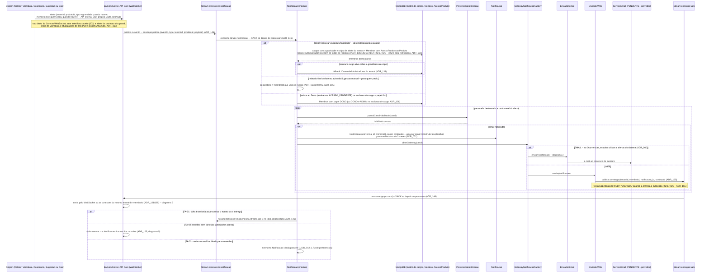
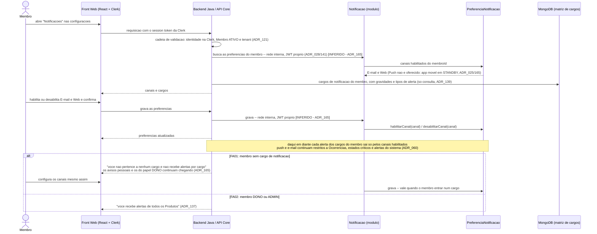
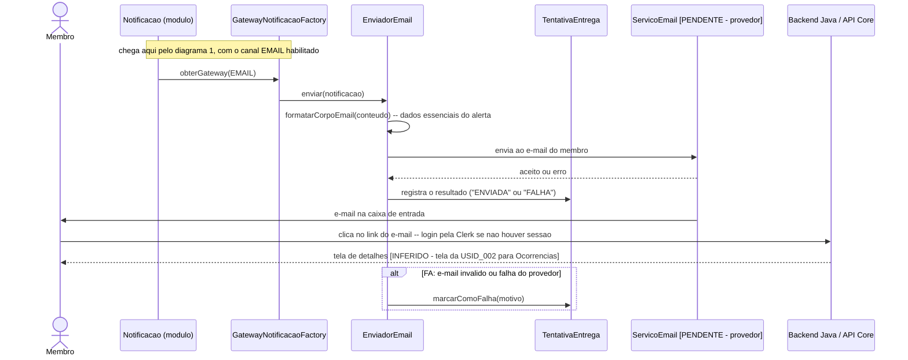
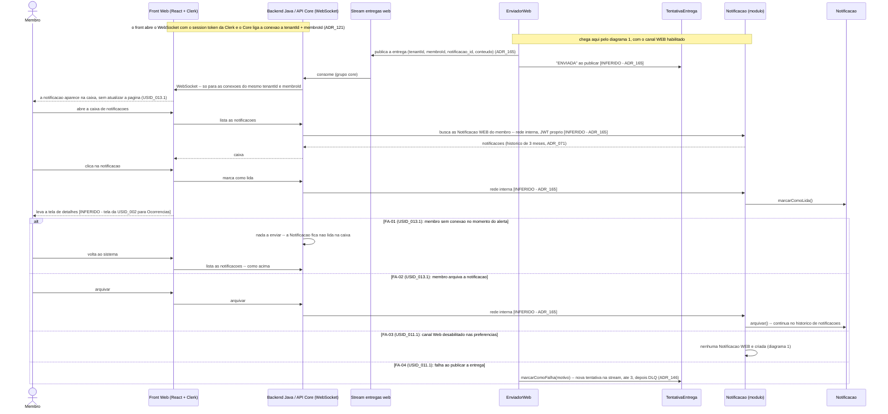

# Diagramas de Sequência — Notificação (LhamaLog) — v2

> **Changelog v2 (28/10/2026, Pedro Alvaro):** aplica a **ADR_165** (notificação web: canal no módulo Notificação, entrega
> pelo WebSocket do Core). Esta versão fica na subpasta `v2` da pasta Notificação; a versão 1 (02/10/2026) continua, sem alteração, na pasta Notificação.
> O que mudou:
> - Diagrama 1 (SSID_019.1): o alerta chega pelo Core, passa pela stream de eventos de notificação e a Notificação escolhe
>   destinatários e canais; o e-mail sai da Notificação e o item WEB volta ao Core pela stream de entregas web.
>   Sai o ator genérico `Sistema` e o `[RISCO]` de orquestrador da v1 vira o módulo Notificação.
> - Diagrama 2 (USID_012.1): segue o caso de uso reescrito; o canal Push não é oferecido enquanto o app móvel estiver em STANDBY.
> - Diagrama 3 (USID_009): só muda a origem (a Notificação, depois do diagrama 1).
> - Diagramas 4 (USID_010) e 6 (USID_014): **em espera**, app móvel em STANDBY (ADR_025). Não foram redesenhados; a v1 guarda os dois.
> - Diagrama 5 (USID_011.1 + USID_013.1): o `EnviadorWeb` não publica mais no WebSocket; publica a entrega na stream e o Core
>   entrega. A caixa de notificações é servida pelo Core.
> - `usuario_id` virou `membroId` em todos os diagramas (DER v9, DC-10 `[DECISÃO v6]`).
> - Revisão de 30/10/2026: os casos citados passam aos IDs reescritos USID_011.1, USID_013.1 e SSID_019.1, criados depois desta versão.

Base: ADR_165; ADR_025, 028, 047, 051, 054, 055, 060, 071, 077, 081, 086, 090, 095, 097, 130, 132, 136, 138, 139, 141, 142, 146;
casos de uso USID_009, USID_011.1, USID_012.1, USID_013.1 e SSID_019.1; DC-10, seção 10 (classes do módulo Notificação);
guia-redis-streams.md v2.

**Marcações:** `[PENDENTE]` sem decisão · `[INFERIDO]` ligação feita a partir das decisões (inclusive as marcadas assim na
própria ADR_165) · `[CONFLITO]` duas fontes dizem coisas diferentes · `[PROPOSTO]` nome novo a aprovar.

**Atenção, risco de confusão de nomes:** o valor de enum `StatusEnvioNotificacao.PENDENTE` ("aguardando envio") não tem
relação com a marcação `[PENDENTE]`. Nos diagramas ele aparece entre aspas (`"PENDENTE"`).

## Participantes

- `Origem` — Coletor, Varredura, Ocorrência, Sugestão ou o próprio Core (assinatura, ACESSO_PENDENTE, exclusão de cargo).
- `Core` — Backend Java / API Core: recebe os alertas (ADR_051), publica na stream de eventos, consome a stream de entregas web
  e tem o WebSocket com o front (ADR_141/165).
- `StreamEventos` — stream "Eventos de notificação" (`lhamalog:prod:notificacao-eventos`, produtor Core, grupo `notificacao`;
  guia-redis-streams.md).
- `StreamEntregasWeb` — stream de entregas web (produtor Notificação, grupo `core`; ADR_165). Chave `lhamalog:prod:notificacao-entregas-web` `[PROPOSTO]`.
- `Notificacao (modulo)` — o serviço Notificação; o consumo da stream e a consulta de agregação não têm classe `[PENDENTE]` (DC-10).
- Classes do módulo (DC-10, seção 10): `PreferenciaNotificacao`, `Notificacao`, `GatewayNotificacaoFactory`, `EnviadorEmail`,
  `EnviadorWeb`, `TentativaEntrega`.
- `ServicoEmail` — provedor de e-mail `[PENDENTE]` (ADR_141).
- `MongoDB` — compartilhado (ADR_054): matriz de cargos (`PapelNotificacao`, `PapelSeveridade`, `PapelTipoAlerta`),
  `Membro`, `AcessoProduto` e a coleção de `Notificacao`.

---

## 1. Geração e distribuição da notificação (SSID_019.1, ADR_165)

**Notas sobre este diagrama:**
- O `[RISCO]` da v1 (não havia orquestrador) agora é o módulo Notificação, mas a classe que consome a stream e faz a
  consulta de agregação continua sem nome `[PENDENTE]` (DC-10, Sugestão S19).
- `Notificacao(ocorrencia_id, membroId, canal, conteudo)` é o construtor da planilha. Para alertas sem Ocorrência
  (varredura finalizada, relatório final, avisos ao Dono, exclusão de cargo) falta um construtor sem `ocorrencia_id`
  `[PENDENTE]` (DC-10, Sugestão S25). Os tipos desses alertas também estão `[PENDENTE]` (ADR_081/136/165).
- Canais por alerta (ADR_060/165): Ocorrências e avisos ao Dono por e-mail e web; "varredura finalizada", relatório final,
  avisos da Sugestão manual e exclusão de cargo só por web. Push em espera (ADR_025).
- `[PENDENTE]` Core com mais de uma instância: a instância que lê a stream de entregas web pode não ter a conexão do membro (ADR_047/165).

## 2. Configuração de preferências (USID_012.1)

**Nota:** a v1 tinha um FA "usuário desabilita todos os canais" com pop-up; o USID_012.1 não tem esse FA e ele saiu.
O FA01 ganhou a observação da ADR_165 sobre avisos pessoais e do papel DONO (ajuste aplicado no USID_012.1).

## 3. Entrega por e-mail (USID_009)

**`[CONFLITO]` já existente no modelo de classes:** a interface `GatewayNotificacao` declara
`enviar(notificacao): TentativaEntrega` e os três enviadores devolvem `StatusEnvioNotificacao` (DC-10, pauta NOT-09 sem decisão).

## 4. Entrega Push (USID_010) — em espera

O app móvel está em STANDBY (ADR_025) e, pela ADR_165, o canal Push não é oferecido nem enviado no MVP. O diagrama 4 da
v1 continua na pasta Notificação, sem alteração, para quando o app voltar.

## 5. Entrega web e caixa de notificações (USID_011.1 + USID_013.1)

**Notas sobre este diagrama:**
- O `[CONFLITO]` da v1 entre USID_011 e USID_013 ("caixa de correios" descrita duas vezes) foi resolvido com os casos
  reescritos: o USID_011.1 é a entrega e o USID_013.1 é a visualização.
- O método do `EnviadorWeb` que publica na stream ainda não tem nome: no modelo de classes continua o
  `publicarViaWebSocket()` da planilha, marcado `[CONFLITO]` (DC-10, Sugestão S24).
- Os alertas que vão direto do Core (aceito, proteção do upload, início da Varredura, atualizações de tela) usam o mesmo
  WebSocket, mas não entram na caixa: se o membro estiver desconectado, eles se perdem e a tela recarrega o estado (ADR_165).

## 6. Visualização no mobile (USID_014) — em espera

App móvel em STANDBY (ADR_025). O diagrama 6 da v1 continua na pasta Notificação, sem alteração.

---

## Pendências desta versão

- `[PENDENTE]` provedor de e-mail (ADR_141) e templates de conteúdo (pauta NOT-03, sem classe).
- `[PENDENTE]` nomes dos tipos novos de Notificacao e do construtor sem Ocorrência (ADR_081/136/165; DC-10 S1 e S25).
- `[PENDENTE]` nome do método do `EnviadorWeb` que publica na stream (DC-10 S24).
- `[PENDENTE]` classe que consome a stream de eventos e faz a consulta de agregação (DC-10 S19).
- `[PENDENTE]` Core com mais de uma instância e escalabilidade do WebSocket (ADR_047/165).
- `[PROPOSTO]` chave `lhamalog:prod:notificacao-entregas-web` (falta entrar no guia-redis-streams.md).
- `[CONFLITO]` retorno de `GatewayNotificacao.enviar()` (pauta NOT-09).
- `[INFERIDO]` caixa e preferências servidas pelo Core com chamada interna à Notificação; leitura da matriz pela
  Notificação; `TentativaEntrega` do WEB `"ENVIADA"` ao publicar (todos marcados assim na ADR_165).

**Rastreabilidade:** USID_009, USID_011.1, USID_012.1, USID_013.1, SSID_019.1 (USID_010 e USID_014 em espera); ADR_165 e as ADRs
da linha "Base"; DC-10, seção 10.
