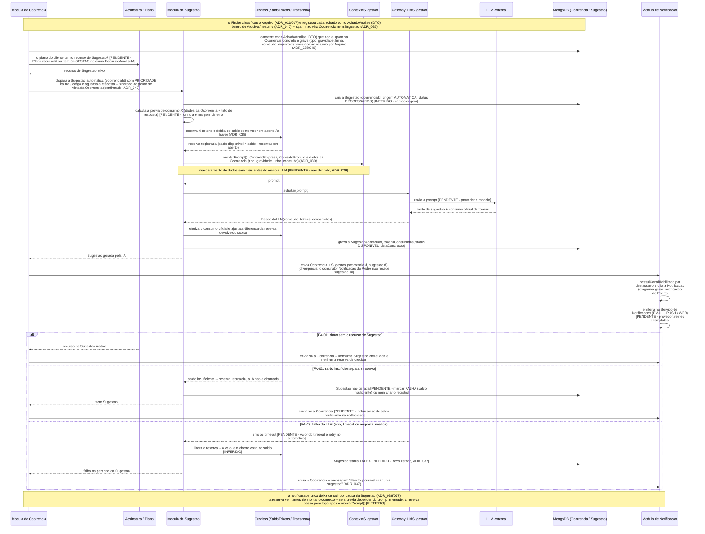
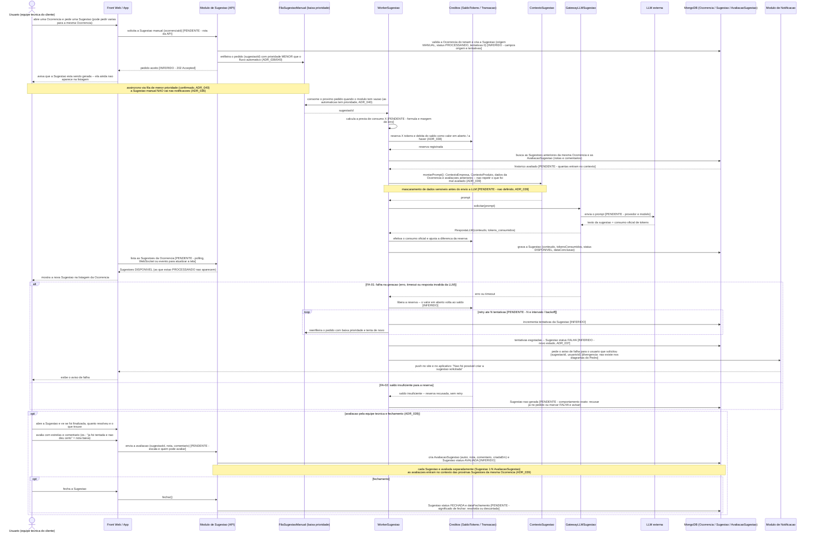

# Diagramas de Sequência — Sugestão por IA (LhamaLog) — v2

> **Changelog v2 (Out 03, 2026, Michel Bocchi Junior):** versão nova e oficial, com as confirmações do Michel registradas
> na **ADR_040** (Confirmações da Sugestão: automático síncrono com prioridade e AchadoAnalise como DTO da Ocorrência —
> https://docs.google.com/document/d/1j35UoBKtjqS82ihh7wHuHDj9iTzBe3zBS3Qz6tNJU34/edit). A versão anterior (v1) dos três arquivos (`sequencia-sugestao-ia.md`, `sugestao_automatica.png` e
> `sugestao_manual.png`) está, sem alteração, na subpasta `v1` desta pasta; os arquivos desta pasta mantêm os nomes oficiais.
> - **Síncrono x assíncrono (ADR_040):** confirmado. O fluxo automático (por plano) é síncrono do ponto de vista da
>   Ocorrência (espera a Sugestão para notificar) e tem prioridade na fila/carga; o manual é assíncrono, em fila de menor
>   prioridade. Saiu o `[INFERIDO — confirmar com Michel]` do texto e dos dois diagramas.
> - **AchadoAnalise como DTO (ADR_040):** confirmado. O AchadoAnalise é uma classe intermediária (DTO) que registra o
>   achado temporariamente dentro do Arquivo/resumo durante a análise do Finder e é convertido na Ocorrência concreta
>   persistida. Saiu o `[PENDENTE]` da ADR_035; o mapeamento DTO → entidade está na nova seção "Mapeamento AchadoAnalise
>   (DTO) → Ocorrencia" e no `sugestao_automatica.png` (nota inicial e passo de conversão).
>
> Regra de versionamento do LhamaLog: a versão atual fica nesta pasta com os nomes oficiais (sem sufixo `_v2`) e a
> anterior vai, sem alteração, para a subpasta `v1` desta pasta.

Baseado em: decisões do Michel de Out 03, 2026, registradas nas novas ADRs (pasta `Documentações > Diagrama ADR`):
- **ADR_035** — Ocorrência concreta e vínculo de 1 Ocorrência para N Sugestões (altera/complementa a ADR_020) —
  https://docs.google.com/document/d/1VHD4bazA8HDPH5feZ4NK8KUQYIBXa77eMYjtm2Ea0V8/edit
- **ADR_036** — Gatilho da Sugestão: automático por plano e manual com fila de menor prioridade (altera/complementa a
  ADR_035, a ADR_020 e a ADR_018) — https://docs.google.com/document/d/18eIcWPN4y_AhtXlqLXkRACiZgpRBRgU_XH50B6fua3M/edit
- **ADR_037** — Falhas na geração da Sugestão: aviso na notificação, retry e estado FALHA (altera/complementa a ADR_036) —
  https://docs.google.com/document/d/1VW_brVCsw2zMWVx9omG5y4mCQUi6Jk58XMXZdTvSs4I/edit
- **ADR_038** — Consumo de créditos/tokens da Sugestão por reserva (altera/complementa a ADR_036 e a ADR_018) —
  https://docs.google.com/document/d/1FKLLDLOF9dJCpUFlTt4_Tbc3Ya_xVe2A1ve9kUG7ZNc/edit
- **ADR_039** — Avaliação das Sugestões, realimentação do contexto e GatewayLLMSugestao (altera/complementa a ADR_018 e
  a ADR_020) — https://docs.google.com/document/d/1wMGFV1c3OihOsC_AEsq4inbLN3g-2nE9kONcCG-URLo/edit
- **ADR_040** — Confirmações da Sugestão: automático síncrono com prioridade e AchadoAnalise como DTO da Ocorrência
  (altera/complementa a ADR_035 e a ADR_036) — https://docs.google.com/document/d/1j35UoBKtjqS82ihh7wHuHDj9iTzBe3zBS3Qz6tNJU34/edit

Também usados: ADR_011/017 (Finder), ADR_018 (GatewayLLM exclusivo do Finder), ADR_019 (Tipo ERRO/WARNING/SPAM),
ADR_020 (Ocorrência-resumo por Arquivo), Modelo de Classes (abas `Sugestao`, `ContextoSugestao`, `GatewayLLM`,
`RespostaLLM`, `SaldoTokens`, `Plano`, `Notificação`), DER v2 (`Levantamento de Entidades DER`) e os diagramas de
Notificação do Pedro (`sequencia-notificacao.md` e PNGs da pasta `Notificação`). O Modelo de Classes, o DER e os
arquivos do Pedro **não foram alterados**; os impactos estão nas seções finais.

**Visão geral do fluxo:** durante a análise, o Finder registra cada achado como `AchadoAnalise` (DTO, só em
trânsito dentro do Arquivo/resumo); ao final, cada erro ou warning é convertido numa **Ocorrência concreta** (documento
próprio no MongoDB). O resumo por Arquivo só agrupa as N Ocorrências e o spam não gera Ocorrência (ADR_035/040). A Sugestão pertence a **uma** Ocorrência e pode ser gerada de dois jeitos (ADR_036):
- **automática** — se o plano do cliente tem o recurso de Sugestão, a criação da Ocorrência dispara a Sugestão, o fluxo
  espera a resposta (síncrono, com prioridade na fila/carga — ADR_040) e envia **Ocorrência + Sugestão** juntas ao
  módulo de Notificação (**diagrama 1**);
- **manual** — o usuário pede, na tela da Ocorrência, quantas Sugestões quiser; o pedido entra numa fila de **menor
  prioridade**, é processado de forma assíncrona (ADR_040) e **não** vai nas notificações (**diagrama 2**).

Nos dois caminhos o consumo de tokens é **reservado antes** da chamada à IA e **efetivado** com o consumo oficial da
resposta (ADR_038); a IA é chamada pela integração própria **GatewayLLMSugestao** (ADR_039), separada do GatewayLLM do
Finder (ADR_018). O prompt usa ContextoEmpresa, ContextoProduto, os dados da Ocorrência (tipo, gravidade, linha) e,
no manual, as avaliações das Sugestões anteriores da mesma Ocorrência.

**Participantes usados:**
- `Modulo de Ocorrencia` — converte o `AchadoAnalise` (DTO) e cria a Ocorrência concreta `[INFERIDO — quem converte]`, consulta o plano, dispara a Sugestão automática, espera a resposta
  e entrega a Ocorrência (com ou sem Sugestão) ao módulo de Notificação (ADR_035/036)
- `Assinatura / Plano` — diz se o plano tem o recurso de Sugestão (`Plano.recursoIA` do DER ou novo item no enum
  `RecursosAnaliseIA` `[PENDENTE]`)
- `Modulo de Sugestao` / `Modulo de Sugestao (API)` — cria e grava a `Sugestao`, recebe os pedidos manuais, as
  avaliações e o fechamento
- `FilaSugestaoManual (baixa prioridade)` — fila dos pedidos manuais, com prioridade menor que o fluxo automático
  (tecnologia `[PENDENTE]`)
- `WorkerSugestao` — consome a fila quando o módulo tem vazão, faz a reserva, monta o contexto, chama a IA e trata o retry
- `Creditos (SaldoTokens / Transacao)` — reserva, efetivação/ajuste e liberação do consumo (ADR_038); unificação de
  `SaldoTokens` com o módulo Créditos `[PENDENTE]`
- `ContextoSugestao` — `montarPrompt()` com ContextoEmpresa, ContextoProduto, dados da Ocorrência e avaliações anteriores
- `GatewayLLMSugestao` — `solicitar(prompt): RespostaLLM(conteudo, tokens_consumidos)`; nome novo para a interface
  `GatewayLLM` do módulo Sugestão (ADR_018/039)
- `LLM externa` — provedor e modelo `[PENDENTE]`
- `MongoDB (Ocorrencia / Sugestao / AvaliacaoSugestao)` — coleções `Ocorrencia`, `Sugestao` e `AvaliacaoSugestao`
- `Modulo de Notificacao` — o módulo do Pedro (`PreferenciaNotificacao`, `Notificacao`, `Servico de Notificacoes`)
- `Usuario (equipe tecnica do cliente)` e `Front Web / App` — só no diagrama 2

Tudo marcado `[PENDENTE]` é requisito ainda sem definição; `[INFERIDO]` é ligação feita por mim a partir das decisões do
Michel e dos artefatos, que não está dita literalmente por ele.

**Atenção, risco de confusão de nomes:** o status `FALHA` da Sugestão (`[INFERIDO]`, ADR_037) **não é** o
`FALHA` de `TentativaEntrega` / `StatusEnvioNotificacao` do módulo de Notificação (falha de entrega de uma notificação).
E o valor de enum `"PENDENTE"` da Notificação continua sem relação com a marcação `[PENDENTE]`.

---

## 1. Sugestão automática (ADR_035–040)

Arquivo: `sugestao_automatica.png`

**Resumo do fluxo:** o Módulo de Ocorrência converte cada `AchadoAnalise` (DTO) que não é spam na Ocorrência concreta e
a grava, confere no plano se o recurso de Sugestão está ativo e dispara a Sugestão automática com prioridade na
fila/carga, aguardando a resposta — síncrono do ponto de vista da Ocorrência (confirmado, ADR_040). O Módulo de Sugestão cria o registro (`PROCESSANDO`, origem `AUTOMATICA`), reserva a prévia de
tokens, monta o contexto, chama a LLM pela GatewayLLMSugestao, efetiva o consumo oficial, grava a Sugestão
`DISPONIVEL` e devolve. O Módulo de Ocorrência envia Ocorrência + Sugestão ao módulo de Notificação, que distribui pelos
canais habilitados.

**Fluxo principal:**
1. `AchadoAnalise` (DTO) convertido na Ocorrência concreta, gravada (tipo, gravidade, linha, conteúdo, arquivoId) e vinculada ao resumo por Arquivo; spam não é convertido (ADR_035/040).
2. Consulta ao plano: recurso de Sugestão ativo.
3. Dispara a Sugestão automática com prioridade e aguarda (síncrono, ADR_040); o Módulo de Sugestão cria a `Sugestao` (`PROCESSANDO`, `AUTOMATICA`).
4. Calcula a prévia X e reserva X tokens como valor em aberto / a haver.
5. `montarPrompt()` com ContextoEmpresa, ContextoProduto e dados da Ocorrência (mascaramento `[PENDENTE]`).
6. `GatewayLLMSugestao.solicitar(prompt)` → LLM → `RespostaLLM(conteudo, tokens_consumidos)`.
7. Efetiva o consumo oficial e ajusta a diferença da reserva; grava a Sugestão `DISPONIVEL`.
8. Ocorrência + Sugestão vão ao módulo de Notificação → `possuiCanalHabilitado` → `Notificacao` → Serviço de Notificações.

**Fluxos alternativos:**
- **FA-01 plano sem o recurso:** não enfileira Sugestão nem reserva créditos; a Ocorrência segue sozinha para a notificação.
- **FA-02 saldo insuficiente:** a reserva é recusada e a IA não é chamada; a Ocorrência segue sem Sugestão. Se o registro
  vira `FALHA` ou nem é criado, e se a notificação leva um aviso de saldo, está `[PENDENTE]`.
- **FA-03 falha da LLM (erro, timeout ou resposta inválida):** libera a reserva `[INFERIDO]`, Sugestão `FALHA`
  `[INFERIDO]` e a notificação sai mesmo assim com a mensagem **"Não foi possível criar uma sugestão"** (ADR_037).
  Timeout e retry no automático `[PENDENTE]`.

**Notas sobre este diagrama:**
- A ordem "verifica plano → reserva créditos → monta contexto" segue o pedido. Se a prévia precisar do prompt montado
  (ADR_038), a reserva passa para logo depois do `montarPrompt()` `[INFERIDO]`; o efeito é o mesmo: nada é enviado à
  LLM sem reserva.
- **Confirmado pelo Michel (ADR_040):** o automático é **síncrono do ponto de vista da Ocorrência** (a notificação
  espera a Sugestão) e tem **prioridade** na fila/carga do módulo de Sugestão sobre os pedidos manuais. Como a prioridade
  é implementada (uma fila com prioridade ou duas filas) e o timeout continuam `[PENDENTE]`.
- **AchadoAnalise como DTO (ADR_040):** o achado fica só em trânsito dentro do Arquivo/resumo durante a análise do Finder e
  é convertido na Ocorrência concreta no primeiro passo deste diagrama; o mapeamento está na seção abaixo.
- A criação do registro `Sugestao` antes da reserva permite ligar a reserva à Sugestão (`sugestaoId`) `[INFERIDO]`.
- Os dois passos internos do `Modulo de Notificacao` resumem o diagrama `gerar_notificacao.png` do Pedro, sem alterá-lo.

---

## 2. Sugestão manual, falha com retry e avaliação (ADR_035–040)

Arquivo: `sugestao_manual.png`

**Resumo do fluxo:** o usuário pede uma Sugestão na tela da Ocorrência (pode pedir várias). O backend cria o registro na
coleção `Sugestao` com status `PROCESSANDO` (origem `MANUAL`), coloca o pedido na fila de **menor prioridade** e responde
na hora — fluxo assíncrono (confirmado, ADR_040). Quando o módulo tem vazão, o worker reserva os tokens, busca as Sugestões anteriores da mesma Ocorrência com as
avaliações, monta o contexto, chama a LLM, efetiva o consumo e grava a Sugestão `DISPONIVEL`; só então ela aparece na
listagem do front. A Sugestão manual **não** vai nas notificações.

**Fluxo principal:**
1. Usuário pede a Sugestão; o front chama o Módulo de Sugestão (rota `[PENDENTE]`).
2. Valida a Ocorrência do tenant e cria a `Sugestao` (`MANUAL`, `PROCESSANDO`, `tentativas = 0` `[INFERIDO]`).
3. Enfileira na `FilaSugestaoManual` (prioridade menor que a automática) e responde "pedido aceito" `[INFERIDO — 202]`.
4. O `WorkerSugestao` consome quando há vazão, calcula a prévia e reserva X tokens.
5. Busca as Sugestões anteriores da mesma Ocorrência e as `AvaliacaoSugestao`, e monta o prompt pedindo para não repetir
   o que foi mal avaliado (ADR_039).
6. `GatewayLLMSugestao` → LLM → `RespostaLLM`; efetiva o consumo e grava a Sugestão `DISPONIVEL`.
7. O front lista as Sugestões da Ocorrência (atualização por polling, WebSocket ou evento `[PENDENTE]`); as `PROCESSANDO`
   não aparecem.

**Fluxos alternativos e opcionais:**
- **FA-01 falha na geração:** libera a reserva `[INFERIDO]` e tenta de novo pela fila de baixa prioridade até N
  tentativas (N e backoff `[PENDENTE]`). Esgotadas, a Sugestão vai para `FALHA` `[INFERIDO]` e o módulo de Notificação
  envia **push no site e no aplicativo**: "Não foi possível criar a sugestão solicitada" (ADR_037).
- **FA-02 saldo insuficiente:** reserva recusada, sem retry; comportamento exato `[PENDENTE]` (recusar já no pedido ou
  marcar `FALHA` e avisar).
- **opt avaliação e fechamento:** a equipe técnica do cliente abre a Sugestão, vê se foi finalizada, quanto resolveu e o
  que trouxe, e avalia com estrelas e comentário; cada avaliação vira uma `AvaliacaoSugestao` `[INFERIDO]` e a Sugestão
  fica `AVALIADA`. Depois pode ser fechada (`FECHADA`; significado `[PENDENTE]`). As avaliações realimentam o contexto
  das próximas Sugestões da mesma Ocorrência.

**Notas sobre este diagrama:**
- O próprio registro `Sugestao` em `PROCESSANDO` funciona como o pedido; a fila só carrega o `sugestaoId` `[INFERIDO]`.
- Ao verificar saldo já no pedido (antes de enfileirar), o sistema evitaria enfileirar além do limite; aqui a reserva
  está no worker, como no pedido do Michel ("worker → reserva"). Se a reserva for feita já no pedido, ela fica presa
  enquanto o item espera na fila `[PENDENTE — escolher o momento da reserva no manual]`.
- O retry está modelado como reenfileiramento na mesma fila de baixa prioridade `[INFERIDO]`.
- "Site" = canal `WEB` (EnviadorWeb, caixa de correios da plataforma web) e "aplicativo" = canal `PUSH` (EnviadorPush /
  DispositivoPush) do módulo do Pedro `[INFERIDO]`. O app móvel está em STANDBY (ADR_025).

---

## Ponte com Notificações (diagramas do Pedro) — divergências

Conferido em Out 03, 2026 com `sequencia-notificacao.md` e os PNGs da pasta `Notificação` (`gerar_notificacao.png`,
`entrega_push.png`, `visualizacao_web_runtime.png`). Nada foi editado nos arquivos do Pedro.

**O que bate:** o módulo de Notificação recebe uma Ocorrência, checa `PreferenciaNotificacao.possuiCanalHabilitado`,
cria a `Notificacao` e enfileira no Serviço de Notificações; os canais `PUSH` e `WEB` existem; a classe `Notificacao`
do Modelo de Classes já tem o atributo `sugestao_id`.

**Divergências:**
1. **Entrada Ocorrência + Sugestão:** no `gerar_notificacao.png` o construtor é `Notificacao(ocorrencia_id, usuario_id,
   canal, conteudo)`, sem `sugestao_id`, embora a classe tenha o atributo. A entrada da ADR_036 precisa passar o
   `sugestao_id` (ou o texto da Sugestão) para a Notificação. No DER, a entidade `Notificacao` também não tem `sugestaoId`.
2. **Origem genérica:** o Pedro usa o ator `Sistema (origem da Ocorrencia)` e marca `[RISCO]` a falta de orquestrador.
   Aqui a origem é o `Modulo de Ocorrencia`, depois de esperar a Sugestão; no aviso de falha da manual, a origem é o
   `Modulo de Sugestao` (`WorkerSugestao`).
3. **Espera pela Sugestão:** no Pedro, "reconhece uma Ocorrência" já gera a notificação. Com a ADR_036, quando o plano tem
   o recurso, a notificação só é gerada depois da Sugestão (ou da falha/timeout). Esse passo e o timeout não existem lá.
4. **Conteúdo:** os enviadores formatam "os dados essenciais da ocorrência". Não há previsão para o texto da Sugestão nem
   para a mensagem "Não foi possível criar uma sugestão" (templates continuam `[PENDENTE]` no Pedro).
5. **Push de falha da Sugestão manual:** não existe. Todos os diagramas do Pedro (USID_009–014, SSID_019) notificam
   Ocorrências. O aviso de falha precisa de um tipo de notificação novo, ligado à Sugestão e só para o usuário que pediu,
   nos canais `PUSH` e `WEB` `[INFERIDO]`, e o clique deve levar à tela da Ocorrência / Sugestões, não à "tela de
   detalhes do erro" `[INFERIDO]`.
6. **Preferências:** se o usuário desabilitou `PUSH` e `WEB`, o aviso de falha não chega; se ele deve ignorar as
   preferências está `[PENDENTE]`.
7. **Destinatários:** a ADR_036 diz "distribui a quem deve receber"; nem o Pedro nem as ADRs definem quem recebe a
   notificação de uma Ocorrência (todos do tenant? por papel?) `[PENDENTE]`.
8. **Retries são coisas diferentes:** o retry da Sugestão manual (ADR_037) não é o retry de entrega da notificação
   (`TentativaEntrega`, `[PENDENTE]` no Pedro).

---

## Mapeamento AchadoAnalise (DTO) → Ocorrencia (entidade) — ADR_040

O `AchadoAnalise` é uma classe intermediária, sem coleção própria: registra cada achado temporariamente dentro do
Arquivo/resumo durante a análise do Finder (MotorAnalise / `classificarAnalise()`, ADR_017) e, ao final, cada achado que não
é spam vira uma `Ocorrencia` persistida. A criação dessa Ocorrência é o gatilho do fluxo automático da Sugestão (ADR_036).

| `AchadoAnalise` (DTO) | `Ocorrencia` (entidade) | Observação |
|---|---|---|
| `tipo` | `tipo` | só ERRO ou WARNING (ADR_019); SPAM não é convertido e só soma em `spamIdentificados` do resumo |
| `gravidade` | `gravidade` | valores e quem define `[PENDENTE]` (ADR_020) |
| `numeroLinha` | `linha` | |
| `titulo` | `titulo` | |
| `resumo` | `resumo` | |
| `linhas` (trecho do log) | `conteudo` | |
| `traceId`, `correlationId`, `hostName`, `moduloId` | mesmos campos | |
| `camposExtraido` | `camposExtraidos` | |
| `dadosSensiveis` | `dadosSensiveis` | base para o mascaramento `[PENDENTE]` (ADR_039) |
| — | `id`, `arquivoId`, referência ao resumo por Arquivo, empresa/tenant, produto, `varreduraId` `[INFERIDO]`, `criadaEm`, `status` `[PENDENTE: valores]` | preenchidos na conversão |

Quem faz a conversão: `[INFERIDO]` o Módulo de Ocorrência, chamado pelo Finder ao concluir o Arquivo. A chave de
idempotência da Ocorrência continua `[PENDENTE]`. Se a análise falhar no meio, os DTOs se perdem e o Arquivo é
reprocessado (ADR_014) `[INFERIDO]`.

---

## Impactos no DER (não alterado agora)

O DER v2 (`Levantamento de Entidades DER`) **não foi alterado**. Mudanças que as ADR_035–040 pedem quando ele for revisado:

| Entidade | Impacto | Marcação |
|---|---|---|
| `Ocorrencia` | Passa a ser concreta (grão do erro/warning): tipo, gravidade, linha, conteúdo, traceId, correlationId, hostName, moduloId, arquivoId e referência ao resumo, preenchidos a partir do `AchadoAnalise` (mapeamento acima). Deixa de ter os contadores. | ADR_035/040 |
| `AchadoAnalise` | Vira DTO (classe intermediária do Finder, sem coleção): sai do DER como entidade; seus campos passam para a `Ocorrencia` na conversão. | ADR_040 (confirmado) |
| Resumo por Arquivo | Nova entidade (nome `[PENDENTE]`, ex.: `ResumoArquivo`) com os contadores da ADR_020; `Arquivo 1:1 Resumo`, `Resumo 1:0..N Ocorrencia`. | `[INFERIDO]` |
| `Sugestao` | `ocorrenciaId` obrigatório (`Ocorrencia 1:0..N Sugestao` deixa de ser inferido); novos campos `origem` (AUTOMATICA/MANUAL), `tentativas`, `motivoFalha`, `usuarioSolicitanteId` (só manual), `dataSolicitacao`, `dataConclusao`; status com `FALHA`. | ADR_035/036/037 + `[INFERIDO]` |
| `AvaliacaoSugestao` | `Sugestao 1:N AvaliacaoSugestao` confirmado; incluir o autor (`usuarioId`) e definir a escala da nota. | `[INFERIDO]` / `[PENDENTE]` |
| Créditos (`Saldo`, `Transacao`) | Reserva: `Transacao` com tipos RESERVA, EFETIVACAO/AJUSTE e ESTORNO ligada à Sugestão (`Sugestao 1:N Transacao`, era 0..1:N), ou entidade `ReservaCreditos`; saldo com valor em aberto. Unificar com `SaldoTokens` do Modelo de Classes. | ADR_038 + `[PENDENTE]` |
| `Notificacao` | Incluir `sugestaoId` (opcional) e um tipo (Ocorrência, Ocorrência + Sugestão, falha da Sugestão). | `[INFERIDO]` |
| `Plano` | `recursoIA` (Boolean) não distingue a Sugestão; criar recurso específico de Sugestão (campo ou item de enum). | `[PENDENTE]` |
| Idempotência | A chave da ADR_014/020 (`arquivoId`) muda para a Ocorrência concreta (ex.: arquivoId + traceId/correlationId + linha). | `[INFERIDO]` / `[PENDENTE]` |

---

## Notas obrigatórias (pendências)

- **Confirmado (ADR_040)** — automático = síncrono do ponto de vista da Ocorrência e com prioridade na fila/carga;
  manual = assíncrono via fila de menor prioridade. Continua `[PENDENTE]` só o timeout do automático.
- **`[PENDENTE]`** mascaramento de dados sensíveis antes de enviar à LLM — não definido agora (ADR_039).
- **`[PENDENTE]`** provedor, modelo, hospedagem e credenciais da LLM da `GatewayLLMSugestao`.
- **`[PENDENTE]`** onde fica a flag do recurso de Sugestão no plano (`Plano.recursoIA` ou item no enum `RecursosAnaliseIA`).
- **`[PENDENTE]`** timeout do automático e se ele tem retry antes de notificar (recomendação: sem retry `[INFERIDO]`).
- **`[PENDENTE]`** número de tentativas e backoff do retry manual.
- **`[PENDENTE]`** comportamento com saldo insuficiente (automático: aviso na notificação?; manual: recusar no pedido ou `FALHA` + aviso).
- **`[PENDENTE]`** fórmula da prévia de consumo, margem de erro, período do saldo e expiração de reservas presas.
- **`[PENDENTE]` / `[INFERIDO]`** unificação `SaldoTokens` × módulo Créditos (`Credito`, `Saldo`, `Controle`, `Transacao`); recomendação: Créditos como fonte única.
- **`[INFERIDO]`** liberação da reserva em qualquer falha; consumo cobrado numa resposta inválida `[PENDENTE]`.
- **`[INFERIDO]`** estado `FALHA` na Sugestão e campos `origem` / `tentativas`.
- **Confirmado (ADR_040)** — AchadoAnalise é DTO e é convertido na Ocorrência concreta. Continuam `[PENDENTE]`: nome da
  entidade do resumo por Arquivo, nova chave de idempotência e valores de status da Ocorrência; quem converte `[INFERIDO]`.
- **`[PENDENTE]`** escala da avaliação, quem pode avaliar/fechar, se cada membro avalia uma vez e o significado de "fechar".
- **`[PENDENTE]`** quantas Sugestões/avaliações anteriores entram no contexto e limite de Sugestões manuais por Ocorrência.
- **`[PENDENTE]`** tecnologia das filas (uma fila com prioridade ou duas filas) e como o front fica sabendo que a Sugestão voltou.
- **`[PENDENTE]`** no módulo de Notificação: `sugestao_id` na criação da Notificação, template com a Sugestão e com a
  mensagem de falha, tipo de notificação de falha da Sugestão, destinatários e preferências (ver divergências).
- **`[PENDENTE]`** revisar agrupamento/recorrência (ADR_013) com a Ocorrência concreta para não notificar o mesmo erro várias vezes.

**Rastreabilidade:** ADR_011, 013, 014, 017–020, 025, 029 e as novas ADR_035–040 (`Documentações > Diagrama ADR`);
Modelo de Classes (`Sugestao`, `ContextoSugestao`, `GatewayLLM`, `RespostaLLM`, `SaldoTokens`, `Plano`, `Notificação`);
DER v2 (`Sugestao`, `AvaliacaoSugestao`, `Transacao`, `Plano`, `Notificacao`); `sequencia-notificacao.md` (Pedro); Jira LLT-64.

**Renderização:** PNGs gerados com o mermaid-cli (`mmdc`, tema neutral, fundo branco) e escala 2, com o mesmo ajuste de
estilo preto e branco usado em `Autenticacao e 2FA` e `Varredura e Finder` (auto-mensagens em laço, setas abertas,
rótulos de `alt`/`opt` em negrito e caixas retas).
