# Diagramas de Sequência — Sugestão por IA (LhamaLog) — v7

> **Changelog v7 (Out 30, 2026, Pedro Alvaro):** aplica a ADR_165 nos dois diagramas. **Diagrama 1 (Sugestão automática):** o
> Módulo de Ocorrência envia a notificação ao Core, que a repassa ao Módulo de Notificação pela fila de eventos de notificação
> (ADR_051/146); a Notificação devolve ao Core as notificações web, que o Core entrega pelo WebSocket; push em espera
> enquanto o app móvel estiver em STANDBY (ADR_025). **Diagrama 2 (Sugestão manual):** os avisos "aceita", "pronta" e
> "falhou" passam pelo Módulo de Notificação, só no canal web, e ficam no histórico; a atualização da tela continua direto
> pelo Core (ADR_086). Os arquivos anteriores (`sequencia-sugestao-ia.md` v6, `sugestao_automatica.png` e
> `sugestao_manual.png`) foram movidos, sem alteração, para a subpasta `v6`; os dois PNGs foram regenerados.
>
> **Changelog v6 (Out 11, 2026, Michel Bocchi Junior):** decisões do Michel (ADR_096 a ADR_098). Os arquivos anteriores
> (`sequencia-sugestao-ia.md` v5, `sugestao_manual.png` e `sugestao_automatica.png`) foram movidos, sem alteração, para a
> subpasta `v5`; os dois PNGs foram regenerados.
> - ADR_096 — Status `PENDENTE` da Sugestão renomeado para `AGUARDANDO_REVISAO` (IA concluída, aguarda o usuário ver e
>   fechar); vai direto para `FECHADA`. Estados: `PROCESSANDO`, `AGUARDANDO_REVISAO`, `FECHADA` + `FALHA` interno, sem `AVALIADA`.
> - ADR_097 — A ADR_090 (falha só no histórico) também vale para a Sugestão automática (confirmado).
> - ADR_098 — Cada retentativa faz uma NOVA reserva; o pedido de retry carrega "cancele a reserva anterior, se houver, e
>   troque por esta" (substituição atômica), sem reservas órfãs.
> Onde changelogs antigos dizem `DISPONIVEL` ou `PENDENTE` (status), leia `AGUARDANDO_REVISAO`.
>
> **Changelog v5 (Out 11, 2026, Michel Bocchi Junior):** novas decisões do Michel para o diagrama manual (ADR_090 a ADR_095).
> Os arquivos anteriores (`sequencia-sugestao-ia.md` v4, `sugestao_manual.png` e `sugestao_automatica.png`) foram movidos,
> sem alteração, para a subpasta `v4`. O `sugestao_automatica.png` também foi regenerado porque mostrava explicitamente o
> status `DISPONIVEL`.
> - ADR_090 — Sugestão com falha não entra na lista da Ocorrência nem bloqueia o fechamento; só aparece no histórico de notificações
> - ADR_091 — Status `PENDENTE` (pendente de análise pela equipe) substitui `DISPONIVEL`; é quando a Ocorrência vai para `EM_ANALISE` (vale para manual e automático)
> - ADR_092 — Saldo insuficiente na manual: 402 Payment Required
> - ADR_093 — Timeout de 30 s também na manual (confirmado)
> - ADR_094 — Retry da manual: 3 retentativas com espera de 5 s, 15 s e 45 s (4 execuções no total) — corrige a ADR_084
> - ADR_095 — Aviso "aceita" por WebSocket e histórico logo após o 202
>
> **Atenção, nome:** o status `PENDENTE` da Sugestão (valor de enum, ADR_091) **não** é a marcação `[PENDENTE]` deste
> documento (requisito sem definição). Onde o texto antigo (v4 e anteriores) diz `DISPONIVEL`, leia `PENDENTE`.

> **Changelog v4 (Out 11, 2026, Michel Bocchi Junior):** revisão do **diagrama 2 (`sugestao_manual.png`)** com as decisões
> do Michel de 11/10/2026, registradas nas ADR_083 a ADR_089. A versão anterior (v3) do `sequencia-sugestao-ia.md` e o
> `sugestao_manual.png` anterior foram movidos, sem alteração, para a subpasta `v3`. O `sugestao_automatica.png` não mudou.
> - ADR_083 — Rota POST /ocorrencias/{id}/sugestoes com 202 Accepted e sem limite de Sugestões manuais por Ocorrência
> - ADR_084 — Retry da Sugestão manual: 3 tentativas, mesma regra da DLQ
> - ADR_085 — Saldo insuficiente: recusa imediata no pedido (reserva mínima da ADR_078)
> - ADR_086 — WebSocket para a Sugestão manual: tela atualizada e aviso de falha, com histórico, sem push/email
> - ADR_087 — Contexto: últimas 5 Sugestões da mesma Ocorrência com avaliações, em cascata
> - ADR_088 — Avaliação: 1 a 5 estrelas + comentário, uma por pessoa por Sugestão
> - ADR_089 — Fechamento da Sugestão e status da Ocorrência (EM_ANALISE só com Sugestão DISPONIVEL; falha mantém ABERTA)
>
> **Correção de status (ADR_089, confirmada):** pedir ou enfileirar uma Sugestão NÃO muda o status da Ocorrência. Ela vai
> para `EM_ANALISE` só quando uma Sugestão (manual ou automática) fica `DISPONIVEL` e visível; se a Sugestão falha, a
> Ocorrência continua `ABERTA`. No diagrama 1, o passo "EM_ANALISE depois da Sugestão gerada e da notificação" deve ser
> lido assim (PNG automático não regenerado, pois o momento é o mesmo: logo após a Sugestão `DISPONIVEL`).

> **Changelog v3 (Out 11, 2026, Michel Bocchi Junior):** revisão do **diagrama 1 (`sugestao_automatica.png`)** com as
> decisões do Michel de 11/10/2026, registradas nas ADR_076 a ADR_082. A versão anterior (v2) do `sequencia-sugestao-ia.md`
> e do `sugestao_automatica.png` foi movida, sem alteração, para a subpasta `v2` desta pasta. O `sugestao_manual.png`
> **não foi alterado** (será revisado em seguida); a seção 2 ganhou só notas curtas onde as decisões a afetam
> (mascaramento, provedor/BYOK, status da Ocorrência).
> Também aplicadas as decisões posteriores: o Finder envia um `ResumoAnalise` com os `AchadoAnalise` e o Módulo de
> Ocorrência cria as Ocorrências concretas e define a gravidade (criticidade do módulo × tipo do achado — ADR_062); push e
> email ficam reservados a Ocorrências, estados críticos e alertas do sistema (ADR_060); mascaramento da ADR_064.
>
> **Novas ADRs (11/10/2026):**
> - ADR_076 — Sugestão automática habilitada por Produto (`ProdutoRecursoIA`: `planoTemIA` e `produtoAtivouIA`)
> - ADR_077 — Timeout de 30 s sem retry e notificação única de falha ("Não foi possível gerar a sugestão")
> - ADR_078 — Reserva de tokens: (prompt + teto de resposta) × 1,2, liquidação pelo consumo real e expiração em 30,6 s
> - ADR_079 — Mascaramento da Sugestão igual ao do Finder (ADR_064)
> - ADR_080 — Provedor da LLM `[PENDENTE]` e token próprio do cliente (BYOK) só na Sugestão
> - ADR_081 — Tipos de Notificação: OCORRENCIA e OCORRENCIA_COM_SUGESTAO
> - ADR_082 — Status da Ocorrência (ABERTA, EM_ANALISE, FECHADA) e endpoint de mudança manual
> (links no relatório da revisão e na pasta `Documentações > Diagrama ADR`)
>
> **Changelog v2 (Out 03, 2026):** confirmações da ADR_040 (automático síncrono com prioridade; AchadoAnalise como DTO).
> A v1 dos três arquivos está na subpasta `v1`.
>
> Regra de versionamento do LhamaLog: a versão atual fica nesta pasta com os nomes oficiais e as anteriores vão, sem
> alteração, para subpastas `vN` desta pasta.

Baseado em (v3): ADR_076–082 (11/10/2026) e ADR_060/062/064. Baseado em: decisões do Michel de Out 03, 2026, registradas nas novas ADRs (pasta `Documentações > Diagrama ADR`):
- **ADR_035** — Ocorrência concreta e vínculo de 1 Ocorrência para N Sugestões (altera/complementa a ADR_020) —
  https://docs.google.com/document/d/1VHD4bazA8HDPH5feZ4NK8KUQYIBXa77eMYjtm2Ea0V8/edit
- **ADR_036** — Gatilho da Sugestão: automático por plano e manual com fila de menor prioridade (altera/complementa a
  ADR_035, a ADR_020 e a ADR_018) — https://docs.google.com/document/d/18eIcWPN4y_AhtXlqLXkRACiZgpRBRgU_XH50B6fua3M/edit
- **ADR_037** — Falhas na geração da Sugestão: aviso na notificação, retry e estado FALHA (altera/complementa a ADR_036) —
  https://docs.google.com/document/d/1VW_brVCsw2zMWVx9omG5y4mCQUi6Jk58XMXZdTvSs4I/edit
- **ADR_038** — Consumo de créditos/tokens da Sugestão por reserva (altera/complementa a ADR_036 e a ADR_018) —
  https://docs.google.com/document/d/1FKLLDLOF9dJCpUFlTt4_Tbc3Ya_xVe2A1ve9kUG7ZNc/edit
- **ADR_039** — Avaliação das Sugestões, realimentação do contexto e GatewayLLMSugestao (altera/complementa a ADR_018 e
  a ADR_020) — https://docs.google.com/document/d/1wMGFV1c3OihOsC_AEsq4inbLN3g-2nE9kONcCG-URLo/edit
- **ADR_040** — Confirmações da Sugestão: automático síncrono com prioridade e AchadoAnalise como DTO da Ocorrência
  (altera/complementa a ADR_035 e a ADR_036) — https://docs.google.com/document/d/1j35UoBKtjqS82ihh7wHuHDj9iTzBe3zBS3Qz6tNJU34/edit

Também usados: ADR_011/017 (Finder), ADR_018 (GatewayLLM exclusivo do Finder), ADR_019 (Tipo ERRO/WARNING/SPAM),
ADR_020 (Ocorrência-resumo por Arquivo), Modelo de Classes (abas `Sugestao`, `ContextoSugestao`, `GatewayLLM`,
`RespostaLLM`, `SaldoTokens`, `Plano`, `Notificação`), DER v2 (`Levantamento de Entidades DER`) e os diagramas de
Notificação do Pedro (`sequencia-notificacao.md` e PNGs da pasta `Notificação`). O Modelo de Classes, o DER e os
arquivos do Pedro **não foram alterados**; os impactos estão nas seções finais.

**Visão geral do fluxo:** durante a análise, o Finder registra cada achado como `AchadoAnalise` (DTO, só em
trânsito dentro do Arquivo/resumo); ao final, cada erro ou warning é convertido numa **Ocorrência concreta** (documento
próprio no MongoDB). O resumo por Arquivo só agrupa as N Ocorrências e o spam não gera Ocorrência (ADR_035/040). A Sugestão pertence a **uma** Ocorrência e pode ser gerada de dois jeitos (ADR_036):
- **automática** — se o plano do cliente tem o recurso de Sugestão, a criação da Ocorrência dispara a Sugestão, o fluxo
  espera a resposta (síncrono, com prioridade na fila/carga — ADR_040) e envia **Ocorrência + Sugestão** juntas ao
  módulo de Notificação (**diagrama 1**);
- **manual** — o usuário pede, na tela da Ocorrência, quantas Sugestões quiser; o pedido entra numa fila de **menor
  prioridade**, é processado de forma assíncrona (ADR_040) e **não** vai nas notificações (**diagrama 2**).

Nos dois caminhos o consumo de tokens é **reservado antes** da chamada à IA e **efetivado** com o consumo oficial da
resposta (ADR_038); a IA é chamada pela integração própria **GatewayLLMSugestao** (ADR_039), separada do GatewayLLM do
Finder (ADR_018). O prompt usa ContextoEmpresa, ContextoProduto, os dados da Ocorrência (tipo, gravidade, linha) e,
no manual, as avaliações das Sugestões anteriores da mesma Ocorrência.

**Participantes usados:**
- `Modulo de Ocorrencia` — recebe o `ResumoAnalise` do Finder, define a gravidade e cria a Ocorrência concreta (Resolvido, ADR_062), consulta o plano, dispara a Sugestão automática, espera a resposta
  e entrega a Ocorrência (com ou sem Sugestão) ao módulo de Notificação (ADR_035/036)
- `Assinatura / Plano` — diz se o plano tem IA; refletido em `ProdutoRecursoIA.planoTemIA` (Resolvido, ADR_076)
- `Modulo de Sugestao` / `Modulo de Sugestao (API)` — cria e grava a `Sugestao`, recebe os pedidos manuais, as
  avaliações e o fechamento
- `FilaSugestaoManual (baixa prioridade)` — fila dos pedidos manuais, com prioridade menor que o fluxo automático
  (tecnologia `[PENDENTE]`)
- `WorkerSugestao` — consome a fila quando o módulo tem vazão, faz a reserva, monta o contexto, chama a IA e trata o retry
- `Creditos (SaldoTokens / Transacao)` — reserva, efetivação/ajuste e liberação do consumo (ADR_038); unificação de
  `SaldoTokens` com o módulo Créditos `[PENDENTE]`
- `ContextoSugestao` — `montarPrompt()` com ContextoEmpresa, ContextoProduto, dados da Ocorrência e avaliações anteriores
- `GatewayLLMSugestao` — `solicitar(prompt): RespostaLLM(conteudo, tokens_consumidos)`; nome novo para a interface
  `GatewayLLM` do módulo Sugestão (ADR_018/039)
- `LLM externa` — provedor e modelo `[PENDENTE]` (candidatos: OpenAI/ChatGPT, Anthropic, DeepSeek); o cliente pode usar token próprio (BYOK) só na Sugestão (ADR_080)
- `ProdutoRecursoIA` — tabela de controle Produto × Plano com `planoTemIA` e `produtoAtivouIA` (ADR_076)
- `Finder` — só no diagrama 1: envia o `ResumoAnalise` ao Módulo de Ocorrência (ADR_062)
- `MongoDB (Ocorrencia / Sugestao / AvaliacaoSugestao)` — coleções `Ocorrencia`, `Sugestao` e `AvaliacaoSugestao`
- `Modulo de Notificacao` — o módulo do Pedro (`PreferenciaNotificacao`, `Notificacao`, `Servico de Notificacoes`)
- `Usuario (equipe tecnica do cliente)` e `Front Web / App` — só no diagrama 2

Tudo marcado `[PENDENTE]` é requisito ainda sem definição; `[INFERIDO]` é ligação feita por mim a partir das decisões do
Michel e dos artefatos, que não está dita literalmente por ele.

**Atenção, risco de confusão de nomes:** o status `FALHA` da Sugestão (confirmado, ADR_037/078) **não é** o
`FALHA` de `TentativaEntrega` / `StatusEnvioNotificacao` do módulo de Notificação (falha de entrega de uma notificação).
E o valor de enum `"PENDENTE"` da Notificação continua sem relação com a marcação `[PENDENTE]`.

---

## 1. Sugestão automática (ADR_035–040, ADR_060/062/064, ADR_076–082)

Arquivo: `sugestao_automatica.png`

**Resumo do fluxo:** o Finder envia ao Módulo de Ocorrência o `ResumoAnalise` com os `AchadoAnalise` do Arquivo
(ADR_062). O Módulo de Ocorrência define a gravidade (criticidade do módulo × tipo do achado), cria as Ocorrências
concretas com status `ABERTA` e consulta a `ProdutoRecursoIA`: só se `planoTemIA` **e** `produtoAtivouIA` forem verdadeiros
dispara a Sugestão automática, com prioridade, e aguarda (síncrono, ADR_040). O Módulo de Sugestão cria a Sugestão
(`PROCESSANDO`, `AUTOMATICA`), monta o prompt com mascaramento (ADR_064/079), reserva os tokens (ADR_078), chama a LLM com
timeout de 30 s e sem retry (ADR_077), liquida o consumo real e grava `AGUARDANDO_REVISAO` (ADR_091/096). O Módulo de Ocorrência envia a
Notificação `OCORRENCIA_COM_SUGESTAO` ao Core, que a repassa ao Módulo de Notificação (ADR_051/146/165), e passa a Ocorrência para `EM_ANALISE` quando a Sugestão fica `AGUARDANDO_REVISAO` (ADR_081/082/089/091/096).

**Fluxo principal:**
1. Finder → Módulo de Ocorrência: `ResumoAnalise` (contadores + `AchadoAnalise`) — Resolvido (ADR_062).
2. Gravidade = criticidade do módulo × tipo do achado — Resolvido (ADR_062); tabela de criticidade `[PENDENTE]`.
3. Cria as Ocorrências concretas (`ABERTA`) e o resumo de ocorrências — Resolvido (ADR_062/082).
4. Consulta `ProdutoRecursoIA` (`planoTemIA` e `produtoAtivouIA`) — Resolvido (ADR_076).
5. Dispara a Sugestão automática com prioridade e aguarda; cria a `Sugestao` (`PROCESSANDO`, `AUTOMATICA`).
6. `montarPrompt()` com ContextoEmpresa, ContextoProduto e dados da Ocorrência, mascarado como no Finder — Resolvido (ADR_079).
7. Reserva = (tokens do prompt + teto fixo de resposta, ex.: 1000) × 1,2; expira em 30,6 s — Resolvido (ADR_078).
8. `GatewayLLMSugestao.solicitar(prompt)` com timeout de 30 s, sem retry (ADR_077); provedor do LhamaLog ou BYOK do cliente (ADR_080).
9. Liquida pelo consumo real e devolve a diferença ao saldo; grava a Sugestão `AGUARDANDO_REVISAO` (ADR_078/091/096).
10. Notificação `OCORRENCIA_COM_SUGESTAO` (ocorrenciaId, sugestaoId), enviada ao Core e repassada ao Módulo de Notificação (ADR_051/146/165), e Ocorrência → `EM_ANALISE` (ADR_081/082).

**Fluxos alternativos e opcionais:**
- **FA-01 Sugestão automática desabilitada** (`planoTemIA = false` ou `produtoAtivouIA = false`): sem Sugestão e sem
  reserva; Notificação tipo `OCORRENCIA`, sem `sugestaoId` — Resolvido (ADR_076/081). No downgrade do plano, a Sugestão
  automática de todos os Produtos é desligada (ADR_076).
- **FA-02 saldo insuficiente:** reserva recusada, a IA não é chamada; Sugestão `FALHA` com `motivoFalha` = saldo
  insuficiente; Notificação `OCORRENCIA_COM_SUGESTAO` com o campo de erro "Não foi possível gerar a sugestão", **sem o
  motivo** no push/email (o motivo só aparece nos detalhes da notificação dentro do sistema) — Resolvido (ADR_077/081).
- **FA-03 timeout (30 s) ou falha da LLM:** sem retry; a reserva é liberada (ou expira em 30,6 s); registro interno `FALHA` com
  `motivoFalha`, fora da lista de Sugestões da Ocorrência (ADR_090); mesma notificação do FA-02 — Resolvido (ADR_077/078).
- **opt mudança manual de status:** clientes sem o recurso de IA mudam o status da Ocorrência por um endpoint (rota
  `[PENDENTE]`). Transições: `ABERTA → EM_ANALISE` ou `FECHADA`; `EM_ANALISE → FECHADA`; `FECHADA → ABERTA` (reabrir) — ADR_082.

```mermaid
sequenceDiagram
    participant Finder
    participant ModOcorr as Modulo de Ocorrencia
    participant RecIA as ProdutoRecursoIA
    participant ModSug as Modulo de Sugestao
    participant Creditos as Creditos [PENDENTE - SaldoTokens ou Creditos]
    participant Ctx as ContextoSugestao
    participant Gw as GatewayLLMSugestao
    participant LLM as LLM externa [PENDENTE - provedor]
    participant Mongo as MongoDB (Ocorrencia / Sugestao)
    participant Core as Backend Java / API Core (WebSocket)
    participant ModNotif as Modulo de Notificacao

    Note over Finder,ModSug: o Finder NAO conhece Ocorrencia: envia o ResumoAnalise com os AchadoAnalise do Arquivo (ADR_062)
    Finder->>ModOcorr: ResumoAnalise (contadores + AchadoAnalise) -- chave arquivoId + execId (ADR_070)
    ModOcorr->>ModOcorr: define a gravidade de cada achado: criticidade do modulo x tipo do achado (ADR_062)<br/>[PENDENTE - tabela de criticidade]
    ModOcorr->>Mongo: cria as Ocorrencias concretas (status ABERTA) e o resumo de ocorrencias (ADR_035/040/062/081)
    ModOcorr->>RecIA: Sugestao automatica habilitada para o Produto? (planoTemIA e produtoAtivouIA) (ADR_076)
    RecIA-->>ModOcorr: planoTemIA = true e produtoAtivouIA = true

    ModOcorr->>ModSug: dispara a Sugestao automatica (ocorrenciaId) com PRIORIDADE e aguarda -- sincrono (ADR_040)
    ModSug->>Mongo: cria a Sugestao (ocorrenciaId, origem AUTOMATICA, status PROCESSANDO)
    ModSug->>Ctx: montarPrompt(): ContextoEmpresa, ContextoProduto e dados da Ocorrencia (tipo, gravidade, linha, conteudo) (ADR_039)
    Ctx->>Ctx: mascaramento igual ao Finder (ADR_064/079): emails substituidos, linhas com senha/token<br/>removidas e trocadas por marcador (ex.: "log com senha omitido")
    Ctx-->>ModSug: prompt mascarado
    ModSug->>Creditos: reserva = (tokens do prompt + teto fixo de resposta, ex.: 1000) x 1,2 (ADR_078)<br/>reserva expira em 30 s + 2% = 30,6 s (liberacao automatica)
    Creditos-->>ModSug: reserva registrada
    ModSug->>Gw: solicitar(prompt) -- timeout de 30 s, sem retry (ADR_077)
    Gw->>LLM: envia o prompt -- provedor do LhamaLog ou token proprio do cliente (BYOK, so na Sugestao) (ADR_080)
    LLM-->>Gw: texto da sugestao + consumo real de tokens
    Gw-->>ModSug: RespostaLLM(conteudo, tokens_consumidos)
    ModSug->>Creditos: liquida pelo consumo real e devolve a diferenca da reserva ao saldo (ADR_078)
    ModSug->>Mongo: grava a Sugestao (conteudo, tokensConsumidos, status AGUARDANDO_REVISAO - IA concluida, aguarda o usuario ver e fechar, dataConclusao) (ADR_091)
    ModSug-->>ModOcorr: Sugestao gerada (sugestaoId)
    ModOcorr->>Core: Notificacao tipo OCORRENCIA_COM_SUGESTAO (ocorrenciaId, sugestaoId) (ADR_081)
    Core->>ModNotif: repassa pela fila de eventos de notificacao (ADR_051/146/165)
    ModOcorr->>Mongo: Ocorrencia ABERTA passa para EM_ANALISE quando a Sugestao fica AGUARDANDO_REVISAO (ADR_082/089/096)
    ModNotif->>ModNotif: possuiCanalHabilitado e cria a Notificacao (diagrama gerar_notificacao do Pedro)
    ModNotif->>ModNotif: Servico de Notificacoes -- push e email reservados a Ocorrencias, estados criticos<br/>e alertas do sistema (ADR_060) -- push em espera enquanto o app movel estiver em STANDBY (ADR_025)
    ModNotif->>Core: devolve as notificacoes web pela fila de entregas web -- o Core entrega pelo WebSocket (ADR_165)

    alt FA-01: Sugestao automatica desabilitada (planoTemIA = false ou produtoAtivouIA = false) (ADR_076)
        RecIA-->>ModOcorr: recurso inativo para o Produto
        ModOcorr->>Core: Notificacao tipo OCORRENCIA, sem sugestaoId (ADR_081) -- nenhuma Sugestao e nenhuma reserva
        Core->>ModNotif: repassa pela fila de eventos de notificacao (ADR_051/146/165)
    else FA-02: saldo insuficiente para a reserva (ADR_077)
        Creditos-->>ModSug: reserva recusada -- a IA nao e chamada
        ModSug->>Mongo: Sugestao status FALHA, motivoFalha = saldo insuficiente
        ModSug-->>ModOcorr: falha
        ModOcorr->>Core: Notificacao OCORRENCIA_COM_SUGESTAO com campo de erro: "Nao foi possivel gerar a sugestao"<br/>-- sem motivo no push/email, motivo so nos detalhes dentro do sistema (ADR_077/081)
        Core->>ModNotif: repassa pela fila de eventos de notificacao (ADR_051/146/165)
    else FA-03: timeout de 30 s ou falha da LLM (erro / resposta invalida) -- sem retry (ADR_077)
        Gw-->>ModSug: timeout ou erro
        ModSug->>Creditos: libera a reserva (ou ela expira em 30,6 s) (ADR_078)
        ModSug->>Mongo: registro interno FALHA, motivoFalha = timeout ou erro da LLM -- fora da lista de Sugestoes e so no historico (ADR_090/097)
        ModSug-->>ModOcorr: falha
        ModOcorr->>Core: Notificacao OCORRENCIA_COM_SUGESTAO com campo de erro: "Nao foi possivel gerar a sugestao"<br/>-- motivo so nos detalhes da notificacao no sistema (ADR_077/081)
        Core->>ModNotif: repassa pela fila de eventos de notificacao (ADR_051/146/165)
    end

    opt cliente sem recurso de IA -- mudanca manual de status da Ocorrencia (ADR_082)
        Note over ModOcorr,Mongo: endpoint de mudanca de status [PENDENTE - rota]: ABERTA -> EM_ANALISE ou FECHADA,<br/>EM_ANALISE -> FECHADA, FECHADA -> ABERTA (reabrir)
    end
    Note over ModOcorr,ModNotif: a notificacao nunca deixa de sair por causa da Sugestao (ADR_036/037)
```

**Notas sobre este diagrama:**
- **v7:** a notificação passa pelo Core antes de chegar ao Módulo de Notificação (ADR_051/146) e as notificações web voltam ao Core para o WebSocket (ADR_165).
- **v5:** `DISPONIVEL` virou `PENDENTE` (ADR_091), renomeado na v6 para `AGUARDANDO_REVISAO` (ADR_096), e a falha fica só como registro interno, fora da lista de Sugestões (ADR_090). A ADR_090 também vale para o automático — Resolvido (ADR_097).
- A reserva agora vem **depois** do `montarPrompt()`, porque a fórmula usa os tokens do prompt (ADR_078). Resolvido o
  antigo `[INFERIDO]` sobre a ordem.
- Confirmado (ADR_078): na falha da LLM a reserva é liberada e a Sugestão vai para `FALHA` (saíram os `[INFERIDO]`).
- O status `FALHA` da Sugestão continua **diferente** do `FALHA` de entrega do módulo de Notificação.
- Quando a Sugestão falha, a Ocorrência continua `ABERTA` — confirmado (ADR_089).
- O `ProdutoRecursoIA` resolve o antigo `[PENDENTE]` de onde fica a flag (`Plano.recursoIA` ou enum): o plano continua
  dizendo se o cliente tem IA (`planoTemIA`) e o Produto ativa a Sugestão automática (`produtoAtivouIA`).
- Push/email: a notificação de Ocorrência (com ou sem Sugestão) usa esses canais por ser Ocorrência (ADR_060).
- Os dois passos internos do `Modulo de Notificacao` resumem o `gerar_notificacao.png` do Pedro, sem alterá-lo.

---

## 2. Sugestão manual, falha com retry, avaliação e fechamento (ADR_035–040, ADR_078–080, ADR_083–089)

Arquivo: `sugestao_manual.png`

**Resumo do fluxo:** o usuário pede uma Sugestão na tela da Ocorrência (sem limite enquanto houver saldo de IA). O front chama
`POST /ocorrencias/{id}/sugestoes`; o módulo valida a Ocorrência, confere se o saldo cobre a reserva mínima (ADR_078) e,
se não cobrir, recusa na hora. Com saldo, cria a Sugestão (`MANUAL`, `PROCESSANDO`), enfileira com baixa prioridade e
responde `202 Accepted`. O worker busca as últimas 5 Sugestões da mesma Ocorrência com as avaliações, monta o prompt
mascarado, reserva, chama a LLM, liquida e grava `AGUARDANDO_REVISAO` (ADR_091/096); a Ocorrência `ABERTA` passa para `EM_ANALISE` e o
front é atualizado por WebSocket. Logo após o 202, o cliente recebe o aviso "aceita"; esse aviso, o "pronta" e o "falhou"
passam pelo Módulo de Notificação, só no canal web, ficam no histórico e chegam pelo WebSocket do Core (ADR_095/165).

**Fluxo principal:**
1. `POST /ocorrencias/{id}/sugestoes` → `202 Accepted` — Resolvido (ADR_083); aviso "aceita" pela Notificação (histórico) e pelo WebSocket do Core — Resolvido (ADR_095/165).
2. Verificação de saldo para a reserva mínima antes de enfileirar — Resolvido (ADR_085).
3. Cria a `Sugestao` (`MANUAL`, `PROCESSANDO`, `tentativas = 0`) e enfileira na `FilaSugestaoManual`. Pedir/enfileirar não muda o status da Ocorrência — Resolvido (ADR_089).
4. Worker busca as últimas 5 Sugestões anteriores da mesma Ocorrência com as avaliações, em cascata — Resolvido (ADR_087).
5. `montarPrompt()` mascarado (ADR_064/079); reserva pela fórmula da ADR_078.
6. `GatewayLLMSugestao` → LLM (provedor `[PENDENTE]`, BYOK permitido, ADR_080); liquida e grava `AGUARDANDO_REVISAO` — Resolvido (ADR_091); timeout de 30 s — Resolvido (ADR_093).
7. Ocorrência `ABERTA` → `EM_ANALISE` quando a Sugestão fica `AGUARDANDO_REVISAO` — Resolvido (ADR_089/091).
8. WebSocket (Backend Java / API Core) atualiza a tela; sem polling — Resolvido (ADR_086). O aviso "pronta" passa pela Notificação e fica no histórico (ADR_165).

**Fluxos alternativos e opcionais:**
- **FA-01 falha na geração:** libera a reserva; 3 retentativas com espera de 5 s, 15 s e 45 s (4 execuções no total),
  reenfileirando no fim da fila de baixa prioridade — Resolvido (ADR_094, corrige a ADR_084). Esgotadas: registro interno
  `FALHA` + `motivoFalha`, que **não** aparece na lista de Sugestões nem bloqueia o fechamento (ADR_090); aviso "falhou" pela
  Notificação, só web (histórico e WebSocket do Core), sem push/email (ADR_060/086/090/165). A Ocorrência continua `ABERTA` (confirmado, ADR_089).
- **FA-02 saldo insuficiente:** o endpoint recusa na hora com `402 Payment Required` (ADR_092); nada é criado nem enfileirado — Resolvido (ADR_085). Substitui o FA-02 anterior.
- **opt avaliação:** 1 a 5 estrelas + comentário; qualquer membro com acesso ao Produto/Ocorrência/Sugestão; uma avaliação
  por pessoa por Sugestão — Resolvido (ADR_088).
- **opt fechamento:** Sugestão `FECHADA` = status final (resolvida ou descartada), sem motivo obrigatório. Fechar uma
  Sugestão não fecha a Ocorrência; a Ocorrência só vai para `FECHADA` quando **todas** as suas Sugestões estão `FECHADA`; falhas não contam — Resolvido (ADR_089/090).

```mermaid
sequenceDiagram
    actor Usuario as Usuario (membro com acesso ao Produto)
    participant Front as Front Web / App
    participant ModSug as Modulo de Sugestao (API)
    participant Creditos as Creditos [PENDENTE - SaldoTokens ou Creditos]
    participant Fila as FilaSugestaoManual (baixa prioridade)
    participant Worker as WorkerSugestao
    participant Ctx as ContextoSugestao
    participant Gw as GatewayLLMSugestao
    participant LLM as LLM externa [PENDENTE - provedor]
    participant Mongo as MongoDB (Ocorrencia / Sugestao / AvaliacaoSugestao)
    participant Core as Backend Java / API Core (WebSocket)
    participant ModNotif as Modulo de Notificacao

    Usuario->>Front: abre a Ocorrencia e pede uma Sugestao (sem limite por Ocorrencia enquanto houver saldo de IA, ADR_083)
    Front->>ModSug: POST /ocorrencias/{id}/sugestoes (ADR_083)
    ModSug->>Mongo: valida a Ocorrencia do tenant
    ModSug->>Creditos: saldo disponivel cobre a reserva minima (formula da ADR_078)? (ADR_085)
    Creditos-->>ModSug: saldo suficiente
    ModSug->>Mongo: cria a Sugestao (origem MANUAL, status PROCESSANDO, tentativas 0)
    Note over ModSug,Mongo: pedir ou enfileirar a Sugestao NAO muda o status da Ocorrencia (ADR_089)
    ModSug->>Fila: enfileira o pedido (sugestaoId) com prioridade MENOR que o automatico (ADR_036/040)
    ModSug-->>Front: 202 Accepted (ADR_083)
    ModSug->>Core: evento Sugestao aceita (sugestaoId, usuarioId)
    Core->>ModNotif: repassa pela fila de eventos de notificacao (ADR_146/165)
    ModNotif->>ModNotif: destinatario = quem pediu -- grava a Notificacao no historico (ADR_071/095) -- so canal web
    ModNotif->>Core: devolve a notificacao web pela fila de entregas web (ADR_165)
    Core-->>Front: WebSocket: "Sugestao aceita" (ADR_095)
    Front-->>Usuario: avisa que a Sugestao esta sendo gerada

    Worker->>Fila: consome o proximo pedido quando ha vazao (o automatico tem prioridade)
    Fila-->>Worker: sugestaoId
    Worker->>Mongo: busca as ultimas 5 Sugestoes anteriores da MESMA Ocorrencia com as avaliacoes (ADR_087)
    Mongo-->>Worker: historico em cascata (ex.: ja existem 2, a 3a usa essas 2)
    Worker->>Ctx: montarPrompt(): ContextoEmpresa, ContextoProduto, dados da Ocorrencia e avaliacoes -- nao repetir o que foi mal avaliado (ADR_039)
    Ctx->>Ctx: mascaramento igual ao Finder (ADR_064/079): emails substituidos, linhas com senha/token trocadas por marcador
    Ctx-->>Worker: prompt mascarado
    Worker->>Creditos: reserva = (tokens do prompt + teto de resposta) x 1,2, expira em 30,6 s (ADR_078)
    Worker->>Gw: solicitar(prompt) -- timeout de 30 s (confirmado, ADR_093)
    Gw->>LLM: envia o prompt -- provedor do LhamaLog ou BYOK do cliente (ADR_080)
    LLM-->>Gw: texto da sugestao + consumo real
    Gw-->>Worker: RespostaLLM(conteudo, tokens_consumidos)
    Worker->>Creditos: liquida pelo consumo real e devolve a diferenca (ADR_078)
    Worker->>Mongo: grava a Sugestao status AGUARDANDO_REVISAO - IA concluida, aguarda o usuario ver e fechar (conteudo, tokensConsumidos, dataConclusao) (ADR_091)
    Worker->>Mongo: Ocorrencia ABERTA passa para EM_ANALISE quando a Sugestao fica AGUARDANDO_REVISAO (ADR_091/096)
    Worker->>Core: evento sugestao pronta (sugestaoId, usuarioId)
    Core-->>Front: WebSocket direto: atualiza a lista de Sugestoes (AGUARDANDO_REVISAO), sem polling e sem historico (ADR_086/165)
    Core->>ModNotif: aviso "Sugestao pronta" pela fila de eventos de notificacao (ADR_165)
    ModNotif->>ModNotif: destinatario = quem pediu -- grava no historico -- so canal web
    ModNotif->>Core: devolve a notificacao web pela fila de entregas web (ADR_165)
    Core-->>Front: WebSocket: aviso "Sugestao pronta"
    Front-->>Usuario: mostra a nova Sugestao na listagem da Ocorrencia

    alt FA-01: falha na geracao (erro, timeout ou resposta invalida da LLM)
        Gw-->>Worker: erro ou timeout
        Worker->>Creditos: libera a reserva (ADR_078)
        loop 3 retentativas com espera crescente 5 s, 15 s e 45 s -- 4 execucoes no total (ADR_094)
            Worker->>Mongo: incrementa tentativas da Sugestao
            Worker->>Creditos: NOVA reserva com substituicao atomica: cancela a reserva anterior, se houver, e troca por esta (ADR_098)
            Worker->>Fila: reenfileira no FIM da fila de baixa prioridade apos a espera e tenta de novo
        end
        Worker->>Mongo: retentativas esgotadas -- registro interno FALHA com motivoFalha -- NAO aparece na lista de Sugestoes<br/>da Ocorrencia e NAO bloqueia o fechamento -- a Ocorrencia continua ABERTA (ADR_090)
        Worker->>Core: evento falha da Sugestao (sugestaoId, usuarioId)
        Core->>ModNotif: repassa pela fila de eventos de notificacao (ADR_146/165)
        ModNotif->>ModNotif: destinatario = quem pediu -- grava no historico (ADR_090) -- so canal web, sem push e sem email (ADR_060/086)
        ModNotif->>Core: devolve a notificacao web pela fila de entregas web (ADR_165)
        Core-->>Front: WebSocket: "Sugestao falhou" / "Nao foi possivel gerar a sugestao"
    else FA-02: saldo insuficiente para a reserva minima (ADR_085)
        Creditos-->>ModSug: saldo insuficiente
        ModSug-->>Front: 402 Payment Required -- pedido RECUSADO na hora, nada e criado nem enfileirado (ADR_092)
        Front-->>Usuario: exibe a recusa por falta de saldo de IA
    end

    opt avaliacao (ADR_088)
        Usuario->>Front: avalia a Sugestao com 1 a 5 estrelas e comentario
        Front->>ModSug: envia a avaliacao (sugestaoId, nota, comentario) [PENDENTE - rota]
        ModSug->>Mongo: cria AvaliacaoSugestao (autor, nota, comentario, criadaEm) -- uma por pessoa por Sugestao
        Note over ModSug,Mongo: qualquer membro com acesso ao Produto, Ocorrencia ou Sugestao pode avaliar<br/>as avaliacoes entram no contexto das proximas Sugestoes da mesma Ocorrencia (ADR_087)
    end
    opt fechamento da Sugestao e da Ocorrencia (ADR_089)
        Usuario->>Front: fecha a Sugestao (resolvida ou descartada, sem motivo obrigatorio)
        Front->>ModSug: fechar() [PENDENTE - rota]
        ModSug->>Mongo: Sugestao AGUARDANDO_REVISAO -> FECHADA (final) e dataFechamento (ADR_096)
        Note over ModSug,Mongo: fechar uma Sugestao NAO fecha a Ocorrencia -- a Ocorrencia so vai para FECHADA<br/>quando TODAS as suas Sugestoes estao FECHADA -- falhas nao contam (ADR_089/090)
    end
```

**Notas sobre este diagrama:**
- O status `AVALIADA` da Sugestão (v2) saiu do diagrama: a avaliação não muda o status; os estados ficam `PROCESSANDO`,
  `AGUARDANDO_REVISAO`, `FECHADA` e o registro interno `FALHA`, sem `AVALIADA` — Resolvido (ADR_096).
- A reserva continua no worker (depois do `montarPrompt()`); no pedido só se confere se o saldo cobre a reserva mínima
  (ADR_085). Como estimar a reserva mínima sem o prompt montado `[PENDENTE]`.
- Uma Sugestão em `FALHA` não conta para fechar a Ocorrência — Resolvido (ADR_090).
- **v7:** os avisos "aceita", "pronta" e "falhou" passam pelo Módulo de Notificação, só no canal web: ele grava no histórico
  (ADR_090/095) e devolve ao Core pela fila de entregas web, e o Core entrega pelo WebSocket (ADR_165). A atualização da tela
  continua direto pelo Core (ADR_086). Nesse ponto a ADR_165 contraria a ADR_086, que tirava o aviso de falha do módulo de
  Notificação; o canal continua só web, sem push nem e-mail, como a ADR_086 decidiu.

---

## Ponte com Notificações (diagramas do Pedro) — divergências

Conferido em Out 03, 2026 com `sequencia-notificacao.md` e os PNGs da pasta `Notificação` (`gerar_notificacao.png`,
`entrega_push.png`, `visualizacao_web_runtime.png`). Nada foi editado nos arquivos do Pedro.

**O que bate:** o módulo de Notificação recebe uma Ocorrência, checa `PreferenciaNotificacao.possuiCanalHabilitado`,
cria a `Notificacao` e enfileira no Serviço de Notificações; os canais `PUSH` e `WEB` existem; a classe `Notificacao`
do Modelo de Classes já tem o atributo `sugestao_id`.

**Divergências:**
1. **Entrada Ocorrência + Sugestão:** no `gerar_notificacao.png` o construtor é `Notificacao(ocorrencia_id, usuario_id,
   canal, conteudo)`, sem `sugestao_id`, embora a classe tenha o atributo. A entrada da ADR_036 precisa passar o
   `sugestao_id` (ou o texto da Sugestão) para a Notificação. No DER, a entidade `Notificacao` também não tem `sugestaoId`.
2. **Origem genérica:** o Pedro usa o ator `Sistema (origem da Ocorrencia)` e marca `[RISCO]` a falta de orquestrador.
   Aqui a origem é o `Modulo de Ocorrencia`, depois de esperar a Sugestão; no aviso de falha da manual, a origem é o
   `Modulo de Sugestao` (`WorkerSugestao`).
3. **Espera pela Sugestão:** no Pedro, "reconhece uma Ocorrência" já gera a notificação. Com a ADR_036, quando o plano tem
   o recurso, a notificação só é gerada depois da Sugestão (ou da falha/timeout). Esse passo e o timeout não existem lá.
4. **Conteúdo:** os enviadores formatam "os dados essenciais da ocorrência". Não há previsão para o texto da Sugestão nem
   para a mensagem "Não foi possível criar uma sugestão" (templates continuam `[PENDENTE]` no Pedro).
5. **Push de falha da Sugestão manual:** Resolvido (ADR_086 e ADR_165) — não usa push/email; passa pela Notificação, só web, e fica no histórico. Texto original: Todos os diagramas do Pedro (USID_009–014, SSID_019) notificam
   Ocorrências. O aviso de falha precisa de um tipo de notificação novo, ligado à Sugestão e só para o usuário que pediu,
   nos canais `PUSH` e `WEB` `[INFERIDO]`, e o clique deve levar à tela da Ocorrência / Sugestões, não à "tela de
   detalhes do erro" `[INFERIDO]`.
6. **Preferências:** se o usuário desabilitou `PUSH` e `WEB`, o aviso de falha não chega; se ele deve ignorar as
   preferências está `[PENDENTE]`.
7. **Destinatários:** a ADR_036 diz "distribui a quem deve receber"; nem o Pedro nem as ADRs definem quem recebe a
   notificação de uma Ocorrência (todos do tenant? por papel?) `[PENDENTE]`.
8. **Retries são coisas diferentes:** o retry da Sugestão manual (ADR_037) não é o retry de entrega da notificação
   (`TentativaEntrega`, `[PENDENTE]` no Pedro).

---

## Mapeamento AchadoAnalise (DTO) → Ocorrencia (entidade) — ADR_040

O `AchadoAnalise` é uma classe intermediária, sem coleção própria: registra cada achado temporariamente dentro do
Arquivo/resumo durante a análise do Finder (MotorAnalise / `classificarAnalise()`, ADR_017) e, ao final, cada achado que não
é spam vira uma `Ocorrencia` persistida. A criação dessa Ocorrência é o gatilho do fluxo automático da Sugestão (ADR_036).

| `AchadoAnalise` (DTO) | `Ocorrencia` (entidade) | Observação |
|---|---|---|
| `tipo` | `tipo` | só ERRO ou WARNING (ADR_019); SPAM não é convertido e só soma em `spamIdentificados` do resumo |
| `gravidade` | `gravidade` | definida pelo Módulo de Ocorrência: criticidade do módulo × tipo do achado (Resolvido, ADR_062); tabela `[PENDENTE]` |
| `numeroLinha` | `linha` | |
| `titulo` | `titulo` | |
| `resumo` | `resumo` | |
| `linhas` (trecho do log) | `conteudo` | |
| `traceId`, `correlationId`, `hostName`, `moduloId` | mesmos campos | |
| `camposExtraido` | `camposExtraidos` | |
| `dadosSensiveis` | `dadosSensiveis` | base para o mascaramento `[PENDENTE]` (ADR_039) |
| — | `id`, `arquivoId`, referência ao resumo por Arquivo, empresa/tenant, produto, `varreduraId` `[INFERIDO]`, `criadaEm`, `status` (ABERTA/EM_ANALISE/FECHADA, ADR_082) | preenchidos na conversão |

Quem faz a conversão: o Módulo de Ocorrência, ao receber o `ResumoAnalise` do Finder — Resolvido (ADR_062). A chave de
idempotência da Ocorrência continua `[PENDENTE]`. Se a análise falhar no meio, os DTOs se perdem e o Arquivo é
reprocessado (ADR_014) `[INFERIDO]`.

---

## Impactos no DER (não alterado agora)

O DER v2 (`Levantamento de Entidades DER`) **não foi alterado**. Mudanças que as ADR_035–040 pedem quando ele for revisado:

| Entidade | Impacto | Marcação |
|---|---|---|
| `Ocorrencia` | Passa a ser concreta (grão do erro/warning): tipo, gravidade, linha, conteúdo, traceId, correlationId, hostName, moduloId, arquivoId e referência ao resumo, preenchidos a partir do `AchadoAnalise` (mapeamento acima). Deixa de ter os contadores. | ADR_035/040 |
| `AchadoAnalise` | Vira DTO (classe intermediária do Finder, sem coleção): sai do DER como entidade; seus campos passam para a `Ocorrencia` na conversão. | ADR_040 (confirmado) |
| Resumo por Arquivo | Nova entidade (nome `[PENDENTE]`, ex.: `ResumoArquivo`) com os contadores da ADR_020; `Arquivo 1:1 Resumo`, `Resumo 1:0..N Ocorrencia`. | `[INFERIDO]` |
| `Sugestao` | `ocorrenciaId` obrigatório (`Ocorrencia 1:0..N Sugestao` deixa de ser inferido); novos campos `origem` (AUTOMATICA/MANUAL), `tentativas`, `motivoFalha`, `usuarioSolicitanteId` (só manual), `dataSolicitacao`, `dataConclusao`; status com `FALHA`. | ADR_035/036/037 + `[INFERIDO]` |
| `AvaliacaoSugestao` | `Sugestao 1:N AvaliacaoSugestao` confirmado; incluir o autor (`usuarioId`) e definir a escala da nota. | `[INFERIDO]` / `[PENDENTE]` |
| Créditos (`Saldo`, `Transacao`) | Reserva: `Transacao` com tipos RESERVA, EFETIVACAO/AJUSTE e ESTORNO ligada à Sugestão (`Sugestao 1:N Transacao`, era 0..1:N), ou entidade `ReservaCreditos`; saldo com valor em aberto. Unificar com `SaldoTokens` do Modelo de Classes. | ADR_038 + `[PENDENTE]` |
| `Notificacao` | Incluir `tipo` (OCORRENCIA, OCORRENCIA_COM_SUGESTAO), `sugestaoId` opcional e campo de erro. Tipo para a falha da Sugestão manual `[PENDENTE]`. | ADR_081 |
| `ProdutoRecursoIA` | Nova tabela Produto × Plano com `planoTemIA` e `produtoAtivouIA`; downgrade desliga todos. | ADR_076 |
| `Ocorrencia.status` | ABERTA, EM_ANALISE, FECHADA e transições. | ADR_082 |
| BYOK | Configuração do token próprio do cliente para a Sugestão (guardar com segurança) `[PENDENTE: entidade]`. | ADR_080 |
| Idempotência | A chave da ADR_014/020 (`arquivoId`) muda para a Ocorrência concreta (ex.: arquivoId + traceId/correlationId + linha). | `[INFERIDO]` / `[PENDENTE]` |

---

## Notas obrigatórias (pendências)

**Resolvidos nesta revisão (diagrama 1):**
- Onde fica o recurso de IA — Resolvido (ADR_076): `ProdutoRecursoIA` (`planoTemIA`, `produtoAtivouIA`).
- Timeout e retry do automático — Resolvido (ADR_077): 30 s, sem retry.
- Saldo insuficiente no automático — Resolvido (ADR_077): `FALHA` + `motivoFalha`, notificação sem motivo.
- Fórmula da prévia, margem e expiração da reserva — Resolvido (ADR_078).
- Liberação da reserva e `FALHA` na falha da LLM — Resolvido (ADR_078).
- Mascaramento — Resolvido (ADR_079, regras da ADR_064).
- `sugestaoId` e tipo na Notificação — Resolvido (ADR_081).
- Status da Ocorrência — Resolvido (ADR_082).
- Quem converte o achado e quem define a gravidade — Resolvido (ADR_062).

**Resolvidos nesta revisão (diagrama 2):** rota e 202 (ADR_083); limite por Ocorrência (ADR_083, sem limite); retry = 3
(ADR_084); saldo insuficiente no manual (ADR_085); momento da verificação de saldo (ADR_085); atualização da tela e aviso de
falha (ADR_086); quantas Sugestões entram no contexto (ADR_087); escala e quem avalia (ADR_088); significado de fechar e
status da Ocorrência (ADR_089); Ocorrência continua ABERTA quando a Sugestão falha (confirmado, ADR_089).

**Continuam abertos (diagrama 1):**
- **`[PENDENTE]`** provedor e modelo da LLM e detalhes da API de BYOK (ADR_080).
- **`[PENDENTE]`** unificação `SaldoTokens` × Créditos.
- **`[PENDENTE]`** tabela de criticidade módulo × tipo do achado (ADR_062).
- **`[PENDENTE]`** rota do endpoint de mudança manual de status da Ocorrência (ADR_082).
- **`[PENDENTE]`** valor exato do teto de resposta e tarifação com BYOK (ADR_078/080).
- **`[INFERIDO]`** campo `origem` da Sugestão.
- **`[PENDENTE]`** destinatários, preferências e templates no módulo de Notificação do Pedro.

**Continuam abertos (diagrama 2):**
- **`[PENDENTE]`** como estimar a reserva mínima antes do prompt (ADR_085). Código HTTP — Resolvido (ADR_092: 402).
- **`[PENDENTE]`** rotas de avaliação e de fechamento da Sugestão.
- **`[PENDENTE]`** tecnologia das filas (uma fila com prioridade ou duas). Backoff — Resolvido (ADR_094).
- **`[PENDENTE]`** como a espera de 5/15/45 s convive com a fila (atraso na própria fila ou agendamento). Nova reserva a cada retentativa, com substituição atômica — Resolvido (ADR_098).
- Estados da Sugestão e ADR_090 no automático — Resolvido (ADR_096/097).
- Transição `AGUARDANDO_REVISAO` → `FECHADA` direta — Resolvido (ADR_096).
- **`[PENDENTE]`** revisar agrupamento/recorrência (ADR_013) com a Ocorrência concreta.

**Rastreabilidade:** ADR_011, 013, 014, 017–020, 025, 029 , ADR_035–040, ADR_060, 062, 064 ADR_076–082, ADR_083–089 e ADR_090–095 e ADR_096–098 (`Documentações > Diagrama ADR`);
Modelo de Classes (`Sugestao`, `ContextoSugestao`, `GatewayLLM`, `RespostaLLM`, `SaldoTokens`, `Plano`, `Notificação`);
DER v2 (`Sugestao`, `AvaliacaoSugestao`, `Transacao`, `Plano`, `Notificacao`); `sequencia-notificacao.md` (Pedro); Jira LLT-64.

**Renderização:** PNGs gerados com o mermaid-cli (`mmdc`, tema neutral, fundo branco) e escala 2, com o mesmo ajuste de
estilo preto e branco usado em `Autenticacao e 2FA` e `Varredura e Finder` (auto-mensagens em laço, setas abertas,
rótulos de `alt`/`opt` em negrito e caixas retas).
