# Tenant e Multi-tenant — modelo SaaS pool (LhamaLog)

**Versão 1 (11/10/2026, Michel Bocchi Junior).** Decisões registradas nas ADR_121 a ADR_124 (pasta `Documentações > Diagrama ADR`).
Substitui o modelo hierárquico hash → metadata da ADR_105 para usuários; a ideia de hash + metadata fica só para máquinas
(`TokenApi`). Marcações: `[PENDENTE]` sem definição; `[INFERIDO]` ligação feita por nós a partir das decisões.

## 1. O que é o tenant

- **Tenant = a empresa cliente**, e só ela. Espelha a **Organization da Clerk** (`clerkOrgId`).
- Nasce na **compra da assinatura**: o Core cria `Tenant` + `Assinatura` + Organization na Clerk, e o comprador vira `Membro` com papel **DONO**.
- **Todo documento no MongoDB e todo log no Elasticsearch carrega `tenantId`.** Toda consulta passa por uma **camada centralizada do Core** que aplica o filtro `tenantId` — nenhum módulo consulta sem ele.
- Modelo **pool**: um único banco e as mesmas coleções para todos os tenants, isolados pelo `tenantId` (sem banco por cliente).

## 2. Coleções e relacionamentos (ER)

| Coleção | Campos principais | Observação |
|---|---|---|
| `Tenant` | tenantId, clerkOrgId, nome, status | 1 por empresa cliente |
| `Assinatura` | tenantId, plano, status, limites (IA, retenção, créditos) | downgrade = trocar só este documento (ADR_124) |
| `Membro` | tenantId, clerkUserId, papel (DONO, ADMIN, MEMBRO) | papel por pessoa, no nosso banco (ADR_123) |
| `Produto` | tenantId, config | |
| `AcessoProduto` | membroId, produtoId | só para MEMBRO; DONO e ADMIN veem todos |
| `Produtor` | producerId, tenantId, produtoId | um Produto tem vários produtores (ADR_115) |
| `TokenApi` | producerId, token cifrado (AES-256-GCM), hash SHA-256, revokedAt | máquinas; busca pelo hash (ADR_113) |

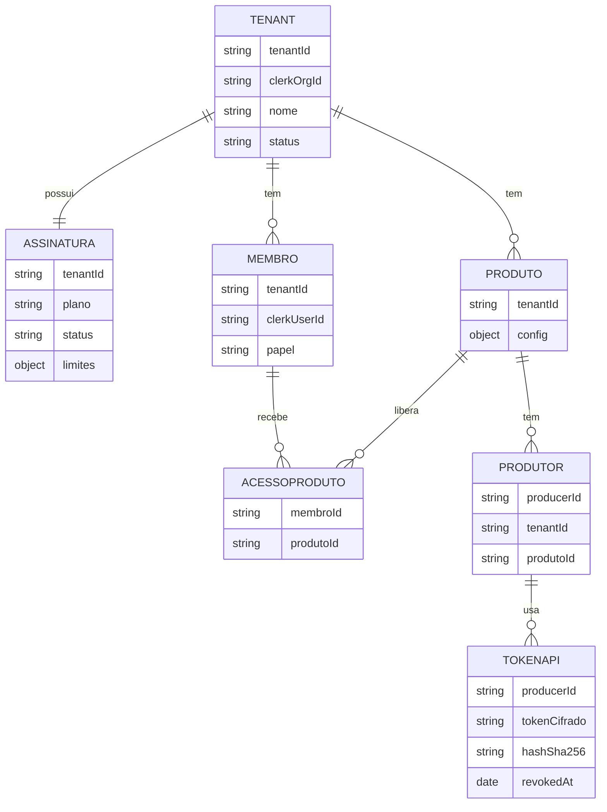

Os demais documentos do sistema (`Arquivo`, lote, `Ocorrencia`, `Sugestao`, `Notificacao`, histórico de execuções, chaves
de lock, `BancoVetorial`) também levam `tenantId` (e `produtoId` quando aplicável) `[INFERIDO — lista completa a revisar no DER]`.

## 3. Modelo antigo × novo — as 7 falhas corrigidas

| # | Falha do modelo hash → metadata (ADR_105) | Como o modelo pool resolve |
|---|---|---|
| 1 | Permissões espalhadas na metadata de cada hash | Papel no `Membro` e acesso no `AcessoProduto`, coleções próprias |
| 2 | enterpriseId e productId duplicados em várias entradas | Um `tenantId` e referências por id; nada repetido em metadata |
| 3 | Downgrade difícil (mexer em várias entradas) | Downgrade = alterar só a `Assinatura` (ADR_124) |
| 4 | Sem um `tenantId` único para isolar dados | `tenantId` em todo documento/log + filtro centralizado no Core |
| 5 | Usuários e máquinas misturados na mesma tabela | Usuários em `Membro`; máquinas em `Produtor`/`TokenApi` |
| 6 | Sem papel por pessoa | `Membro.papel` = DONO, ADMIN ou MEMBRO |
| 7 | Desalinhado com a Clerk | Tenant = Organization; org:admin ↔ DONO/ADMIN, org:member ↔ MEMBRO |

## 4. Cadeia de validação por requisição de usuário

1. **Identidade (Clerk):** session token válido → `clerkUserId` e `clerkOrgId` (Organization ativa) (ADR_022/032).
2. **Tenant + papel (`Membro`):** `Tenant` pelo `clerkOrgId`; `Membro` pelo (tenantId, clerkUserId) → papel.
3. **Acesso ao Produto (`AcessoProduto`):** MEMBRO precisa do registro; DONO/ADMIN veem todos.
4. **Limites (`Assinatura`):** status e limites do plano (IA, retenção, créditos).
5. **Filtro `tenantId`:** a consulta sai da camada centralizada do Core sempre com `tenantId`.

Máquinas (OTel Collector) não passam pela Clerk: Bearer → SHA-256 → `TokenApi` → `Produtor` → tenantId + produtoId → `Assinatura`.
Serviços internos (Coletor, Varredura, Finder, Ocorrência) recebem o `tenantId` no item da fila e no JWT interno (ADR_028) `[INFERIDO]`.

## 5. Como cada módulo obtém e valida o tenant

| Módulo / ponto | Como obtém o tenantId | Como valida | Diagrama |
|---|---|---|---|
| Core / API Core (Backend Java) | session token da Clerk → clerkOrgId → `Tenant` | cadeia completa (seção 4); filtro centralizado | tenant_requisicao_usuario |
| Auth / webhooks da Clerk | `organization.*` e `organizationMembership.*` → clerkOrgId | assinatura do webhook `[PENDENTE — Svix]`; Tenant existente | tenant_convite_promocao_membro |
| Assinatura | criada com o Tenant na compra | só DONO altera `[INFERIDO]`; gateway de pagamento `[PENDENTE]` | tenant_criacao_assinatura, tenant_downgrade_plano |
| Coletor — ingestão OTLP | Bearer → SHA-256 → `TokenApi` → `Produtor` | token não revogado; Assinatura ativa; cota `[PENDENTE]` | tenant_ingestao_coletor |
| Upload Manual | cadeia do usuário no Core; repassado ao Coletor no JWT interno `[INFERIDO]` | AcessoProduto ao Produto do card | tenant_upload_manual |
| Varredura | tenantId + produtoId no item da `FilaDesordenada` do Produto | item coerente com o Produto `[INFERIDO]` | tenant_varredura_finder |
| Finder | tenantId no item da `FilaOrdenada` | consultas ao Elasticsearch e ao BancoVetorial filtradas por tenant/Produto | tenant_varredura_finder |
| Ocorrência | tenantId do `ResumoAnalise` | cria Ocorrências com tenantId; APIs de consulta pela cadeia do usuário | tenant_ocorrencia_sugestao |
| Sugestão por IA (automática/manual, BYOK, Créditos) | automática: tenantId da Ocorrência; manual: cadeia do usuário | `Assinatura.limites.IA` + `produtoAtivouIA`; Créditos do tenant; chave BYOK do tenant `[PENDENTE — coleção]` | tenant_ocorrencia_sugestao |
| Notificações / WebSocket | conexão WebSocket validada pela Clerk → tenantId + membroId | envio só para conexões do mesmo tenant com acesso ao Produto | tenant_notificacao_websocket |
| Gestão de tokens | cadeia do usuário (DONO/ADMIN) | Produto do tenant; `Produtor` + `TokenApi` | tenant_produtor_token |
| Convite / promoção de membros | cadeia do usuário (DONO/ADMIN) | regras da ADR_114; limite de 20 membros/org da Clerk | tenant_convite_promocao_membro |
| Health (`GET /health`, grpc.health.v1) | não usa tenant | público, sem token (ADR_118) | — |

## 6. Clerk — decisão de custo (ADR_123)

- **Organizations gratuitas** da Clerk: até 100 organizações retidas por mês (MRO), 20 membros por organização, papéis Admin/Member e convites (fonte: https://clerk.com/pricing).
- **MFA** pelo plano Clerk Student do GitHub Student Developer Pack: limites do Pro, grátis enquanto o estudante estiver verificado, um único workspace, sem SMS (fonte: https://clerk.com/github-student-developer-pack).
- **Sem o add-on B2B Enhanced** (US$ 85–100/mês, papéis customizados): os papéis ficam na nossa coleção `Membro`; org:admin ↔ DONO/ADMIN, org:member ↔ MEMBRO.
- **Vigiar** os limites de 20 membros por organização e 100 MRO. `[PENDENTE]` MFA por organização não confirmado (a configuração parece ser do app inteiro).

---

## Criação do tenant na compra da assinatura

Arquivo: `tenant_criacao_assinatura.png`

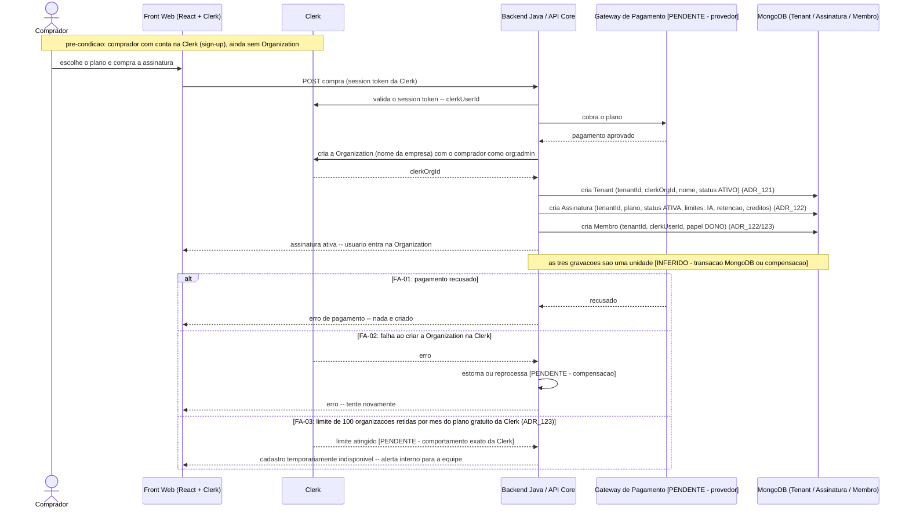

## Cadeia de validação por requisição de usuário

Arquivo: `tenant_requisicao_usuario.png`

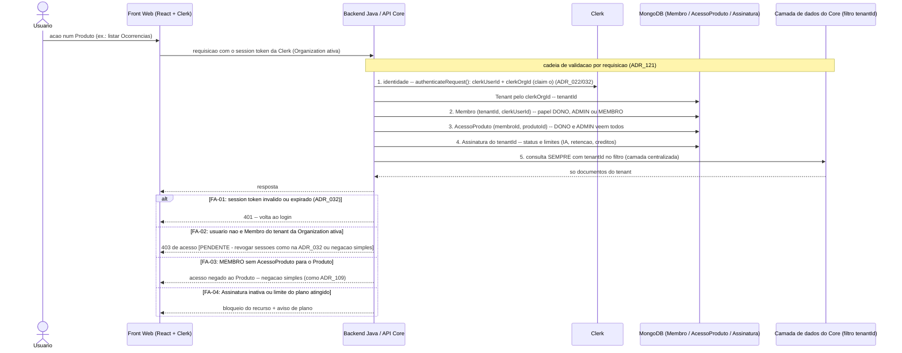

## Convite e promoção de membro

Arquivo: `tenant_convite_promocao_membro.png`

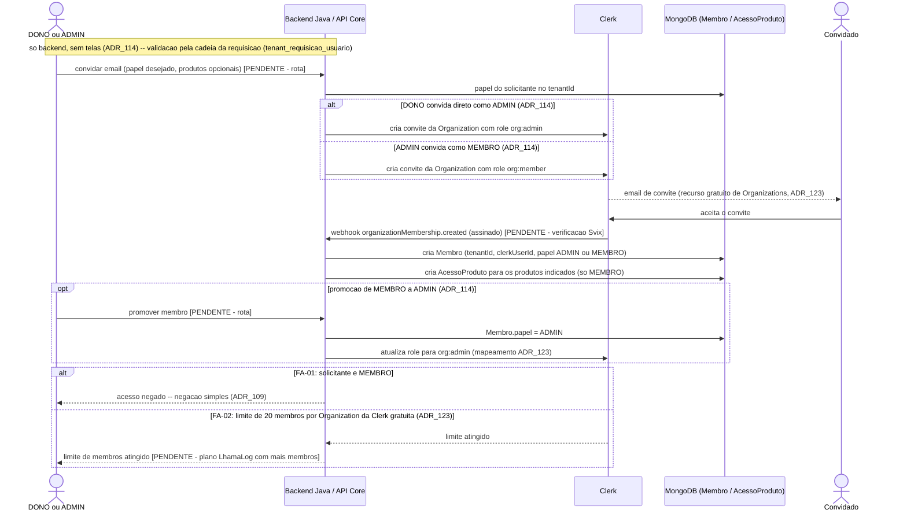

## Produtor e TokenApi

Arquivo: `tenant_produtor_token.png`

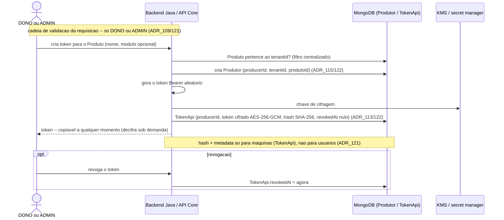

## Ingestão OTLP no Coletor

Arquivo: `tenant_ingestao_coletor.png`

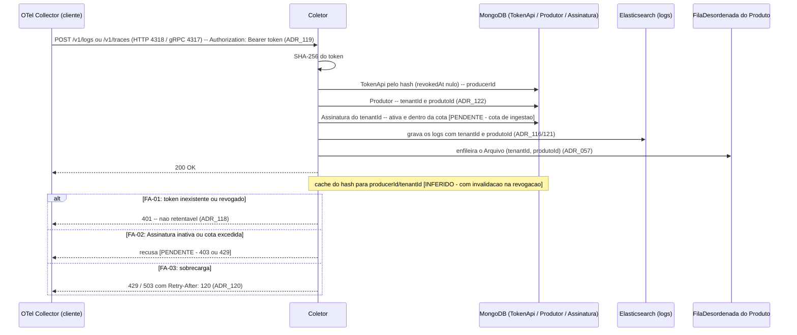

## Upload manual

Arquivo: `tenant_upload_manual.png`

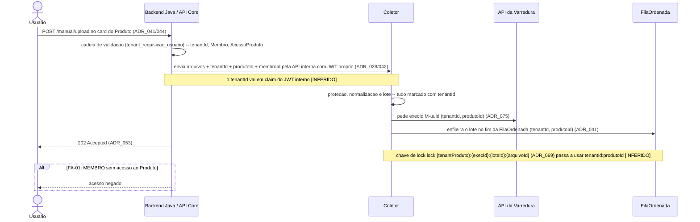

## Varredura e Finder

Arquivo: `tenant_varredura_finder.png`

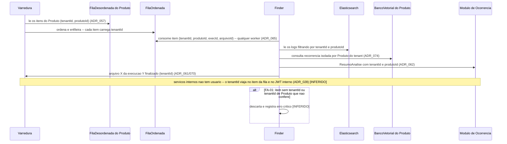

## Ocorrência e Sugestão por IA (BYOK e Créditos)

Arquivo: `tenant_ocorrencia_sugestao.png`

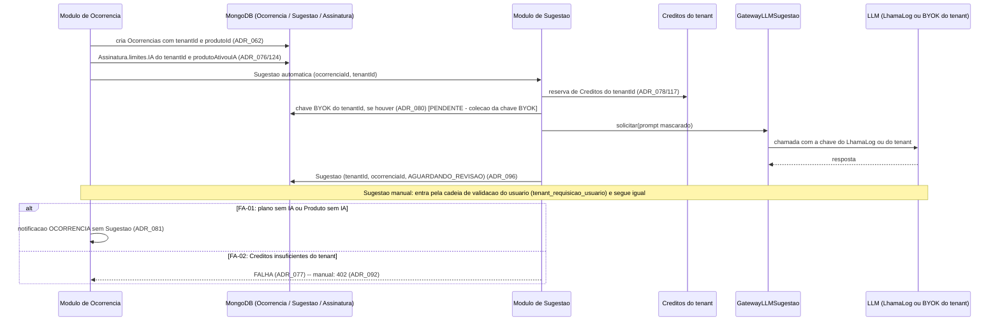

## Notificações e WebSocket

Arquivo: `tenant_notificacao_websocket.png`

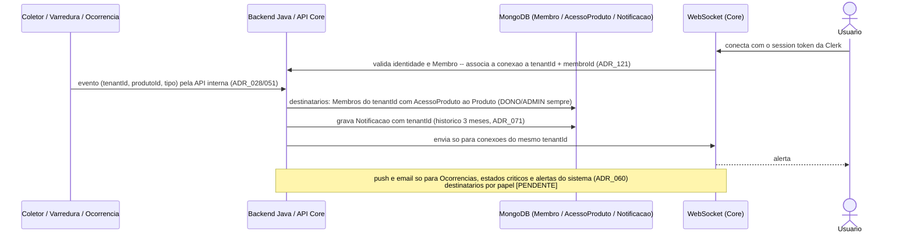

## Downgrade / troca de plano

Arquivo: `tenant_downgrade_plano.png`

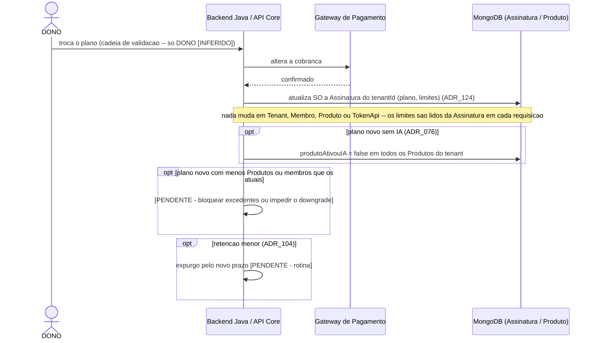

---

## Pendências

- **`[PENDENTE]`** gateway de pagamento e compensação se a criação da Organization falhar após o pagamento.
- **`[PENDENTE]`** comportamento da Clerk ao atingir 100 MRO; plano do LhamaLog para empresas com mais de 20 membros.
- **`[PENDENTE]`** MFA por organização (parece ser do app inteiro).
- **`[PENDENTE]`** verificação dos webhooks da Clerk (Svix) e eventos usados.
- **`[PENDENTE]`** rotas de convite e promoção (ADR_114).
- **`[PENDENTE]`** 403 com revogação de sessões (ADR_032) × negação simples quando o usuário não é Membro do tenant.
- **`[PENDENTE]`** cota de ingestão por plano e código de recusa (403 ou 429).
- **`[PENDENTE]`** coleção da chave BYOK do tenant.
- **`[PENDENTE]`** downgrade com Produtos/membros acima do novo limite; expurgo pela nova retenção.
- **`[PENDENTE]`** destinatários de notificação por papel.
- **`[INFERIDO]`** tenantId no JWT interno e nos itens das filas; chave de lock passa a usar tenantId:produtoId (ADR_069).
- **`[INFERIDO]`** gravação de Tenant + Assinatura + Membro como uma unidade (transação ou compensação).
- **`[INFERIDO]`** cache hash → producerId/tenantId no Coletor, invalidado na revogação.
- **`[INFERIDO]`** só o DONO troca o plano.
- **`[PENDENTE]`** atualizar DER, Modelo de Classes e os .md dos outros fluxos que citam a tabela de tenant da ADR_105 (Ingestão de Telemetria, Upload Manual, Varredura e Finder).

**Rastreabilidade:** ADR_022, 028, 030, 032, 041–075, 076, 078, 080, 104, 105, 109, 113–120 e ADR_121–124.

**Renderização:** PNGs com o mermaid-cli (`mmdc`, tema neutral, fundo branco), escala 2.
