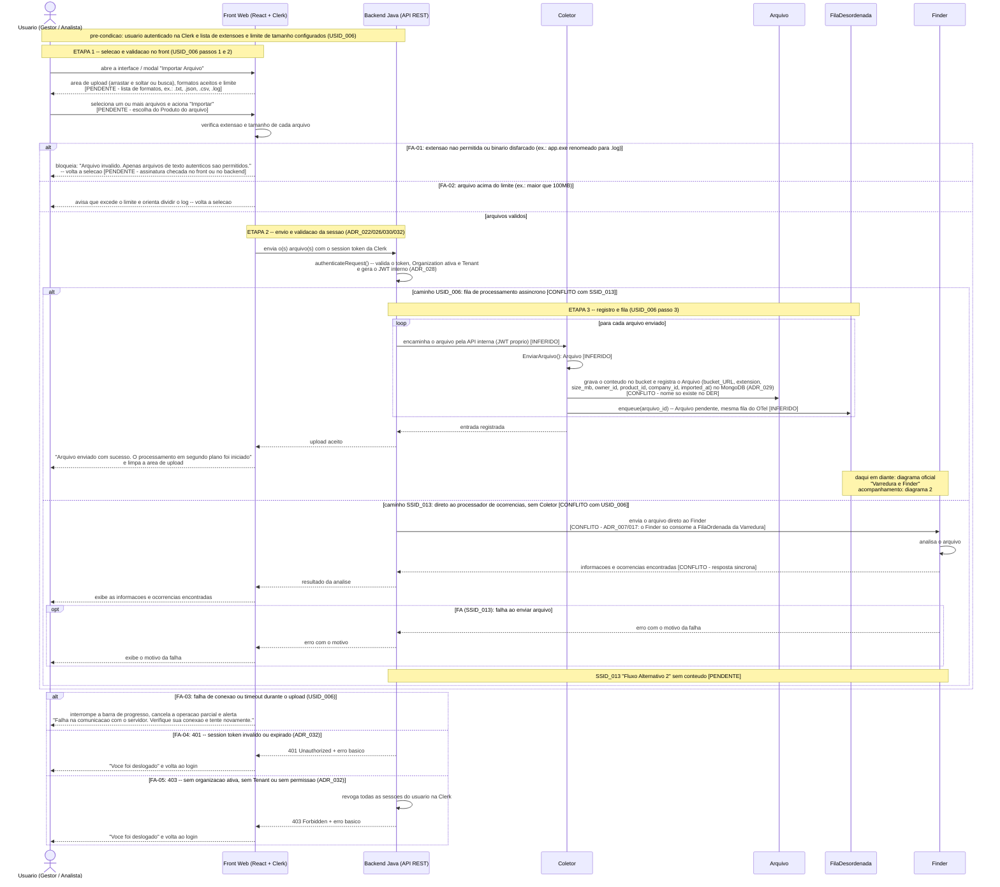
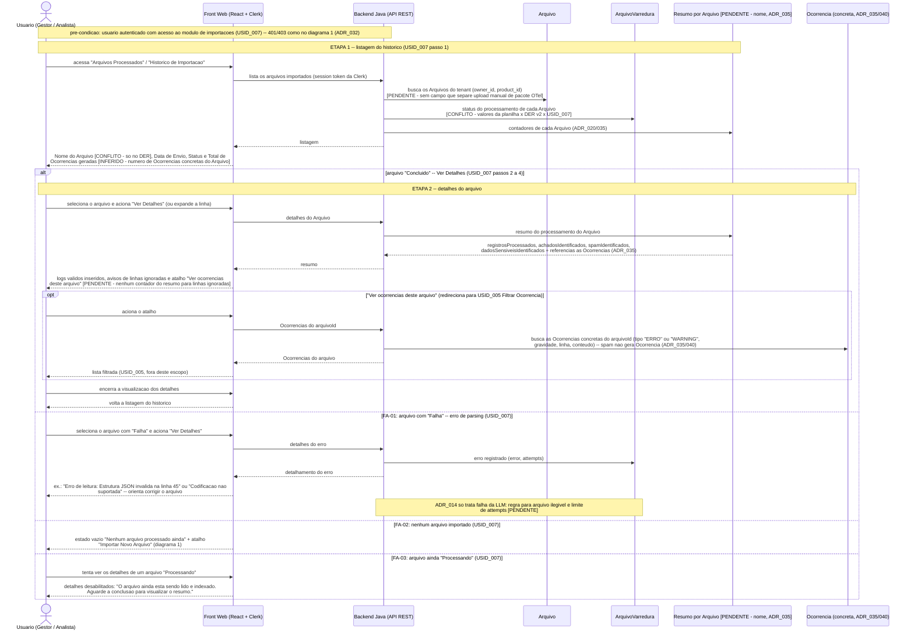

# Diagramas de Sequência v2 — Upload Manual (LhamaLog)

**Versão 2 (03/10/2026).** Versão consolidada em **2 diagramas**: cada fluxo alternativo fica num `alt` dentro do
diagrama, e as etapas são separadas por notas. O conflito SSID_013 × USID_006 virou um `alt` dentro do diagrama 1. A v1
(4 diagramas) está, sem alteração, na subpasta `v1`.

**Escopo:** seleção, validação e envio do arquivo até ele entrar na `FilaDesordenada` (diagrama 1) e o acompanhamento
dos arquivos importados (diagrama 2). O processamento (Varredura → Finder → Ocorrência) é o do diagrama oficial
`Varredura e Finder`; a Ocorrência segue o modelo das ADR_035/040 (Ocorrência concreta por erro/warning + resumo por
Arquivo).

Marcações: `[PENDENTE]` requisito sem definição nas fontes; `[INFERIDO]` ligação feita por nós entre o modelo de
classes, os casos de uso e as ADRs; `[CONFLITO]` duas fontes dizem coisas diferentes. Valores de enum entre aspas
(`"PENDING"`), sem relação com `[PENDENTE]`. Onde o modelo de classes não tem método, o passo aparece como descrição.

**Base:** USID_006 (Importar Arquivo), SSID_013 (Importar arquivo para varredura), USID_007 (Consultar Arquivos
Processados) (`LhamaLog_casos_de_uso.xlsx`); abas `Coletor`, `Arquivo`, `Arquivo Varredura`, `LogNormalizado`
(`Modelo_de_Classes_LhamaLog.xlsx`); `diagrama_classes_varredura_finder_v2.md` (`FilaDesordenada`, `Arquivo` v2);
`der.md` v2 (`Arquivo`, `ArquivoVarredura`); ADR_007, 014, 017, 020, 022, 026, 028, 029, 030, 032, 035, 040;
quadro-branco do time. Nenhuma das 40 ADRs trata de upload manual; as ADRs usadas valem para qualquer requisição da
Aplicação Web (autenticação, tokens internos, tenant) ou para o modelo da Ocorrência.

**Visão geral do fluxo:** o usuário escolhe um ou mais arquivos; o front valida extensão e tamanho; o backend valida a
sessão da Clerk e o tenant. Pela USID_006, o arquivo é registrado como `Arquivo` e vai para a fila assíncrona; pela
SSID_013, iria direto ao Finder e voltaria com o resultado — as duas fontes estão em `[CONFLITO]` e aparecem como dois
ramos do mesmo `alt` (**diagrama 1**). Depois, o usuário acompanha o status, o resumo e as Ocorrências de cada arquivo
(**diagrama 2**).

**Participantes usados:**
- `Usuario (Gestor / Analista)` — atores da USID_006/007
- `Front Web (React + Clerk)` / `Backend Java (API REST)` — sessão da Clerk validada no backend (ADR_022/026/032)
- `Coletor` — `EnviarArquivo(): Arquivo` `[INFERIDO]`
- `Arquivo` — conteúdo no bucket (`bucket_URL`) e metadados (`extension`, `size_mb`, `owner_id`, `product_id`,
  `company_id`, `imported_at`); `nome` só no DER v2
- `FilaDesordenada` — classe v2 (`enqueue(arquivo_id)`), a mesma fila do pipeline OTel `[INFERIDO]`
- `Finder` — só no ramo SSID_013
- `ArquivoVarredura` — status, `attempts` e `error` do processamento de cada Arquivo
- `Resumo por Arquivo` — agrupador com os contadores e as referências às Ocorrências do Arquivo (ADR_035; nome da
  entidade `[PENDENTE]`)
- `Ocorrencia` — Ocorrência concreta, uma por erro/warning (ADR_035/040)

## ⚠️ Pontos críticos

**1. `[CONFLITO]` Caminho direto Web → Finder (SSID_013) × fila assíncrona (USID_006)** — a USID_006 descreve upload →
registro → "fila de processamento assíncrono" → aviso de "processamento em segundo plano". A SSID_013 descreve o arquivo
"enviado diretamente para o processador de ocorrências, sem passar por nenhum coletor", com retorno das ocorrências
encontradas, que soa síncrono. Os dois ramos estão no mesmo `alt` do diagrama 1, sem reconciliar.

**2. `[CONFLITO]` SSID_013 × arquitetura do Finder nas ADRs** — pelas ADR_007 e ADR_017, o Finder só consome a
`FilaOrdenada` montada pela Varredura (`processar()` sobre o próximo Arquivo). Nenhuma ADR prevê um caminho em que o
Finder atenda uma requisição direta e devolva o resultado na hora. Diagrama 1, ramo SSID_013.

**3. `[PENDENTE]` Formatos aceitos** — a USID_006 só dá exemplos (".txt, .json, .csv, .log") e diz que a lista de
extensões é "previamente configurada". A `LogNormalizado` é citada como abstração de TXT, LOG, JSON e CSV, mas a aba
original ainda não foi transcrita (ADR_016, pontos em aberto). O quadro-branco tem a nota "OBS: Definir Formato de
Leitura/conversão Universal". Nenhuma fonte fecha a lista. Diagrama 1.

**4. `[PENDENTE]` Onde é checada a assinatura do arquivo** — a USID_006 (FA-01) bloqueia binários disfarçados (ex.:
`app.exe` renomeado para `.log`) "no passo 2", mas não diz se isso é no front ou no backend. Diagrama 1.

**5. `[PENDENTE]` SSID_013 "Fluxo Alternativo 2"** — o cabeçalho existe na planilha, sem nenhuma linha.

**6. `[INFERIDO]` Entrada pelo Coletor e mesma fila do OTel** — a USID_006 não nomeia classes. O diagrama usa
`Coletor.EnviarArquivo(): Arquivo` (método que já existe, separado do `EnviarLote()` da telemetria) e assume que a "fila
de processamento assíncrono" é a `FilaDesordenada` do pipeline OTel. A passagem Backend → Coletor pela API interna com
JWT próprio segue a ADR_028 `[INFERIDO]`. Diagrama 1.

**7. `[PENDENTE]` Produto do arquivo enviado** — o `Arquivo` tem `product_id` e o tenant da ADR_030 é por empresa +
usuário + produto, mas a USID_006 não tem passo para escolher o Produto. Diagrama 1.

**8. `[CONFLITO]` "Nome do Arquivo"** — a USID_007 lista "Nome do Arquivo". O DER v2 tem `Arquivo.nome`; a classe
`Arquivo` (planilha original e v2) não tem esse atributo. Diagramas 1 e 2.

**9. `[RISCO]` Mesma classe `Arquivo` para pacote OTel e upload manual** — o `Arquivo` é o pacote de traces da ADR_015
e também o arquivo enviado pelo usuário. Não há campo de origem (OTel × upload), então:
(a) a listagem da USID_007 misturaria pacotes do Collector com arquivos importados `[PENDENTE]`;
(b) um log enviado à mão pode não ter traces nem `service.name`, e a prioridade na Varredura vem do módulo do trace
(ADR_009) — a prioridade de um arquivo manual está `[PENDENTE]`.

**10. `[CONFLITO]` Status do processamento** — a planilha (`Arquivo Varredura`) tem `"PENDING"`, `"PROCESSING"`,
`"COMPLETED"`, `"ERROR"`, `"FAILED"`; o DER v2 tem `"PENDING"`, `"PROCESSING"`, `"COMPLETED"`, `"COMPLETED_WITH_ERROR"`;
a USID_007 mostra "Concluído", "Processando" e "Falha". O mapeamento entre eles não está definido. Diagrama 2.

**11. `[PENDENTE]` Resumo mostrado na USID_007** — a tela pede "quantidade exata de logs válidos inseridos" e "avisos
sobre linhas ignoradas". O resumo por Arquivo (ADR_020/035) tem `registrosProcessados`, `achadosIdentificados`,
`spamIdentificados` e `dadosSensiveisIdentificados`; nenhum contador corresponde a "linhas ignoradas". "Total de
Ocorrências geradas" foi lido como o número de Ocorrências concretas do Arquivo `[INFERIDO]`. Diagrama 2.

**12. `[PENDENTE]` Arquivo ilegível (erro de parsing)** — a USID_007 (FA-01) mostra erros como "Estrutura JSON inválida
na linha 45". A ADR_014 só define o que acontece na falha da LLM (o Arquivo volta à fila); para um arquivo que não pode
ser lido não há regra (reprocessar ou ir direto para falha), nem limite de `attempts`. Diagrama 2.

**13. `[PENDENTE]` Nome e chave do resumo por Arquivo** — a ADR_035 sugere `ResumoArquivo` ou `RelatorioProcessamento`;
a chave de idempotência da Ocorrência concreta também ficou em aberto (ADR_035/040).

**14. Observação** — o 403 da ADR_032 revoga todas as sessões do usuário; vale para o upload como para qualquer
requisição. A própria ADR registra o risco de deslogar o usuário de todos os dispositivos por falta de organização ou
Tenant.

---

## 1. Upload manual — seleção, validação e envio até a fila (USID_006 × SSID_013)

Arquivo: `upload_manual_envio.png`

**Resumo do fluxo:** o usuário abre "Importar Arquivo", escolhe os arquivos e confirma. O front verifica extensão e
tamanho; o backend valida o session token, a Organization ativa e o Tenant. No ramo USID_006, cada arquivo vira um
`Arquivo` (conteúdo no bucket, metadados no MongoDB) e entra na `FilaDesordenada`; o usuário recebe o aviso de
processamento em segundo plano. No ramo SSID_013, o arquivo iria direto ao Finder, que devolveria as ocorrências.

**Fluxo principal (USID_006):**
1. Usuário abre "Importar Arquivo"; o front mostra formatos aceitos e limite de tamanho.
2. Usuário seleciona os arquivos e aciona "Importar"; o front verifica extensão e tamanho.
3. O backend valida a sessão; para cada arquivo, `EnviarArquivo()`, registro do `Arquivo` e `enqueue(arquivo_id)`.
4. O front mostra "Arquivo enviado com sucesso. O processamento em segundo plano foi iniciado" e limpa a área.

**Fluxos alternativos:**
- **FA-01** extensão não permitida ou binário disfarçado (USID_006).
- **FA-02** arquivo acima do limite de tamanho (USID_006).
- **FA-03** falha de conexão ou timeout durante o upload (USID_006).
- **FA-04** 401 — session token inválido ou expirado (ADR_032).
- **FA-05** 403 — sem organização ativa, sem Tenant ou sem permissão (ADR_032).
- **Ramo SSID_013** `[CONFLITO]` e o seu FA "falha ao enviar arquivo".

**Notas sobre este diagrama:**
- `[CONFLITO]` ramos USID_006 × SSID_013: pontos críticos 1 e 2.
- O loop por arquivo segue o "um ou mais arquivos" da USID_006; se o upload de vários arquivos é uma requisição só ou
  uma por arquivo está `[PENDENTE]`.
- FA-03 vale para a ETAPA 2 (transferência ao servidor); FA-04 e FA-05 valem para qualquer resposta do backend.

---

## 2. Acompanhamento — Consultar Arquivos Processados (USID_007; Ocorrência pelas ADR_035/040)

Arquivo: `upload_manual_acompanhamento.png`

**Resumo do fluxo:** o usuário abre o histórico de importação; o backend lista os Arquivos do tenant com o status do
processamento e o total de Ocorrências. Em um arquivo concluído, "Ver Detalhes" mostra o resumo por Arquivo e o atalho
para as Ocorrências concretas daquele arquivo (USID_005). Arquivo com falha mostra o erro; arquivo em processamento fica
com os detalhes desabilitados.

**Fluxo principal:**
1. Usuário abre "Arquivos Processados"; o backend busca `Arquivo`, `ArquivoVarredura` e o resumo de cada Arquivo.
2. A tela lista Nome do Arquivo, Data de Envio, Status e Total de Ocorrências geradas.
3. Em um arquivo "Concluído", "Ver Detalhes" mostra o resumo e o atalho "Ver ocorrências deste arquivo".
4. O usuário encerra os detalhes e volta à listagem.

**Fluxos alternativos:**
- **FA-01** arquivo com "Falha" (erro de parsing).
- **FA-02** nenhum arquivo importado.
- **FA-03** arquivo ainda "Processando".

**Notas sobre este diagrama:**
- `[CONFLITO]` status e "Nome do Arquivo": pontos críticos 8 e 10.
- A Ocorrência segue as ADR_035/040: cada erro/warning do Arquivo é uma Ocorrência concreta, e o resumo por Arquivo
  guarda os contadores e as referências a elas. O diagrama oficial `finder.png` (r3, 02/10) ainda mostra a
  Ocorrência-resumo da ADR_020, anterior às ADR_035/040.
- A criação de cada Ocorrência concreta dispara a Sugestão automática quando o plano tem o recurso (ADR_036/040); isso
  está no diagrama oficial `Sugestao por IA`, não aqui.
- USID_007 é consulta sob demanda; a notificação das Ocorrências é outro fluxo (módulo de Notificação).

---

## Notas obrigatórias (pendências)
- **`[CONFLITO]`** SSID_013 (direto ao Finder, síncrono) × USID_006 (fila assíncrona) — diagrama 1.
- **`[CONFLITO]`** SSID_013 × ADR_007/017 (o Finder só consome a `FilaOrdenada`).
- **`[CONFLITO]`** `Arquivo.nome` no DER v2 × classe `Arquivo` sem nome.
- **`[CONFLITO]`** valores de status do processamento: planilha × DER v2 × USID_007.
- **`[PENDENTE]`** lista fechada de formatos aceitos; transcrição da aba `LogNormalizado`.
- **`[PENDENTE]`** onde é checada a assinatura do arquivo (front ou backend).
- **`[PENDENTE]`** escolha do Produto no upload (`product_id`, tenant da ADR_030).
- **`[PENDENTE]`** campo de origem do `Arquivo` (upload × OTel) e prioridade de um arquivo manual na Varredura (ADR_009).
- **`[PENDENTE]`** contador de "linhas ignoradas" no resumo; nome da entidade do resumo; chave de idempotência da
  Ocorrência concreta (ADR_035/040).
- **`[PENDENTE]`** regra para arquivo ilegível e limite de `attempts` (ADR_014 só cobre falha da LLM).
- **`[PENDENTE]`** SSID_013 "Fluxo Alternativo 2" vazio.
- **`[PENDENTE]`** upload de vários arquivos: uma requisição ou uma por arquivo.
- **`[INFERIDO]`** `Coletor.EnviarArquivo()`, passagem Backend → Coletor por JWT interno (ADR_028) e uso da mesma
  `FilaDesordenada` do OTel.
- **`[INFERIDO]`** "Total de Ocorrências geradas" = número de Ocorrências concretas do Arquivo.
- **`[RISCO]`** mesma classe `Arquivo` para pacote OTel e arquivo enviado pelo usuário.
- Nenhuma ADR trata de upload manual.

**Rastreabilidade:** USID_006, SSID_013, USID_007 (`LhamaLog_casos_de_uso.xlsx`); `Modelo_de_Classes_LhamaLog.xlsx`
(`Coletor`, `Arquivo`, `Arquivo Varredura`, `LogNormalizado`); `diagrama_classes_varredura_finder_v2.md`; `der.md` v2;
ADR_007, 009, 014, 016, 017, 020, 022, 026, 028, 029, 030, 032, 035, 036, 040; quadro-branco.

**Renderização:** PNGs gerados com o mermaid-cli (`mmdc`, tema neutral, fundo branco) e escala 2.
