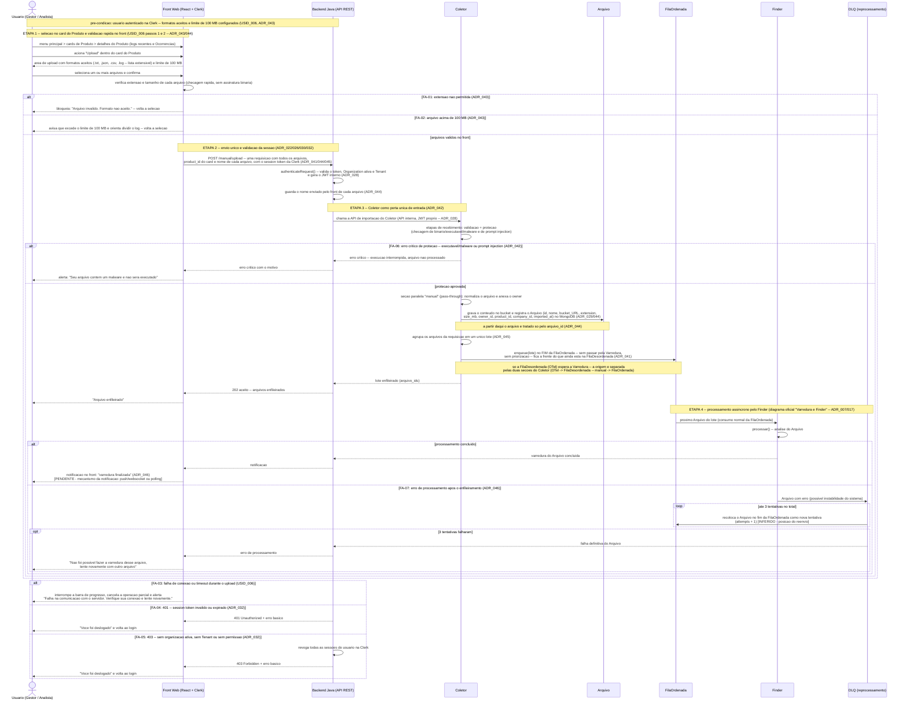
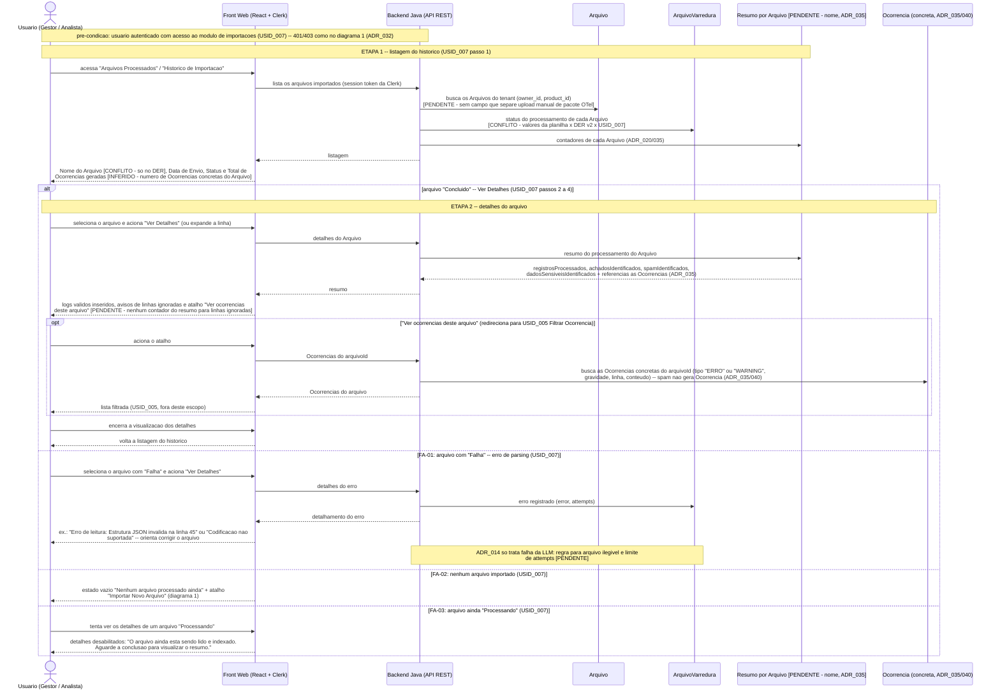

# Diagramas de Sequência v3 — Upload Manual (LhamaLog)

**Versão 3 (10/10/2026).** Atualiza **só o diagrama 1** (`upload_manual_envio.png`) com as decisões do Michel de
10/10/2026, registradas nas ADR_041 a ADR_046. O diagrama 2 (acompanhamento) fica como na v2 e será revisado depois;
ganhou apenas uma nota curta apontando as decisões que o afetam. A v2 deste documento e o PNG anterior do diagrama 1
(`selecao_validacao_envio.png`) foram copiados para a subpasta `v2` (os originais ainda precisam ser movidos para lá); a v1 (4 diagramas) continua na subpasta `v1`.

**Escopo:** seleção (no card do Produto), validação e envio do arquivo até ele entrar no **fim da `FilaOrdenada`** e o
retorno ao usuário (diagrama 1); acompanhamento dos arquivos importados (diagrama 2). O processamento (Finder →
Ocorrência) é o do diagrama oficial `Varredura e Finder`; a Ocorrência segue o modelo das ADR_035/040.

Marcações: `[PENDENTE]` requisito sem definição nas fontes; `[INFERIDO]` ligação feita por nós entre o modelo de
classes, os casos de uso e as ADRs; `[CONFLITO]` duas fontes dizem coisas diferentes; **Resolvido (ADR_0xx)** item que
uma ADR fechou. Valores de enum entre aspas (`"PENDING"`), sem relação com `[PENDENTE]`.

**Base:** USID_006 (Importar Arquivo), SSID_013 (Importar arquivo para varredura), USID_007 (Consultar Arquivos
Processados) (`LhamaLog_casos_de_uso.xlsx`); abas `Coletor`, `Arquivo`, `Arquivo Varredura`, `LogNormalizado`
(`Modelo_de_Classes_LhamaLog.xlsx`); `diagrama_classes_varredura_finder_v2.md`; `der.md` v2; ADR_007, 009, 014, 017,
020, 022, 026, 028, 029, 030, 032, 035, 040 e **ADR_041 a ADR_046** (decisões do upload manual, 10/10/2026).

**Visão geral do fluxo:** dentro do card de um Produto, o usuário envia um ou mais arquivos; o front checa extensão e
tamanho (100 MB). O backend recebe tudo em **uma** requisição `POST /manual/upload`, valida a sessão da Clerk e o tenant,
guarda o nome enviado e chama a API de importação do **Coletor** (JWT interno, ADR_028). O Coletor faz as etapas de
validação e proteção (binário/executável/malware e prompt injection); se a proteção falha, a execução para e o cliente é
alertado. Se passa, a seção paralela "manual" do Coletor normaliza, anexa o owner, registra o `Arquivo` (que passa a ser
tratado só pelo id), agrupa os arquivos num **lote** e o coloca no **fim da `FilaOrdenada`**, sem passar pela Varredura.
O usuário vê "Arquivo enfileirado" e, ao fim, recebe a notificação "varredura finalizada"; erros de processamento vão à
DLQ com até 3 tentativas (**diagrama 1**). Depois, o usuário acompanha o status, o resumo e as Ocorrências (**diagrama 2**).

**Participantes usados (diagrama 1):**
- `Usuario (Gestor / Analista)` — atores da USID_006/007
- `Front Web (React + Clerk)` / `Backend Java (API REST)` — sessão da Clerk validada no backend (ADR_022/026/032)
- `Coletor` — porta única de entrada; seção paralela "manual" (pass-through com proteção) (ADR_042)
- `Arquivo` — conteúdo no bucket e metadados (`id`, `nome`, `bucket_URL`, `extension`, `size_mb`, `owner_id`,
  `product_id`, `company_id`, `imported_at`) (ADR_044)
- `FilaOrdenada` — fila já consumida pelo Finder (ADR_007/017); o lote manual entra no fim (ADR_041)
- `Finder` — consome a `FilaOrdenada` normalmente
- `DLQ (reprocessamento)` — até 3 tentativas no total (ADR_046)

## ⚠️ Pontos críticos

**1. Resolvido (ADR_041) — SSID_013 × USID_006.** O upload é **enfileirado**, não síncrono, e nunca vai direto ao
Finder. O arquivo pula a Varredura e entra no **fim da `FilaOrdenada`** (ex.: se a Varredura acabou de montar 10
arquivos, o manual é o 11º); não é priorizado dentro da fila, mas fica à frente de tudo que ainda está na
`FilaDesordenada`. O ramo "direto ao Finder" da SSID_013 saiu do diagrama 1, **substituído por esta decisão**.

**2. Resolvido (ADR_041) — SSID_013 × arquitetura do Finder.** O Finder continua consumindo só a `FilaOrdenada`
(ADR_007/017); o upload manual apenas entra nessa fila.

**3. Resolvido (ADR_043) — Formatos aceitos.** Inicialmente `.txt`, `.json`, `.csv` e `.log`; lista **extensível**, não
fechada. Limite de **100 MB**. O front checa extensão e tamanho. (A transcrição da aba `LogNormalizado` continua
`[PENDENTE]`, fora deste diagrama.)

**4. Resolvido (ADR_042) — Onde é checada a assinatura.** Só no **backend**, pelo Coletor, como etapa de recebimento,
junto com a proteção contra prompt injection. Executável/malware ou prompt injection = **erro crítico**: execução
interrompida, arquivo não processado, alerta "Seu arquivo contem um malware e nao sera executado" (FA-06).

**5. Resolvido (ADR_046) — SSID_013 "Fluxo Alternativo 2".** Vira tratamento de erro: (a) erro crítico de proteção no
Coletor (FA-06, ADR_042); (b) erro de processamento após o enfileiramento → DLQ automática, até 3 tentativas no total;
depois, "Nao foi possivel fazer a varredura desse arquivo, tente novamente com outro arquivo" (FA-07).

**6. Resolvido (ADR_042) — Entrada pelo Coletor.** O Coletor recebe **sempre** todos os arquivos (regra-base). O backend
chama a mesma API de importação do Coletor pela API interna com JWT próprio (ADR_028); o Coletor roda as mesmas etapas de
validação/proteção, normaliza, anexa o owner e encaminha para uma seção paralela "manual", que enfileira direto na
`FilaOrdenada`. Sai o `[INFERIDO]` de `EnviarArquivo()` e da `FilaDesordenada` do OTel para o upload.

**7. Resolvido (ADR_044) — Produto do arquivo.** O usuário não escolhe: o upload é feito dentro do card do Produto
(menu principal > cards de Produto > detalhes com logs recentes e Ocorrências > botão de upload) e o front envia esse
`product_id`.

**8. Resolvido (ADR_044) — "Nome do Arquivo".** O backend guarda o nome enviado pelo front; ao passar pelo Coletor, o
arquivo recebe o id e passa a ser tratado só por ele. A classe `Arquivo` ganha o atributo `nome` (alinha com o DER v2).

**9. Resolvido (ADR_041/042) — Origem OTel × upload.** A origem fica separada pelas duas seções/filas do Coletor (OTel →
`FilaDesordenada`; manual → direto na `FilaOrdenada`). Prioridade de arquivo manual na Varredura (ADR_009) não se aplica:
ele não passa pela Varredura e não é priorizado (ADR_045). Para a listagem da USID_007 (diagrama 2), se é preciso um
campo de origem persistido no `Arquivo` continua `[PENDENTE]`.

**10. `[CONFLITO]` Status do processamento** — a planilha (`Arquivo Varredura`) tem `"PENDING"`, `"PROCESSING"`,
`"COMPLETED"`, `"ERROR"`, `"FAILED"`; o DER v2 tem `"PENDING"`, `"PROCESSING"`, `"COMPLETED"`, `"COMPLETED_WITH_ERROR"`;
a USID_007 mostra "Concluído", "Processando" e "Falha". O mapeamento entre eles não está definido. Diagrama 2 (o
"enfileirado" da ADR_046 e a falha após 3 tentativas também precisam entrar nesse mapeamento).

**11. `[PENDENTE]` Resumo mostrado na USID_007** — a tela pede "quantidade exata de logs válidos inseridos" e "avisos
sobre linhas ignoradas"; nenhum contador do resumo por Arquivo (ADR_020/035) corresponde a "linhas ignoradas". Diagrama 2.

**12. Parcialmente resolvido (ADR_046) — Arquivo ilegível / limite de `attempts`.** Erro de processamento após o
enfileiramento vai à DLQ, com até 3 tentativas no total. Se um erro de parsing determinístico também gasta as 3
tentativas ou falha direto continua `[PENDENTE]`. Diagrama 2 a revisar.

**13. `[PENDENTE]` Nome e chave do resumo por Arquivo** — a ADR_035 sugere `ResumoArquivo` ou `RelatorioProcessamento`;
a chave de idempotência da Ocorrência concreta também ficou em aberto (ADR_035/040).

**14. Observação** — o 403 da ADR_032 revoga todas as sessões do usuário; vale para o upload como para qualquer
requisição.

**15. Resolvido (ADR_045) — Vários arquivos.** Um ou mais arquivos vão em **uma** requisição; o Coletor agrupa num único
lote e coloca o lote no fim da `FilaOrdenada`. Prioridade é irrelevante para o upload manual.

---

## 1. Upload manual — seleção, validação e envio até a FilaOrdenada (USID_006 + SSID_013; ADR_041 a 046)

Arquivo: `upload_manual_envio.png`

**Resumo do fluxo:** no card de um Produto, o usuário aciona o upload, escolhe os arquivos e confirma. O front checa
extensão e tamanho; o backend recebe tudo em `POST /manual/upload`, valida session token, Organization ativa e Tenant,
guarda os nomes e chama o Coletor. O Coletor valida e protege (erro crítico interrompe), normaliza, anexa o owner,
registra cada `Arquivo`, agrupa num lote e o coloca no fim da `FilaOrdenada`. O usuário vê "Arquivo enfileirado"; o
Finder consome o lote normalmente e o usuário recebe "varredura finalizada"; erro de processamento vai à DLQ (até 3
tentativas).

**Fluxo principal:**
1. Usuário entra nos detalhes de um Produto (menu principal > cards de Produto) e aciona o upload; o front mostra formatos
   aceitos (.txt, .json, .csv, .log — lista extensível) e o limite de 100 MB.
2. Usuário seleciona um ou mais arquivos e confirma; o front checa extensão e tamanho.
3. O front envia uma requisição `POST /manual/upload` com os arquivos, o `product_id` do card e os nomes; o backend valida
   a sessão, gera o JWT interno e guarda os nomes.
4. O backend chama a API de importação do Coletor; o Coletor roda validação + proteção (binário/executável/malware e
   prompt injection).
5. A seção "manual" do Coletor normaliza, anexa o owner, registra o `Arquivo` (id + nome), agrupa os arquivos num lote e
   faz `enqueue` no fim da `FilaOrdenada`.
6. O front mostra "Arquivo enfileirado".
7. O Finder consome o lote da `FilaOrdenada`; ao concluir, o usuário recebe a notificação "varredura finalizada".

**Fluxos alternativos:**
- **FA-01** extensão não permitida (front; ADR_043).
- **FA-02** arquivo acima de 100 MB (front; ADR_043).
- **FA-03** falha de conexão ou timeout durante o upload (USID_006).
- **FA-04** 401 — session token inválido ou expirado (ADR_032).
- **FA-05** 403 — sem organização ativa, sem Tenant ou sem permissão (ADR_032).
- **FA-06** erro crítico de proteção no Coletor — executável/malware ou prompt injection (ADR_042; SSID_013 FA 2a).
- **FA-07** erro de processamento após o enfileiramento — DLQ, até 3 tentativas (ADR_046; SSID_013 FA 2b).
- ~~Ramo SSID_013 direto ao Finder~~ — **removido, substituído pela ADR_041** (o FA "falha ao enviar arquivo" da SSID_013
  passa a ser coberto pelos FA-06/FA-07).

**Notas sobre este diagrama:**
- O ramo SSID_013 "direto ao Finder" foi removido: **substituído pela ADR_041** (upload enfileirado no fim da
  `FilaOrdenada`).
- O loop por arquivo da v2 deu lugar ao lote único (ADR_045): uma requisição, um lote, um `enqueue`.
- FA-03 vale para a ETAPA 2 (transferência ao servidor); FA-04 e FA-05 valem para qualquer resposta do backend (ADR_032).
- FA-06 interrompe a execução antes de qualquer registro na fila; FA-07 acontece depois do "Arquivo enfileirado".
- `[INFERIDO]` o reenvio da DLQ volta ao fim da `FilaOrdenada`.
- `[PENDENTE]` mecanismo da notificação "varredura finalizada" no front (push/websocket ou polling).
- `202` como código de "aceito/enfileirado" é `[INFERIDO]` (a decisão só fixa o retorno "Arquivo enfileirado").

---

## 2. Acompanhamento — Consultar Arquivos Processados (USID_007; Ocorrência pelas ADR_035/040)

Arquivo: `upload_manual_acompanhamento.png`

**Resumo do fluxo:** o usuário abre o histórico de importação; o backend lista os Arquivos do tenant com o status do
processamento e o total de Ocorrências. Em um arquivo concluído, "Ver Detalhes" mostra o resumo por Arquivo e o atalho
para as Ocorrências concretas daquele arquivo (USID_005). Arquivo com falha mostra o erro; arquivo em processamento fica
com os detalhes desabilitados.

**Fluxo principal:**
1. Usuário abre "Arquivos Processados"; o backend busca `Arquivo`, `ArquivoVarredura` e o resumo de cada Arquivo.
2. A tela lista Nome do Arquivo, Data de Envio, Status e Total de Ocorrências geradas.
3. Em um arquivo "Concluído", "Ver Detalhes" mostra o resumo e o atalho "Ver ocorrências deste arquivo".
4. O usuário encerra os detalhes e volta à listagem.

**Fluxos alternativos:**
- **FA-01** arquivo com "Falha" (erro de parsing).
- **FA-02** nenhum arquivo importado.
- **FA-03** arquivo ainda "Processando".

> **Nota (v3, 10/10/2026):** este diagrama não foi revisado nesta versão. Decisões do diagrama 1 que o afetam: o `Arquivo`
> ganha `nome` (ADR_044, resolve o `[CONFLITO]` do "Nome do Arquivo"); a origem é separada pelas seções do Coletor
> (ADR_041/042); "enfileirado", notificação "varredura finalizada" e DLQ com até 3 tentativas (ADR_046) precisam entrar
> no mapeamento de status e no FA-01. Revisão pendente.

**Notas sobre este diagrama:**
- `[CONFLITO]` status e "Nome do Arquivo": pontos críticos 8 e 10.
- A Ocorrência segue as ADR_035/040: cada erro/warning do Arquivo é uma Ocorrência concreta, e o resumo por Arquivo
  guarda os contadores e as referências a elas. O diagrama oficial `finder.png` (r3, 02/10) ainda mostra a
  Ocorrência-resumo da ADR_020, anterior às ADR_035/040.
- A criação de cada Ocorrência concreta dispara a Sugestão automática quando o plano tem o recurso (ADR_036/040); isso
  está no diagrama oficial `Sugestao por IA`, não aqui.
- USID_007 é consulta sob demanda; a notificação das Ocorrências é outro fluxo (módulo de Notificação).

---

## Notas obrigatórias (pendências)
- **Resolvido (ADR_041)** SSID_013 (direto ao Finder, síncrono) × USID_006 (fila assíncrona): upload enfileirado no fim da
  `FilaOrdenada`, sem Varredura; o ramo SSID_013 foi removido do diagrama 1.
- **Resolvido (ADR_041)** SSID_013 × ADR_007/017: o Finder continua consumindo só a `FilaOrdenada`.
- **Resolvido (ADR_044)** `Arquivo.nome`: a classe `Arquivo` ganha `nome`; depois do Coletor o arquivo é tratado pelo id.
- **`[CONFLITO]`** valores de status do processamento: planilha × DER v2 × USID_007 (diagrama 2).
- **Resolvido (ADR_043)** formatos aceitos: `.txt`, `.json`, `.csv`, `.log`, lista extensível; limite 100 MB. Continua
  `[PENDENTE]` a transcrição da aba `LogNormalizado`.
- **Resolvido (ADR_042)** assinatura do arquivo: só no backend, pelo Coletor, com proteção contra prompt injection.
- **Resolvido (ADR_044)** Produto no upload: vem do card do Produto (`product_id` enviado pelo front).
- **Resolvido (ADR_041/042)** origem do `Arquivo`: separada pelas seções do Coletor; prioridade na Varredura não se aplica
  (ADR_045). Continua `[PENDENTE]` um campo de origem persistido para a listagem da USID_007 (diagrama 2).
- **`[PENDENTE]`** contador de "linhas ignoradas" no resumo; nome da entidade do resumo; chave de idempotência da
  Ocorrência concreta (ADR_035/040).
- **Parcialmente resolvido (ADR_046)** limite de `attempts`: 3 tentativas no total via DLQ. Continua `[PENDENTE]` se erro
  de parsing determinístico gasta as 3 tentativas.
- **Resolvido (ADR_046)** SSID_013 "Fluxo Alternativo 2": erro crítico de proteção (FA-06) e DLQ (FA-07).
- **Resolvido (ADR_045)** vários arquivos: uma requisição, um lote.
- **Resolvido (ADR_042)** `[INFERIDO]` da v2 sobre `Coletor.EnviarArquivo()`, JWT interno (ADR_028) e uso da
  `FilaDesordenada` do OTel.
- **`[PENDENTE]`** mecanismo da notificação "varredura finalizada" (diagrama 1).
- **`[INFERIDO]`** reenvio da DLQ no fim da `FilaOrdenada`; código `202` no aceite (diagrama 1).
- **`[INFERIDO]`** "Total de Ocorrências geradas" = número de Ocorrências concretas do Arquivo (diagrama 2).
- **`[PENDENTE]`** ajustes no Modelo de Classes/DER: `Arquivo.nome`, seção "manual" do Coletor, DLQ (ADR_042/044/046).

**Rastreabilidade:** USID_006, SSID_013, USID_007 (`LhamaLog_casos_de_uso.xlsx`); `Modelo_de_Classes_LhamaLog.xlsx`
(`Coletor`, `Arquivo`, `Arquivo Varredura`, `LogNormalizado`); `diagrama_classes_varredura_finder_v2.md`; `der.md` v2;
ADR_007, 009, 014, 016, 017, 020, 022, 026, 028, 029, 030, 032, 035, 036, 040, 041, 042, 043, 044, 045, 046; quadro-branco.

**Renderização:** PNGs gerados com o mermaid-cli (`mmdc`, tema neutral, fundo branco) e escala 2. Na v3 só o
`upload_manual_envio.png` foi regerado.
