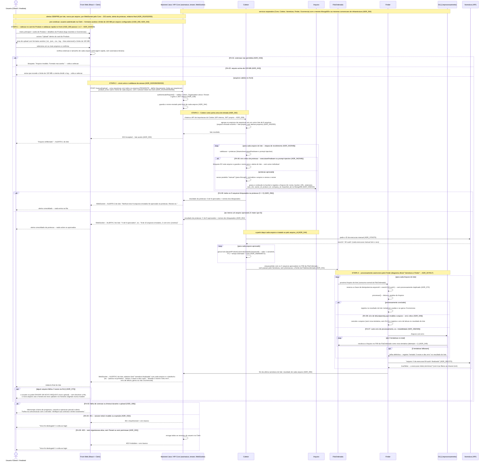
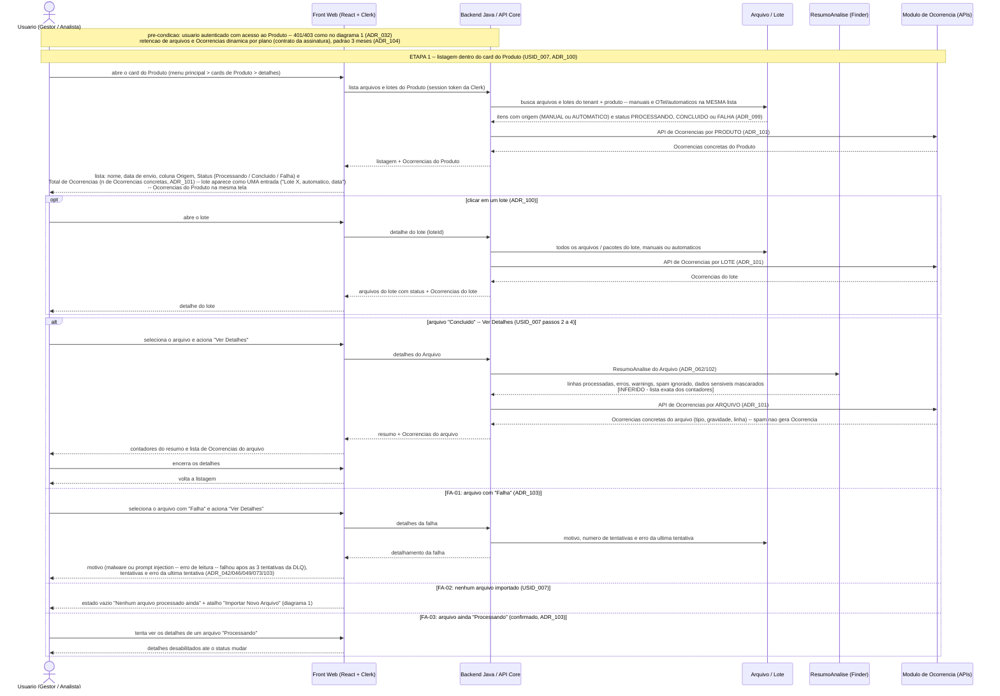

# Diagramas de Sequência v8 — Upload Manual (LhamaLog)

> **Changelog v8 (Out 11, 2026, Michel Bocchi Junior):** revisão do **diagrama 2 (consultar arquivo processado,
> USID_007)** com as decisões do Michel de 11/10/2026 (ADR_099 a ADR_104). O diagrama 2 passa a ser um original deste
> módulo, na raiz da pasta, ao lado do `upload_manual_envio.png`. O `.md` v7 foi movido, sem alteração, para a subpasta `v7`.
> O `consultar_arquivo_processado.png` original do Pedro **não pôde ser movido (403, sem permissão de escrita do app)**;
> ele continua na raiz, intacto, e o novo diagrama foi gravado como **`upload_manual_consulta.png`** para não haver dois
> arquivos com o mesmo nome. Quando o arquivo do Pedro for movido manualmente para `v7`, o novo pode ser renomeado para
> `consultar_arquivo_processado.png`. O `upload_manual_envio.png` (diagrama 1) não mudou.

**Versão 7 (11/10/2026).** Alinha o diagrama 1 com o diagrama `Varredura e Finder` v4 (ADR_069, 070, 072, 073, 075): o
Coletor pede à API da Varredura o `execId = M<uuid>` antes de enfileirar o lote; chave lock
`lock:{tenantProduto}:{execId}:{loteId}:{arquivoId}` (TTL = estimativa + 10%) e idempotência `arquivoId + execId`; o Finder
avisa a API da Varredura a cada arquivo (true/false); após 3 falhas na DLQ o usuário só pode enviar um novo arquivo, com o
horário do novo upload. O resto não mudou. A v6 está na subpasta `v6`.

**Histórico — Versão 6 (10/10/2026).** Aplica as ADR_054 a ADR_056: Backend Java e API Core são o **mesmo serviço** (participante
`Backend Java / API Core`), 5 serviços de backend com o mesmo MongoDB; alertas **sempre por lote** (202 aceito → alerta
consolidado da proteção → relatório final por arquivo); lote todo bloqueado não entra na fila (confirmado). A v5 está na
subpasta `v5`.

**Histórico — Versão 5 (10/10/2026).** Aplica as ADR_051 a ADR_053: participante `API Core (assinatura, tenant, alertas)` como
emissor dos alertas por WebSocket, **um alerta consolidado por lote** (sem notificação por arquivo) e `202 Accepted`
confirmado. A v4 (PNG e .md) está na subpasta `v4`.

**Histórico — Versão 4 (10/10/2026).** Atualiza **só o diagrama 1** (`upload_manual_envio.png`) com as decisões do Michel de
10/10/2026, registradas nas ADR_041 a ADR_046 e, nesta versão, nas ADR_047 a ADR_050 (WebSocket, bloqueio por arquivo
no lote, erro crítico de leitura, DLQ no fim da `FilaOrdenada`, limite por requisição em aberto). A v3 (PNG e .md) está
na subpasta `v3`. O diagrama 2 (acompanhamento) fica como na v2 e será revisado depois;
ganhou apenas uma nota curta apontando as decisões que o afetam. A v2 deste documento e o PNG anterior do diagrama 1
(`selecao_validacao_envio.png`) foram copiados para a subpasta `v2` (os originais ainda precisam ser movidos para lá); a v1 (4 diagramas) continua na subpasta `v1`.

**Escopo:** seleção (no card do Produto), validação e envio do arquivo até ele entrar no **fim da `FilaOrdenada`** e o
retorno ao usuário (diagrama 1); acompanhamento dos arquivos importados (diagrama 2). O processamento (Finder →
Ocorrência) é o do diagrama oficial `Varredura e Finder`; a Ocorrência segue o modelo das ADR_035/040.

Marcações: `[PENDENTE]` requisito sem definição nas fontes; `[INFERIDO]` ligação feita por nós entre o modelo de
classes, os casos de uso e as ADRs; `[CONFLITO]` duas fontes dizem coisas diferentes; **Resolvido (ADR_0xx)** item que
uma ADR fechou. Valores de enum entre aspas (`"PENDING"`), sem relação com `[PENDENTE]`.

**Base:** USID_006 (Importar Arquivo), SSID_013 (Importar arquivo para varredura), USID_007 (Consultar Arquivos
Processados) (`LhamaLog_casos_de_uso.xlsx`); abas `Coletor`, `Arquivo`, `Arquivo Varredura`, `LogNormalizado`
(`Modelo_de_Classes_LhamaLog.xlsx`); `diagrama_classes_varredura_finder_v2.md`; `der.md` v2; ADR_007, 009, 014, 017,
020, 022, 026, 028, 029, 030, 032, 035, 040 e **ADR_041 a ADR_056** (decisões do upload manual, 10/10/2026).

**Visão geral do fluxo:** dentro do card de um Produto, o usuário envia um ou mais arquivos; o front checa extensão e
tamanho (100 MB). O backend recebe tudo em **uma** requisição `POST /manual/upload`, valida a sessão da Clerk e o tenant,
guarda o nome enviado e chama a API de importação do **Coletor** (JWT interno, ADR_028). O Coletor faz as etapas de
validação e proteção (binário/executável/malware e prompt injection); se a proteção falha, a execução para e o cliente é
alertado. Se passa, a seção paralela "manual" do Coletor normaliza, anexa o owner, registra o `Arquivo` (que passa a ser
tratado só pelo id), agrupa os arquivos num **lote** e o coloca no **fim da `FilaOrdenada`**, sem passar pela Varredura.
O usuário vê "Arquivo enfileirado" e, ao fim, recebe a notificação "varredura finalizada"; erros de processamento vão à
DLQ com até 3 tentativas (**diagrama 1**). Depois, o usuário acompanha o status, o resumo e as Ocorrências (**diagrama 2**).

**Participantes usados (diagrama 1):**
- `Usuario (Gestor / Analista)` — atores da USID_006/007
- `Front Web (React + Clerk)` — sessão da Clerk
- `Backend Java / API Core (assinatura, tenant, WebSocket)` — um único serviço (ADR_054): requisições do front, sessão
  (ADR_022/026/032), assinatura, multi-tenant e alertas por WebSocket (ADR_051)
- `Coletor` — porta única de entrada; seção paralela "manual" (pass-through com proteção) (ADR_042)
- `Arquivo` — conteúdo no bucket e metadados (`id`, `nome`, `bucket_URL`, `extension`, `size_mb`, `owner_id`,
  `product_id`, `company_id`, `imported_at`) (ADR_044)
- `FilaOrdenada` — fila já consumida pelo Finder (ADR_007/017); o lote manual entra no fim (ADR_041)
- `Finder` — consome a `FilaOrdenada` normalmente
- `DLQ (reprocessamento)` — até 3 tentativas no total, reenvio no fim da `FilaOrdenada` (ADR_046/049)
- `Varredura (API)` — gera o `execId = M<uuid>` da execução manual e recebe o aviso de cada arquivo concluído (ADR_070/075)
- Serviços separados (repositórios próprios): Core, Coletor, Varredura, Finder e Ocorrência, com o mesmo MongoDB e as
  mesmas convenções de thread/infraestrutura (ADR_054)

## ⚠️ Pontos críticos

**1. Resolvido (ADR_041) — SSID_013 × USID_006.** O upload é **enfileirado**, não síncrono, e nunca vai direto ao
Finder. O arquivo pula a Varredura e entra no **fim da `FilaOrdenada`** (ex.: se a Varredura acabou de montar 10
arquivos, o manual é o 11º); não é priorizado dentro da fila, mas fica à frente de tudo que ainda está na
`FilaDesordenada`. O ramo "direto ao Finder" da SSID_013 saiu do diagrama 1, **substituído por esta decisão**.

**2. Resolvido (ADR_041) — SSID_013 × arquitetura do Finder.** O Finder continua consumindo só a `FilaOrdenada`
(ADR_007/017); o upload manual apenas entra nessa fila.

**3. Resolvido (ADR_043) — Formatos aceitos.** Inicialmente `.txt`, `.json`, `.csv` e `.log`; lista **extensível**, não
fechada. Limite de **100 MB**. O front checa extensão e tamanho. (A transcrição da aba `LogNormalizado` continua
`[PENDENTE]`, fora deste diagrama.)

**4. Resolvido (ADR_042) — Onde é checada a assinatura.** Só no **backend**, pelo Coletor, como etapa de recebimento,
junto com a proteção contra prompt injection. Executável/malware ou prompt injection = **erro crítico**: execução
interrompida, arquivo não processado, alerta "Seu arquivo contem um malware e nao sera executado" (FA-06).

**5. Resolvido (ADR_046) — SSID_013 "Fluxo Alternativo 2".** Vira tratamento de erro: (a) erro crítico de proteção no
Coletor (FA-06, ADR_042); (b) erro de processamento após o enfileiramento → DLQ automática, até 3 tentativas no total;
depois, "Nao foi possivel fazer a varredura desse arquivo, tente novamente com outro arquivo" (FA-07).

**6. Resolvido (ADR_042) — Entrada pelo Coletor.** O Coletor recebe **sempre** todos os arquivos (regra-base). O backend
chama a mesma API de importação do Coletor pela API interna com JWT próprio (ADR_028); o Coletor roda as mesmas etapas de
validação/proteção, normaliza, anexa o owner e encaminha para uma seção paralela "manual", que enfileira direto na
`FilaOrdenada`. Sai o `[INFERIDO]` de `EnviarArquivo()` e da `FilaDesordenada` do OTel para o upload.

**7. Resolvido (ADR_044) — Produto do arquivo.** O usuário não escolhe: o upload é feito dentro do card do Produto
(menu principal > cards de Produto > detalhes com logs recentes e Ocorrências > botão de upload) e o front envia esse
`product_id`.

**8. Resolvido (ADR_044) — "Nome do Arquivo".** O backend guarda o nome enviado pelo front; ao passar pelo Coletor, o
arquivo recebe o id e passa a ser tratado só por ele. A classe `Arquivo` ganha o atributo `nome` (alinha com o DER v2).

**9. Resolvido (ADR_041/042/100) — Origem OTel × upload.** A origem fica separada pelas duas seções/filas do Coletor (OTel →
`FilaDesordenada`; manual → direto na `FilaOrdenada`). Prioridade de arquivo manual na Varredura (ADR_009) não se aplica:
ele não passa pela Varredura e não é priorizado (ADR_045). Na listagem da USID_007 (diagrama 2), a coluna Origem
(`MANUAL`/`AUTOMATICO`) resolve o campo de origem — Resolvido (ADR_100).

**10. Resolvido (ADR_099) — Status do processamento:** `PROCESSANDO`, `CONCLUIDO`, `FALHA` (Processando, Concluído, Falha). Texto original: — a planilha (`Arquivo Varredura`) tem `"PENDING"`, `"PROCESSING"`,
`"COMPLETED"`, `"ERROR"`, `"FAILED"`; o DER v2 tem `"PENDING"`, `"PROCESSING"`, `"COMPLETED"`, `"COMPLETED_WITH_ERROR"`;
a USID_007 mostra "Concluído", "Processando" e "Falha". O mapeamento entre eles não está definido. Diagrama 2 (o
"enfileirado" da ADR_046 e a falha após 3 tentativas também precisam entrar nesse mapeamento).

**11. Resolvido (ADR_102) — Resumo mostrado na USID_007:** contadores do `ResumoAnalise` (lista exata `[INFERIDO]`). Texto original: — a tela pede "quantidade exata de logs válidos inseridos" e "avisos
sobre linhas ignoradas"; nenhum contador do resumo por Arquivo (ADR_020/035) corresponde a "linhas ignoradas". Diagrama 2.

**12. Resolvido (ADR_046/049) — Arquivo ilegível / limite de `attempts`.** Erro de leitura/parsing que invalida o arquivo
é erro crítico, sem retry nem DLQ (ADR_049); outros erros vão à DLQ, até 3 tentativas no total (ADR_046). O FA-01 do
diagrama 2 foi revisado na v8 (ADR_103).

**13. `[PENDENTE]` Nome e chave do resumo por Arquivo** — a ADR_035 sugere `ResumoArquivo` ou `RelatorioProcessamento`;
a chave de idempotência da Ocorrência concreta também ficou em aberto (ADR_035/040).

**14. Observação** — o 403 da ADR_032 revoga todas as sessões do usuário; vale para o upload como para qualquer
requisição.

**15. Resolvido (ADR_045) — Vários arquivos.** Um ou mais arquivos vão em **uma** requisição; o Coletor agrupa num único
lote e coloca o lote no fim da `FilaOrdenada`. Prioridade é irrelevante para o upload manual.

**16. Resolvido (ADR_047; revisado pela ADR_052) — Canal das notificações.** "varredura finalizada" e todas as atualizações de progresso chegam
ao front por **WebSocket**: (a) "lote criado para N arquivos"; (b) uma notificação por arquivo bloqueado, com o nome;
(c) ao fim da proteção, "varredura em andamento de X de N arquivos" (ex.: 8 de 10 com 2 bloqueados); (d) "varredura
finalizada". **A parte de notificação por arquivo foi substituída pela ADR_052** (ponto 20).

**17. Resolvido (ADR_048) — Bloqueio no lote.** Se um arquivo do lote falha na proteção (malware ou prompt injection),
**só ele** é bloqueado; os demais continuam. O aviso individual foi substituído pelo alerta consolidado (ADR_052).

**18. Resolvido (ADR_049) — Erro de leitura/parsing e DLQ.** Erro de leitura/parsing que invalida o arquivo é **erro
crítico**: cancela a execução daquele arquivo, **sem nova tentativa e sem DLQ** (FA-08). A DLQ com 3 tentativas fica só
para os outros erros de processamento (ex.: instabilidade) e cada tentativa volta ao **fim da `FilaOrdenada`**
(confirmado, sai o `[INFERIDO]`).

**19. `[PENDENTE - definir futuramente]` Limite por requisição (ADR_050).** Só o limite de 100 MB por arquivo está
definido; não há limite total por requisição (quantidade de arquivos ou tamanho somado) por enquanto.

**20. Resolvido (ADR_052) — Um alerta consolidado por lote.** Não há notificação por arquivo: cada lote gera um único
alerta após a proteção (ex.: "8 de 10 arquivos enviados, 2 com erro"), listando só os nomes dos arquivos com erro; nada
é dito sobre os aprovados. Dez arquivos nunca geram dez notificações. O "lote criado para N arquivos" foi incorporado a
esse alerta. Depois, o lote recebe só o "varredura finalizada". Substitui a parte por arquivo das ADR_047/048.

**21. Resolvido (ADR_051) — Quem envia os alertas.** A `API Core` (assinatura, tenant, alertas) recebe os alertas do
Coletor e do Finder e os envia ao front por WebSocket. Sai o `[INFERIDO]` "Backend envia os eventos".

**22. Resolvido (ADR_053) — Resposta do aceite.** `202 Accepted` (sai o `[INFERIDO]`).

**23. Resolvido (ADR_054) — Backend Java × API Core.** São o mesmo serviço (Core): assinatura, multi-tenant, requisições
do front e WebSocket. Coletor, Varredura, Finder e Ocorrência são serviços separados, com repositórios próprios; os 5
serviços usam o mesmo MongoDB e as mesmas convenções de thread/infraestrutura. Fecha o `[PENDENTE]` da ADR_051.

**24. Resolvido (ADR_055) — Alertas sempre por lote.** Sequência: importação → um "aceito" (`202 Accepted`); proteção → um
alerta consolidado ("X de N aprovados", com os nomes dos que falharam); fim da última varredura do lote → **um relatório
final** com cada arquivo e seu desfecho (tentativas usadas — "passou na primeira", "tentou 2 vezes e deu certo",
"tentado 3 vezes e deu erro" —, erro de leitura e se gerou Ocorrências). Arquivo enviado sozinho tem seus próprios
alertas. Confirma o `[INFERIDO]` de que as falhas aparecem pelo nome no alerta final.

**25. Resolvido (ADR_056) — Lote todo bloqueado.** Se os N arquivos forem bloqueados na proteção, nada entra na fila e o
alerta consolidado diz "Nenhum dos N arquivos enviados foi aprovado na protecao. Revise-os." (FA-09). Sai o `[INFERIDO]`.

**26. Resolvido (ADR_070/075) — Execução manual.** O **Coletor** pede à API da Varredura o `execId = M<uuid>` antes de
enfileirar o lote; IDs de execução são UUID (`V<uuid>`/`M<uuid>`). Chave lock `lock:{tenantProduto}:{execId}:{loteId}:{arquivoId}`
com TTL = estimativa + 10% (ADR_069/072); idempotência `arquivoId + execId` (ADR_070). O Finder avisa a API da Varredura a
cada arquivo concluído e recebe true/false (execução terminou?).

**27. Resolvido (ADR_073) — Depois de 3 falhas.** O usuário só pode enviar um novo arquivo (não há devolução à fila); o novo
arquivo usa o horário do novo upload e os horários originais nunca mudam.
---

## 1. Upload manual — seleção, validação e envio até a FilaOrdenada (USID_006 + SSID_013; ADR_041 a 056)

Arquivo: `upload_manual_envio.png`

**Resumo do fluxo:** no card de um Produto, o usuário aciona o upload, escolhe os arquivos e confirma. O front checa
extensão e tamanho (100 MB por arquivo); o `Backend Java / API Core` recebe tudo em `POST /manual/upload`, valida a
sessão, guarda os nomes e chama o Coletor, que agrupa os N arquivos num lote. O Core responde `202 Accepted` (alerta 1 do
lote: "Arquivo enfileirado"). O Coletor roda validação + proteção arquivo a arquivo; o reprovado é bloqueado sozinho.
Ao fim da proteção, um alerta consolidado por WebSocket (alerta 2: "X de N aprovados", com os nomes dos que falharam, ou
"Nenhum dos N arquivos enviados foi aprovado na protecao. Revise-os." e nada entra na fila). Os X aprovados vão em lote
para o fim da `FilaOrdenada`; o Finder consome; erro de leitura cancela o arquivo (sem retry); outros erros vão à DLQ
(até 3 tentativas, no fim da `FilaOrdenada`). Ao fim da última varredura do lote, um relatório final por WebSocket
(alerta 3) com o desfecho de cada arquivo.

**Fluxo principal:**
1. Usuário entra nos detalhes de um Produto (menu principal > cards de Produto) e aciona o upload; o front mostra formatos
   aceitos (.txt, .json, .csv, .log — lista extensível) e o limite de 100 MB por arquivo.
2. Usuário seleciona um ou mais arquivos e confirma; o front checa extensão e tamanho.
3. O front envia uma requisição `POST /manual/upload` com os arquivos, o `product_id` do card e os nomes; o Core valida a
   sessão, gera o JWT interno e guarda os nomes. Limite por requisição `[PENDENTE - definir futuramente]` (ADR_050).
4. O Core chama a API de importação do Coletor, que agrupa os arquivos num lote de N; o Core responde `202 Accepted` e o
   front mostra "Arquivo enfileirado" (alerta 1).
5. Para cada arquivo, o Coletor roda validação + proteção; aprovados passam pela seção "manual" (normaliza, anexa o
   owner, registra o `Arquivo` com id + nome); bloqueados só têm o nome guardado (ADR_048).
6. Ao fim da proteção, o Coletor manda o resultado ao Core, que envia por WebSocket o alerta consolidado (alerta 2). Com
   X > 0, o lote dos aprovados entra no fim da `FilaOrdenada`.
6a. Antes do enqueue, o Coletor pede à API da Varredura o `execId = M<uuid>` e grava a chave lock de cada arquivo aprovado
   (`lock:{tenantProduto}:{execId}:{loteId}:{arquivoId}`, TTL = estimativa + 10%).
7. O Finder consome os Arquivos do lote (idempotência `arquivoId + execId`), registrando tentativas, erros de leitura e
   Ocorrências geradas, e avisa a API da Varredura a cada arquivo (true/false); ao fim da última varredura, o Core envia o
   relatório final do lote (alerta 3).

**Fluxos alternativos:**
- **FA-01** extensão não permitida (front; ADR_043).
- **FA-02** arquivo acima de 100 MB (front; ADR_043).
- **FA-03** falha de conexão ou timeout durante o upload (USID_006).
- **FA-04** 401 — session token inválido ou expirado (ADR_032).
- **FA-05** 403 — sem organização ativa, sem Tenant ou sem permissão (ADR_032).
- **FA-06** erro crítico de proteção em um arquivo — malware ou prompt injection; só aquele arquivo é bloqueado e entra
  no alerta consolidado (ADR_042/048/052).
- **FA-07** outro erro de processamento (ex.: instabilidade) — DLQ, até 3 tentativas, reenvio no fim da `FilaOrdenada`;
  desfecho no relatório final; depois de 3 falhas o usuário só pode enviar um novo arquivo, com o horário do novo upload
  (ADR_046/049/055/073).
- **FA-08** erro de leitura/parsing que invalida o arquivo — erro crítico, sem retry nem DLQ; aparece no relatório final
  (ADR_049/055).
- **FA-09** todos os N arquivos bloqueados — nada entra na fila; alerta "Nenhum dos N arquivos enviados foi aprovado na
  protecao. Revise-os." (ADR_056).
- ~~Ramo SSID_013 direto ao Finder~~ — **removido, substituído pela ADR_041**.

**Notas sobre este diagrama:**
- O ramo SSID_013 "direto ao Finder" foi removido: **substituído pela ADR_041**.
- `Backend Java / API Core` é um único serviço (ADR_054); Coletor, Varredura, Finder e Ocorrência são serviços separados
  com o mesmo MongoDB. A Varredura e a Ocorrência não aparecem: o manual pula a Varredura (ADR_041) e a criação de
  Ocorrências é a do diagrama oficial `Varredura e Finder`.
- No máximo 3 alertas por lote: `202` aceito, alerta consolidado da proteção e relatório final (ADR_055). Nunca um aviso
  por arquivo; arquivo enviado sozinho é um lote de 1, com os próprios alertas.
- `202 Accepted` agora sai logo após o Coletor receber o lote, antes da proteção, seguindo a ordem da ADR_055 ("importação
  → aceito → proteção"); na v5 ele saía depois da proteção.
- FA-03 vale para a ETAPA 2; FA-04 e FA-05 valem para qualquer resposta do Core (ADR_032).
- Limite por requisição `[PENDENTE - definir futuramente]` (ADR_050).
- v7: Coletor → API da Varredura (`M<uuid>`), chave lock e idempotência com `execId`, aviso do Finder à API da Varredura
  (true/false) e FA-07 sem devolução à fila (ADR_069/070/072/073/075). `[PENDENTE]` detalhes da API de Estimativa (ADR_072).

---

## 2. Consultar arquivo processado (USID_007; ADR_099 a ADR_104)

Arquivo: `upload_manual_consulta.png` (substitui o `consultar_arquivo_processado.png` do Pedro, que segue na raiz por causa do 403)

**Resumo do fluxo:** dentro do card do Produto, o usuário vê uma única lista com uploads manuais e importações
OTel/automáticas, com a coluna Origem (`MANUAL` ou `AUTOMATICO`), o status (Processando, Concluído, Falha) e o total de
Ocorrências. Lotes aparecem como uma entrada só e abrem o detalhe com todos os arquivos. As Ocorrências são servidas em
três níveis (Produto, lote, arquivo) por APIs do Módulo de Ocorrência. O detalhe de um arquivo concluído mostra os
contadores do `ResumoAnalise`; o de um arquivo com falha mostra motivo, tentativas e erro da última tentativa.

**Fluxo principal:**
1. Usuário abre o card do Produto; o Core lista arquivos e lotes do tenant + Produto, manuais e automáticos juntos, com a coluna Origem — Resolvido (ADR_100).
2. Status `PROCESSANDO`, `CONCLUIDO`, `FALHA`, exibidos como Processando, Concluído e Falha — Resolvido (ADR_099).
3. Lote = uma entrada ("Lote X, automático, data"); clicar abre o detalhe com todos os arquivos/pacotes — Resolvido (ADR_100).
4. Ocorrências por Produto (na mesma tela), por lote e por arquivo, cada uma por uma API — Resolvido (ADR_101).
5. "Total de Ocorrências" = número de Ocorrências concretas criadas pelo Módulo de Ocorrência — Resolvido (ADR_101).
6. Detalhes de um arquivo Concluído: contadores do `ResumoAnalise` (linhas processadas, erros, warnings, spam ignorado, dados sensíveis mascarados) — Resolvido (ADR_102), lista exata `[INFERIDO]`.

**Fluxos alternativos e opcionais:**
- **opt lote:** detalhe do lote com arquivos e Ocorrências do lote (ADR_100/101).
- **FA-01 arquivo com Falha:** motivo (malware ou prompt injection, erro de leitura, ou falha após as 3 tentativas da DLQ),
  número de tentativas e erro da última tentativa — Resolvido (ADR_103).
- **FA-02 nenhum arquivo importado:** estado vazio com atalho para o diagrama 1 (sem mudança).
- **FA-03 arquivo Processando:** detalhes desabilitados até o status mudar — confirmado (ADR_103).

**Notas sobre este diagrama:**
- O participante `ArquivoVarredura` e o "Resumo por Arquivo" da v7 foram substituídos por `Arquivo / Lote` e pelo
  `ResumoAnalise` do Finder (ADR_062); as Ocorrências vêm das APIs do Módulo de Ocorrência (ADR_062/101).
- Retenção de arquivos e Ocorrências: dinâmica por plano, definida no contrato da assinatura; padrão 3 meses (ADR_104).
- "falhou após 3 retentativas" da decisão foi lido como as 3 tentativas da DLQ do diagrama 1 (ADR_046/073) `[INFERIDO]`.
- O status "enfileirado" do aceite (ADR_046) aparece na listagem como Processando `[INFERIDO]`.
- O atalho para USID_005 (Filtrar Ocorrência) foi substituído pela lista de Ocorrências por arquivo (ADR_101).
- A Sugestão automática disparada pelas Ocorrências está no diagrama `Sugestao por IA`, não aqui.

---

## Notas obrigatórias (pendências)
- **Resolvido (ADR_041)** SSID_013 (direto ao Finder, síncrono) × USID_006 (fila assíncrona): upload enfileirado no fim da
  `FilaOrdenada`, sem Varredura; o ramo SSID_013 foi removido do diagrama 1.
- **Resolvido (ADR_041)** SSID_013 × ADR_007/017: o Finder continua consumindo só a `FilaOrdenada`.
- **Resolvido (ADR_044)** `Arquivo.nome`: a classe `Arquivo` ganha `nome`; depois do Coletor o arquivo é tratado pelo id.
- **Resolvido (ADR_099)** valores de status do processamento: `PROCESSANDO`, `CONCLUIDO`, `FALHA`.
- **Resolvido (ADR_043)** formatos aceitos: `.txt`, `.json`, `.csv`, `.log`, lista extensível; limite 100 MB. Continua
  `[PENDENTE]` a transcrição da aba `LogNormalizado`.
- **Resolvido (ADR_042)** assinatura do arquivo: só no backend, pelo Coletor, com proteção contra prompt injection.
- **Resolvido (ADR_044)** Produto no upload: vem do card do Produto (`product_id` enviado pelo front).
- **Resolvido (ADR_041/042)** origem do `Arquivo`: separada pelas seções do Coletor; prioridade na Varredura não se aplica
  (ADR_045). Campo de origem na listagem — Resolvido (ADR_100), coluna Origem.
- **Resolvido (ADR_102)** contador de "linhas ignoradas": substituído pelos contadores do `ResumoAnalise` (lista exata `[INFERIDO]`); nome da entidade do resumo — `ResumoAnalise` (ADR_062). Continua `[PENDENTE]` chave de idempotência da
  Ocorrência concreta (ADR_035/040).
- **Resolvido (ADR_046/049)** limite de `attempts`: 3 tentativas via DLQ, só para erros como instabilidade; erro de
  leitura/parsing é crítico, sem retry.
- **Resolvido (ADR_046)** SSID_013 "Fluxo Alternativo 2": erro crítico de proteção (FA-06) e DLQ (FA-07).
- **Resolvido (ADR_045)** vários arquivos: uma requisição, um lote.
- **Resolvido (ADR_042)** `[INFERIDO]` da v2 sobre `Coletor.EnviarArquivo()`, JWT interno (ADR_028) e uso da
  `FilaDesordenada` do OTel.
- **Resolvido (ADR_047)** mecanismo da notificação: WebSocket para "varredura finalizada" e todo o progresso.
- **Resolvido (ADR_049)** reenvio da DLQ no fim da `FilaOrdenada` (sai o `[INFERIDO]`).
- **Resolvido (ADR_048)** arquivo bloqueado na proteção não derruba o lote.
- **`[PENDENTE - definir futuramente]`** limite por requisição (ADR_050); só 100 MB por arquivo está definido.
- **Resolvido (ADR_053)** `202 Accepted` no aceite.
- **Resolvido (ADR_051)** emissor do WebSocket: `API Core` (assinatura, tenant, alertas).
- **Resolvido (ADR_052)** um alerta consolidado por lote; substitui os avisos por arquivo das ADR_047/048.
- **Resolvido (ADR_056)** lote com X = 0 não é enfileirado; alerta "Nenhum dos N arquivos enviados foi aprovado na
  protecao. Revise-os.".
- **Resolvido (ADR_055)** relatório final do lote com o desfecho de cada arquivo (tentativas, erro de leitura,
  Ocorrências).
- **Resolvido (ADR_054)** Backend Java e API Core são o mesmo serviço; 5 serviços com o mesmo MongoDB.
- **`[PENDENTE]`** protocolo Coletor/Finder → Core para os alertas (chamada interna com JWT da ADR_028 ou fila);
  formato/texto final dos alertas; persistência do relatório para usuário desconectado.
- **Resolvido (ADR_101)** "Total de Ocorrências" = número de Ocorrências concretas criadas pelo Módulo de Ocorrência.
- **Resolvido (ADR_103)** detalhe da falha e detalhes desabilitados em Processando.
- **Resolvido (ADR_104)** retenção por plano, padrão 3 meses.
- **`[PENDENTE]`** rotas/contratos das APIs de Ocorrências por Produto, lote e arquivo (ADR_101); paginação/filtros da listagem.
- **`[PENDENTE]`** onde o motivo, as tentativas e o erro da última tentativa ficam persistidos (Arquivo, histórico de execução ou DLQ) (ADR_103).
- **`[PENDENTE]`** mover manualmente o `consultar_arquivo_processado.png` do Pedro para `v7` (403).
- **`[PENDENTE]`** ajustes no Modelo de Classes/DER: `Arquivo.nome`, seção "manual" do Coletor, DLQ (ADR_042/044/046).

**Rastreabilidade:** USID_006, SSID_013, USID_007 (`LhamaLog_casos_de_uso.xlsx`); `Modelo_de_Classes_LhamaLog.xlsx`
(`Coletor`, `Arquivo`, `Arquivo Varredura`, `LogNormalizado`); `diagrama_classes_varredura_finder_v2.md`; `der.md` v2;
ADR_007, 009, 014, 016, 017, 020, 022, 026, 028, 029, 030, 032, 035, 036, 040, 041, 042, 043, 044, 045, 046, 047, 048, 049, 050, 051, 052, 053, 054, 055, 056, 062, 069, 070, 072, 073, 075, 099, 100, 101, 102, 103, 104; quadro-branco.

**Renderização:** PNGs gerados com o mermaid-cli (`mmdc`, tema neutral, fundo branco) e escala 2. Na v8 só o
diagrama 2 foi gerado (`upload_manual_consulta.png`).
