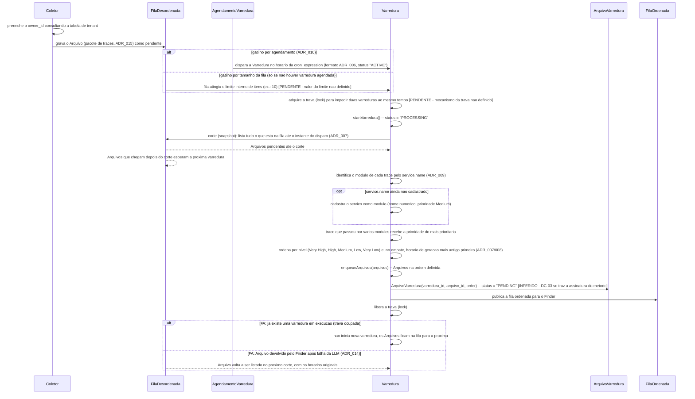
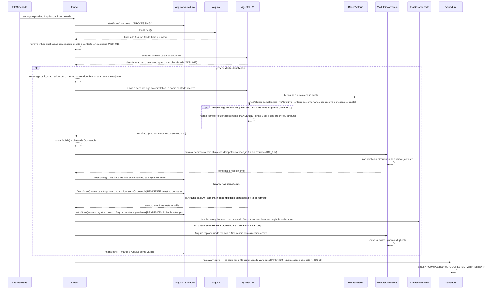

# Diagramas de Sequência — Varredura e Finder (LhamaLog)

Baseado em: ADR_007 (Ordenação da fila pela Varredura), ADR_008 (Níveis de prioridade),
ADR_009 (Prioridade definida por módulo), ADR_010 (Disparo da Varredura), ADR_011 (Papel do
Finder e montagem do contexto para a LLM), ADR_012 (Taxonomia da classificação — status
Proposta), ADR_013 (Regra de recorrência), ADR_014 (Confiabilidade do Finder: idempotência e
reprocessamento) e ADR_015 (Arquivo como pacote de traces) — pasta `Documentações > Diagrama ADR`.
Classes, atributos e métodos lidos do DC-03 (abas `Arquivo`, `Arquivo Varredura`, `Varredura` e
`Agendamento Varredura`): `Varredura.enqueueArquivos()`, `startVarredura()`, `finishVarredura()`,
`ArquivoVarredura.startScan()`, `retryScan(error)`, `finishScan()`, `AgendamentoVarredura`
(`cron_expression`, status `ACTIVE/PAUSE/DISABLE`) e `Arquivo.loadLines()`.

Os dois diagramas substituem o diagrama único "Fluxo Varredura e Finder - ADR 007 a 015"
(Doc/PNG/TXT na raiz de `Diagramas de Sequencia`), que não seguia este padrão.

**Visão geral do fluxo:** o OpenTelemetry Collector do cliente envia logs/traces ao Coletor, que
preenche o `owner_id` (tabela de tenant) e grava cada Arquivo (pacote de traces) numa fila
desordenada. A **Varredura** (diagrama 1) é disparada por cron ou pelo tamanho da fila, faz o corte,
prioriza e publica uma fila ordenada. O **Finder** (diagrama 2) consome essa fila, usa o agente
LLM para classificar e transforma erros/alertas em Ocorrências.

**Participantes usados:**
- `Coletor` — recebe do OTel Collector do cliente, preenche `owner_id` e grava o Arquivo na fila
- `FilaDesordenada` — fila de Arquivos pendentes vinda do Coletor
- `AgendamentoVarredura` — agendamento por cron do cliente (formato da ADR_006)
- `Varredura` — corte, identificação do módulo, prioridade e ordenação (ADR_007–010)
- `ArquivoVarredura` — estado de cada Arquivo dentro de uma Varredura (`order`, `attempts`, status
  `PENDING, PROCESSING, COMPLETED, ERROR, FAILED`)
- `FilaOrdenada` — fila priorizada entregue ao Finder
- `Finder` — gestor de agentes: monta o contexto, aciona a LLM, monta e envia a Ocorrência (ADR_011)
- `Arquivo` — pacote de traces (ADR_015), lido com `loadLines()`
- `AgenteLLM` — LLM do time que classifica (hospedagem ainda não definida)
- `BancoVetorial` — histórico de erros/alertas usado pelo agente (fica a cargo do agente, ADR_013)
- `ModuloOcorrencia` — módulo que recebe a Ocorrência e respeita a chave de idempotência

Tudo marcado `[PENDENTE]` é requisito ainda sem definição nas ADRs; `[INFERIDO]` é ligação feita
por mim entre o DC-03 e as ADRs, que não está escrita literalmente em nenhum dos dois.

**Atenção, risco de confusão de nomes:** o enum `FileScanStatus` tem o valor `PENDING` (Arquivo
aguardando varredura). Isso **não tem relação** com a marcação `[PENDENTE]` deste documento. Nos
diagramas, valores de enum aparecem sempre entre aspas (`"PENDING"`, `"PROCESSING"`).

---

## 1. Varredura — do disparo até a fila ordenada (ADR_007, 008, 009, 010)

Arquivo: `varredura.png`

**Resumo do fluxo:** o Coletor grava o Arquivo na fila desordenada como pendente. A Varredura é
disparada pelo agendamento (cron) ou, se não houver varredura agendada, quando a fila atinge um
limite interno (ex.: 10). Uma trava impede duas varreduras ao mesmo tempo. A Varredura faz o corte
(tudo o que está na fila até o instante do disparo; o que chega depois espera a próxima),
identifica o módulo de cada trace pelo `service.name` (cadastrando automaticamente serviços novos
com nome numérico e prioridade Medium), dá ao trace a prioridade do módulo mais prioritário por
onde passou, ordena pelos 5 níveis (Very High, High, Medium, Low, Very Low) e, no empate, pelo
horário de geração mais antigo, e publica a fila ordenada.

**Notas sobre este diagrama:**
- O gatilho por tamanho aparece saindo da `FilaDesordenada` só para mostrar a origem do evento;
  o mecanismo que observa o tamanho da fila não está definido nas ADRs.
- `[INFERIDO]` `enqueueArquivos(arquivos)` foi usado como o passo que registra os Arquivos ordenados
  na Varredura, criando um `ArquivoVarredura` por Arquivo com `order` e status `"PENDING"`. O DC-03
  só traz a assinatura do método, não o comportamento.
- A ordem dos níveis vem da ADR_008, e o desempate pelo mais antigo existe para não inverter a
  recorrência no Finder (ADR_007).
- `[PENDENTE]` A ADR_010 ainda precisa detalhar o que é "não houver varredura agendada" (cliente sem
  agendamento ativo vs. agendada prestes a rodar) e o valor do limite (10 é exemplo).

## 2. Finder — da fila ordenada até a Ocorrência (ADR_011, 012, 013, 014, 015)

Arquivo: `finder.png`

**Resumo do fluxo:** o Finder pega o próximo Arquivo da fila ordenada (`startScan()`), lê as
linhas (`loadLines()`), remove linhas duplicadas com regex e envia o contexto ao agente LLM, que
classifica em erro, alerta ou spam/não classificado. Em erro ou alerta, o Finder recarrega os logs
com o mesmo correlation ID e o agente busca no banco vetorial se aquilo já existiu. É recorrente
quando é o mesmo log, da mesma máquina, em arquivos diferentes, 3 ou 4 vezes seguidas (repetição
dentro do mesmo Arquivo não conta). O Finder monta a Ocorrência e a envia ao módulo de Ocorrência
com a chave de idempotência `trace_id` / id do arquivo, e **só depois** marca o Arquivo como varrido
(`finishScan()`). Spam é marcado como varrido sem Ocorrência. Se a LLM falhar (demora,
indisponibilidade ou resposta fora do formato), o Arquivo continua pendente (`retryScan(error)`) e
volta para a fila como se viesse do Coletor, com os horários originais, para a próxima varredura.

**Notas sobre este diagrama:**
- A ADR_011 diz que o Finder recarrega os logs do mesmo correlation ID "quando um erro é
  identificado". Por isso a recarga aparece depois da primeira classificação, seguida de um novo
  envio ao agente com a série inteira. As ADRs não dizem se isso é uma segunda chamada ou parte da
  mesma, então fica como leitura do texto.
- `[PENDENTE]` "Recorrente" pode virar tipo próprio ou atributo de erro/alerta (ADR_012, revisão
  sábado 03/10 às 14h). O diagrama usa "erro/alerta recorrente" sem decidir isso.
- `[PENDENTE]` Limite de tentativas: `ArquivoVarredura` tem `attempts`, mas o limite para um Arquivo
  que sempre falha não foi definido (ADR_014). Também não está definido se o status depois de
  `retryScan()` é `"PENDING"` ou `"ERROR"`. A ADR só diz que o Arquivo "continua pendente".
- `[INFERIDO]` `finishVarredura()` no fim da fila ordenada, com status `"COMPLETED"` ou
  `"COMPLETED_WITH_ERROR"`: o DC-03 tem os métodos e os status, mas não diz quem chama nem quando.
- O caso "queda entre enviar e marcar" é o reprocessamento seguro da ADR_014: a chave de
  idempotência evita uma Ocorrência duplicada.

---

## Notas obrigatórias (pendências)

- **`[PENDENTE]`** limite de itens do gatilho por tamanho e regra exata de precedência do agendado (ADR_010).
- **`[PENDENTE]`** mecanismo da trava (lock) contra duas varreduras ao mesmo tempo (ADR_010).
- **`[PENDENTE]`** paralelismo do Finder (sequencial ou paralelo) e hospedagem da LLM (ADR_011).
- **`[PENDENTE]`** quem define a criticidade da Ocorrência, Finder ou módulo de Ocorrência (ADR_011).
- **`[PENDENTE]`** destino do spam: descartado, guardado ou só contado (ADR_012).
- **`[PENDENTE]`** recorrente como tipo próprio ou atributo, e limite de 3 ou 4 repetições (ADR_012/013).
- **`[PENDENTE]`** critério de semelhança, isolamento por cliente e janela de tempo do banco vetorial (ADR_013).
- **`[PENDENTE]`** limite de `attempts` para um Arquivo que sempre falha na LLM (ADR_014).
- **`[PENDENTE]`** segurança e LGPD dos logs enviados à LLM (ADR_011).
- Nenhum endpoint foi inventado: onde o DC-03 não tem método, o passo aparece como descrição.

**Rastreabilidade:** ADR_007–015 e DC-03 (`Arquivo`, `ArquivoVarredura`, `Varredura`,
`AgendamentoVarredura`).
