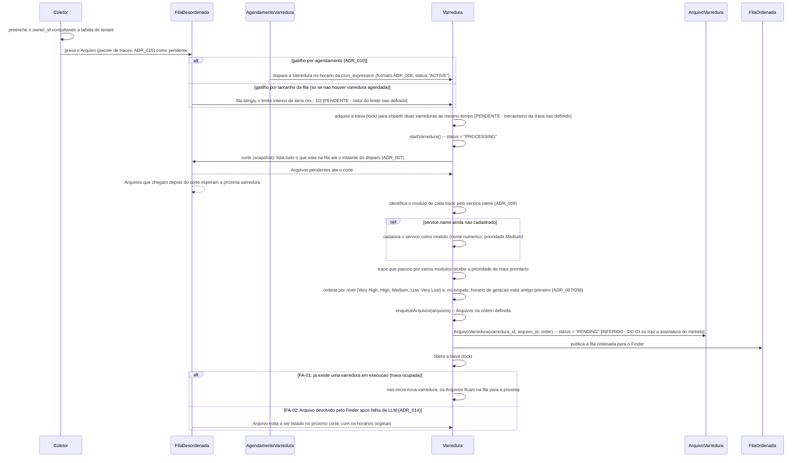
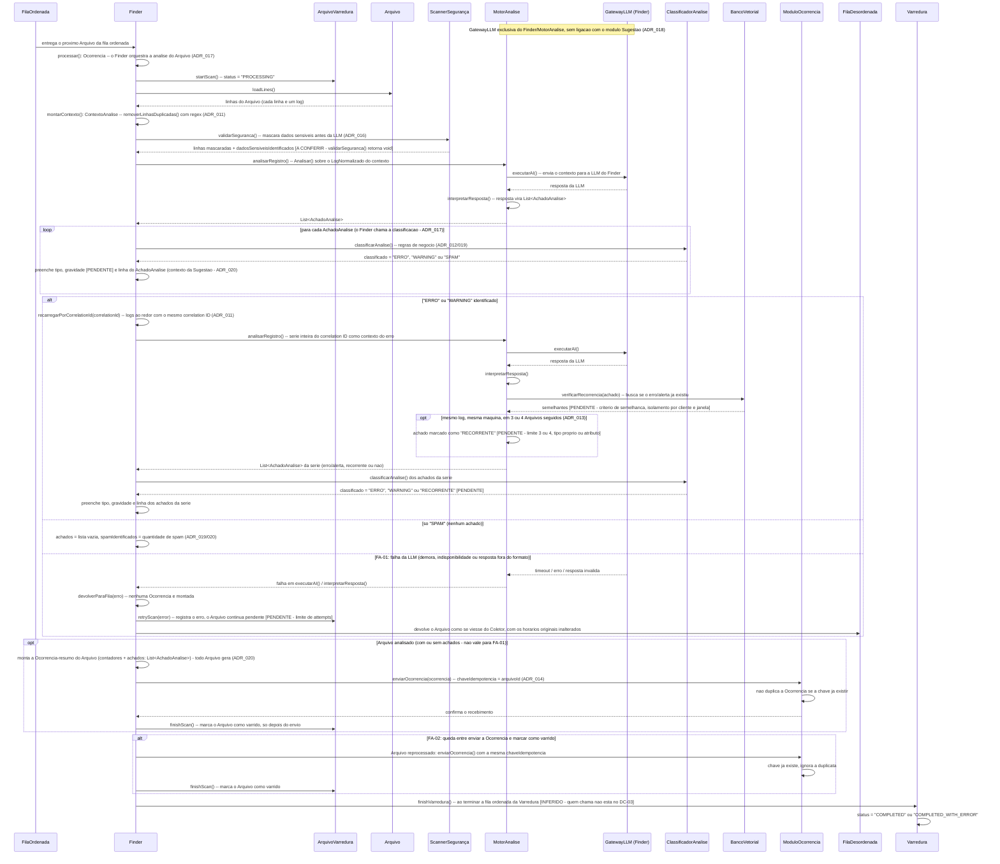

# Diagramas de Sequência v2 — Varredura e Finder (LhamaLog)

**Versão 2 — revisão r3 (02/10/2026, 22h50).** Versão oficial em `Diagramas de Sequencia > Varredura e Finder`. A v1 aprovada
(`varredura.png`, `finder.png`, `sequencia-varredura-finder.md`) foi movida, **sem alteração**, para a subpasta `v1` desta pasta.
Motivo: decisão do Michel — **os nomes do Modelo de Classes original prevalecem** sobre os nomes usados na v1 dos diagramas (ADR_016).
Revisão r3: decisões do Michel de 02/10 registradas nas **ADR_016 a ADR_020** (só o `finder` mudou; a `varredura` não mudou).
Mesmo formato do Pedro (Mermaid, preto e branco, `alt FA-01`, `opt`, `loop`, marcações `[PENDENTE]` / `[INFERIDO]`, mesmo `render.sh`).

Marcações: `[PENDENTE]` requisito sem definição nas ADRs; `[INFERIDO]` ligação feita por nós entre o modelo de classes e as ADRs;
`[A CONFERIR]` decisão para o Michel ou aba original ainda não transcrita. Valores de enum sempre entre aspas (`"PENDING"`), sem relação com `[PENDENTE]`.

Base: ADR_007 a ADR_020; abas originais `Finder`, `MotorAnalise`, `ClassificadorAnalise`, `ScannerSegurança`, `ContextoAnalise`,
`Ocorrencia`, `Arquivo`, `Arquivo Varredura`, `Varredura`, `Agendamento Varredura`; abas v2 da planilha `Modelo de Classes LhamaLog v2`
(`Finder v2`, `MotorAnalise v2`, `ClassificadorAnalise v2`, `Ocorrencia v2`, `AchadoAnalise (adições v2)`, `Varredura v2`, `ArquivoVarredura v2`...)
e `der.md` v2, em `Levantamento de Entidades DER` (Ocorrencia como resumo por Arquivo + entidade `AchadoAnalise`).

## Changelog em relação à v1 (`Varredura e Finder`)

### Organização dos arquivos (02/10/2026, regra de versionamento do Michel)
- A versão mais nova fica na pasta oficial `Varredura e Finder`; a v1 (`varredura.png`, `finder.png`,
  `sequencia-varredura-finder.md`) foi movida, sem alteração, para a subpasta `v1`.
- Os arquivos desta v2, criados como `varredura_v2.png`, `finder_v2.png` e `sequencia_varredura_finder_v2.md` em
  `Atualização - 02/10 > Diagramas de Sequencia v2`, foram movidos para a pasta oficial e renomeados para `varredura.png`,
  `finder.png` e `sequencia-varredura-finder.md`. O código Mermaid não mudou.

### varredura (v2)
- **Nenhum nome mudou**: a v1 já usava os nomes do original (`Coletor`, `AgendamentoVarredura`, `Varredura.startVarredura()`,
  `enqueueArquivos()`, `ArquivoVarredura`, `FilaDesordenada`, `FilaOrdenada`).
- Única mudança: fluxos alternativos numerados no padrão do Pedro — `FA` → `FA-01` (trava ocupada) e `FA-02` (Arquivo devolvido pelo Finder).
- Gerado `varredura.png` (v2) só para manter o par v2 completo e no mesmo padrão.
- **r3:** sem mudança (o PNG no Drive continua válido).

### finder (v2)
| v1 | v2 (nome do original) |
|---|---|
| participante `AgenteLLM` | `MotorAnalise` + `GatewayLLM (Finder)`: interface exclusiva do Finder/MotorAnalise, sem ligação com o módulo Sugestão (ADR_018) |
| "envia o contexto para classificação" | `Finder.analisarRegistro()` → `MotorAnalise.Analisar()` → `executarAI()` → `interpretarResposta()` |
| classificação devolvida pelo agente | `ClassificadorAnalise.classificarAnalise()` em `loop` para cada `AchadoAnalise` (participante novo) |
| erro / alerta / spam | `"ERRO"`, `"WARNING"` (= alerta), `"SPAM"` + `"RECORRENTE"` [PENDENTE] — enum `Tipo` sem INFO (ADR_019) |
| "remove linhas duplicadas com regex e monta o contexto" | `Finder.montarContexto(): ContextoAnalise` com `removerLinhasDuplicadas()` |
| — | `ScannerSegurança.validarSeguranca()` mascara dados antes da LLM (participante novo, ADR_016) |
| "recarrega os logs com o mesmo correlation ID" | `Finder.recarregarPorCorrelationId(correlationId)` + novo `analisarRegistro()` |
| `AgenteLLM` → `BancoVetorial` / marca recorrente | `MotorAnalise.verificarRecorrencia(achado)` → `BancoVetorial`; achado `"RECORRENTE"` |
| "monta (builda) o objeto da Ocorrencia" | Finder monta a `Ocorrencia`-resumo do Arquivo (contadores + `achados: List<AchadoAnalise>` com tipo, gravidade e linha) dentro de `processar()` — todo Arquivo (ADR_020) |
| chave `trace_id` / id do arquivo | `enviarOcorrencia(ocorrencia)` com `chaveIdempotencia = arquivoId` (ADR_014/020) |
| `retryScan(error)` + devolve à fila | `Finder.devolverParaFila(erro)` [INFERIDO] → `retryScan(error)` + `FilaDesordenada` |
| `else FA:` | `else FA-01:` (falha da LLM), `else FA-02:` (queda entre enviar e marcar) |
| "spam / não classificado" | `else` só `"SPAM"`: achados vazios + `spamIdentificados`; **também** monta e envia a Ocorrencia-resumo (ADR_020) |

### finder (v2) — revisão r3 (02/10, 22h50)
| r2 | r3 | ADR |
|---|---|---|
| participante `GatewayLLM` com `[A CONFERIR]`/`[INFERIDO]` (interface do módulo Sugestão) | `GatewayLLM (Finder)`, sem tags, com nota "exclusiva do Finder/MotorAnalise, sem ligação com o módulo Sugestão" | ADR_018 |
| `classificarAnalise()` com `[A CONFERIR]` sobre quem chama | o **Finder** chama, no `loop` de cada `AchadoAnalise` (o MotorAnalise não chama o Classificador) | ADR_017 |
| retorno `"ERRO"`, `"WARNING"`, `"INFO"` ou `"SPAM"` | retorno `"ERRO"`, `"WARNING"` ou `"SPAM"` (INFO removido, absorvido por SPAM) | ADR_019 |
| — | o Finder preenche **tipo, gravidade [PENDENTE] e linha** de cada `AchadoAnalise` (contexto da Sugestão) | ADR_020 |
| montar/enviar/`finishScan()` só dentro do `alt` ERRO/WARNING | `opt Arquivo analisado` depois do `alt`: monta e envia a Ocorrencia-resumo para **todo** Arquivo (com ou sem achados) | ADR_020 |
| `else` só INFO/SPAM: `finishScan()` **sem** Ocorrencia | `else` só SPAM: achados vazios + `spamIdentificados`, segue para o envio da Ocorrencia-resumo | ADR_020 |
| `ScannerSegurança` `[INFERIDO]` | mascaramento antes da LLM decidido (resta `[A CONFERIR]` o retorno `void`) | ADR_016 |
| `FA-02` dentro do mesmo `alt` | `alt FA-02` separado (queda entre enviar e marcar); `FA-01` não monta Ocorrencia | ADR_014 |
| `chaveIdempotencia = arquivoId [A CONFERIR]` | `chaveIdempotencia = arquivoId` | ADR_014/020 |

**ADRs antigas não editadas.** A ADR_020 substitui o trecho "monta a Ocorrência, se houver" da ADR_011 e complementa o ponto
"spam não gera Ocorrências" da ADR_012; a ADR_019 complementa a taxonomia da ADR_012.

---

## 1. Varredura — do disparo até a fila ordenada (ADR_007, 008, 009, 010)

Arquivo: `varredura.png` (mesmo fluxo da v1, ver `v1/sequencia-varredura-finder.md` para o resumo e as notas).

## 2. Finder — da fila ordenada até a Ocorrência (ADR_011 a ADR_020)

Arquivo: `finder.png`

**Resumo do fluxo:** o Finder recebe o próximo Arquivo da fila ordenada e executa `processar()` — é ele quem orquestra a análise
do Arquivo (ADR_017): `startScan()`, lê as linhas (`loadLines()`), monta o `ContextoAnalise` (`montarContexto()`, removendo linhas
duplicadas com regex) e passa as linhas pelo `ScannerSegurança.validarSeguranca()`, que mascara dados sensíveis antes de qualquer
envio à LLM (ADR_016). Em `analisarRegistro()`, o `MotorAnalise` analisa o `LogNormalizado` (`Analisar()`), chama a LLM pela
`GatewayLLM` **exclusiva do Finder** (`executarAI()`, ADR_018) e converte a resposta em `AchadoAnalise` (`interpretarResposta()`).
O **Finder** chama `ClassificadorAnalise.classificarAnalise()` para cada achado (`"ERRO"`, `"WARNING"` ou `"SPAM"` — ADR_019) e
preenche **tipo, gravidade e linha** do achado. Em `"ERRO"`/`"WARNING"`, recarrega a série do mesmo correlation ID e reanalisa; o
`MotorAnalise.verificarRecorrencia()` consulta o `BancoVetorial` e marca `"RECORRENTE"` [PENDENTE] quando é o mesmo log, da mesma
máquina, em 3 ou 4 Arquivos seguidos. Se só houver `"SPAM"`, a lista de achados fica vazia e só `spamIdentificados` é contado.
Em **todo** Arquivo analisado (com ou sem achados), o Finder monta a `Ocorrencia`-resumo, envia com `chaveIdempotencia = arquivoId`
e **só depois** chama `finishScan()` (ADR_014/020). Falha da LLM (FA-01) → `devolverParaFila()`: nenhuma Ocorrencia, `retryScan(error)`
e o Arquivo volta à `FilaDesordenada` com os horários originais.

**Notas sobre este diagrama:**
- **Grão e contexto da Sugestão (ADR_020):** a `Ocorrencia` é o resumo de UM Arquivo (contadores + `List<AchadoAnalise>`). `tipo`,
  `gravidade` e `linha` (e `conteudo`) ficam em cada `AchadoAnalise` e são as características passadas como contexto à IA quando o
  usuário pedir uma Sugestão. O módulo Sugestão segue seu próprio caminho até a IA e não usa o `MotorAnalise` nem a `GatewayLLM` do Finder (ADR_018).
- **Todo Arquivo gera Ocorrencia-resumo**, inclusive só spam (achados vazios). Isso muda o comportamento descrito na ADR_011/012
  (spam não gerava Ocorrencia); registrado na ADR_020, sem editar as ADRs antigas.
- `[A CONFERIR]` `validarSeguranca()` retorna `void`: não está claro como o Finder recebe as linhas mascaradas e o total para
  `Ocorrencia.dadosSensiveisIdentificados`.
- `[PENDENTE]` valores de `gravidade` e quem define a criticidade (Finder ou módulo de Ocorrência — ADR_011).
- `[PENDENTE]` "Recorrente" como valor do enum ou atributo (revisão 03/10, 14h); limite 3 ou 4 (ADR_012/013).
- `[PENDENTE]` limite de `attempts` e status depois de `retryScan()` (ADR_014).
- `[INFERIDO]` `finishVarredura()` no fim da fila ordenada (quem chama não está no DC-03).
- O caso FA-02 é o reprocessamento seguro da ADR_014: a chave de idempotência evita Ocorrencia duplicada.
- Possível colisão de nome: o módulo Sugestão também tem uma interface `GatewayLLM`; sugerido renomear uma delas (ex.: `GatewayLLMFinder`).

---

## Notas obrigatórias (pendências)
- **`[PENDENTE]`** limite do gatilho por tamanho e precedência do agendado; mecanismo da trava (ADR_010).
- **`[PENDENTE]`** paralelismo do Finder e hospedagem da LLM (ADR_011); segurança/LGPD dos logs enviados (mascaramento pelo `ScannerSegurança`, ADR_016).
- **`[PENDENTE]`** destino do spam além da contagem (ADR_012/019); recorrente tipo × atributo e limite 3 ou 4 (ADR_012/013); valores de gravidade (ADR_011/020).
- **`[PENDENTE]`** critério de semelhança, isolamento por cliente e janela do banco vetorial (ADR_013).
- **`[PENDENTE]`** limite de `attempts` (ADR_014).
- **`[A CONFERIR]`** retorno do `validarSeguranca()`; `chaveIdempotencia` só arquivoId ou arquivoId + varreduraId; Sugestão por Ocorrencia ou por achado.
- Resolvidos na r3: enum `Tipo` (ADR_019), GatewayLLM exclusiva do Finder (ADR_018), quem chama `classificarAnalise()` (ADR_017), Ocorrencia-resumo para todo Arquivo (ADR_020).
- Nenhum endpoint foi inventado: onde o modelo de classes não tem método, o passo aparece como descrição.

**Rastreabilidade:** ADR_007–020; Modelo de Classes original (Finder, MotorAnalise, ClassificadorAnalise, ScannerSegurança,
ContextoAnalise, Ocorrencia, Arquivo, Arquivo Varredura, Varredura, Agendamento Varredura) e abas v2.
