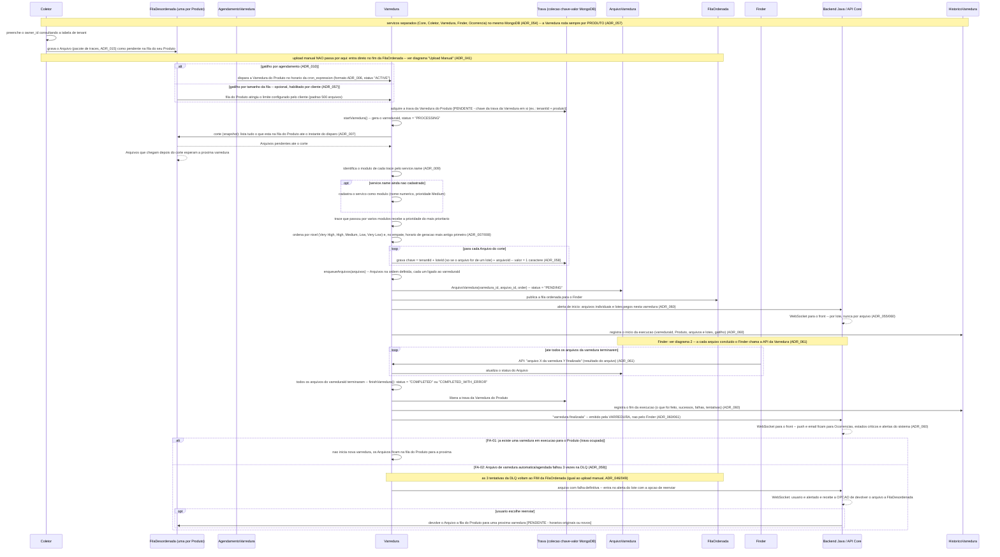
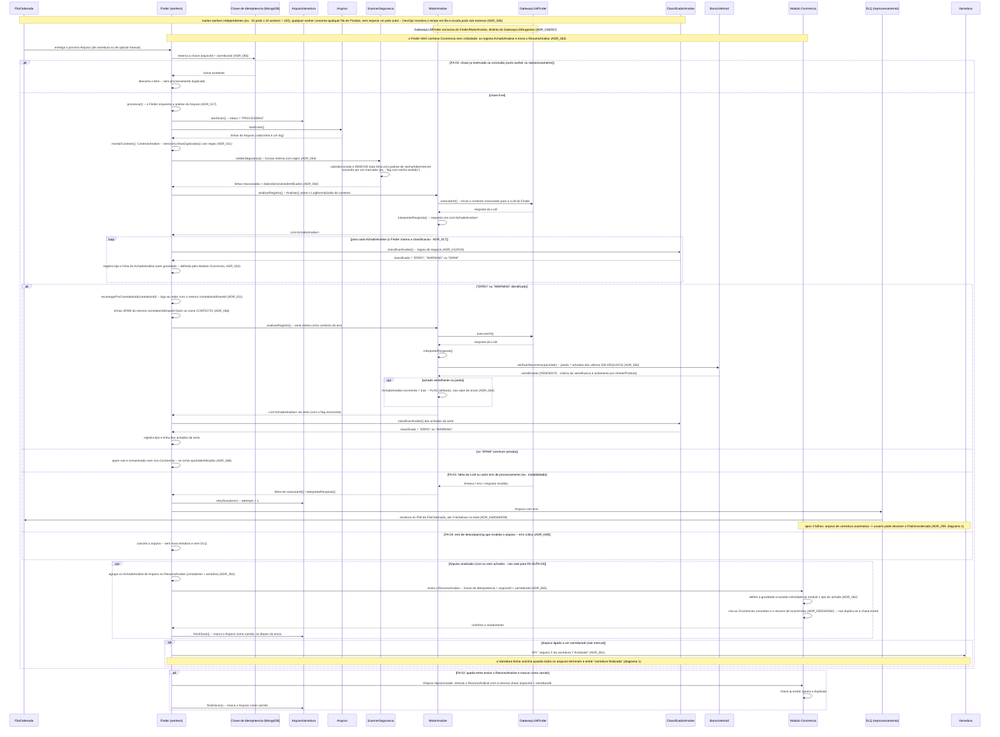

# Diagramas de Sequência v3 — Varredura e Finder (LhamaLog)

**Versão 3 (10/10/2026).** Versão oficial em `Diagramas de Sequencia > Varredura e Finder`. A v2 r3 (02/10/2026)
(`varredura.png`, `finder.png`, `sequencia-varredura-finder.md`) foi movida, **sem alteração**, para a subpasta `v2`; a v1
continua na subpasta `v1`. Motivo: decisões do Michel de 10/10/2026, registradas nas **ADR_057 a ADR_067**, e alinhamento
com as ADR_035 a ADR_056 (Clerk/Core, Sugestão, upload manual, alertas por lote, Core = Backend, 5 serviços no mesmo
MongoDB). Os **dois** diagramas mudaram.
Mesmo formato do Pedro (Mermaid, preto e branco, `alt FA-xx`, `opt`, `loop`, marcações `[PENDENTE]` / `[INFERIDO]`, sem
acentos no código Mermaid; `mmdc`, tema neutral, fundo branco, escala 2).

Marcações: `[PENDENTE]` requisito sem definição nas ADRs; `[INFERIDO]` ligação feita por nós entre o modelo de classes e as
ADRs; `[A CONFERIR]` decisão para o Michel; **Resolvido (ADR_0xx)** item que uma ADR fechou. Valores de enum entre aspas
(`"PENDING"`), sem relação com `[PENDENTE]`.

Base: ADR_006 a ADR_067 (em especial 007–020, 035, 040, 041, 046, 049, 051–056 e 057–067); Modelo de Classes original e
abas v2; `der.md` v2.

## Changelog em relação à v2 r3 (02/10)

### varredura (v3)
| v2 r3 | v3 | ADR |
|---|---|---|
| gatilho por tamanho "so se nao houver agendada", limite `[PENDENTE]` (ex.: 10) | gatilho por tamanho **opcional, habilitado por cliente**, padrão **500 arquivos** na fila do Produto; o agendamento (cron) continua | ADR_057 |
| uma `FilaDesordenada` | **uma `FilaDesordenada` por Produto**; a Varredura roda sempre por Produto | ADR_057 |
| trava `[PENDENTE - mecanismo]` | coleção **chave-valor no MongoDB**: chave `tenantId + loteId (só se for de lote) + arquivoId`, valor de 1 caractere | ADR_058 |
| — | Note: upload manual entra no fim da `FilaOrdenada` → diagrama "Upload Manual" | ADR_041 |
| FA-02 Arquivo devolvido direto à `FilaDesordenada` | FA-02: **DLQ com 3 tentativas** (fim da `FilaOrdenada`); após 3 falhas o usuário é alertado e **escolhe** se devolve à `FilaDesordenada` | ADR_059 |
| — | alerta de início (arquivos e lotes pegos) e "varredura finalizada" **emitido pela Varredura**, por WebSocket via Core; **histórico** de cada execução | ADR_060 |
| `finishVarredura()` chamado pelo Finder `[INFERIDO]` | o Finder chama a **API da Varredura** a cada arquivo concluído; a Varredura fecha sozinha | ADR_061 |
| libera a trava logo após publicar | libera a trava ao fechar a varredura `[INFERIDO]` | ADR_058/061 |

### finder (v3)
| v2 r3 | v3 | ADR |
|---|---|---|
| Finder monta a `Ocorrencia`-resumo e chama `enviarOcorrencia()` | Finder só registra `AchadoAnalise`; ao fim do arquivo agrupa no **`ResumoAnalise`** e envia ao Módulo Ocorrência, que cria as Ocorrências concretas e o resumo de ocorrências | ADR_062 |
| "preenche tipo, gravidade [PENDENTE] e linha" | Finder registra só tipo e linha; **gravidade definida pelo Módulo Ocorrência** (criticidade do módulo × tipo do achado) | ADR_062 |
| `"RECORRENTE"` `[PENDENTE]` (enum? 3 ou 4 arquivos seguidos) | **flag `recorrente`** (atributo) marcada pelo `MotorAnalise`; janela do `BancoVetorial` = achados dos **últimos 500 arquivos** | ADR_063 |
| `validarSeguranca()` `[A CONFERIR - retorna void]` | função interna com regex: troca emails, **remove** linhas com senha/token/secret e põe marcador ("log com senha omitido"); **retorna as linhas mascaradas** | ADR_064 |
| `chaveIdempotencia = arquivoId` | **`arquivoId + varreduraId`**; também impede dois workers no mesmo item (FA-03 novo) | ADR_065 |
| paralelismo `[PENDENTE]` | muitos **workers independentes** (ex.: 10 pods × 10 workers), qualquer worker em qualquer fila de Produto; DevOps escala pods (Note) | ADR_065 |
| spam: só contagem | spam **não é armazenado** nem vira Ocorrência; linhas spam com o mesmo `correlationId`/`traceId` de um erro/warning ficam **só como contexto** | ADR_066 |
| `GatewayLLM (Finder)` | **`GatewayLLMFinder`** (distinta da `GatewayLLMSugestao`) | ADR_067 |
| FA-01 `devolverParaFila()` → `FilaDesordenada` | FA-01 → **DLQ**, 3 tentativas no fim da `FilaOrdenada` | ADR_046/049/059 |
| — | FA-04: erro de leitura/parsing é crítico, sem retry nem DLQ | ADR_049 |
| `Finder->>Varredura: finishVarredura()` `[INFERIDO]` | `Finder->>Varredura`: API "arquivo X da varredura Y finalizado" (só arquivos com `varreduraId`) | ADR_061 |

**ADRs antigas não editadas.** As ADR_057–067 complementam/substituem trechos das ADR_010, 011, 012, 013, 014, 016, 018 e 020
(ex.: a ADR_062 substitui a montagem da Ocorrência-resumo pelo Finder da ADR_020; a ADR_064 fecha o `[A CONFERIR]` da
ADR_016; a ADR_066 complementa o spam da ADR_012/019/020).

---

## 1. Varredura — do disparo até o fechamento (ADR_007–010, 057–061)

Arquivo: `varredura.png`

**Resumo do fluxo:** o Coletor grava o Arquivo na `FilaDesordenada` **do seu Produto**. A Varredura do Produto é disparada
pelo agendamento (cron) ou, se o cliente habilitou, pelo tamanho da fila (padrão 500 arquivos). Ela adquire a trava, gera o
`varreduraId`, faz o corte, identifica módulos e prioridades, ordena, grava a chave de cada arquivo na coleção chave-valor
(`tenantId + loteId? + arquivoId`) e publica a `FilaOrdenada`. Avisa o Core (WebSocket) dos arquivos e lotes pegos e
registra o início no histórico. A cada arquivo concluído o Finder chama a API da Varredura; quando todos terminam, a
Varredura fecha (`"COMPLETED"`/`"COMPLETED_WITH_ERROR"`), libera a trava, registra o fim no histórico e **ela mesma** emite
"varredura finalizada" pelo Core. Upload manual não passa por aqui (Note → diagrama "Upload Manual").

**Fluxos alternativos:**
- **FA-01** trava ocupada: já existe varredura do Produto em execução.
- **FA-02** arquivo de varredura automática/agendada falhou 3 vezes na DLQ: o usuário é alertado (no alerta do lote) e
  escolhe se devolve o arquivo à `FilaDesordenada` (ADR_059). Substitui o antigo FA-02.

**Notas sobre este diagrama:**
- Alertas sempre por lote e só por WebSocket, enviados pelo `Backend Java / API Core` (ADR_054/055/060). Push e email ficam
  para Ocorrências, estados críticos e alertas do sistema.
- `[PENDENTE]` chave da trava da **própria Varredura** (ex.: `tenantId + produtoId`); a coleção chave-valor da ADR_058 é
  por arquivo.
- `[INFERIDO]` a trava da Varredura é liberada ao fechar (e não logo após publicar a fila), já que a Varredura agora
  acompanha os arquivos até o fim (ADR_061).
- `[PENDENTE]` se o arquivo devolvido pelo usuário à `FilaDesordenada` mantém os horários originais (ADR_059).
- `[PENDENTE]` estrutura do histórico de execução (`HistoricoVarredura` é nome provisório) e retenção.
- `[PENDENTE]` onde o cliente configura o gatilho por tamanho (tela/assinatura no Core).
- O participante `Backend Java / API Core` entrega o WebSocket ao front (o front não aparece neste diagrama).

---

## 2. Finder — da fila ordenada até o ResumoAnalise (ADR_011–020, 062–067)

Arquivo: `finder.png`

**Resumo do fluxo:** vários workers independentes consomem qualquer `FilaOrdenada` de Produto. Cada worker reserva a chave
`arquivoId + varreduraId` (sem duplicidade) e executa `processar()`: `startScan()`, `loadLines()`, `montarContexto()` e
`validarSeguranca()` (emails trocados, linhas de senha/token/secret removidas com marcador; retorna as linhas mascaradas). O
`MotorAnalise` chama a LLM pela `GatewayLLMFinder` e devolve `List<AchadoAnalise>`; o Finder classifica cada achado
(`"ERRO"`, `"WARNING"`, `"SPAM"`) e registra tipo e linha, **sem gravidade**. Em erro/warning, recarrega a série do
`correlationId`/`traceId` (spam dessa série entra só como contexto) e o `MotorAnalise` consulta o `BancoVetorial` (janela de
500 arquivos), marcando a flag `recorrente`. Spam isolado não é armazenado. Ao fim do arquivo, o Finder agrupa os achados no
`ResumoAnalise` e envia ao Módulo Ocorrência, que define a gravidade e cria as Ocorrências concretas e o resumo; depois
`finishScan()` e, se o arquivo tem `varreduraId`, a chamada à API da Varredura.

**Fluxos alternativos:**
- **FA-01** falha da LLM ou outro erro de processamento → DLQ, até 3 tentativas no fim da `FilaOrdenada` (ADR_046/049/059).
- **FA-02** queda entre enviar o `ResumoAnalise` e marcar como varrido → reenvio com a mesma chave, sem duplicar (ADR_014/065).
- **FA-03** chave `arquivoId + varreduraId` já reservada → item descartado, sem processamento duplicado (ADR_065).
- **FA-04** erro de leitura/parsing que invalida o arquivo → erro crítico, sem retry nem DLQ (ADR_049).

**Notas sobre este diagrama:**
- O Finder não conhece `Ocorrencia` nem criticidade (ADR_062). O `ResumoAnalise` (contadores + `List<AchadoAnalise>`)
  substitui a `Ocorrencia`-resumo da ADR_020 no lado do Finder; o resumo de ocorrências e as Ocorrências concretas são do
  Módulo Ocorrência (ADR_035/040/062).
- Gravidade = criticidade do módulo × tipo do achado, no Módulo Ocorrência (ex.: módulo crítico + erro → "critico"; módulo
  menos crítico ou médio + erro crítico → "alto"). `[PENDENTE]` tabela completa da matriz.
- `recorrente` é atributo do `AchadoAnalise`, não valor do enum `Tipo` (ADR_063); o enum continua `"ERRO"`, `"WARNING"`,
  `"SPAM"` (ADR_019).
- `[PENDENTE]` critério de semelhança no `BancoVetorial` e isolamento por cliente/Produto da janela de 500 arquivos.
- `[PENDENTE]` lista exata de regex de senha/token/secret e texto final do marcador (ADR_064).
- `[INFERIDO]` arquivo de upload manual usa um `varreduraId` próprio/nulo na chave de idempotência e não chama a API da
  Varredura (ADR_061/065).
- `[PENDENTE]` métrica e limiar de "tempo em fila" para o DevOps escalar pods (ADR_065).
- O FA-02 é o reprocessamento seguro da ADR_014, agora com a chave `arquivoId + varreduraId`.

---

## Notas obrigatórias (pendências)
- **Resolvido (ADR_057)** limite do gatilho por tamanho (opcional por cliente, padrão 500) e escopo por Produto.
- **Resolvido (ADR_058)** mecanismo da trava: coleção chave-valor no MongoDB. **`[PENDENTE]`** chave da trava da própria
  Varredura.
- **Resolvido (ADR_065)** paralelismo do Finder (workers independentes). **`[PENDENTE]`** hospedagem da LLM (ADR_011) e
  métrica de escala.
- **Resolvido (ADR_064)** retorno do `validarSeguranca()` e regras de mascaramento. **`[PENDENTE]`** lista de regex.
- **Resolvido (ADR_066)** destino do spam: não armazenado, só contexto da série de um erro/warning.
- **Resolvido (ADR_063)** recorrente como atributo e janela de 500 arquivos (substitui "3 ou 4 arquivos seguidos" da
  ADR_013). **`[PENDENTE]`** critério de semelhança e isolamento por cliente.
- **Resolvido (ADR_062)** gravidade definida pelo Módulo Ocorrência. **`[PENDENTE]`** matriz completa.
- **Resolvido (ADR_046/049/059)** limite de `attempts`: 3 via DLQ; opção do usuário para arquivo de varredura automática.
- **Resolvido (ADR_065)** `chaveIdempotencia = arquivoId + varreduraId`.
- **Resolvido (ADR_061)** quem fecha a Varredura (a própria Varredura, via API chamada pelo Finder).
- **Resolvido (ADR_067)** colisão de nome: `GatewayLLMFinder` × `GatewayLLMSugestao`.
- **`[PENDENTE]`** horários do arquivo devolvido à `FilaDesordenada` (ADR_059); estrutura/retenção do histórico (ADR_060);
  configuração do gatilho no Core (ADR_057).
- **`[A CONFERIR]`** Sugestão por Ocorrência ou por achado (r3) — tratado pelas ADR_035/036/040, fora deste diagrama.
- **Ajustes pendentes no Modelo de Classes/DER:** `ResumoAnalise`, `AchadoAnalise.recorrente`, `GatewayLLMFinder`,
  coleção da trava, histórico da Varredura, `FilaDesordenada` por Produto.
- Nenhum endpoint foi inventado além da API da Varredura decidida na ADR_061 (rota `[PENDENTE]`).

**Rastreabilidade:** ADR_006–067; Modelo de Classes original (Finder, MotorAnalise, ClassificadorAnalise, ScannerSegurança,
ContextoAnalise, Ocorrencia, Arquivo, Arquivo Varredura, Varredura, Agendamento Varredura) e abas v2; diagrama "Upload Manual".

**Renderização:** PNGs gerados com o mermaid-cli (`mmdc`, tema neutral, fundo branco), escala 2.
