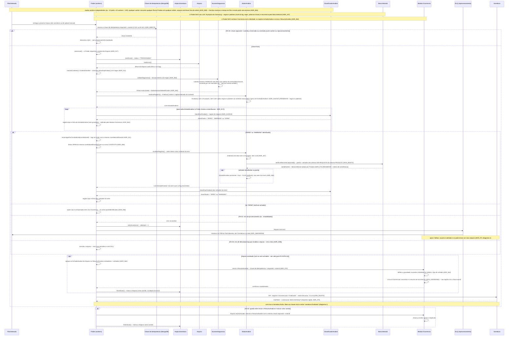

# Diagramas de Sequência v6 — Varredura e Finder (LhamaLog)

> **Nota multi-tenant (12/10/2026) — ADR_121 a ADR_130.** O modelo hierárquico hash → metadata da ADR_105 foi **substituído**
> pelo modelo SaaS pool: tenant = empresa cliente (Organization da Clerk, `clerkOrgId`), coleções `Tenant`, `Assinatura`,
> `Membro` (papel DONO/ADMIN/MEMBRO), `Produto`, `AcessoProduto`, `Produtor` e `TokenApi`; todo documento e log leva `tenantId`
> e toda consulta passa pelo filtro centralizado do Core. Hash + metadata ficou só para máquinas (`TokenApi`). Não-membro ou
> produtoId errado = negação simples e volta à tela inicial (ADR_126). Detalhes e diagramas por módulo na pasta
> `Diagramas de Sequencia > Tenant e Multi-tenant` (`sequencia-tenant-multitenant.md`).
>
> **Neste fluxo:** os itens das filas levam `tenantId` + `produtoId`; o "preenche o owner_id consultando a tabela de tenant"
> do Coletor passa a ser TokenApi → Produtor → `tenantId` (ADR_122). `tenantProduto` da chave de lock (ADR_069) =
> `tenantId:produtoId` `[INFERIDO]`. Elasticsearch e BancoVetorial consultados com filtro de tenant/Produto (ver
> `tenant_varredura_finder.png`). Alertas por papel (ADR_130).

**Versão 6 (30/10/2026, Pedro Alvaro).** Os dois diagramas mudaram. **Diagrama 1 (Varredura):** dois modos por Produto,
contínuo e agendado, com disparo pela stream de execuções (ADR_006/010/057/143/146/147), e "varredura finalizada" pelo Módulo
de Notificação (ADR_165). **Diagrama 2 (Finder):** o Finder não usa LLM (ADR_167). Detalhes no changelog v6. Os arquivos da
v5 (`sequencia-varredura-finder.md` com a nota multi-tenant, `varredura.png` e `finder.png`) foram movidos, sem alteração, para
a subpasta `v5-multitenant` (a subpasta `v5` já guarda a versão de 11/10, antes da nota); os dois PNGs foram regenerados.

**Histórico — Versão 5 (11/10/2026).** Só o .md mudou (ADR_075): o **Coletor** é quem pede à API da Varredura o `execId` manual, e os IDs
de execução são **UUID** (`V<uuid>`, `M<uuid>`). Os PNGs da v4 continuam válidos (não trazem essas marcações; mostram
`V<id>`/`M<id>` de forma genérica). A v4 do .md está na subpasta `v4`.

**Histórico — Versão 4 (11/10/2026).** Decisões do Michel de 11/10/2026 nas **ADR_068 a ADR_074**: sem trava por Produto; chave
`lock:{tenantProduto}:{execId}:{loteId}:{arquivoId}` com TTL; `execId` = `V<id>` (automática) ou `M<id>` (manual, que agora chama
a API da Varredura); idempotência `arquivoId + execId`; API true/false de fim de execução; DLQ sem devolução à
`FilaDesordenada` (corrige a ADR_059); retenção de 3 meses; `BancoVetorial` por Produto. A v3 está na subpasta `v3`.

**Histórico — Versão 3 (10/10/2026).** Versão oficial em `Diagramas de Sequencia > Varredura e Finder`. A v2 r3 (02/10/2026)
(`varredura.png`, `finder.png`, `sequencia-varredura-finder.md`) foi movida, **sem alteração**, para a subpasta `v2`; a v1
continua na subpasta `v1`. Motivo: decisões do Michel de 10/10/2026, registradas nas **ADR_057 a ADR_067**, e alinhamento
com as ADR_035 a ADR_056 (Clerk/Core, Sugestão, upload manual, alertas por lote, Core = Backend, 5 serviços no mesmo
MongoDB). Os **dois** diagramas mudaram.
Mesmo formato do Pedro (Mermaid, preto e branco, `alt FA-xx`, `opt`, `loop`, marcações `[PENDENTE]` / `[INFERIDO]`, sem
acentos no código Mermaid; `mmdc`, tema neutral, fundo branco, escala 2).

Marcações: `[PENDENTE]` requisito sem definição nas ADRs; `[INFERIDO]` ligação feita por nós entre o modelo de classes e as
ADRs; `[A CONFERIR]` decisão para o Michel; **Resolvido (ADR_0xx)** item que uma ADR fechou. Valores de enum entre aspas
(`"PENDING"`), sem relação com `[PENDENTE]`.

Base: ADR_006 a ADR_067 (em especial 007–020, 035, 040, 041, 046, 049, 051–056 e 057–067); Modelo de Classes original e
abas v2; `der.md` v2. Na v6, também as ADR_068 a ADR_075, ADR_121, ADR_122, ADR_143, ADR_146, ADR_147, ADR_165 e ADR_167, o
DER v9 (`Varredura.trigger`, `AgendamentoVarredura`) e o `Varredura.mmd` (DC-10, módulo 6).

## Changelog em relação à v2 r3 (02/10)

### varredura (v3)
| v2 r3 | v3 | ADR |
|---|---|---|
| gatilho por tamanho "so se nao houver agendada", limite `[PENDENTE]` (ex.: 10) | gatilho por tamanho **opcional, habilitado por cliente**, padrão **500 arquivos** na fila do Produto; o agendamento (cron) continua | ADR_057 |
| uma `FilaDesordenada` | **uma `FilaDesordenada` por Produto**; a Varredura roda sempre por Produto | ADR_057 |
| trava `[PENDENTE - mecanismo]` | coleção **chave-valor no MongoDB**: chave `tenantId + loteId (só se for de lote) + arquivoId`, valor de 1 caractere | ADR_058 |
| — | Note: upload manual entra no fim da `FilaOrdenada` → diagrama "Upload Manual" | ADR_041 |
| FA-02 Arquivo devolvido direto à `FilaDesordenada` | FA-02: **DLQ com 3 tentativas** (fim da `FilaOrdenada`); após 3 falhas o usuário é alertado e **escolhe** se devolve à `FilaDesordenada` | ADR_059 |
| — | alerta de início (arquivos e lotes pegos) e "varredura finalizada" **emitido pela Varredura**, por WebSocket via Core; **histórico** de cada execução | ADR_060 |
| `finishVarredura()` chamado pelo Finder `[INFERIDO]` | o Finder chama a **API da Varredura** a cada arquivo concluído; a Varredura fecha sozinha | ADR_061 |
| libera a trava logo após publicar | libera a trava ao fechar a varredura `[INFERIDO]` | ADR_058/061 |

### finder (v3)
| v2 r3 | v3 | ADR |
|---|---|---|
| Finder monta a `Ocorrencia`-resumo e chama `enviarOcorrencia()` | Finder só registra `AchadoAnalise`; ao fim do arquivo agrupa no **`ResumoAnalise`** e envia ao Módulo Ocorrência, que cria as Ocorrências concretas e o resumo de ocorrências | ADR_062 |
| "preenche tipo, gravidade [PENDENTE] e linha" | Finder registra só tipo e linha; **gravidade definida pelo Módulo Ocorrência** (criticidade do módulo × tipo do achado) | ADR_062 |
| `"RECORRENTE"` `[PENDENTE]` (enum? 3 ou 4 arquivos seguidos) | **flag `recorrente`** (atributo) marcada pelo `MotorAnalise`; janela do `BancoVetorial` = achados dos **últimos 500 arquivos** | ADR_063 |
| `validarSeguranca()` `[A CONFERIR - retorna void]` | função interna com regex: troca emails, **remove** linhas com senha/token/secret e põe marcador ("log com senha omitido"); **retorna as linhas mascaradas** | ADR_064 |
| `chaveIdempotencia = arquivoId` | **`arquivoId + varreduraId`**; também impede dois workers no mesmo item (FA-03 novo) | ADR_065 |
| paralelismo `[PENDENTE]` | muitos **workers independentes** (ex.: 10 pods × 10 workers), qualquer worker em qualquer fila de Produto; DevOps escala pods (Note) | ADR_065 |
| spam: só contagem | spam **não é armazenado** nem vira Ocorrência; linhas spam com o mesmo `correlationId`/`traceId` de um erro/warning ficam **só como contexto** | ADR_066 |
| `GatewayLLM (Finder)` | **`GatewayLLMFinder`** (distinta da `GatewayLLMSugestao`) | ADR_067 |
| FA-01 `devolverParaFila()` → `FilaDesordenada` | FA-01 → **DLQ**, 3 tentativas no fim da `FilaOrdenada` | ADR_046/049/059 |
| — | FA-04: erro de leitura/parsing é crítico, sem retry nem DLQ | ADR_049 |
| `Finder->>Varredura: finishVarredura()` `[INFERIDO]` | `Finder->>Varredura`: API "arquivo X da varredura Y finalizado" (só arquivos com `varreduraId`) | ADR_061 |

### v4 (11/10/2026)
| v3 | v4 | ADR |
|---|---|---|
| trava da Varredura do Produto `[PENDENTE - chave]` + FA-01 trava ocupada | **sem trava por Produto**: workers em qualquer ordem e em paralelo, arquivos terminam fora de ordem; FA-01 vira expiração de TTL | ADR_068 |
| chave `tenantId + loteId? + arquivoId` | `lock:{tenantProduto}:{execId}:{loteId}:{arquivoId}`, valor 1 caractere | ADR_069 |
| `varreduraId`; manual sem API `[INFERIDO]` | `execId` = `V<id>` (automática) ou `M<id>` (manual pela API da Varredura); idempotência `arquivoId + execId` | ADR_069/070 |
| Finder avisa a Varredura só se tiver `varreduraId` | toda execução: API "arquivo X da execução Y finalizado" responde **true/false** (execução terminou?); chaves liberadas só no fechamento | ADR_070 |
| liberação da trava no fechamento `[INFERIDO]` | confirmado | ADR_070 |
| retenção do histórico `[PENDENTE]` | histórico e notificações: **3 meses**, consultáveis pelo cliente | ADR_071 |
| expiração das chaves `[PENDENTE]` | **TTL = tempo estimado + 10%** (API de Estimativa `[PENDENTE]`) | ADR_072 |
| FA-02: usuário escolhe devolver à `FilaDesordenada` | usuário **só pode enviar um novo arquivo**; horário do upload; horários originais nunca mudam (corrige a ADR_059) | ADR_073 |
| isolamento do `BancoVetorial` `[PENDENTE]` | **por Produto** | ADR_074 |

### v6 (30/10/2026)
| v5 | v6 | ADR |
|---|---|---|
| dois gatilhos: agendamento (cron) e tamanho da fila, opcional por cliente | dois **modos** do Produto: **contínuo** (tamanho da fila, padrão 500 Arquivos) e **agendado** (cron POSIX de 5 campos) | ADR_006/010/057 |
| `AgendamentoVarredura` e a fila disparam a Varredura direto | agendador `@Scheduled` + ShedLock (tick global) e gatilho de tamanho publicam na **stream de execuções** (Redis Streams); um worker da Varredura consome | ADR_143/146/147 |
| — | `opt` de disparo manual (USID_025.1) `[PENDENTE]`; `FORCED` é `[INFERIDO]` no DER v9 | — |
| "preenche o owner_id consultando a tabela de tenant" | TokenApi → Produtor → `tenantId`; `tenantId` e `produtoId` em toda execução | ADR_121/122 |
| "varredura finalizada" por WebSocket via Core + histórico | "varredura finalizada" pelo Módulo de Notificação (histórico, só web), entregue pelo WebSocket do Core; o alerta de início continua direto, sem histórico de notificações | ADR_060/165 |
| FA-02: as 3 tentativas da DLQ voltam ao fim da `FilaOrdenada` | FA-02: a DLQ recebe o Arquivo depois da 3ª tentativa, como no guia | ADR_146 |
| — | FA-03: fila vazia no disparo `[PENDENTE]` | — |
| diagrama 2: o `MotorAnalise` chama a LLM pela `GatewayLLMFinder` (`executarAI()`) | IA própria do LhamaLog, sem LLM: regras e padrões e recorrência pelo `BancoVetorial`; sai a `GatewayLLMFinder` | ADR_167 (substitui as ADR_018/067) |
| diagrama 2, FA-01: falha da LLM ou outro erro de processamento | FA-01: erro de processamento | ADR_167 |

No diagrama 2 continuam para revisão: chave de idempotência e DLQ pelo guia de Redis Streams (ADR_146) e BancoVetorial no
Elasticsearch, com índice único filtrado por tenant (ADR_152).

**ADRs antigas não editadas.** As ADR_057–067 complementam/substituem trechos das ADR_010, 011, 012, 013, 014, 016, 018 e 020
(ex.: a ADR_062 substitui a montagem da Ocorrência-resumo pelo Finder da ADR_020; a ADR_064 fecha o `[A CONFERIR]` da
ADR_016; a ADR_066 complementa o spam da ADR_012/019/020).

---

## 1. Varredura — do disparo até o fechamento (ADR_006–010, 057–061, 068–075, 143–147, 165)

Arquivo: `varredura.png`

**Resumo do fluxo:** o Coletor publica o Arquivo na `FilaDesordenada` **do seu Produto** (Redis Streams). Cada Produto tem um
modo de Varredura: **contínuo**, em que a execução é disparada quando a fila chega ao limite (padrão 500 Arquivos, ADR_057), ou
**agendado**, por expressão cron POSIX de 5 campos (ADR_006/010). No modo agendado, o agendador `@Scheduled` + ShedLock (tick
global) publica as execuções vencidas; no contínuo, a própria fila publica a execução; nos dois casos a execução entra na stream
de execuções e um worker da Varredura a consome (ADR_143/146/147). Sem trava por Produto, a Varredura gera o `execId`
(`V<uuid>`), faz o corte, identifica módulos e prioridades, ordena, grava a chave `lock:{tenantProduto}:{execId}:{loteId}:{arquivoId}`
de cada arquivo (TTL = estimativa + 10%) e publica a `FilaOrdenada`. Avisa o Core dos arquivos e lotes pegos (WebSocket direto)
e registra o início no histórico. A cada arquivo concluído o Finder chama a API da Varredura; quando todos terminam, a Varredura
fecha (`"COMPLETED"`/`"COMPLETED_WITH_ERROR"`), libera as chaves, registra o fim no histórico e **ela mesma** emite "varredura
finalizada", que o Core passa ao Módulo de Notificação (histórico) e entrega pelo WebSocket (ADR_165). Upload manual não passa
pela `FilaDesordenada` (Note → diagrama "Upload Manual").

**Fluxos alternativos:**
- **FA-01** worker caiu no meio do arquivo: o TTL da chave expira e o arquivo fica livre para outro worker (ADR_072).
  Substitui o antigo FA-01 (trava ocupada), já que não há trava por Produto (ADR_068).
- **FA-02** arquivo falhou nas 3 tentativas e foi para a DLQ (guia da ADR_146): o usuário é alertado (no alerta do lote) e só
  pode enviar um novo arquivo, com o horário do upload (ADR_073; corrige a ADR_059).
- **FA-03** fila vazia no disparo: registrar uma execução vazia ou não gerar execução `[PENDENTE]`.

**Pontos em aberto (decisão do time):**

1. `[PENDENTE]` **Modo padrão** quando o cliente não configura nada: contínuo ou agendado.
2. `[PENDENTE]` **Os dois modos ao mesmo tempo.**
   - A ADR_057 não proíbe que cron e gatilho por tamanho fiquem ligados juntos.
   - A ADR_010 dizia que a agendada tem precedência sobre a por tamanho, e a ADR_057 não repete isso.
3. `[PENDENTE]` **Tempo máximo de espera no modo contínuo.**
   - Um Produto com pouco volume pode levar muito tempo para chegar a 500 Arquivos.
   - Nenhuma ADR define um gatilho por tempo para esse caso.
4. `[PENDENTE]` **Onde o modo e o limite ficam guardados e em que tela o cliente configura** (já era pendência da ADR_057).
   O `FilaDesordenada.limite_disparo` do DC-10 é o candidato.
5. `[PENDENTE]` **Disparo manual (forçar), parar uma varredura e prioridade entre execuções:** nenhuma ADR define.
   - A ADR_010 tem só dois gatilhos.
   - Sem trava por Produto (ADR_068), não está claro o que "parar" interrompe.
6. `[PENDENTE]` **Disparo com a fila vazia:** se gera uma execução vazia ou se não gera nada.

```mermaid
sequenceDiagram
    participant Coletor
    participant FilaDesordenada as FilaDesordenada (uma por Produto, Redis Streams)
    participant Agendador as Agendador (Scheduled + ShedLock, tick global)
    participant Core as Backend Java / API Core
    participant StreamExec as Stream de execucoes (Redis Streams)
    participant Varredura as Varredura (workers)
    participant Trava as Trava (chaves lock por arquivo, MongoDB)
    participant Estimativa as API de Estimativa
    participant ArquivoVarredura
    participant FilaOrdenada
    participant Finder
    participant Historico as HistoricoVarredura

    Note over Coletor,Historico: a Varredura roda sempre por PRODUTO (ADR_057) -- SEM trava por Produto: workers em qualquer ordem e em paralelo, arquivos terminam fora de ordem (ADR_068)
    Note over Coletor,Historico: modo de Varredura do Produto: CONTINUO (gatilho por tamanho da fila, padrao 500, ADR_057) ou AGENDADO (cron POSIX 5 campos, ADR_006/010)<br/>[PENDENTE - modo padrao e se os dois podem ficar ligados juntos]
    Coletor->>FilaDesordenada: publica o Arquivo na fila do seu Produto (tenantId, produtoId pelo TokenApi, ADR_122) -- SSID_001.1 / SSID_003.1
    Note over Coletor,FilaOrdenada: upload manual NAO passa pela FilaDesordenada: entra direto no fim da FilaOrdenada (ADR_041) -- diagrama Upload Manual
    opt upload manual (ADR_070/075)
        Coletor->>Varredura: API da Varredura: abre execucao manual
        Varredura-->>Coletor: execId = M-uuid (cada execucao manual tem o seu)
    end

    alt modo CONTINUO -- gatilho por tamanho da fila (ADR_057)
        FilaDesordenada->>FilaDesordenada: tamanho da fila do Produto chegou ao limite (padrao 500 Arquivos)
        FilaDesordenada->>StreamExec: publica a execucao do Produto -- gatilho QUEUE_SIZE (ADR_147)
        Note over FilaDesordenada,StreamExec: para o cliente a analise parece acontecer o tempo todo, sem configurar agendamento (ADR_010)<br/>[PENDENTE - tempo maximo de espera para Produto com pouco volume]
    else modo AGENDADO -- cron (ADR_006/010)
        Agendador->>Agendador: tick global: so uma instancia executa (ShedLock, lock no MongoDB) (ADR_147)
        Agendador->>Agendador: le varredura_schedules (cron e proxima execucao por Produto, AgendamentoVarredura status ACTIVE)
        Agendador->>StreamExec: publica as execucoes vencidas -- gatilho SCHEDULED (ADR_147)
        Agendador->>Agendador: calcula e grava a proxima execucao do Produto
    end

    opt disparo manual -- USID_025.1 [PENDENTE - nenhuma ADR define, FORCED e INFERIDO no DER v9]
        Core->>StreamExec: publica a execucao do Produto -- gatilho FORCED
    end

    StreamExec->>Varredura: um worker consome a execucao (grupo = servico, XACK so depois de processar, ADR_146)
    Varredura->>Varredura: startVarredura() -- gera execId = V-uuid, status = PROCESSING (ADR_069/075)
    Varredura->>FilaDesordenada: corte (snapshot): tudo o que esta na fila do Produto ate o instante do disparo (ADR_007)
    FilaDesordenada-->>Varredura: Arquivos pendentes ate o corte
    FilaDesordenada-->>FilaDesordenada: Arquivos que chegam depois do corte esperam o proximo disparo (CONTINUO: novo limite / AGENDADO: proxima cron)
    Varredura->>Varredura: identifica o modulo de cada trace pelo service.name (ADR_009)
    opt service.name ainda nao cadastrado
        Varredura->>Varredura: cadastra o servico como modulo (nome numerico, prioridade Medium)
    end
    Varredura->>Varredura: trace que passou por varios modulos recebe a prioridade do mais prioritario
    Varredura->>Varredura: ordena por nivel (Very High, High, Medium, Low, Very Low) e, no empate, horario de geracao mais antigo primeiro (ADR_007/008)
    loop para cada Arquivo do corte
        Varredura->>Estimativa: tempo estimado de processamento do arquivo [PENDENTE - detalhes da API de Estimativa]
        Estimativa-->>Varredura: tempo estimado
        Varredura->>Trava: grava lock:{tenantProduto}:{execId}:{loteId}:{arquivoId} -- valor 1 caractere, TTL = tempo estimado + 10% (ADR_058/069/072)
    end
    Varredura->>ArquivoVarredura: ArquivoVarredura(varredura_id, arquivo_id, order) -- status = PENDING
    Varredura->>FilaOrdenada: publica a fila ordenada para o Finder
    Varredura->>Core: alerta de inicio: arquivos individuais e lotes pegos nesta execucao (ADR_060)
    Core-->>Core: WebSocket direto para o front, sem historico de notificacoes -- por lote, nunca por arquivo (ADR_055/060/165)
    Varredura->>Historico: registra o inicio (execId, Produto, gatilho, arquivos e lotes) -- retencao de 3 meses (ADR_060/071)

    Note over ArquivoVarredura,Core: Finder: ver diagrama 2 -- a cada arquivo concluido o Finder chama a API da Varredura (ADR_061)
    loop ate todos os Arquivos da execucao terminarem
        Finder->>Varredura: API: arquivo X da execucao Y finalizado (ADR_061)
        Varredura->>ArquivoVarredura: atualiza o status do Arquivo
        Varredura-->>Finder: true/false -- a execucao inteira terminou? (ADR_070)
    end
    Varredura->>Varredura: finishVarredura(): status = COMPLETED ou COMPLETED_WITH_ERROR
    Varredura->>Trava: libera as chaves lock da execucao so agora, no fechamento (ADR_070)
    Varredura->>Historico: registra o fim (o que foi feito, sucessos, falhas, tentativas) -- retencao de 3 meses (ADR_060/071)
    Varredura->>Core: varredura finalizada -- emitido pela Varredura, nao pelo Finder (ADR_060/061)
    Core->>Core: publica o alerta na stream de eventos de notificacao (ADR_146/165)
    Note over Core: a Notificacao grava o alerta no historico (3 meses, ADR_071) e devolve o item WEB<br/>pela stream de entregas web, e o Core envia por WebSocket -- so canal WEB, sem push nem email (ADR_060/165)

    alt FA-01: worker caiu no meio do arquivo
        Trava->>Trava: TTL da chave expira e libera o arquivo para outro worker (ADR_072)
    else FA-02: Arquivo falhou nas 3 tentativas e foi para a DLQ (ADR_059/073, guia da ADR_146)
        Varredura->>Core: arquivo com falha definitiva -- entra no alerta do lote
        Core-->>Core: WebSocket: o usuario so pode enviar um novo arquivo, com o horario do novo upload (ADR_073)
    else FA-03: fila vazia no disparo [PENDENTE]
        Varredura->>Varredura: execucao sem Arquivos [PENDENTE - registrar execucao vazia ou nao gerar execucao]
    end
```

**Notas sobre este diagrama:**
- Alerta de início sempre por lote e direto pelo WebSocket do `Backend Java / API Core`, sem histórico de notificações;
  "varredura finalizada" passa pelo Módulo de Notificação, só no canal web, e fica no histórico (ADR_055/060/165). Push e
  e-mail ficam para Ocorrências, estados críticos e alertas do sistema.
- **Modo contínuo:** usa o gatilho por tamanho que já existia, sem módulo novo. A Varredura continua no meio do caminho,
  fazendo corte e ordenação (ADR_007). "Sem varredura" quer dizer que o cliente não precisa configurar agendamento,
  e não que o módulo Varredura sai do fluxo.
- **Execuções em paralelo:** sem trava por Produto (ADR_068), duas execuções do mesmo Produto podem rodar juntas; o corte
  separa os Arquivos de cada uma (ADR_007).
- **Nome da stream:** `lhamalog:AMBIENTE:varredura-execucoes` é `[INFERIDO]` na própria ADR_147.
- **Execuções perdidas:** com o servidor fora do ar, o próximo tick publica as execuções vencidas pela "próxima execução"
  gravada `[INFERIDO]` (ADR_006 alerta que o cron puro não recupera execuções perdidas).
- Sem trava por Produto (ADR_068); as chaves lock por arquivo são liberadas só no fechamento da execução, ou pelo TTL
  (ADR_070/072).
- **Resolvido (ADR_075)** upload manual: o **Coletor** chama a API da Varredura e recebe `M<uuid>`.
- `[PENDENTE]` detalhes da API de Estimativa (cálculo do tempo por arquivo) (ADR_072).
- `[PENDENTE]` estrutura do histórico (`HistoricoVarredura` é nome provisório); retenção definida: 3 meses (ADR_071).
- O participante `Backend Java / API Core` entrega o WebSocket ao front (o front não aparece neste diagrama).
- **Casos de uso:** USID_025.1, USID_026.1, SSID_003.1, SSID_005.1 e SSID_006.1.

---

## 2. Finder — da fila ordenada até o ResumoAnalise (ADR_011–020, 062–067, 167)

Arquivo: `finder.png`

**Resumo do fluxo:** vários workers independentes consomem qualquer `FilaOrdenada` de Produto. Cada worker reserva a chave
`arquivoId + execId` (sem duplicidade) e executa `processar()`: `startScan()`, `loadLines()`, `montarContexto()` e
`validarSeguranca()` (emails trocados, linhas de senha/token/secret removidas com marcador; retorna as linhas mascaradas). O
`MotorAnalise` analisa com a IA própria do LhamaLog, sem LLM (regras e padrões, ADR_167), e devolve `List<AchadoAnalise>`; o Finder classifica cada achado
(`"ERRO"`, `"WARNING"`, `"SPAM"`) e registra tipo e linha, **sem gravidade**. Em erro/warning, recarrega a série do
`correlationId`/`traceId` (spam dessa série entra só como contexto) e o `MotorAnalise` consulta o `BancoVetorial` (janela de
500 arquivos), marcando a flag `recorrente`. Spam isolado não é armazenado. Ao fim do arquivo, o Finder agrupa os achados no
`ResumoAnalise` e envia ao Módulo Ocorrência, que define a gravidade e cria as Ocorrências concretas e o resumo; depois
`finishScan()` e a chamada à API da Varredura (toda execução, `V` ou `M`), que responde true/false.

**Fluxos alternativos:**
- **FA-01** erro de processamento (ex.: instabilidade) → DLQ, até 3 tentativas no fim da `FilaOrdenada` (ADR_046/049/059).
- **FA-02** queda entre enviar o `ResumoAnalise` e marcar como varrido → reenvio com a mesma chave, sem duplicar (ADR_014/065).
- **FA-03** chave `arquivoId + execId` já reservada → item descartado, sem processamento duplicado (ADR_065).
- **FA-04** erro de leitura/parsing que invalida o arquivo → erro crítico, sem retry nem DLQ (ADR_049).

**Notas sobre este diagrama:**
- O Finder não conhece `Ocorrencia` nem criticidade (ADR_062). O `ResumoAnalise` (contadores + `List<AchadoAnalise>`)
  substitui a `Ocorrencia`-resumo da ADR_020 no lado do Finder; o resumo de ocorrências e as Ocorrências concretas são do
  Módulo Ocorrência (ADR_035/040/062).
- Gravidade = criticidade do módulo × tipo do achado, no Módulo Ocorrência (ex.: módulo crítico + erro → "critico"; módulo
  menos crítico ou médio + erro crítico → "alto"). `[PENDENTE]` tabela completa da matriz.
- `recorrente` é atributo do `AchadoAnalise`, não valor do enum `Tipo` (ADR_063); o enum continua `"ERRO"`, `"WARNING"`,
  `"SPAM"` (ADR_019).
- `BancoVetorial` isolado por Produto (ADR_074). `[PENDENTE]` critério de semelhança.
- `[PENDENTE]` lista exata de regex de senha/token/secret e texto final do marcador (ADR_064).
- Upload manual tem `execId = M<id>` e também chama a API da Varredura (ADR_070); substitui os `[INFERIDO]` da v3.
- `[PENDENTE]` métrica e limiar de "tempo em fila" para o DevOps escalar pods (ADR_065).
- O FA-02 é o reprocessamento seguro da ADR_014, agora com a chave `arquivoId + execId`.
- **v6:** o Finder não usa LLM (ADR_167). A análise é da IA própria do LhamaLog: classificação por regras e padrões no
  `ClassificadorAnalise` e recorrência pelo `BancoVetorial`. A `GatewayLLMFinder` e o `executarAI()` deixaram de existir
  (substitui as ADR_018 e ADR_067). `[PENDENTE]` regras e padrões de classificação, modelo que gera os vetores e se o
  `MotorAnalise` mantém o `timeoutMs` (pauta FIN-02).
- Continuam para revisão neste diagrama: chave de idempotência e DLQ pelo guia de Redis Streams (ADR_146) e BancoVetorial no
  Elasticsearch, com índice único filtrado por tenant (ADR_152).

---

## Notas obrigatórias (pendências)
- **Resolvido (ADR_057)** limite do gatilho por tamanho (opcional por cliente, padrão 500) e escopo por Produto.
- **Resolvido (ADR_058/068/069)** trava: chaves `lock:{tenantProduto}:{execId}:{loteId}:{arquivoId}` no MongoDB; não existe
  trava por Produto.
- **Resolvido (ADR_072)** expiração das chaves: TTL = estimativa + 10%. **`[PENDENTE]`** detalhes da API de Estimativa.
- **Resolvido (ADR_065)** paralelismo do Finder (workers independentes). **Resolvido (ADR_167)** hospedagem da LLM do
  Finder (ADR_011): o Finder não usa LLM. **`[PENDENTE]`** métrica de escala.
- **Resolvido (ADR_064)** retorno do `validarSeguranca()` e regras de mascaramento. **`[PENDENTE]`** lista de regex.
- **Resolvido (ADR_066)** destino do spam: não armazenado, só contexto da série de um erro/warning.
- **Resolvido (ADR_063)** recorrente como atributo e janela de 500 arquivos (substitui "3 ou 4 arquivos seguidos" da
  ADR_013). **Resolvido (ADR_074)** isolamento por Produto. **`[PENDENTE]`** critério de semelhança.
- **Resolvido (ADR_062)** gravidade definida pelo Módulo Ocorrência. **`[PENDENTE]`** matriz completa.
- **Resolvido (ADR_046/049/073)** limite de `attempts`: 3 via DLQ; depois, o usuário só pode enviar um novo arquivo (corrige a
  ADR_059).
- **Resolvido (ADR_070)** `chaveIdempotencia = arquivoId + execId` (`V<id>` ou `M<id>`).
- **Resolvido (ADR_075)** formato do id de execução: UUID (`V<uuid>`, `M<uuid>`); o Coletor pede o `M<uuid>`.
- **Resolvido (ADR_061/070)** quem fecha a Varredura: a própria Varredura, via API chamada pelo Finder, que responde true/false.
- **Resolvido (ADR_167)** o Finder não usa LLM: a `GatewayLLMFinder` da ADR_067 deixou de existir; a LLM externa fica só na
  Sugestão (`GatewayLLMSugestao`). **`[PENDENTE]`** regras e padrões de classificação; modelo que gera os vetores; `timeoutMs`
  do `MotorAnalise`.
- **Resolvido (ADR_073)** horários: o novo arquivo usa o horário do upload; originais nunca mudam.
- **Resolvido (ADR_071)** retenção de histórico e notificações: 3 meses. **`[PENDENTE]`** estrutura do histórico;
  configuração do modo e do limite no Core (ADR_057).
- **`[PENDENTE]`** modo padrão, os dois modos ao mesmo tempo, tempo máximo no modo contínuo, disparo manual e fila vazia
  (pontos em aberto do diagrama 1).
- **`[PENDENTE]`** tabela de criticidade do Módulo Ocorrência (ADR_062); lista de regex (ADR_064); métricas de escala de
  pods (ADR_065).
- **`[A CONFERIR]`** Sugestão por Ocorrência ou por achado (r3) — tratado pelas ADR_035/036/040, fora deste diagrama.
- **Ajustes pendentes no Modelo de Classes/DER:** `ResumoAnalise`, `AchadoAnalise.recorrente`,
  coleção da trava, histórico da Varredura, `FilaDesordenada` por Produto.
- Nenhum endpoint foi inventado além da API da Varredura decidida na ADR_061 (rota `[PENDENTE]`).

**Rastreabilidade:** ADR_006–075, ADR_121, ADR_122, ADR_143, ADR_146, ADR_147, ADR_165 e ADR_167; casos de uso USID_025.1,
USID_026.1, SSID_003.1, SSID_005.1 e SSID_006.1; Modelo de Classes original (Finder, MotorAnalise, ClassificadorAnalise, ScannerSegurança,
ContextoAnalise, Ocorrencia, Arquivo, Arquivo Varredura, Varredura, Agendamento Varredura) e abas v2; diagrama "Upload Manual".

**Renderização:** PNGs gerados com o mermaid-cli (`mmdc`, tema neutral, fundo branco), escala 2.
