# DER LhamaLog — v1 (transcrição do Miro)

**Fonte:** frame **DER** do board Miro **"Database Schema"** (https://miro.com/app/board/uXjVHnWP4VI=/), lido pelo navegador em 02/10/2026 (somente leitura, nada foi editado no board).
Cruzado com `Levantamento de Classes para DER.docx` e `Levantamento de Casos de Uso para DER.docx` (tabela "Relacionamentos Estruturais Necessários para Fechar o DER") desta mesma pasta.
O `DER.pdf` existente nesta pasta **não foi alterado** (ele mostra o frame de diagrama de classes com métodos, não este frame).

## Convenções da transcrição

- Nomes de entidades, atributos e tipos **exatamente como no Miro** (camelCase). No Miro não há PK/FK explícitas: todas as entidades têm `id UUID`, e as FKs ficam implícitas nas ligações — por isso a v1 não marca PK/FK.
- Agrupamento por módulo do Miro nos comentários `%% ===== MOD_... =====`.
- `Relatório` é uma caixa de texto sem atributos no Miro; aparece como entidade `Relatorio["Relatório"]` só para não perder o elemento.
- `Empresa.endereco` é atributo do tipo `Endereco` no Miro, além da ligação Empresa possui Endereco (mantidos os dois, como no board).
- Cardinalidades no formato do Miro (`cardA / cardB`) convertidas para a notação crow's foot do Mermaid. Ligação tracejada (`substituir`) = linha pontilhada.
- **[INFERIDO]** = ligação cujo rótulo/cardinalidade foram lidos no Miro, mas uma ou as duas pontas estavam ilegíveis; a ponta foi deduzida pelos docs de levantamento. O export do board (1224×816) não tem resolução para seguir as linhas, então nenhuma ponta foi resolvida pela posição.

## Entidades (43, em 12 módulos)

- **MOD_ASSINATURA_PAGAMENTO**: Plano, Assinatura, Pagamento, Reembolso, EventoGateway
- **MOD_LEGADO**: Executavel, ExternalToken
- **MOD_PRODUTO_CONTEXTO**: Produto, ContextoEmpresa, ContextoProduto, PoliticaRetencao, ConfiguracaoProduto
- **MOD_OPENTELEMETRY**: IntegracaoOpenTelemetry, FonteTelemetria, CredencialIngestao
- **MOD_COLETOR**: Arquivo, LoteAgrupador, LogRecebido
- **MOD_EMPRESA_IDENTIDADE**: Usuario, Configuracao2FA, Gestor, Empresa, Vinculo, Endereco, Acesso, PermissaoProduto
- **MOD_RELATORIOS**: Relatório, ExportacaoRelatorio, GeracaoRelatorioAgendada, RelatorioConsolidado
- **MOD_VARREDURA**: Agendamento, Varredura, ArquivoVarredura
- **MOD_FINDER**: Ocorrencia, HistoricoOcorrencia
- **MOD_NOTIFICACOES**: Notificacao, TentativaEntrega, PreferenciaNotificacao, DispositivoPush
- **MOD_IA**: Sugestao, AvaliacaoSugestao
- **MOD_CREDITOS**: Credito, Transacao

## Código Mermaid

```mermaid
---
title: DER LhamaLog v1 - transcrição do frame DER (Miro Database Schema)
---
erDiagram
    %% ===== MOD_ASSINATURA_PAGAMENTO =====
    Plano {
        UUID id
        String nome
        Decimal precoMensal
        Integer armazenamento
        Integer retencao
        Boolean recursoIA
        Boolean dashboard
    }
    Assinatura {
        UUID id
        String status
        DateTime inicioVigencia
        DateTime fimVigencia
        DateTime canceladaEm
    }
    Pagamento {
        UUID id
        Decimal valor
        String status
        String referenciaExterna
        DateTime processadoEm
    }
    Reembolso {
        UUID id
        Decimal valor
        String motivo
        String status
        DateTime solicitadoEm
    }
    EventoGateway {
        UUID id
        String origem
        String operacao
        String resultado
        String motivoFalha
        String payload
        DateTime recebidoEm
    }
    %% ===== MOD_LEGADO =====
    Executavel {
        UUID id
        String versao
        String status
        String pastaMonitorada
        DateTime heartbeat
    }
    ExternalToken {
        UUID id
        String status
        DateTime criadoEm
        DateTime revogadoEm
    }
    %% ===== MOD_PRODUTO_CONTEXTO =====
    Produto {
        UUID id
        String nome
        String descricao
        String status
        DateTime criadoEm
    }
    ContextoEmpresa {
        UUID id
        String conteudo
        DateTime atualizadoEm
    }
    ContextoProduto {
        UUID id
        String conteudo
        DateTime atualizadoEm
    }
    PoliticaRetencao {
        UUID id
        String tipoDado
        Integer diasRetencao
        Boolean ativo
    }
    ConfiguracaoProduto {
        UUID id
        Boolean ativo
        Boolean varreduraAvancada
        Map parametros
    }
    %% ===== MOD_OPENTELEMETRY =====
    IntegracaoOpenTelemetry {
        UUID id
        String protocolo
        String endpoint
        Boolean logsHabilitados
        Boolean metricasHabilitadas
        Boolean tracesHabilitados
        String status
        DateTime ultimaValidacao
    }
    FonteTelemetria {
        UUID id
        String nome
        String tipo
        String ambiente
        String serviceName
        String namespace
        String status
        DateTime ultimaComunicacao
    }
    CredencialIngestao {
        UUID id
        String tipo
        String identificador
        String status
        DateTime criadaEm
        DateTime expiraEm
        DateTime revogadaEm
    }
    %% ===== MOD_COLETOR =====
    Arquivo {
        UUID id
        String nome
        String bucketUrl
        String extensao
        Decimal tamanhoMb
        DateTime importadoEm
        Boolean excluido
    }
    LoteAgrupador {
        UUID id
        String status
        DateTime criadoEm
        Integer quantidadeItens
    }
    LogRecebido {
        UUID id
        DateTime recebidoEm
        String origem
        String severidade
        String conteudo
    }
    %% ===== MOD_EMPRESA_IDENTIDADE =====
    Usuario {
        UUID id
        String nome
        String email
        String status
        DateTime criadoEm
    }
    Configuracao2FA {
        UUID id
        Boolean habilitado
        String metodo
        DateTime atualizadoEm
    }
    Gestor {
        UUID id
        String nome
        String status
    }
    Empresa {
        UUID id
        String cnpj
        String razaoSocial
        String nomeFantasia
        String status
        Endereco endereco
    }
    Vinculo {
        UUID id
        String papel
        DateTime inicioVigencia
        DateTime fimVigencia
    }
    Endereco {
        UUID id
        String tipo
        String logradouro
        String cidade
        String estado
        String cep
    }
    Acesso {
        UUID id
        String perfil
        Boolean bloqueado
        DateTime ultimoAcesso
    }
    PermissaoProduto {
        UUID id
        String papel
        String nivelPermissao
        String status
        DateTime inicioVigencia
        DateTime fimVigencia
    }
    %% ===== MOD_RELATORIOS =====
    Relatorio["Relatório"] {
        texto caixa_sem_atributos
    }
    ExportacaoRelatorio {
        UUID id
        String formato
        String status
        DateTime criadaEm
        String arquivoUrl
    }
    GeracaoRelatorioAgendada {
        UUID id
        String cron
        Boolean ativa
        DateTime proximaExecucao
    }
    RelatorioConsolidado {
        UUID id
        DateTime periodoInicio
        DateTime periodoFim
        DateTime geradoEm
    }
    %% ===== MOD_VARREDURA =====
    Agendamento {
        UUID id
        String cron
        Boolean ativo
        DateTime criadoEm
        DateTime proximaExecucao
    }
    Varredura {
        UUID id
        String status
        DateTime iniciadaEm
        DateTime finalizadaEm
        Boolean avancada
    }
    ArquivoVarredura {
        UUID id
        String status
        Integer tentativas
        String erro
        DateTime iniciadaEm
        DateTime finalizadaEm
    }
    %% ===== MOD_FINDER =====
    Ocorrencia {
        UUID id
        String tipo
        String gravidade
        String status
        Integer linha
        String conteudo
        DateTime descobertaEm
        Boolean arquivada
    }
    HistoricoOcorrencia {
        UUID id
        String acao
        String estadoAnterior
        String estadoNovo
        String observacao
        DateTime dataHora
    }
    %% ===== MOD_NOTIFICACOES =====
    Notificacao {
        UUID id
        String canal
        String titulo
        String conteudo
        String status
        Boolean lida
        DateTime criadaEm
    }
    TentativaEntrega {
        UUID id
        String status
        String motivoFalha
        DateTime executadaEm
    }
    PreferenciaNotificacao {
        UUID id
        Boolean email
        Boolean push
        Boolean web
        String severidadeMinima
    }
    DispositivoPush {
        UUID id
        String token
        String plataforma
        DateTime registradoEm
        DateTime ultimoUso
    }
    %% ===== MOD_IA =====
    Sugestao {
        UUID id
        String conteudo
        String status
        Integer tokensConsumidos
        DateTime criadaEm
        DateTime fechadaEm
    }
    AvaliacaoSugestao {
        UUID id
        Integer nota
        String comentario
        DateTime criadaEm
    }
    %% ===== MOD_CREDITOS =====
    Credito {
        UUID id
        Decimal quantidade
        DateTime expiraEm
        String status
    }
    Transacao {
        UUID id
        String tipo
        Decimal quantidade
        String descricao
        DateTime criadaEm
    }
    %% ===== RELACIONAMENTOS =====
    Empresa ||--o{ Assinatura : "contrata"
    Plano ||--o{ Assinatura : "plano"
    Assinatura ||--o{ Pagamento : "cobranças"
    Pagamento ||--o{ Reembolso : "reembolso"
    Reembolso |o--o{ EventoGateway : "eventos"
    Executavel ||--o{ ExternalToken : "LEGADO"
    Produto ||--o{ ContextoEmpresa : "contexto"
    Produto ||--o{ PoliticaRetencao : "retenção"
    Produto ||--o{ ConfiguracaoProduto : "configura"
    IntegracaoOpenTelemetry ||--o{ CredencialIngestao : "autentica"
    IntegracaoOpenTelemetry ||--|{ FonteTelemetria : "configura"
    FonteTelemetria ||--o{ LogRecebido : "envia"
    LoteAgrupador ||--|{ LogRecebido : "agrupa"
    Usuario ||--o| Configuracao2FA : "configura"
    Usuario ||--o| Acesso : "perfil"
    Gestor ||--o{ Empresa : "participa"
    Empresa ||--o{ Vinculo : "possui"
    Empresa ||--o{ Endereco : "possui"
    Usuario ||--o{ Sugestao : "solicita"
    Usuario ||--o{ ContextoEmpresa : "contexto"
    GeracaoRelatorioAgendada ||--o{ RelatorioConsolidado : "gera"
    Agendamento ||--o{ Varredura : "dispara"
    Varredura ||--o{ ArquivoVarredura : "processa"
    Ocorrencia ||--o{ HistoricoOcorrencia : "histórico"
    Notificacao ||--o{ TentativaEntrega : "entregas"
    Sugestao ||--o{ AvaliacaoSugestao : "avaliações"
    %% [INFERIDO] origem ilegível; doc: Varredura 1:N Ocorrencia
    Varredura ||--o{ Ocorrencia : "identifica [INFERIDO]"
    %% [INFERIDO] doc: Empresa 1:N Produto
    Empresa ||--o{ Produto : "possui [INFERIDO]"
    %% [INFERIDO] doc: Empresa 1:N Usuario
    Empresa ||--o{ Usuario : "possui [INFERIDO]"
    %% [INFERIDO] doc: Empresa 1:N Credito
    Empresa ||--o{ Credito : "possui [INFERIDO]"
    %% [INFERIDO] doc: Produto 1:1/N ContextoProduto (única 'possui 1/0..1')
    Produto ||--o| ContextoProduto : "possui [INFERIDO]"
    %% [INFERIDO] doc: Produto 1:N Executavel no modelo antigo
    Produto ||--o{ Executavel : "LEGADO [INFERIDO]"
    %% [INFERIDO] tracejada; doc: ExternalToken -> generalizar para CredencialIngestao
    ExternalToken ||..o{ CredencialIngestao : "substituir [INFERIDO]"
    %% [INFERIDO] tracejada, alvo ilegível; doc: substituir por fonte/exportador (alternativa: IntegracaoOpenTelemetry)
    Executavel ||..o{ FonteTelemetria : "substituir [INFERIDO]"
    %% [INFERIDO] doc: IntegracaoOpenTelemetry.produtoId
    Produto ||--o{ IntegracaoOpenTelemetry : "integração [INFERIDO]"
    %% [INFERIDO] doc: Produto 1:N FonteTelemetria
    Produto ||--o{ FonteTelemetria : "fontes [INFERIDO]"
    %% [INFERIDO] doc: Usuario 1:N Notificacao
    Usuario ||--o{ Notificacao : "recebe [INFERIDO]"
    %% [INFERIDO] doc: Usuario 1:N PreferenciaNotificacao
    Usuario ||--o{ PreferenciaNotificacao : "configura [INFERIDO]"
    %% [INFERIDO] doc: Usuario 1:N DispositivoPush
    Usuario ||--o{ DispositivoPush : "dispositivos [INFERIDO]"
    %% [INFERIDO] doc 8: Sugestao relacionada ao usuário avaliador
    Usuario ||--o{ AvaliacaoSugestao : "avalia [INFERIDO]"
    %% [INFERIDO] doc 7.4: HistoricoOcorrencia.usuarioId
    Usuario ||--o{ HistoricoOcorrencia : "realiza [INFERIDO]"
    %% [INFERIDO] doc: Produto 1:N Agendamento
    Produto ||--o{ Agendamento : "agenda [INFERIDO]"
    %% [INFERIDO] doc: Produto 1:N Varredura
    Produto ||--o{ Varredura : "executa [INFERIDO]"
    %% [INFERIDO] doc: histórico de movimentações de créditos
    Credito ||--o{ Transacao : "movimentações [INFERIDO]"
    %% [INFERIDO] doc: Sugestao 0..1:N Transacao
    Sugestao |o--o{ Transacao : "consumoIA [INFERIDO]"
    %% [INFERIDO] doc 8: Notificacao relacionada a Ocorrencia quando aplicável
    Ocorrencia |o--o{ Notificacao : "origina [INFERIDO]"
    %% [INFERIDO] sem rótulo; doc: Arquivo N:M Varredura via ArquivoVarredura
    Arquivo ||--o{ ArquivoVarredura : "(sem rótulo) [INFERIDO]"
    %% [INFERIDO] sem rótulo; doc: Produto 1:N Ocorrencia
    Produto ||--o{ Ocorrencia : "(sem rótulo) [INFERIDO]"
    %% [INFERIDO] sem rótulo; doc: Ocorrencia 1:N Sugestao
    Ocorrencia ||--o{ Sugestao : "(sem rótulo) [INFERIDO]"
    %% [INFERIDO] sem rótulo; doc: Pagamento/Assinatura 1:N EventoGateway
    Pagamento |o--o{ EventoGateway : "(sem rótulo) [INFERIDO]"
    %% [INFERIDO] sem rótulo; doc: Pagamento/Assinatura 1:N EventoGateway
    Assinatura |o--o{ EventoGateway : "(sem rótulo) [INFERIDO]"
    %% [INFERIDO] doc: Produto 1:N Arquivo (confiança baixa no rótulo)
    Produto ||--o{ Arquivo : "pertence [INFERIDO]"
    %% [INFERIDO] doc 7.2: PermissaoProduto = Gestor x Produto (confiança baixa)
    Produto ||--o{ PermissaoProduto : "concede [INFERIDO]"
    %% [INFERIDO] Gestor recebe [?]; doc 7.2 (confiança baixa)
    Gestor ||--o{ PermissaoProduto : "recebe [INFERIDO]"
    %% [INFERIDO] doc: Vinculo associa Gestor x Empresa (confiança baixa)
    Gestor ||--o{ Vinculo : "possui [INFERIDO]"
```

## Ligações lidas no Miro com as duas pontas (26)

| A | Rótulo | Card. A / B | B | Obs. |
|---|---|---|---|---|
| Empresa | contrata | 1 / 0..* | Assinatura | |
| Plano | plano | 1 / 0..* | Assinatura | |
| Assinatura | cobranças | 1 / 0..* | Pagamento | |
| Pagamento | reembolso | 1 / 0..* | Reembolso | |
| Reembolso | eventos | 0..1 / 0..* | EventoGateway | |
| Executavel | LEGADO | 1 / 0..* | ExternalToken | |
| Produto | contexto | 1 / 0..* | ContextoEmpresa | |
| Produto | retenção | 1 / 0..* | PoliticaRetencao | |
| Produto | configura | 1 / 0..* | ConfiguracaoProduto | |
| IntegracaoOpenTelemetry | autentica | 1 / 0..* | CredencialIngestao | |
| IntegracaoOpenTelemetry | configura | 1 / 1..* | FonteTelemetria | |
| FonteTelemetria | envia | 1 / 0..* | LogRecebido | |
| LoteAgrupador | agrupa | 1 / 1..* | LogRecebido | |
| Usuario | configura | 1 / 0..1 | Configuracao2FA | |
| Usuario | perfil | 1 / 0..1 | Acesso | |
| Gestor | participa | 1 / 0..* | Empresa | |
| Empresa | possui | 1 / 0..* | Vinculo | |
| Empresa | possui | 1 / 0..* | Endereco | |
| Usuario | solicita | 1 / 0..* | Sugestao | |
| Usuario | contexto | 1 / 0..* | ContextoEmpresa | |
| GeracaoRelatorioAgendada | gera | 1 / 0..* | RelatorioConsolidado | |
| Agendamento | dispara | 1 / 0..* | Varredura | |
| Varredura | processa | 1 / 0..* | ArquivoVarredura | |
| Ocorrencia | histórico | 1 / 0..* | HistoricoOcorrencia | |
| Notificacao | entregas | 1 / 0..* | TentativaEntrega | |
| Sugestao | avaliações | 1 / 0..* | AvaliacaoSugestao | |

## Ligações com ponta ilegível resolvidas por dedução — [INFERIDO] (29)

| A | Rótulo (Miro) | Card. A / B (Miro) | B | Confiança | Justificativa |
|---|---|---|---|---|---|
| Varredura | identifica | 1 / 0..* | Ocorrencia | alta | origem ilegível; doc: Varredura 1:N Ocorrencia |
| Empresa | possui | 1 / 0..* | Produto | alta | doc: Empresa 1:N Produto |
| Empresa | possui | 1 / 0..* | Usuario | média | doc: Empresa 1:N Usuario |
| Empresa | possui | 1 / 0..* | Credito | média | doc: Empresa 1:N Credito |
| Produto | possui | 1 / 0..1 | ContextoProduto | média | doc: Produto 1:1/N ContextoProduto (única 'possui 1/0..1') |
| Produto | LEGADO | 1 / 0..* | Executavel | alta | doc: Produto 1:N Executavel no modelo antigo |
| ExternalToken | substituir | 1 / 0..* | CredencialIngestao | alta | tracejada; doc: ExternalToken -> generalizar para CredencialIngestao (tracejada) |
| Executavel | substituir | 1 / 0..* | FonteTelemetria | média | tracejada, alvo ilegível; doc: substituir por fonte/exportador (alternativa: IntegracaoOpenTelemetry) (tracejada) |
| Produto | integração | 1 / 0..* | IntegracaoOpenTelemetry | alta | doc: IntegracaoOpenTelemetry.produtoId |
| Produto | fontes | 1 / 0..* | FonteTelemetria | alta | doc: Produto 1:N FonteTelemetria |
| Usuario | recebe | 1 / 0..* | Notificacao | alta | doc: Usuario 1:N Notificacao |
| Usuario | configura | 1 / 0..* | PreferenciaNotificacao | média | doc: Usuario 1:N PreferenciaNotificacao |
| Usuario | dispositivos | 1 / 0..* | DispositivoPush | alta | doc: Usuario 1:N DispositivoPush |
| Usuario | avalia | 1 / 0..* | AvaliacaoSugestao | média | doc 8: Sugestao relacionada ao usuário avaliador |
| Usuario | realiza | 1 / 0..* | HistoricoOcorrencia | média | doc 7.4: HistoricoOcorrencia.usuarioId |
| Produto | agenda | 1 / 0..* | Agendamento | alta | doc: Produto 1:N Agendamento |
| Produto | executa | 1 / 0..* | Varredura | alta | doc: Produto 1:N Varredura |
| Credito | movimentações | 1 / 0..* | Transacao | alta | doc: histórico de movimentações de créditos |
| Sugestao | consumoIA | 0..1 / 0..* | Transacao | alta | doc: Sugestao 0..1:N Transacao |
| Ocorrencia | origina | 0..1 / 0..* | Notificacao | média | doc 8: Notificacao relacionada a Ocorrencia quando aplicável |
| Arquivo | (sem rótulo) | 1 / 0..* | ArquivoVarredura | alta | sem rótulo; doc: Arquivo N:M Varredura via ArquivoVarredura |
| Produto | (sem rótulo) | 1 / 0..* | Ocorrencia | média | sem rótulo; doc: Produto 1:N Ocorrencia |
| Ocorrencia | (sem rótulo) | 1 / 0..* | Sugestao | média | sem rótulo; doc: Ocorrencia 1:N Sugestao |
| Pagamento | (sem rótulo) | 0..1 / 0..* | EventoGateway | média | sem rótulo; doc: Pagamento/Assinatura 1:N EventoGateway |
| Assinatura | (sem rótulo) | 0..1 / 0..* | EventoGateway | baixa | sem rótulo; doc: Pagamento/Assinatura 1:N EventoGateway |
| Produto | pertence | 1 / 0..* | Arquivo | baixa | doc: Produto 1:N Arquivo (confiança baixa no rótulo) |
| Produto | concede | 1 / 0..* | PermissaoProduto | baixa | doc 7.2: PermissaoProduto = Gestor x Produto (confiança baixa) |
| Gestor | recebe | 1 / 0..* | PermissaoProduto | baixa | Gestor recebe [?]; doc 7.2 (confiança baixa) |
| Gestor | possui | 1 / 0..* | Vinculo | baixa | doc: Vinculo associa Gestor x Empresa (confiança baixa) |

Todas as 27 ligações com pontas ilegíveis da transcrição foram distribuídas acima, mais as 3 ligações com uma ponta `[?]`
(`[?] identifica Ocorrencia`, `Executavel substituir`, `Gestor recebe [?]`). Supôs-se que um dos dois `recebe 1/0..*` ilegíveis é o próprio `Gestor recebe`.
As de confiança **baixa** devem ser conferidas no board antes de virar modelo físico.

## Não resolvido / fora do desenho

- `Relatório` e `ExportacaoRelatorio` ficaram **sem nenhuma ligação** (nenhum rótulo restante encaixa). Os docs pedem `Produto/Empresa 1:N ExportacaoRelatorio` e `Produto/Empresa 1:N RelatorioConsolidado` (escopo Produto × Empresa em aberto) — não desenhados.
- Doc pede `Empresa 1:N Transacao` e `Empresa 1:1/N ContextoEmpresa`; no Miro aparecem `Produto contexto ContextoEmpresa` e `Usuario contexto ContextoEmpresa` (transcritos como estão) e nenhum rótulo restante para Empresa–Transacao.
- Alvo de `Executavel substituir` (tracejada): escolhida `FonteTelemetria`; a alternativa é `IntegracaoOpenTelemetry`.
- `Gestor participa Empresa` (1/0..*) coexiste com `Vinculo` (associativa Gestor × Empresa no doc) — redundância a decidir.
- Frames "Diagrama" do board (diagramas de classes, com `VinculoUsuario`, `Cargos`, `NotificacaoCargo`) não foram transcritos e não entram no DER.
